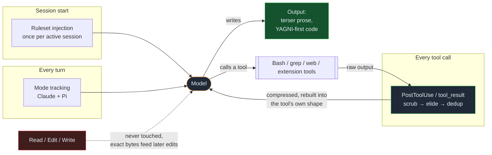
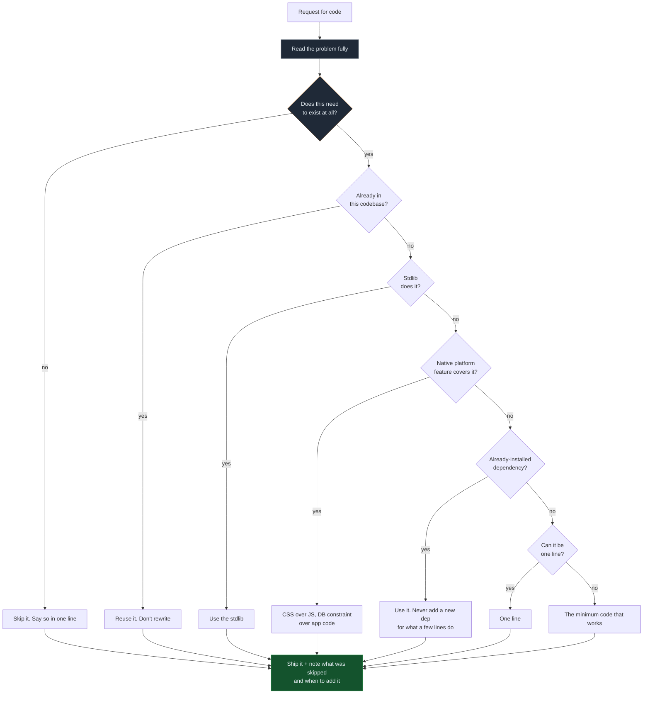

# JayPokale/Chisle

## Metadata
- Stars: 719
- Forks: 50
- Primary language: JavaScript
- Default branch: main
- License: MIT License
- Homepage: https://chisle.jaypokale.me
- Pushed at: 2026-10-24T04:48:37Z
- Fetched: 2026-10-27
- Final URL: https://github.com/JayPokale/Chisle

## Description
Cut your AI coding agent's token bill on three axes: terse prose, YAGNI-first code, and tool-output compression. Claude Code, Pi, Cursor, Codex, Gemini + 4 more. Zero deps, published benchmarks including the runs it loses.

## Latest release
v3.8.1	Latest	v3.8.1	2026-10-18T04:23:51Z

## README
<p align="center">
  
</p>

<h1 align="center">Chisle</h1>

<h3 align="center">Fewer tokens than caveman and ponytail. No accuracy lost.</h3>

<p align="center">
  <em>Your AI talks less, builds less, reads less, and says more. Like a senior dev who bills by the syllable.</em>
</p>

<p align="center">
  <em>The only tool in this class that publishes the runs where it lost. <a href="https://jaypokale.me/writing/chisle-benchmarks-it-loses">Here's why.</a></em>
</p>

<p align="center">
  <a href="https://www.npmjs.com/package/chisle"></a>
  
  <a href="https://github.com/JayPokale/Chisle/actions/workflows/test.yml"></a>
  
  
  <a href="https://github.com/JayPokale/Chisle/stargazers"></a>
</p>

<p align="center">
  <strong>Built for Claude Code: answers about half as long, shorter than caveman and ponytail &middot; 13 agents &middot; zero dependencies &middot; one command</strong>
</p>

Chisle is a Claude Code plugin that makes Claude cheaper to run without making it dumber. It cuts what Claude writes: no filler, no hedging, no speculative abstractions, just the smallest code that works. It also cuts what Claude reads: a `PostToolUse` hook trims oversized tool output by ~46% before it re-enters the context window, where it would be re-billed on every later request. In agent-loop tests Claude with Chisle passes the same tasks as Claude without it. One `npx chisle` installs it, and the same ruleset ships to Pi, Cursor, Codex, Gemini, Copilot, OpenCode, Antigravity and four more agents. Every number here comes from committed raw transcripts, including the runs where it lost.

<p align="center">
  
</p>

<p align="center"><sub>Pi, 6 tasks: answer length vs the same model with no ruleset. Lower is leaner. <a href="#benchmarks">More below.</a></sub></p>

---

"Implement an order state machine covering created, paid, shipped, delivered, cancelled and refunded, with the legal transitions enforced and invalid ones rejected." Same model, same prompt, one difference: the injected ruleset. Both answers are the **verbatim committed output** from [`raw-oct-notools/large-s2`](benchmarks/results/raw-oct-notools/large-s2/):

<table>
<tr><th align="left" width="50%">bare model: 125 lines, 1,342 answer tokens</th><th align="left" width="50%">Chisle: 54 lines, 450 answer tokens</th></tr>
<tr valign="top"><td>

An `Enum` of states, a custom exception class, type hints and docstrings on every method, a file write, then a test harness:

```python
class OrderState(Enum):
    CREATED = "created"
    PAID = "paid"
    # … four more

class InvalidTransition(Exception):
    """Raised when attempting an invalid state transition."""
    pass

class Order:
    VALID_TRANSITIONS = { … }
    def transition_to(self, next_state: OrderState) -> None:
        """Transition to next state if valid, …"""
```

…plus usage, tests and a summary.

</td><td>

One dict of legal transitions, one method that enforces it:

```python
class OrderStateMachine:
    TRANSITIONS = {
        'created': {'paid', 'cancelled'},
        'paid': {'shipped', 'refunded'},
        'shipped': {'delivered', 'cancelled'},
        'delivered': {'refunded'},
        'cancelled': set(),
        'refunded': set(),
    }
    def transition(self, new_state):
        if new_state not in self.TRANSITIONS[self.state]:
            raise ValueError(f"Invalid transition: …")
        self.state = new_state
```

Then a short usage block and one line on how it works.

</td></tr>
</table>

Same behaviour, a third of the tokens. caveman wrote 1,140 and ponytail 842 on the same prompt.

## What it compresses

| axis | what | how |
|---|---|---|
| **Output: prose** | filler, hedging, manufactured structure | zero-fluff ruleset, injected per session |
| **Output: code** | speculative abstractions, unrequested boilerplate | YAGNI efficiency ladder |
| **Input: context** | oversized tool output flooding the window | Claude `PostToolUse`, Pi `tool_result`, OpenCode plugin, Copilot CLI `postToolUse`: scrub, elide, dedup, plus prevention rules |
| **Input: MCP** | oversized MCP tool results in any agent | `npx chisle mcp wrap`: a proxy in front of each stdio MCP server (Cursor, Windsurf, Cline, Kiro, Gemini, Qwen Code, Copilot CLI) |

Where each one attaches to a session:



The loop on the right is the input axis: tool output is billed again on *every* later request in the session, so shrinking it once pays repeatedly. `Read`, `Edit`, and `Write` are deliberately outside it.

---

## Install

One command. Auto-detects your agents (Claude Code, Pi, Cursor, Windsurf, Cline, Kiro, Antigravity, Codex, Gemini, Copilot, Copilot CLI, OpenCode, Hermes) and wires each one. `--uninstall` puts everything back. `npx chisle mcp wrap` extends tool-output compression to MCP servers in any agent ([details](INSTALL.md#mcp-output-compression-any-agent)).

```bash
npx chisle
```

```bash
# or via curl
curl -fsSL https://raw.githubusercontent.com/JayPokale/Chisle/main/install.sh | bash
```

```powershell
# Windows
irm https://raw.githubusercontent.com/JayPokale/Chisle/main/install.ps1 | iex
```

Preview first with `npx chisle --dry-run`, scope with `--only claude` or `--only pi`, see everything with `npx chisle --help`. Remove with `npx chisle --uninstall`.

Upgrading, per-agent setup, `--stats` and config: [docs/usage.md](docs/usage.md).

---

## Benchmarks

Same model, same prompts, one difference: the injected ruleset. Lower = leaner. Chisle is the leanest on every row.

**Claude Code** (Haiku 4.5, 26 live prompts, tools off, [raw cells](benchmarks/results/raw-oct-notools/)):

| % of a bare model | caveman | ponytail | **Chisle** |
|---|--:|--:|--:|
| answer length | 65% | 58% | **56%** |
| answer lines | 66% | 54% | **52%** |

**Pi** (GPT-5.5, 6 tasks, [raw cells](benchmarks/results/raw-pi/)):

| % of a bare model | caveman | ponytail | **Chisle** |
|---|--:|--:|--:|
| answer length | 56% | 49% | **37%** |
| answer lines | 75% | 38% | **37%** |
| billed tokens, explanations | 43% | 76% | **39%** |

**Accuracy** holds against the bare model: 156/156 vs 155/156 on auto-graded maths and coding, 48/60 vs 49/60 on agentic hidden-test repos, Fisher p = 1.000 on both ([writeup](benchmarks/results/2026-09-14-quality-and-agentic.md)). No judge model anywhere.

**Tool output** is two thirds of a Claude Code session's context and re-billed every turn. The compressor cuts **~46%** off every oversized output ([171 sessions](benchmarks/results/2026-07-07-input-axis.md)); on OpenCode a 30 KB log dropped **87%** of fresh input tokens.

Method and every raw cell: [docs/benchmarks.md](docs/benchmarks.md).

---

## How it works

Before writing code, the agent stops at the first rung that holds:



The ladder runs **after** reading, never instead of it. Note the exit: every rung lands on the same obligation: say what you skipped, so "later" doesn't quietly become "never".

The ladder runs *after* reading the code, lazy about the solution and never about understanding. Lazy is not negligent: trust-boundary validation, data-loss handling, security, and accessibility are never on the chopping block.

Mark deliberate simplifications so "later" doesn't quietly become "never":

```js
// chisle: global lock, per-account locks if throughput matters
// chisle: O(n) scan, index this when table exceeds ~10k rows
```

## Usage

| Command | Effect |
|---------|--------|
| *(nothing)* | On automatically every session after install |
| `/chisle` | Re-activate if you'd stopped it |
| `/chisle off` | Deactivate |
| `stop chisle` | Deactivate (ruleset *and* input-side compression) |
| `normal mode` | Deactivate |

Natural language works too: "activate chisle", "chisle mode", "chislify this". Code symbols, function/API names, and error strings stay verbatim, so only the noise around them compresses.

---

## Contributing

See [CONTRIBUTING.md](CONTRIBUTING.md). Built by [Jay Pokale](https://github.com/JayPokale) with [Claude](https://claude.com/claude-code), [Antigravity](https://antigravity.google), and [Codex](https://openai.com/blog/openai-codex/) as co-engineers.

## Star History

<a href="https://www.star-history.com/?repos=JayPokale%2FChisle&type=date&legend=top-left">
  <picture>
    <source media="(prefers-color-scheme: dark)" srcset="https://api.star-history.com/svg?repos=JayPokale/Chisle&type=date&legend=top-left&theme=dark">
    <source media="(prefers-color-scheme: light)" srcset="https://api.star-history.com/svg?repos=JayPokale/Chisle&type=date&legend=top-left">
    
  </picture>
</a>

## License

[MIT](LICENSE). The shortest license that works.

Chisle began as a merge of [caveman](https://github.com/JuliusBrussee/caveman) (terse prose) and [ponytail](https://github.com/DietrichGebert/ponytail) (lazy-senior-dev code rules), and its ruleset still carries parts of both. Their MIT notices are in [NOTICE](NOTICE).

## Contributors

<a href="https://github.com/JayPokale/Chisle/graphs/contributors">
  
</a>

**AI co-engineers** (pair-work credited in commit trailers and the changelog):

<p>
  <a href="https://claude.com/claude-code"></a>
  <a href="https://openai.com/codex/"></a>
  <a href="https://antigravity.google/"></a>
</p>

---

<p align="center">
  Saved you tokens? <a href="https://github.com/JayPokale/Chisle">⭐ Star the repo</a>. It costs zero tokens and keeps the benchmarks running.
</p>

## Top-level structure
- .agents
- .claude-plugin
- .clinerules
- .codex-plugin
- .cursor
- .github
- .gitignore
- .kiro
- .opencode
- .windsurf
- AGENTS.md
- CHANGELOG.md
- CODE_OF_CONDUCT.md
- CONTRIBUTING.md
- GEMINI.md
- INSTALL.md
- LICENSE
- NOTICE
- README.md
- SECURITY.md
- SUPPORT.md
- TODO.md
- assets
- benchmarks
- bin
- commands
- docs
- gemini-extension.json
- hooks
- install.ps1
- install.sh
- package.json
- pi-extension
- rules
- scripts
- site
- skills
- tests
