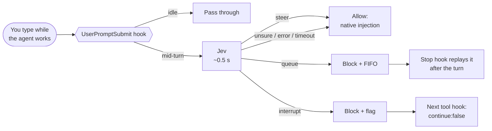

# Larkspur-Wang/Jev_steer_or_queue

## Metadata
- Stars: 17
- Primary language: Python
- Default branch: main
- Latest release: none
- License: MIT License
- Homepage: (none)
- Fetched: 2026-10-28
- Final URL: https://github.com/Larkspur-Wang/Jev_steer_or_queue

## Description
Let TypeSafe Jev decide whether a message you send mid-turn should steer, queue, or interrupt your coding agent. Claude Code plugin; Codex CLI in testing.

## README
<div align="center">


<br>

**Your coding agent is busy. You send another message. Should it change course, wait its turn, or stop?**<br>
A hook that lets [TypeSafe Jev](https://docs.typesafe.ai/) make that call in about half a second.

<br>

[](LICENSE)
[](claude-code/)
[-10a37f?style=flat-square)](codex/)
[](https://docs.typesafe.ai/)
[](claude-code/scripts/jev_router.py)
[](claude-code/scripts/jev_router.py)
<br>
[](https://github.com/Larkspur-Wang/Jev_steer_or_queue/stargazers)
[](https://github.com/Larkspur-Wang/Jev_steer_or_queue/commits/main)
[](https://github.com/Larkspur-Wang/Jev_steer_or_queue/issues)
[](#contributing)

**English** · [简体中文](README.zh-CN.md)

</div>

---

## Why

Coding agents treat every message you send mid-turn the same way. Claude Code injects it into the running turn right away. That works for *"use the simpler approach"*, but not for *"when you're done, update the changelog"*, which then gets mixed into the current task. Nor does it work for *"stop, don't continue"*, which only works if the model decides to stop.

This project classifies each mid-turn message into one of three timings and acts on it:

| Jev says | Meaning | What the hook does |
| :--- | :--- | :--- |
| 🟢 **steer** | Change the running task now | Lets it through; the client injects it at the next tool boundary |
| 🟡 **queue** | Separate request, do it afterwards | Holds it in a per-session FIFO and replays it when the turn ends |
| 🔴 **interrupt** | Stop the running task | Swallows the message and ends the turn at the next tool boundary |

Messages sent while the agent is idle are never touched and never sent to Jev.

## Clients

| Client | Folder | Status |
| :--- | :--- | :--- |
| Claude Code CLI | [`claude-code/`](claude-code/) | ✅ Tested end to end on 2.1.280 |
| Codex CLI | [`codex/`](codex/) | ✅ Tested on 0.156.1, with a caveat: Codex can only be nudged, not blocked |

The two clients have different hook contracts, so each one has its own self-contained folder.

## How it works



- **Mid-turn detection:** Claude Code gives a mid-turn message the running turn's `prompt_id`, and gives a new turn a fresh one.
- **Only confident answers change behaviour.** Queue and interrupt each need probability ≥ 0.9, and interrupt also needs an explicit "stop" signal. Anything else falls back to the client's native behaviour.
- **Fails open.** A missing key, a network error or a timeout (default 2 s) means the message passes through untouched.

## Quick start (Claude Code)

```text
/plugin marketplace add Larkspur-Wang/Jev_steer_or_queue
/plugin install jev-steer-or-queue@jev-steer-or-queue
```

Claude Code then asks for:

1. **TypeSafe API key.** Get one at [console.typesafe.ai](https://console.typesafe.ai/). It is stored in the system keychain. Leave it empty to use the `TYPESAFE_API_KEY` environment variable.
2. **Mode.** `shadow` (the default) only logs decisions. `active` queues and stops for real. You can change it later in `/config`.

Start in `shadow`, read the log for a few days, then switch to `active`. See [`claude-code/README.md`](claude-code/README.md) for all options.

## Limitations

- **The hook can only stop at tool boundaries.** A running command finishes first, and a turn that is only producing text can't be stopped.
- **Esc fires no hook.** Messages still in the queue when you press Esc are listed and dropped on your next prompt.
- **Held messages don't appear as user messages.** You see the hook's notice, and a replayed message shows up as `Stop hook feedback`.
- **Jev can be wrong,** especially on colloquial Chinese, negations and messages with several intents. Calibrate the thresholds on your own messages.

## Privacy

For every **mid-turn** message, the hook sends TypeSafe the message (up to 2,000 characters) and the start of the current task (up to 500 characters). Nothing else is sent: no transcript, no files, no tool output. Logs stay on your machine; set `JEV_ROUTER_LOG_PROMPTS=false` to keep message text out of them.

## Test results

See [`docs/test-results.md`](docs/test-results.md) for the Chinese-language test notes: what each hook actually receives, how the client behaves with and without the plugin, and latency.

## Contributing

Issues and pull requests are welcome, especially:

- real mid-turn messages that were misclassified (redact them first),
- Codex CLI test results,
- adapters for other clients (Cursor, Grok Build, OpenClaw).

## Acknowledgements

- [TypeSafe](https://typesafe.ai/) for Jev and the System One API.
- The OpenClaw [queue modes](https://docs.openclaw.ai/concepts/queue) (`steer` / `followup` / `interrupt`) and other Jev-based routers ([pi-card](https://github.com/carbon-ni/pi-card), [KiroCrew #12338](https://github.com/kirodotdev/KiroCrew/pull/12338)) for prior art.

## License

[MIT](LICENSE) © 2026 Larkspur-Wang. Not affiliated with TypeSafe, Anthropic or OpenAI.


## Docs
### docs/test-results.md

# 测试记录

2026-09-23，macOS。Claude Code 2.1.280（Fable 5.1）；Codex CLI 0.156.1。Jev：`jev-latest`。

测试方法：用 tmux 驱动 TUI。先让 agent 分三次执行 `sleep 12`（每次一个工具调用），在第一次 sleep 期间发一条中途消息。

## 1. hook 能看到什么（Claude Code，影子模式）

| 中途消息 | `UserPromptSubmit` | Jev | 不干预时的原生行为 |
| --- | --- | --- | --- |
| 改一下，剩下的每次 sleep 3 就行 | 发送后立刻触发 | steer 0.99–1.0 | 下一个工具边界注入，后两次变成 sleep 3 |
| 做完这个任务之后，再告诉我当前目录下有几个文件 | 立刻触发 | queue 1.0 | 也被注入当前 turn，有一次和第三次 sleep 并行跑了 `ls` |
| 停一下，别继续了 | 立刻触发 | interrupt 1.0，explicit_stop 0.97–0.98 | 模型在当前工具结束后自己收尾 |
| （按 Esc） | 不触发任何 hook，也没有 Stop | — | 中断 |

- 中途消息的 `prompt_id` 等于当前 turn 的 `prompt_id`，新 turn 会拿到新的 `prompt_id`。
- Stop hook 触发续发期间再发的消息，同样带着原来的 `prompt_id`，被正确识别为中途消息。
- 通过 `continue:false` 硬停之后，不会触发 Stop hook。

## 2. 插件端到端（active 模式，`claude --plugin-dir ./claude-code`）

| 场景 | 插件动作 | 结果 |
| --- | --- | --- |
| queue | block → 入队 → Stop 用 `additionalContext` 续发 | 三次 sleep 全部完成后，显示 `Stop hook feedback`，然后才列目录 ✅ |
| steer | 放行 | 回复“收到，剩下两次改为 sleep 3”，后两次是 sleep 3 ✅ |
| interrupt | block → 下一个 PostToolUse 返回 `continue:false` | 第一次 sleep 结束后立即停止，没有多开一轮 ✅ |

早期版本的两个问题已修复：

- 用 `decision:block` 续发时，界面显示为 `Stop hook error`。改用 `additionalContext` 后显示为 `Stop hook feedback`。
- 放行“停一下”时，硬停之后它会自己开出一个新 turn。现在这条消息也会被 block。

## 3. Jev 延迟

共约 25 次调用，438–660ms，偶尔 1.5 秒左右。超时设为 3 秒时有 1 次超时；插件默认 2 秒，超时即放行。

## 4. Codex CLI

- 项目级 `.codex/hooks.json` 在信任目录下会加载；`SessionStart`、`UserPromptSubmit` 会触发，带 `turn_id`。
- 由于账号用量上限，模型没有跑起来，中途消息的行为还没测。

## 5. Codex CLI（2026-09-24，GPT-6-Luna low）

| 你做什么 | hook 是否触发 | 结果 |
| --- | --- | --- |
| Enter 插话（任务运行中） | `UserPromptSubmit` 立刻触发，`turn_id` = 当前 turn | 原生注入；加了提示后行为可控 |
| Tab 排队 | **不触发** | 消息等到本轮 Stop 之后才作为新 turn 出现；原生排队已经正确 |
| Esc | 触发 `Interrupt`（无 `turn_id`） | 正常中断 |
| 等待中的 turn | `Stop` 触发，带 `turn_id` | — |

关键结论：

- **在 Codex 里 block 会挂死本轮。** 对中途消息返回 `{"decision":"block"}` 后，没有新的模型调用，也没有 `Stop`，TUI 一直停在“Blocked by hook”，直到手动按 Esc。所以 Codex 适配器不 block，只加提示。
- **软提示有效。** queue 提示后，三次 sleep 全部按原计划做完，之后才列目录；stop 提示加 `PreToolUse` deny 后，第一次 sleep 结束就停了。延迟 760–980ms。
- **Codex 自己的提示词也会触发 `UserPromptSubmit`**（记忆整理、子会话、自动审查）。这些必须过滤，否则会把内部任务误当成“当前任务”。适配器用 `INTERNAL_MARKERS` 过滤。
- Codex hook 条目不能带插件配置，API key 走 `~/.jev-steer-or-queue/config.json`。

早期一次失败值得记下来：第一轮 e2e 测试时会话里没有 API key，路由静默走“失败即放行”，看起来像成功，实际只是 Codex 原生行为。日志里 `jev: null` 才能区分。


## Top-level structure
```
.claude-plugin/
claude-code/   # plugin, hooks, scripts
codex/         # hooks.example.json, scripts (testing)
docs/test-results.md
assets/, LICENSE, README.md, README.zh-CN.md
```
- `claude-code/`: Claude Code plugin that asks Jev whether mid-turn messages should steer, queue, or interrupt
- `codex/`: Codex CLI variant in testing
- `docs/test-results.md`: evaluation notes

