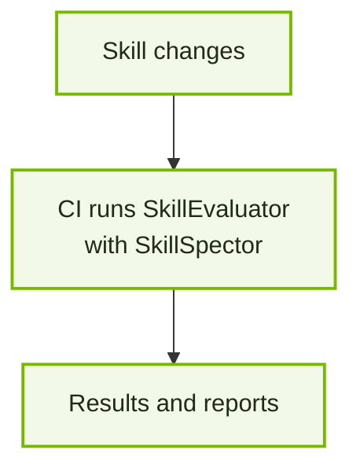

# NVIDIA/SkillEvaluator

## Metadata
- Stars: 4189
- Forks: 545
- Primary language: Python
- Default branch: main
- Latest release: v1.0.1 (2026-11-18)
- License: Apache License 2.0
- Homepage: https://docs.nvidia.com/skills/skillevaluator/
- Fetched: 2026-11-20
- Final URL: https://github.com/NVIDIA/SkillEvaluator

## Description
Multi-tier framework for evaluating AI agent skills and plugins with quality gates, security scanning, harness compatibility checks, semantic overlap detection, synthetic evaluation dataset generation, and live agent evaluation that measures how skills affect agent behavior. Ships reusable CI templates that bring every check to any repository.

## README
<div align="center">

# 

<h4>Evaluate and improve AI agent skills and plugins: quality, security, overlap, compatibility, and real impact across agents</h4>

[](LICENSE)
[](https://www.python.org/)
[](https://pypi.org/project/skillevaluator/)
[](https://docs.nvidia.com/skills/skillevaluator/repository-integration#copy-a-template)
[](https://docs.nvidia.com/skills/skillevaluator/)
[](https://arxiv.org/abs/2608.20614)
[](https://developer.nvidia.com/blog/evaluating-ai-agent-skill-performance-with-nvidia-skillevaluator/)
[](https://github.com/NVIDIA/SkillEvaluator/stargazers)
[](https://github.com/NVIDIA/SkillEvaluator/forks)

</div>

> 📺 **Livestream:** [Ask the Experts: Evaluating Agent Skills](https://www.youtube.com/watch?v=4rI0zATFxYI)

SkillEvaluator checks AI agent skills and plugins, and measures a skill's effect
on task results: start with quality checks, then compare runs with and without a skill.

Catch skill issues before merge. Connect your repository to SkillEvaluator with a
[CI template](https://docs.nvidia.com/skills/skillevaluator/repository-integration)
for automated quality and security gates, without building or maintaining
evaluation code.

Agent skills are folders of instructions and supporting files defined by the
[Agent Skills specification](https://agentskills.io/). SkillEvaluator is part of
the [NVIDIA Verified Skills pipeline](https://github.com/NVIDIA/skills).

## Get started

Install the CLI in a Python 3.12–3.14 environment:

```bash
pip install skillevaluator
```

<details><summary>Or use uv</summary>

```bash
uv tool install --python 3.13 skillevaluator
```

</details>

For uv setup or direct GitHub source installation, see
[Installation](https://docs.nvidia.com/skills/skillevaluator/installation).

Then check skills from your terminal, CI, or agent:

<table><tbody><tr valign="top">
<td width="33%">

<p></p>

Run checks backed by **500+ static rules and detection patterns**, without an
LLM key. Complete [scanner setup](https://docs.nvidia.com/skills/skillevaluator/installation-options#system-tools)
for full coverage:

```bash
skillevaluator validate \
  ./my-skill --tiers 1
```

<details><summary>Run all three tiers</summary>

After [all-tier setup with NVIDIA Build](#run-all-three-tiers-with-a-free-nvidia-build-key),
remove `--tiers 1` to add deduplication and live agent evaluation to measure
skill lift:

```bash
skillevaluator validate \
  ./my-skill
```

</details>

</td>
<td width="33%">

<p></p>

Check every skill change. Run in your GitHub repo to open a setup PR:

```bash
skillevaluator ci init
```

**Start here:** [Guided setup for GitHub and GitLab](#bring-skill-evaluation-to-your-repository).

</td>
<td width="33%">

<p></p>

Add the skill to Claude Code, Codex or another agent:

```bash
npx skills add \
  NVIDIA/SkillEvaluator
```

Then ask: *"Is my skill any good?"*
See the [agent guide](https://docs.nvidia.com/skills/skillevaluator/agent-skill).

</td>
</tr></tbody></table>

### ⚡ [Harness check](https://docs.nvidia.com/skills/skillevaluator/harness-check): will your agent load your skill?

🔑 **No API key** · 🤖 **No agent run**

```bash
skillevaluator harness-check ./my-skill
```

Illustrative summary of versioned profiles. Full output can include notes and schema diagnostics.

```text
╭─ Harness compatibility · my-skill ──────────────────────────────────────────────────────╮
│  ⚠️ codex        degraded    Description cut to 1,021 chars + '...' in the skill list   │
│  ❌ claude-code  not loaded  .agents/skills is not scanned                              │
│  ✅ opencode     loads                                                                  │
│  ✅ hermes       loads                                                                  │
│  ✅ openclaw     loads                                                                  │
│  ❌ copilot-cli  not loaded  description is 1,028 UTF-16 units, 4 over the 1,024 limit  │
╰────────────────────────────────────────────────────────────────── ❌ 2 of 6 not loaded ─╯
```

`skillevaluator validate` includes Harness Check in Tier 1 alongside **quality,
schema, version, PII, license, Unicode and script linting**. Security and code
integrity checks use **SkillSpector, Gitleaks, Bandit and optional Semgrep**.
[See all Tier 1 checks](https://docs.nvidia.com/skills/skillevaluator/tier1-reference#the-checks);
use `--tiers 1` to run only this tier.

🧪 **Ready to go deeper?** Try a
[live agent evaluation](https://docs.nvidia.com/skills/skillevaluator/tier3-live-evaluation) (Tier 3).

## Quickstart

### Check your skill without a key

```bash
skillevaluator quality-check ./my-skill
```

No API key, scanner, GPU or Docker is needed. It prints a score out of 100 with a
grade and the findings behind it; the passing threshold defaults to 70. This is
static quality only; publication evidence stays `INCOMPLETE`. Security and agent impact need additional checks. See the
[keyless walkthrough](docs/quickstart.mdx#run-without-an-llm).

No skill yet? Clone the repository and use the bundled
`src/skillevaluator/tier3/reference_skills/text-analyzer`. Scores can differ by release.

### Run all three tiers with a free NVIDIA Build key

Eligible NVIDIA Developer Program members can use NVIDIA-hosted endpoints for
**free prototyping**, subject to [access terms and rate limits](https://docs.api.nvidia.com/nim/docs/product).

1. Sign in at [build.nvidia.com](https://build.nvidia.com/) and complete enrollment.
2. Open a model page, select **Get API Key**, and generate your key.
3. Complete [scanner setup](docs/installation-options.mdx#system-tools), start Docker, and [prepare a reviewed dataset](docs/prepare-dataset.mdx). Install every tier, set the provider and key, then validate:

```bash
pip install "skillevaluator[all]"
export SKILL_EVAL_LLM_PROVIDER=nv_build
export NVIDIA_API_KEY='nvapi-...'
skillevaluator validate ./my-skill
```

Without `--tiers`, `validate` runs all three. The key covers embeddings and chat
in Tier 2 and supported agents in Tier 3; add `--llm` for model checks in Tier 1.
For uv or GitHub installations, use the matching [all-tier install](https://docs.nvidia.com/skills/skillevaluator/installation#all-tiers) instead of the pip command above. Tier 3 also
needs Docker running; add `--tiers 1,2` to skip it. More in
[Run the combined pipeline](#run-the-combined-pipeline), the
[Build walkthrough](docs/quickstart.mdx#use-nvidia-build) and [provider configuration](docs/configuration.mdx).

## Bring skill evaluation to your repository

> **Start here: [Repository integration guide](https://docs.nvidia.com/skills/skillevaluator/repository-integration)**,
> install to first passing check on GitHub or GitLab. Below is the summary.

**Minimal setup. No evaluation code to write or maintain.** Choose your skill
folders and thresholds to get automated validation, security scanning and
downloadable reports for changed skills in GitHub or GitLab.

**[11 CI checks](https://docs.nvidia.com/skills/skillevaluator/tier1-reference#the-checks) backed by 500+ static rules and detection patterns:**
quality, schema, version, PII, license, Unicode, script linting,
[Harness Check](https://docs.nvidia.com/skills/skillevaluator/harness-check),
security, code integrity and dependency auditing.<br>
**Scanners:** [SkillSpector](https://docs.nvidia.com/skills/skillevaluator/tier1-reference#security--vulnerability-scanning),
[Gitleaks, Bandit and Semgrep](https://docs.nvidia.com/skills/skillevaluator/tier1-reference#code-integrity--code-risk-secrets-and-hygiene),
and [pip-audit](https://docs.nvidia.com/skills/skillevaluator/tier1-reference#dependency--cve-audit-opt-in).

**GitHub guided setup:** after [installing the CLI](#get-started), run inside
your checked-out repository:

```bash
skillevaluator ci init
```

Choose checks and optional hosted feedback, then review the setup PR.
[CLI setup guide](https://docs.nvidia.com/skills/skillevaluator/cli-onboarding).

**Manual setup (no CLI):** copy a filled-in template from [CI templates](ci/bundles/README.md).

| Your repository | Ready-to-use template | Copy destination |
| --- | --- | --- |
| GitHub | [Skill checks](ci/bundles/1.0.1/skill-checks.yml) | `.github/workflows/skill-checks.yml` |
| GitLab | [Skill checks](ci/bundles/1.0.1/gitlab-skill-checks.yml) | `.gitlab-ci.yml`, or merge into your existing pipeline |
| GitHub PR comments without hosting | [Optional comments](ci/bundles/1.0.1/comment-skill-checks.yml) | Second workflow; complete [comment setup](ci/bundles/1.0.1/README.md#pr-comment-setup) |
| GitHub hosted reports and PR comments | [Optional publisher](ci/bundles/1.0.1/publish-skill-reports.yml) | Second workflow; complete [publisher setup](ci/bundles/1.0.1/README.md#one-time-publisher-setup) |

Pick one optional feedback workflow. These run Tier 1 checks without a model
key; [all-tier CI setup](https://docs.nvidia.com/skills/skillevaluator/advanced-ci)
adds deduplication and live agent evaluation.

Also: [template reference](ci/templates/README.md) and [report examples](ci/examples/README.md).

## Three-tier overview


Each tier is independent. Use the [all-tier installation](https://docs.nvidia.com/skills/skillevaluator/installation#all-tiers) for all three:

| Tier | Question | Example after setup | Additional setup |
| --- | --- | --- | --- |
| Tier 1: Validation | Is the skill safe, well-formed and [harness-compatible](docs/tier1-reference.mdx#the-checks)? | `skillevaluator tier1 ./my-skill --no-llm` | External scanners for full static coverage; a provider and model clients enable LLM checks |
| Tier 1: Harness Check | Will the agent load the skill? | `skillevaluator harness-check ./my-skill` | No API key or agent run |
| Tier 2: Deduplication | Does guidance repeat or overlap? | `skillevaluator tier2 ./my-skill` | Embeddings and chat; add `--catalog ./skill-catalog.json` for inter-skill comparison |
| Tier 3: Live Agent Evaluation | Does the skill help the agent? | `skillevaluator tier3 ./my-skill` | Provider access, a supported agent, and a running sandbox (Docker by default) |

Prepare [scanners](docs/installation-options.mdx#system-tools) for your installed release; Semgrep is optional.
`--no-llm` does not remove scanner requirements; a scanner that cannot run is
`INCOMPLETE` and exits nonzero.
[SkillSpector](https://github.com/NVIDIA/SkillSpector) provides specialized skill
security scanning; [Harbor](https://github.com/harbor-framework/harbor), the
open-source agent evaluation framework, powers sandboxed agent runs.

Tier 2 reports when inter-skill comparison did not run. Tier 3 autopilot reuses
sources or creates one skill-grounded case with limited coverage. See
[tier guides](https://docs.nvidia.com/skills/skillevaluator/).

## Run the combined pipeline

After setting up the provider, scanners, and agent sandbox, run all three tiers:

```bash
skillevaluator doctor --env-mode docker
skillevaluator validate ./my-skill
```

`doctor` checks readiness, not inference success. `validate` runs all tiers with
autopilot for skills. Use `--tiers 1,2` to skip live evaluation or `--tiers 1` for
static checks. `--no-autopilot` requires an existing source. Other artifact types
retain their applicable stages.

Tier 1 gates `validate`. Tier 2 gates unless `--no-block-on-dedup` is set;
Tier 3 gates only with `--block-on-agent-eval`. Model and managed-sandbox usage
can incur charges; see [runtime and cost](docs/tier3-run-reference.mdx#plan-for-cost).

Standalone generation needs substantive `evals/EVAL.md` guidance, a `--prompt`
file with task requests and outcomes, or matching retained traces. `--force`
below replaces the autopilot starter; `--refine` refines it. Explicit
`--grounding skill` permits skill-only starters. Review cases; templates omit
unauthored negatives.

```bash
skillevaluator tier3 create-eval-dataset ./my-skill --full --prompt eval-guidance.md --force
```

## Run from a source checkout

For an editable environment, follow the [development setup](docs/developer-guide.mdx#set-up-a-development-environment).

## Research and citation

Resources: [paper](https://arxiv.org/abs/2608.20614),
[PDF](https://arxiv.org/pdf/2608.20614),
[DOI](https://doi.org/10.48550/arXiv.2608.20614),
[BibTeX](https://arxiv.org/bibtex/2608.20614), and
[NVIDIA Developer blog](https://developer.nvidia.com/blog/evaluating-ai-agent-skill-performance-with-nvidia-skillevaluator/).
Cite the paper and record the SkillEvaluator release or commit; see [CITATION.cff](CITATION.cff).

## Documentation

See [the documentation](https://docs.nvidia.com/skills/skillevaluator/) for
setup, tier guides, reports, CI integration, CLI reference, and
[performance dashboard](docs/reports.mdx#performance-dashboard).

## Installation and third-party software

This project will download and install additional third-party open source
software projects. Review the license terms of these open source projects before
use.

## Contributing

Read [CONTRIBUTING.md](CONTRIBUTING.md) and run:

```bash
make lint && make test && make build
```

See [project governance](GOVERNANCE.md) and [Code of Conduct](CODE_OF_CONDUCT.md).

## Support

Support level: **Experimental**. Community-supported, best-effort, with no SLA
or NVIDIA enterprise support entitlement. Report bugs and feature requests through
[GitHub Issues](https://github.com/NVIDIA/SkillEvaluator/issues); see
[SUPPORT.md](SUPPORT.md).

## Security

Report suspected vulnerabilities using the private process in
[SECURITY.md](SECURITY.md). Do not disclose security issues in a public GitHub
issue.

## Releases

See [CHANGELOG.md](CHANGELOG.md) and
[GitHub Releases](https://github.com/NVIDIA/SkillEvaluator/releases).

## License

Apache License 2.0: see [LICENSE](LICENSE), [NOTICE](NOTICE), and
[THIRD_PARTY_NOTICES.md](THIRD_PARTY_NOTICES.md).

Copyright (c) 2026 NVIDIA CORPORATION & AFFILIATES. All rights reserved.

## Docs

Key documentation files fetched for standard detail (published site: https://docs.nvidia.com/skills/skillevaluator/). Large reference pages (`tier1-reference.mdx`, `cli-reference.mdx`, `reports.mdx`, etc.) were listed but not inlined.

### docs/index.mdx

---
title: "SkillEvaluator"
description: "Check an agent skill, measure its effect on a real agent, or add automatic checks to your repository."
layout: overview
---

Check your agent skills for quality and security, then measure whether they help an agent complete real tasks.

<div id="try-it-in-two-minutes">

## Start with a first result

<Card title="Run your first check" icon="rocket" href="/skills/skillevaluator/quickstart">
  **Install → check the example → read your result.**

  Use a bundled skill to get a quality score and actionable findings.
  The quickstart links to installation and walks through a bundled skill.
  No API key, GPU, or Docker required for this check.
</Card>

</div>

## What do you want to do?

<CardGroup cols={3}>
  <Card title="Test a skill with an agent" icon="flask" href="/skills/skillevaluator/tier3-live-evaluation">
    Run the same tasks with and without your skill. Open a report comparing the results.
  </Card>
  <Card title="Add checks to your repository" icon="code-branch" href="/skills/skillevaluator/repository-integration">
    Copy a GitHub or GitLab template. Get automatic quality and security reports when skills change.
  </Card>
  <Card title="Evaluate from your agent" icon="robot" href="/skills/skillevaluator/agent-skill">
    Install the SkillEvaluator skill and ask your agent to run an evaluation.
  </Card>
</CardGroup>

## The three tiers

Choose the check that answers your question. Each tier can run independently.

| Your question | Evaluation |
| --- | --- |
| Is my skill well-formed and safe to use? | [Tier 1: Validation](/skills/skillevaluator/tier1-validation) |
| Will my agent load the skill correctly? | [Tier 1: Harness Check](/skills/skillevaluator/harness-check) |
| Does it repeat or overlap with existing guidance? | [Tier 2: Deduplication](/skills/skillevaluator/tier2-deduplication) |
| Does it improve an agent's results? | [Tier 3: Live Agent Evaluation](/skills/skillevaluator/tier3-live-evaluation) |

Need a specific option? Open [Installation](/skills/skillevaluator/installation),
[Providers & Credentials](/skills/skillevaluator/configuration),
[Reports & Results](/skills/skillevaluator/reports), or the
[CLI Reference](/skills/skillevaluator/cli-reference).

<Accordion title="About SkillEvaluator and support">
  SkillEvaluator is an open-source, multi-tier framework for evaluating AI agent artifacts,
  starting with agent skills: deterministic quality gates, semantic overlap detection,
  synthetic eval dataset generation, and live agent evaluation.

  It is part of [NVIDIA Verified Skills](https://docs.nvidia.com/skills/) and the
  [NVIDIA/skills catalog](https://github.com/NVIDIA/skills). Tier 1 integrates
  [SkillSpector](https://github.com/NVIDIA/SkillSpector) for security scanning.

  **Experimental:** community-supported on a best-effort basis, with no SLA.
  [Get support](https://github.com/NVIDIA/SkillEvaluator/blob/main/SUPPORT.md),
  [report a security vulnerability privately](https://github.com/NVIDIA/SkillEvaluator/blob/main/SECURITY.md),
  or [contribute](/skills/skillevaluator/developer-guide).
  SkillEvaluator is [Apache-2.0 licensed](https://github.com/NVIDIA/SkillEvaluator/blob/main/LICENSE).
</Accordion>
### docs/README.md

<!-- SPDX-License-Identifier: Apache-2.0 -->
<!-- Copyright (c) 2026 NVIDIA CORPORATION & AFFILIATES. All rights reserved. -->

# Documentation

Long-form documentation for SkillEvaluator. Pages are authored in MDX and
published to <https://docs.nvidia.com/skills/skillevaluator>. This page is the human
quickstart; [`AGENTS.md`](AGENTS.md) holds the detailed authoring rules (MDX
gotchas, link conventions, page-adding checklist) for both AI agents and
contributors making non-trivial edits.

## Layout

- `index.mdx` — landing page and three-tier overview
- `quickstart.mdx` — check a bundled example with the installed CLI
- `installation.mdx` — shared pip, uv, and GitHub installation paths and verification
- `installation-options.mdx` — upgrades, Docker, release differences, extras, and scanner setup
- `configuration.mdx` — providers, embeddings, and Tier 3 credential roles
- `tier1-validation.mdx` — first static run, report, and next steps
- `tier1-reference.mdx` — detailed checks, policies, scanners, and exit semantics
- `tier2-deduplication.mdx` — choose a scope, run deduplication, and read findings
- `tier2-reference.mdx` — chunking, catalogs, thresholds, algorithms, and limits
- `tier3-live-evaluation.mdx` — first live comparison, from model setup to report
- `prepare-dataset.mdx` — author, generate, review, and validate cases before trials
- `tier3-run-options.mdx` — choose an agent and attempt count for reviewed cases
- `tier3-run-reference.mdx` — staging contracts, run settings, budgets, and repeat comparisons
- `nemo-gym.mdx` — NeMo Gym setup, first evaluation, supported agents, and optional reference
- `tier3-runtime.mdx` — runtime contracts, backend compatibility, and troubleshooting
- `tier3-grading.mdx` — judges, evidence budgets, retries, and fallback models
- `tier3-results.mdx` — scores, applicability, verdicts, and incomplete results
- `tier3-experiments.mdx` — skill interactions and activation validation
- `eval-datasets.mdx` — the `evals/` contract, dataset generation, run policy
- `agents-and-sandboxes.mdx` — agents, environment backends, local mode, readiness
- `custom-graders.mdx` — bring-your-own graders and native Harbor tasks
- `reports.mdx` — report formats, scores, and the results-on-disk contract
- `performance-dashboard.mdx` — compare saved Tier 3 scores and resource use
- `benchmark-rollout.mdx` — regenerating and promoting `BENCHMARK.md` cards
- `github-actions.mdx` — reusable skill checks and optional hosted PR feedback
- `cli-onboarding.mdx` — install the CLI, automate GitHub setup and open an optional test PR
- `repository-integration.mdx` — choose GitHub or GitLab for skill checks; pre-commit hooks
- `gitlab-ci.mdx` — reusable skill checks and downloadable GitLab reports
- `advanced-ci.mdx` — secondary opt-in prerequisites and all-tier reference
- `ci-integration.mdx` — exit codes, GitHub Actions recipe, progressive adoption
- `cli-reference.mdx` — every command and flag
- `environment-variables.mdx` — variable-by-variable inventory
- `developer-guide.mdx` — contributor setup, tests, and docs workflow

Navigation order and slugs are defined in [`../fern/docs.yml`](../fern/docs.yml).

## Build Locally

You only need to build locally if you are editing the documentation. The site is
published automatically from `main` via the Fern GitHub integration.

Prerequisites: Node.js 22+ and npm 10+ (the versions the Fern CLI requires).

```bash
# Install the pinned Fern CLI from the committed lockfile
npm ci --prefix fern --ignore-scripts --omit=optional

# From the repo root, preview the site with live reload
./fern/node_modules/.bin/fern docs dev

# Validate the docs configuration and links
./fern/node_modules/.bin/fern check
```

`fern docs dev` serves the site at <http://localhost:3000> and reloads on changes
to `.mdx` files or `fern/docs.yml`.

## Authoring Notes

- New pages must be added to the `navigation` section of
  [`../fern/docs.yml`](../fern/docs.yml); otherwise they will not appear in the
  site.
- In published MDX pages, use site paths such as
  `/skills/skillevaluator/configuration` for other documentation pages. File-relative
  `.mdx` links are not resolved by Fern; see the
  [official link format](https://buildwithfern.com/learn/docs/writing-content/markdown-basics#link-format).
  The Fern 5.121.0 local preview returned HTTP 400 for those `.mdx` page URLs.
  Keep images, YAML `path:` values and
  repository-only Markdown links relative to their source files.
- The Fern version is pinned in
  [`../fern/fern.config.json`](../fern/fern.config.json); bump it intentionally
  rather than as a side effect.
### docs/AGENTS.md

<!-- SPDX-License-Identifier: Apache-2.0 -->
<!-- Copyright (c) 2026 NVIDIA CORPORATION & AFFILIATES. All rights reserved. -->

# AGENTS.md — `docs/`

Guidance for AI agents editing SkillEvaluator's long-form documentation. This
folder holds MDX pages published to <https://docs.nvidia.com/skills/skillevaluator> via
[Fern](https://buildwithfern.com/). Human-facing notes live in
[`README.md`](README.md); this file is the machine-facing companion.

## What lives here

- `index.mdx` — landing page and three-tier overview (Fern slug `/`)
- `quickstart.mdx` — check a bundled example with the installed CLI
- `starter-demo.mdx` — reproducible public terminal starter, output checks and adaptation
- `installation.mdx` — shared pip, uv, and GitHub installation paths and verification
- `installation-options.mdx` — upgrades, Docker, release differences, extras, and scanner setup
- `configuration.mdx` — providers, embeddings, and Tier 3 credential roles
- `agent-skill.mdx` — installing and using the `skills/skillevaluator` agent skill
- `tier1-validation.mdx` — first static run, report, and next steps
- `tier1-reference.mdx` — detailed checks, policies, scanners, and exit semantics
- `tier2-deduplication.mdx` — choose a scope, run deduplication, and read findings
- `tier2-reference.mdx` — chunking, catalogs, thresholds, algorithms, and limits
- `tier3-live-evaluation.mdx` — first Tier 3 comparison; keep this task-focused
- `prepare-dataset.mdx` — author, generate, review, and validate cases before trials
- `tier3-run-options.mdx` — choose an agent and attempt count for reviewed cases
- `tier3-run-reference.mdx` — staging contracts, run settings, budgets, and repeat comparisons
- `nemo-gym.mdx` — NeMo Gym setup, first evaluation, supported agents, and optional reference
- `tier3-runtime.mdx` — backend compatibility, runtime contracts, and troubleshooting
- `tier3-grading.mdx` — judges, evidence budgets, retries, and fallback policies
- `tier3-results.mdx` — scores, applicability, verdicts, and incomplete evidence
- `tier3-experiments.mdx` — skill interaction and activation experiments
- `grader-validation.mdx` — independent-label qualification of the shipped verifier
- `eval-datasets.mdx` — the `evals/` contract, dataset generation, run policy
- `agents-and-sandboxes.mdx` — agents, environment backends, local mode, readiness
- `custom-graders.mdx` — bring-your-own graders and native Harbor tasks
- `reports.mdx` — report formats, scores, and the results-on-disk contract
- `metrics-reference.mdx` — every metric's formula, range, units, evidence, and validation status
- `performance-dashboard.mdx` — compare saved Tier 3 scores and resource use
- `benchmark-rollout.mdx` — regenerating and promoting `BENCHMARK.md` cards
- `github-actions.mdx` — skill check workflow setup and optional hosted PR feedback
- `cli-onboarding.mdx` — released GitHub setup wizard
- `repository-integration.mdx` — choose GitHub or GitLab for skill checks; pre-commit hooks
- `gitlab-ci.mdx` — reusable skill checks and downloadable GitLab reports
- `advanced-ci.mdx` — secondary opt-in prerequisites and all-tier reference
- `ci-integration.mdx` — exit codes, GitHub Actions recipe, progressive adoption
- `cli-reference.mdx` — every command and flag
- `environment-variables.mdx` — variable-by-variable inventory
- `developer-guide.mdx` — contributor setup, tests, and docs workflow
- `assets/` — images referenced by the pages
- `README.md` (human authoring guide) and this `AGENTS.md` are **not** published
  pages — do not add them to the navigation

Navigation order, page titles, and slugs are defined in
[`../fern/docs.yml`](../fern/docs.yml). The Fern CLI version is pinned in
[`../fern/fern.config.json`](../fern/fern.config.json).

## Rules for editing

Keep entry pages focused on the reader's next action: setup, a runnable command,
the expected output, and a next step. Put advanced contracts and edge cases in
the linked reference page. Use Steps for ordered actions, Tabs for exclusive
choices, and Accordions for optional detail; do not put a reference chapter
ahead of the first runnable example.

Keep pip, uv, uv bootstrap, and direct repository installation in
`installation.mdx`; keep upgrades and advanced setup in
`installation-options.mdx`. Default to the lightweight `skillevaluator` install;
keep `skillevaluator[all]` as an explicit opt-in for all tiers. Distinguish the published PyPI release from
unreleased GitHub features and dependencies. Tier guides and the
quickstart link there and use the installed `skillevaluator` command. Avoid
copying package-manager recipes into each tier or mixing `uv run`, `uv tool
install`, and pip in a single first-run workflow. Contributor checkout commands
belong in the development guide.

1. **Every page needs YAML frontmatter** with `title` and `description`. The
   `title` renders as the page H1 — do **not** also add a `# Heading` in the
   body, or the title appears twice.

   ```mdx
   ---
   title: "Configuration"
   description: "One-sentence summary used for SEO and the nav preview."
   ---
   ```

2. **File names use URL best practices**: lowercase, hyphen-separated, no spaces
   or underscores (`tier1-validation.mdx`, not `TIER1_VALIDATION.mdx`). Keep the
   file name equal to the page `slug` in `docs.yml`.

3. **Adding a page**: create the `.mdx` file, then register it under
   `navigation` in [`../fern/docs.yml`](../fern/docs.yml). A page not listed
   there will not appear on the site. Rename via `git mv` to preserve history,
   and update every reference (see rule 5).

4. **This is MDX, not Markdown.** A bare `<` starts a JSX tag and `{` starts an
   expression. Keep angle brackets and braces (e.g. `<placeholder>`,
   `${VAR}`) inside backtick code spans or fenced code blocks, where MDX leaves
   them literal. Do not use `<https://...>` autolink syntax — write a normal
   `[text](url)` link.

5. **Links**:
   - In published MDX, use site paths such as
     `/skills/skillevaluator/configuration` or
     `/skills/skillevaluator/tier1-validation#anchor`. The pinned Fern 5.121.0
     preview returns HTTP 400 for file-relative `.mdx` page URLs; it does not
     resolve them to published slugs.
   - For repository-only files outside `docs/`, use full GitHub source URLs in
     published MDX. Keep repository Markdown, images and YAML `path:` entries
     relative to their source files.
   - When renaming a page, grep the whole repo and fix references in the sibling
     pages, the root [`../README.md`](../README.md), [`README.md`](README.md),
     and [`../fern/docs.yml`](../fern/docs.yml).

## Verify before committing

Requires **Node.js 22+**. Install the pinned CLI from the committed lockfile with
`npm ci --prefix fern --ignore-scripts --omit=optional`.

```bash
./fern/node_modules/.bin/fern check       # validate docs.yml config and all links — must pass
./fern/node_modules/.bin/fern docs dev    # optional live preview at http://localhost:3000
```

`fern check` must pass; it is the same gate the site build relies on. Publishing
is automatic from `main` via [`../.github/workflows/publish-docs.yml`](../.github/workflows/publish-docs.yml)
— do not run `fern generate` locally.

## Repo conventions that still apply

- Sign off commits (`git commit -s`); the DCO check rejects unsigned commits
  (see [`../CONTRIBUTING.md`](../CONTRIBUTING.md)).
- Update [`../CHANGELOG.md`](../CHANGELOG.md) when a docs change is user-visible.
### docs/quickstart.mdx

---
title: "Run your first check"
sidebar-title: "Quickstart"
description: "Get a bundled skill, run a quality check, and read the saved result. No API key required."
---

Get a quality score and findings for a complete example skill.
[Install SkillEvaluator](/skills/skillevaluator/installation#install) first,
then return here. The lightweight installation is enough; this check needs no API key, GPU, or Docker.

<Steps toc={true}>

### Get the example

You need Git to download the example.

```bash title="Clone the repository"
git clone --depth 1 https://github.com/NVIDIA/SkillEvaluator.git
cd SkillEvaluator
```

The bundled `text-analyzer` skill includes instructions and a working script.
Keep this terminal open for the following commands.

### Run without an LLM

```bash title="Score the bundled skill"
skillevaluator quality-check \
  src/skillevaluator/tier3/reference_skills/text-analyzer \
  -r cli -r json -o reports/first-quality
```

The check runs offline with your installed CLI.

### Read your result

The terminal shows your **score out of 100**, **A–F grade**, and findings to fix.
The default minimum quality score is **70**. Open the saved JSON result at:

```text title="Your saved report"
reports/first-quality/skillevaluator-quality.json
```

<Note>
  This is a quality check. Security scanners and live agents have not run,
  so the report's overall publication status remains **INCOMPLETE** even when
  the quality check passes.
</Note>

</Steps>

## Check your own skill

Replace the sample path with the directory containing your `SKILL.md`.
Keep the report output outside that directory:

```bash title="Run from the same checkout"
skillevaluator quality-check ./my-skill \
  -r cli -r json -o reports/my-skill-quality
```

## Use NVIDIA Build

Want model feedback on the instructions? Add a rubric review for the same skill.

<Accordion title="Set up a key and run a rubric review">
  Add the `llm` extra using [Installation Options](/skills/skillevaluator/installation-options#choosing-extras),
  or choose the [all-tier installation](/skills/skillevaluator/installation#all-tiers) first.

  1. Sign in to [NVIDIA Build](https://build.nvidia.com/) and complete the
     Developer Program enrollment prompts.
  2. On a model page, choose **Get API Key** and copy your key. See the
     [API Catalog quickstart](https://docs.api.nvidia.com/nim/docs/api-quickstart)
     for the account setup steps and the
     [access FAQ](https://docs.api.nvidia.com/nim/docs/product) for eligibility and limits.
  3. In the same terminal, replace the example key and run:

  ```bash title="Add model-backed feedback"
  export SKILL_EVAL_LLM_PROVIDER=nv_build
  export NVIDIA_API_KEY='nvapi-...'
  skillevaluator rubric-eval \
    src/skillevaluator/tier3/reference_skills/text-analyzer \
    -r cli -r json -o reports/first-build
  ```

  Read the rubric feedback in the terminal or open
  `reports/first-build/skillevaluator-rubric.json`.
  Scores can vary between calls. This reviews the instructions; it does not
  run an agent with the skill. No local GPU or Docker is needed.

  For other providers or model overrides, see
  [Providers & Credentials](/skills/skillevaluator/configuration).
</Accordion>

## Where to go next

<CardGroup cols={2}>
  <Card title="Run a live comparison" icon="flask" href="/skills/skillevaluator/tier3-live-evaluation">
    Measure whether a skill improves an agent's task results.
  </Card>
  <Card title="Add automatic checks" icon="code-branch" href="/skills/skillevaluator/repository-integration">
    Start with a GitHub or GitLab CI template.
  </Card>
  <Card title="Run full static validation" icon="shield" href="/skills/skillevaluator/installation-options#system-tools">
    Check scanner setup for Semgrep, SkillSpector, and Gitleaks, then run Tier 1.
  </Card>
  <Card title="Try a guided experiment" icon="terminal" href="/skills/skillevaluator/starter-demo">
    Change the example, introduce a regression, and compare real outputs.
  </Card>
</CardGroup>

Find overlapping skills with [Tier 2](/skills/skillevaluator/tier2-deduplication),
or learn more about your [reports](/skills/skillevaluator/reports).
### docs/installation.mdx

---
title: "Install SkillEvaluator"
sidebar-title: "Installation"
description: "Start with the lightweight SkillEvaluator CLI, then add all-tier dependencies when you need them."
---

Start with the **lightweight CLI** for quality scoring and basic static checks.
Choose your package manager below. Need all three tiers? [Add the all-tier dependencies](#all-tiers).

<div id="install">
<div id="install-the-cli">
<div id="requirements">

<Tabs>
  <Tab title="pip (PyPI)">

Use **Python 3.12–3.14** in an activated virtual environment.

```bash title="Install the PyPI release"
python -m pip install --upgrade skillevaluator
```

<Accordion title="Create a virtual environment first">
  <Tabs>
    <Tab title="macOS / Linux">

```bash
python3.13 -m venv .venv
source .venv/bin/activate
```

    </Tab>
    <Tab title="Windows (untested)">

```powershell
py -3.13 -m venv .venv
.venv\Scripts\Activate.ps1
```

    </Tab>
  </Tabs>

  These examples use an installed Python 3.13; Python 3.12 and 3.14 also work.
  Run the install command after activation. Keep this environment activated
  whenever you use SkillEvaluator.
</Accordion>

  </Tab>
  <Tab title="uv tool (PyPI)">

uv creates an isolated tool environment and sets up Python 3.13 automatically.

```bash title="Install the PyPI release with uv"
uv tool install --python 3.13 skillevaluator
```

Need uv first? Use the **Install uv** section below.

  </Tab>
  <Tab title="GitHub source">

Use this for changes not yet available in a published package.
You need Git and either uv or an activated Python 3.12–3.14 environment.

```bash title="Install current source with uv"
uv tool install --python 3.13 --reinstall "skillevaluator @ git+https://github.com/NVIDIA/SkillEvaluator.git"
```

Or, in your activated environment:

```bash title="Install current source with pip"
python -m pip install --upgrade --force-reinstall "skillevaluator @ git+https://github.com/NVIDIA/SkillEvaluator.git"
```

When reinstalling, keep any extras you need; see the [all-tier option](#all-tiers).
The repository can contain unreleased changes. For an editable checkout,
use the [development guide](/skills/skillevaluator/developer-guide#set-up-a-development-environment).

  </Tab>
</Tabs>

</div>
</div>
</div>

Harness Check, JUnit reports, and the NeMo Gym adapter are included in
SkillEvaluator **1.0.1**. Check the [published PyPI versions](https://pypi.org/project/skillevaluator/#history);
if 1.0.1 is not yet available, use the GitHub source option above.
See [release differences](/skills/skillevaluator/installation-options#release-and-source-differences).
Use the [all-tier option](#all-tiers) below when you need model-backed checks or live evaluation.

<div id="get-uv">

<Accordion title="Install uv">
  Choose one method. With pip, use an activated Python environment; the
  standalone installers work without an existing Python installation.

  <Tabs>
    <Tab title="pip">

```bash title="Install uv with pip"
python -m pip install --upgrade uv
uv --version
```

    </Tab>
    <Tab title="macOS / Linux">

```bash title="Install uv"
curl -LsSf https://astral.sh/uv/install.sh | sh
```

    </Tab>
    <Tab title="Windows (untested)">

```powershell title="Install uv in PowerShell"
powershell -ExecutionPolicy ByPass -c "irm https://astral.sh/uv/install.ps1 | iex"
```

    </Tab>
  </Tabs>

  Open a new terminal after using a standalone installer, then run the
  `uv tool install` command above. See [uv's installation guide](https://docs.astral.sh/uv/getting-started/installation/)
  for other package managers.
</Accordion>

</div>

<Accordion title="What does the lightweight install include?">
  `pip install skillevaluator` or `uv tool install skillevaluator` installs
  the lightweight CLI for quality scoring and basic static checks.

  On PyPI 0.9.0, the base install does not include model clients for rubric
  reviews or Tier 2, the Tier 3 agent runtime, Bandit, or pip-audit. Full static
  validation can report **INCOMPLETE** until scanner requirements are met.
  `[all]` includes the `tier2`, `tier3`, and `security` extras; provider keys,
  Docker, and the optional dashboard still have separate setup.

  Add [all evaluation dependencies](#all-tiers) later, or
  choose [individual extras](/skills/skillevaluator/installation-options#choosing-extras).
  In 1.0.1, the base package also includes Harness Check, Bandit, and uv.
  Model clients, the Tier 3 runtime, and pip-audit still require their extras.
</Accordion>

## Verify your install

```bash title="Check the CLI"
skillevaluator --version
```

You should see a version number. With pip, keep your virtual environment
activated. With uv, run `uv tool update-shell` and open a new terminal if the
command is not found.

<div id="all-tiers">

## Add all tiers

Use `skillevaluator[all]` for Tier 1 security dependencies, Tier 2, and Tier 3.
These commands also add the extras to an existing lightweight installation.

<Tabs>
  <Tab title="pip">

In your activated Python environment:

```bash title="Install all evaluation dependencies"
python -m pip install --upgrade "skillevaluator[all]"
```

  </Tab>
  <Tab title="uv tool">

```bash title="Install all evaluation dependencies with uv"
uv tool install --python 3.13 --reinstall "skillevaluator[all]"
```

  </Tab>
  <Tab title="GitHub source">

With uv:

```bash
uv tool install --python 3.13 --reinstall "skillevaluator[all] @ git+https://github.com/NVIDIA/SkillEvaluator.git"
```

Or in your activated Python environment:

```bash
python -m pip install --upgrade --force-reinstall "skillevaluator[all] @ git+https://github.com/NVIDIA/SkillEvaluator.git"
```

  </Tab>
</Tabs>

Provider credentials, Docker, and [scanner setup](/skills/skillevaluator/installation-options#system-tools)
still depend on the checks you run. The dashboard is a separate extra.
For just one capability, [choose individual extras](/skills/skillevaluator/installation-options#choosing-extras).

</div>

<div id="next-steps">

## Choose an evaluation

| Guide | What you need next |
| --- | --- |
| [Tier 1: Validation](/skills/skillevaluator/tier1-validation) | A skill folder and [scanner setup](/skills/skillevaluator/installation-options#system-tools) for full validation. No API key for static checks. |
| [Tier 1: Harness Check](/skills/skillevaluator/harness-check) | SkillEvaluator 1.0.1 and a skill folder. No API key or agent run. |
| [Tier 2: Deduplication](/skills/skillevaluator/tier2-deduplication) | The [all-tier option](#all-tiers) and a provider for embeddings and model analysis. |
| [Tier 3: Live Agent Evaluation](/skills/skillevaluator/tier3-live-evaluation) | The [all-tier option](#all-tiers), a [reviewed dataset](/skills/skillevaluator/prepare-dataset), a model API key, and Docker. |

Need an example skill? Start with the [quickstart](/skills/skillevaluator/quickstart).

</div>

<div id="upgrade">
<div id="other-installation-methods">
<div id="choosing-extras">
<div id="system-tools">
<div id="troubleshooting">

**More options:** [Upgrade](/skills/skillevaluator/installation-options#upgrade),
[Docker](/skills/skillevaluator/installation-options#other-installation-methods),
[smaller installs](/skills/skillevaluator/installation-options#choosing-extras),
[security scanners](/skills/skillevaluator/installation-options#system-tools),
or [troubleshooting](/skills/skillevaluator/installation-options#troubleshooting).

</div>
</div>
</div>
</div>
</div>
### docs/tier1-validation.mdx

---
title: "Tier 1: Validation"
sidebar-title: "Tier 1: Validation"
description: "Run static checks on a skill, read the saved report, and fix the findings. No model key required."
---

Check a skill's structure, security, quality, and dependencies before using it.
[Install SkillEvaluator](/skills/skillevaluator/installation#install) first.
This walkthrough needs no model key, GPU, or Docker.

<Steps toc={true}>

### Choose your skill

Use a folder containing `SKILL.md`. Replace `./my-skill` below with that folder.
Need an example? Start with the [bundled skill](/skills/skillevaluator/quickstart#get-the-example).

Before full static validation, complete [scanner setup](/skills/skillevaluator/installation-options#system-tools).
Add the `security` extra for the full scanner workflow. PyPI 0.9.0 also needs
uv for SkillSpector provisioning; 1.0.1 includes Bandit and uv but
still uses the extra for Python dependency audits. First-use downloads need network access.

### Run static validation

```bash title="Run Tier 1 without model calls"
skillevaluator tier1 ./my-skill --no-llm -o reports/tier1
```

This runs Tier 1 only. Keep the output folder outside the skill so later scans
do not inspect generated reports. The terminal prints findings and saves HTML
and JSON reports automatically.

### Read the result

Open `reports/tier1/skillevaluator-tier1.html` in your browser. Use
`reports/tier1/skillevaluator-tier1.json` for automation.

| Result | Next action |
| --- | --- |
| **Passed** | The selected static checks passed. This does not measure live agent performance. |
| **Failed** | Fix the listed findings, then run the same command again. |
| **Incomplete** | Restore missing scanner evidence before treating the check as passed. |

Exit `0` means the Tier 1 gate passed; `1` means a check failed or required
evidence is incomplete. Exit `2` indicates a command or configuration error.
LLM stages are skipped in this walkthrough. The quality threshold defaults to
**70/100**; serious findings can still fail the gate.

</Steps>

## Choose another check

<AccordionGroup>
  <Accordion title="Check scanner readiness">
    ```bash
    skillevaluator doctor --tier 1
    ```

    Inspect scanner paths and versions. Semgrep is optional unless
    `SKILLEVALUATOR_REQUIRE_SEMGREP=1` is set; its absence alone does not make
    validation incomplete. See [scanner setup](/skills/skillevaluator/installation-options#system-tools)
    for provisioning, offline preparation, and missing-tool fixes.
  </Accordion>
  <Accordion title="Start with structure and quality only">
    ```bash
    skillevaluator tier1 ./my-skill --no-llm --checks schema,quality -o reports/tier1-focused
    ```

    This needs no external scanners. It is a partial check, so a passing result
    does not establish complete Tier 1 evidence.
  </Accordion>
  <Accordion title="Add model feedback">
    Add the [llm extra](/skills/skillevaluator/installation-options#choosing-extras)
    or use the [all-tier installation](/skills/skillevaluator/installation#all-tiers),
    then [configure a provider](/skills/skillevaluator/configuration) and run:

    ```bash
    skillevaluator tier1 ./my-skill --llm -o reports/tier1-model
    ```

    This adds rubric judging, LLM security analysis, and finding verification.
    Model calls can incur charges. See the
    [LLM check reference](/skills/skillevaluator/tier1-reference#add-llm-analysis-optional)
    for verdicts and report details.
  </Accordion>
</AccordionGroup>

## Next steps

- [Harness Check](/skills/skillevaluator/harness-check): see how agents load the skill. Included in 1.0.1; see [Installation](/skills/skillevaluator/installation#install) for availability.
- [Tier 2: Deduplication](/skills/skillevaluator/tier2-deduplication): find repeated or overlapping guidance.
- [Add a CI gate](/skills/skillevaluator/ci-integration): enforce the result on changes to your skills.

## Detailed reference

<div id="tier-1-in-automatic-ci">
<div id="what-tier-1-checks">
<div id="run-the-combined-or-focused-validation-commands">
<div id="run-the-default-suite">
<div id="run-static-checks-only">
<div id="narrow-to-specific-checks">
<div id="add-llm-analysis-optional">

[Commands and CI](/skills/skillevaluator/tier1-reference#run-the-combined-or-focused-validation-commands) — combined runs, selected checks, and model analysis.

</div>
</div>
</div>
</div>
</div>
</div>
</div>

<div id="content-types">
<div id="validation-profiles-and-policies">
<div id="write-a-custom-policy-overlay">
<div id="permit-reviewed-ownership-contacts-without-allowing-other-email-addresses">
<div id="author-attribution-and-contact-emails">
<div id="pii-waivers">

[Profiles and content types](/skills/skillevaluator/tier1-reference#content-types) — policy rules, ownership contacts, and PII waivers.

</div>
</div>
</div>
</div>
</div>
</div>

<div id="the-checks">
<div id="schema--frontmatter-and-repository-governance">
<div id="harness--harness-compatibility">
<div id="security--vulnerability-scanning">
<div id="pii--pii-credentials-and-local-identifiers">
<div id="license--compliance">
<div id="code-integrity--code-risk-secrets-and-hygiene">
<div id="unicode--smuggling-detection">
<div id="quality--weighted-scoring">
<div id="rubric-eval--llm-as-judge-requires-a-provider">
<div id="lint--script-linting-advisory">
<div id="version--semantic-version-check">
<div id="dependency--cve-audit-opt-in">

[Every validation check](/skills/skillevaluator/tier1-reference#the-checks) — rules, severity, scoring, and fixes.

</div>
</div>
</div>
</div>
</div>
</div>
</div>
</div>
</div>
</div>
</div>
</div>
</div>

<div id="scanner-setup">
<div id="audited-skillspector-baselines">

[Scanner behavior and baselines](/skills/skillevaluator/tier1-reference#scanner-setup) — tool resolution and reviewed exceptions.

</div>
</div>

<div id="exit-behavior-and-scoring">

[Exit behavior and scoring](/skills/skillevaluator/tier1-reference#exit-behavior-and-scoring) — gate membership, report formats, and thresholds.

</div>

<div id="troubleshooting">
<div id="why-is-skillspector-analysis-incomplete">
<div id="gitleaks-is-not-installed">
<div id="a-scanner-is-missing">
<div id="skillspector-reports-incomplete-analysis-for-a-valid-helper-script">
<div id="skillspector-could-not-fully-model-the-hooks">
<div id="skillspector-times-out">
<div id="the-skillspector-llm-provider-keeps-failing">
<div id="an-llm-backed-stage-fails-immediately">
<div id="no-scannable-files-are-found">
<div id="an-executable-override-is-rejected">
<div id="skillspector-stops-at-a-runtime-limit">

[Troubleshooting](/skills/skillevaluator/tier1-reference#troubleshooting) — incomplete analysis, timeouts, and scanner failures.

</div>
</div>
</div>
</div>
</div>
</div>
</div>
</div>
</div>
</div>
</div>
</div>
### docs/harness-check.mdx

---
title: "Tier 1: Harness Check"
sidebar-title: "Tier 1: Harness Check"
description: "See whether Claude Code, Codex and four other agent harnesses load your skill, cut it short, or drop it. No LLM, no agent run, no API key."
---

No LLM. No agent run. No API key. In about a second, the harness check predicts
whether each agent harness **loads** your skill, **degrades** it, or **drops** it,
and what to change.

Harness Check is included in SkillEvaluator **1.0.1**. Follow
[Installation](/skills/skillevaluator/installation#install) for package availability,
then run the command below. It is not included in 0.9.0.

```bash
skillevaluator harness-check ./my-skill
```

Results use versioned harness profiles. Add `-v` to see their verified versions
and dates, or `--harness-version HARNESS=VERSION` to flag a different release.
See the [CLI reference](/skills/skillevaluator/cli-reference#harness-check) for all options.

A skill can follow the [Agent Skills specification](https://agentskills.io/) and
still never reach the model. Every harness has its own loader, with its own YAML
parser, folders and size limits. The same `SKILL.md` can work in Claude Code and
be dropped by Codex without an error. The harness check finds those differences
before your users do.

<CardGroup cols={3}>
  <Card title="Static" icon="bolt">
    It reads the files on disk. No model, no agent, no sandbox, no key.
  </Card>
  <Card title="Six harnesses" icon="layer-group">
    Claude Code, Codex, Copilot CLI, Hermes, OpenClaw and OpenCode in one run.
  </Card>
  <Card title="Fixes included" icon="wrench">
    Every finding names the rule, what the harness does, and the change that fixes it.
  </Card>
</CardGroup>

## What you get

This example skill has two small problems. The front matter has `license` twice,
and the body uses `$ARGUMENTS`.

```text title="skillevaluator harness-check ./my-skill"
╭─ Harness compatibility · my-skill ───────────────────────────────────────────────╮
│  ✓ claude-code   ✗ codex   ✗ copilot-cli   ! hermes   ✗ openclaw   ✗ opencode    │
│                                                                                  │
│  ✓ claude-code  loads                                                    1 note  │
│  ✗ codex        NOT LOADED  Skill dropped: invalid YAML (tabs           +1 more  │
│                 or duplicate keys).                                              │
│  ✗ copilot-cli  NOT LOADED  Skill dropped: Copilot's YAML       +1 more, 1 note  │
│                 parsing is strict.                                               │
│  ! hermes       degraded  $ARGUMENTS is not substituted: the             1 note  │
│                 model sees the literal text.                                     │
│  ✗ openclaw     rejected  Skill dropped: invalid YAML (tabs or          +1 more  │
│                 duplicate keys).                                                 │
│  ✗ opencode     rejected  Skill dropped: duplicate frontmatter  +1 more, 1 note  │
│                 keys.                                                            │
│                                                                                  │
│  Doesn't change pass/fail.  Details and fixes: -v                                │
╰──────────────────────────────────────────────────────────── ✗ 4 of 6 not loaded ─╯
Tier 1 schema also fails for my-skill: [SCHEMA-HIGH] Duplicate frontmatter key 'license': YAML parsers disagree on it (Codex, OpenCode, Copilot CLI and OpenClaw drop the skill; others keep the last value). Run `skillevaluator validate --tiers 1` for details.
```

Read it from the top:

- **The first row** has one mark per harness, so you see the result at a glance.
- **Each line below** is one harness: its verdict and its most serious finding.
  `+1 more` means it has more findings. `1 note` counts notes that don't change the verdict.
  A harness with nothing to report gets no line.
- **The bottom corner** is the tally, here 4 of 6 not loaded.
- **The line under the panel** appears when the same problem also fails a Tier 1
  schema check, and points you to `validate --tiers 1`.

Each harness gets one of three verdicts:

| Mark | Verdict | What it means |
| --- | --- | --- |
| `✓` | `loads` | No loading or degradation rule matched. Read any notes: another installed copy may take precedence. |
| `!` | `degraded` | The skill loads, but something is cut, hidden or ignored. |
| `✗` | `not_loaded` | The harness drops the skill. The model never sees it. |

The compact view labels a finding with its outcome when the rule names one, such
as `not found`, `rejected`, `listing shortened` or `delivery truncated`.

## See every finding and its fix

Add `-v` for the detailed view. `--harness` narrows it to the harnesses you care about.

```bash
skillevaluator harness-check ./my-skill --harness codex,hermes -v
```

```text
╭─ Harness compatibility · my-skill ───────────────────────────────────────────────╮
│  ✗ codex   ! hermes                                                              │
│                                                                                  │
│  ✗ codex   NOT LOADED    verified 0.166.0, 2026-11-01                            │
│            ✗ NOT LOADED  Skill dropped: invalid YAML (tabs or duplicate keys).   │
│                          [CX-STRICT-YAML]                                        │
│                          → Use spaces, not tabs, and remove duplicate keys.      │
│                            confidence: high                                      │
│            ! degraded    $ARGUMENTS is not substituted: the model sees the       │
│                          literal text.  [CX-ARGUMENTS]                           │
│                          → Describe the expected input in words instead of       │
│                          $ARGUMENTS.                                             │
│                            confidence: medium                                    │
│  ! hermes  degraded      verified main @ c419cf7c864a (binary reports            │
│                          2026.9.24), 2026-11-01                                  │
│            · note        Duplicate keys: last value wins.  [HM-DUP-KEY]          │
│                          → Remove the duplicate frontmatter key.                 │
│                            confidence: high                                      │
│            ! degraded    $ARGUMENTS is not substituted: the model sees the       │
│                          literal text.  [HM-ARGUMENTS]                           │
│                          → Describe the expected input in words instead of       │
│                          $ARGUMENTS.                                             │
│                            confidence: high                                      │
│                                                                                  │
│  Description in the model's skill list (from the profile):                       │
│  hermes  cut to 60 chars  “Write release notes from merged pull requests. Use    │
│                           when t…”                                               │
│                                                                                  │
│  Doesn't change pass/fail.                                                       │
╰──────────────────────────────────────────────────────────── ✗ 1 of 2 not loaded ─╯
```

The detailed view adds:

- **The rule ID** in brackets, such as `CX-STRICT-YAML`, so you can search for it or refer to it.
- **The fix** after the arrow.
- **A confidence level** for each rule.
- **The harness release and date** each profile was verified against.
- **Your description as the model sees it**, for each harness that shortens it in its skill list.

Remove the duplicate key, replace `$ARGUMENTS` with words, and run it again:

```text title="skillevaluator harness-check ./my-skill"
╭─ Harness compatibility · my-skill ───────────────────────────────────────────────╮
│  ✓ claude-code   ✓ codex   ✓ copilot-cli   ✓ hermes   ✓ openclaw   ✓ opencode    │
│                                                                                  │
│  ✓ copilot-cli  loads                                                    1 note  │
│  ✓ opencode     loads                                                    1 note  │
│                                                                                  │
│  Doesn't change pass/fail.  Details and fixes: -v                                │
╰────────────────────────────────────────────────────────────────── ✓ 6 of 6 load ─╯
```

## Fix what it finds

Every finding comes with its own fix, so recovering is a short loop.

<Steps>

### Run it with `-v`

The detailed view prints the fix for each finding after the arrow. The JSON
output has the same text in the `fix` field.

### Fix `✗ not loaded` first

Those harnesses never show your skill to the model, so nothing else matters
until they are fixed. Then work through `! degraded`. Notes are optional.

### Run it again

Repeat until the tally reads `6 of 6 load`. One change often clears several
harnesses at once, because the same problem trips more than one loader.

</Steps>

These are the findings you are most likely to meet:

| You see | Why | Fix |
| --- | --- | --- |
| Skill dropped: invalid YAML | Codex, Copilot CLI, OpenClaw and OpenCode parse front matter strictly. | Indent with spaces, not tabs, and use each front matter key once. |
| No usable description | Codex, OpenClaw and OpenCode drop a skill without one. The others list it badly. | Add a non-empty `description` as plain text. |
| Non-canonical name | `skill.md` or `Skill.md` is not `SKILL.md`. Codex and Hermes never load it. | Rename the file to `SKILL.md`, with that exact casing. |
| Not found | The skill sits in a folder this harness does not read. | Install it in the folder the finding names, such as `.claude/skills` for Claude Code or `.agents/skills` for Codex. |
| Symlinked `SKILL.md` skipped | Codex, Hermes and OpenClaw skip a symlinked manifest. | Copy `SKILL.md` into the folder. If you symlink a folder, OpenClaw requires its target to stay within the skills root. |
| Description cut in the skill list | Codex cuts at 1,024 characters, Claude Code at 1,536, and Copilot CLI drops the skill past 1,024 UTF-16 units. | Put the trigger first and keep the description under 1,024 characters. |
| Skill list over budget | The skills in this folder have more description text than the harness lists. | Shorten descriptions, or install fewer skills in that folder. |
| Delivery truncated | `SKILL.md` is larger than the harness reads in one go. | Move detail into `references/` files. The tightest limit is OpenClaw, at about 15,000 characters. |
| `$ARGUMENTS` is not substituted | Claude Code substitutes `$ARGUMENTS` and `${CLAUDE_SKILL_DIR}`. OpenCode also substitutes `$ARGUMENTS` through `/command`; its skill tool leaves it literal. | Describe the expected input in words, and use paths relative to `SKILL.md`. |
| `disable-model-invocation` is ignored | Codex, Hermes and OpenCode don't honour it. | For Codex, add `agents/openai.yaml` with `policy: {allow_implicit_invocation: false}`. |

<Tip>
  Only ship to some harnesses? Narrow the check with `--harness codex,claude-code`,
  so findings for the others stay out of your way.
</Tip>

## Two ways to run it

<Tabs>
  <Tab title="On its own">
    Use `harness-check` when this is the only answer you want. It takes a skill
    folder, a folder of skills, or a plugin folder. Its findings never change the
    exit code.

    ```bash
    skillevaluator harness-check ./my-skill
    ```

    ```bash title="Only the harnesses you ship to"
    skillevaluator harness-check ./my-skill --harness codex,claude-code
    ```

    ```bash title="Every skill in a folder"
    skillevaluator harness-check ./skills
    ```

    ```bash title="Save the result as JSON"
    skillevaluator harness-check ./my-skill --json harness.json
    ```
  </Tab>
  <Tab title="Inside validate">
    `validate` runs the harness check as part of Tier 1, for all six harnesses.
    You don't have to ask for it.

    ```bash
    skillevaluator validate ./my-skill --tiers 1
    ```

    To run only the harness check, and still get the report files:

    ```bash
    skillevaluator validate ./my-skill --tiers 1 --checks harness
    ```

    ```text
    ╭─ Tier 1 · Static & Security ─────────────────────────────────────────────────────╮
    │    checks      ! harness                                                         │
    │    summary     1/1 checks passed                                                 │
    │    harness     4 not loaded · 1 degraded  (see below)                            │
    ╰────────────────────────────────────────────────────────────────── ✓ pass · 0.1s ─╯
    ╭─ Harness compatibility ──────────────────────────────────────────────────────────╮
    │  ✓ claude-code   ✗ codex   ✗ copilot-cli   ! hermes   ✗ openclaw   ✗ opencode    │
    │                                                                                  │
    │  ✓ claude-code  loads                                                    1 note  │
    │  ✗ codex        NOT LOADED  Skill dropped: invalid YAML (tabs           +1 more  │
    │                 or duplicate keys).                                              │
    │  ✗ copilot-cli  NOT LOADED  Skill dropped: Copilot's YAML       +1 more, 1 note  │
    │                 parsing is strict.                                               │
    │  ! hermes       degraded  $ARGUMENTS is not substituted: the             1 note  │
    │                 model sees the literal text.                                     │
    │  ✗ openclaw     rejected  Skill dropped: invalid YAML (tabs or          +1 more  │
    │                 duplicate keys).                                                 │
    │  ✗ opencode     rejected  Skill dropped: duplicate frontmatter  +1 more, 1 note  │
    │                 keys.                                                            │
    │                                                                                  │
    │  Doesn't change pass/fail.  Details and fixes: -v                                │
    ╰──────────────────────────────────────────────────────────── ✗ 4 of 6 not loaded ─╯
    ╭──────────────────────────────────────────────────────────────────────────────────╮
    │   ✓ PASS   Passed required checks  ·  exit 0                                     │
    │  Tier 1: 1 of 1 checks passed; 0 failed, 0 incomplete, 0 skipped, 0 N/A          │
    │  Tier 2: Not run (not requested)                                                 │
    │  Tier 3: Not run (not requested)                                                 │
    │  Publication eligibility: Incomplete                                             │
    │                                                                                  │
    │  ! harness: skill won't load in codex, copilot-cli, openclaw, opencode · skill   │
    │  loads degraded in hermes                                                        │
    ╰──────────────────────────────────────────────────────────────────────────────────╯
    ```

    The run still passes. The harness check shows up in four places: `! harness`
    in the checks line, a `harness` line in the Tier 1 summary, the same panel
    as above, and a note in the result box. `--harness` and `-v` work here too.
  </Tab>
</Tabs>

| | `harness-check` | `validate` |
| --- | --- | --- |
| Runs | Only the harness check | Selected checks in the requested tiers (default: 1, 2, 3). Dependency auditing is opt-in; use `--tiers 1` to limit the tiers |
| Exit code | `0` whatever it finds. A usage error or a folder with no skills is nonzero | Set by the selected checks and active policy. Harness findings are advisory by default; a policy override can make them blocking |
| Files | `--json FILE` | HTML and JSON reports by default. Choose formats with `-r`, for example `-r json,html,sarif` to include SARIF |
| Model setup flags | Yes, see [Match your setup](#match-your-setup) | No |

## What it checks

The rules cover everything between your folder and the model's context.

| Area | What it looks for |
| --- | --- |
| Front matter | Duplicate keys, tab indentation, a UTF-8 BOM, a missing front matter block, and long custom fields that never reach the model. |
| Description | Missing or empty descriptions and harness limits: Hermes shortens its skill-list description to 60 characters; Copilot CLI rejects descriptions over 1,024 UTF-16 units. |
| Location | `SKILL.md` casing, nested or symlinked manifests, how deep a harness scans, and whether the skill sits in a folder the harness reads. |
| Catalog | Your skill counted with the skills installed next to it: skill-list budgets, duplicate names, and near-identical descriptions. |
| Delivery | Size limits when the model opens the skill, such as OpenCode's 51,200 bytes or 2,000 lines and Hermes's 100,000 characters. |
| Placeholders | Whether `$ARGUMENTS` and `${CLAUDE_SKILL_DIR}` reach the model literally; substitution depends on the harness and invocation path. |
| Invocation | `disable-model-invocation`, `allowed-tools` and Claude Code-only fields that other harnesses ignore. |
| Gates | Hermes `platforms` and OpenClaw `metadata.openclaw.requires`, which hide the skill on hosts that don't match. |
| Plugins | Which plugin formats each harness accepts, how plugin skills are named, and components a harness registers but doesn't deliver. |

The full rule list, harness by harness, is in
[Tier 1: Validation](/skills/skillevaluator/tier1-reference#the-checks) under **harness**.

## Supported harnesses

| Harness | Name for `--harness` |
| --- | --- |
| Claude Code | `claude-code` |
| OpenAI Codex CLI | `codex` |
| GitHub Copilot CLI | `copilot-cli` |
| Hermes Agent | `hermes` |
| OpenClaw | `openclaw` |
| OpenCode | `opencode` |

## Where the rules come from

Each harness has a profile that ships with SkillEvaluator. The profiles come from
repeated runs of each harness in which the request sent to the model was
captured, so a rule describes what the harness did, not what its documentation says.

Harnesses change between releases, so every profile records the release and date
it was verified against, and `-v` shows them.

- `--harness-version codex=0.170.0` adds a note when you run a release other than the verified one.
- `--harness-profiles DIR` uses your own profile YAML files, so you can try newer profiles without waiting for a release.

## Match your setup

Some limits depend on how you run the harness. `harness-check` takes four flags for that:

| Flag | What you are telling it |
| --- | --- |
| `--context-tokens N` | The context window of your model, in tokens. |
| `--custom-provider` | Your model is served through a custom or OpenAI-compatible provider. |
| `--explicit-invocation` | Skills are activated by an explicit mention, such as Codex `$skill`. |
| `--headless` | The harness runs non-interactively, such as `claude -p` in CI. |

Without them, the check assumes an unknown context window, a native provider, a
model that opens the skill by itself, and an interactive session. See the
[CLI reference](/skills/skillevaluator/cli-reference#harness-check) for every flag.

## JSON output

`--json FILE` writes a `harness_compatibility` block with one entry per skill and harness.
`validate` puts the same block in its JSON report.

```json title="harness.json (one harness shown)"
{
  "harness_compatibility": {
    "/path/to/my-skill": [
      {
        "harness": "codex",
        "display_name": "OpenAI Codex CLI",
        "status": "not_loaded",
        "verified_version": "0.166.0",
        "verified_date": "2026-11-01",
        "findings": [
          {
            "id": "CX-STRICT-YAML",
            "effect": "not_loaded",
            "message": "Skill dropped: invalid YAML (tabs or duplicate keys).",
            "fix": "Use spaces, not tabs, and remove duplicate keys.",
            "confidence": "high"
          },
          {
            "id": "CX-ARGUMENTS",
            "effect": "degraded",
            "message": "$ARGUMENTS is not substituted: the model sees the literal text.",
            "fix": "Describe the expected input in words instead of $ARGUMENTS.",
            "confidence": "medium"
          }
        ],
        "catalog": { "size": 1, "desc_chars": 504, "folder": "" }
      }
    ]
  }
}
```

`status` is `loads`, `degraded` or `not_loaded`. A finding's `effect` is one of
those last two, or `advisory` for a note. Each entry also has a `listed` field
with the description as that harness lists it.

## When it helps

- **Before you publish.** One skill, six harnesses, about a second. Fix what gets dropped before anyone installs it.
- **When a skill never triggers.** Check first that the harness loads it and how much of the description reaches the model's skill list.
- **When you move a skill to another harness.** A skill written for Claude Code often relies on placeholders and fields that other harnesses ignore.
- **When the skills folder grows.** Harnesses give the skill list a budget. Past it, descriptions get shortened and skills get left out.
- **In CI.** Include it in `validate` to report loading problems on each change. Findings are advisory by default; an active policy can make them block the run.

## Good to know

<AccordionGroup>
  <Accordion title="Does it change pass or fail?">
    No. Its findings are MEDIUM for `not_loaded`, LOW for `degraded` and INFO for
    a note. All three sit below the default gate, so the check never fails a run
    unless a [policy](/skills/skillevaluator/tier1-reference#validation-profiles-and-policies)
    raises those severities. `harness-check` exits `0` whatever it finds.
  </Accordion>
  <Accordion title="Is there a score?">
    No. You get a verdict per harness and a tally such as 4 of 6 not loaded. For a
    quality score, run `skillevaluator quality-check`.
  </Accordion>
  <Accordion title="Does it replace a live evaluation?">
    No. It predicts loader behavior from versioned profiles without running the
    agent. It doesn't establish which skill reaches a live model or whether the
    skill helps once it is there. That is what
    [Tier 3: Live Agent Evaluation](/skills/skillevaluator/tier3-live-evaluation) measures, by running the agent.
  </Accordion>
  <Accordion title="Why does it mention my other skills?">
    A harness lists your skill together with the skills installed next to it, and
    that list has a budget. A skill under a harness root such as `.claude/skills`
    is counted with everything in that folder. A `catalog` line in the panel names
    the folder.
  </Accordion>
  <Accordion title="When do the install-location rules apply?">
    Only when the skill sits under a harness root such as `.claude/skills` or
    `.agents/skills`. A skill in a working folder is not flagged for being in the
    wrong place.
  </Accordion>
</AccordionGroup>

## Next steps

<CardGroup cols={2}>
  <Card title="Tier 1: Validation" icon="shield-check" href="/skills/skillevaluator/tier1-validation">
    The other static checks that run with it, and every harness rule.
  </Card>
  <Card title="CLI Reference" icon="terminal" href="/skills/skillevaluator/cli-reference#harness-check">
    Every `harness-check` flag and its default.
  </Card>
  <Card title="Agents & Sandboxes" icon="robot" href="/skills/skillevaluator/agents-and-sandboxes">
    Run the same agents live once the skill loads.
  </Card>
  <Card title="Reports & Results" icon="chart-column" href="/skills/skillevaluator/reports">
    Where the harness findings appear in the HTML, JSON and SARIF reports.
  </Card>
</CardGroup>
### docs/tier2-deduplication.mdx

---
title: "Tier 2: Deduplication"
sidebar-title: "Tier 2: Deduplication"
description: "Check one skill for repeated instructions, compare a collection, or screen a candidate against a saved catalog."
---

Find instructions you can consolidate, or skills that may overlap. Choose a
scope, run the check, and open the findings. No Docker or evaluation dataset needed.

<Steps toc={true}>

### Connect your provider

[Install SkillEvaluator](/skills/skillevaluator/installation#all-tiers) with the
**all-tier option**, then choose one provider below. Replace the example key
and keep the exports in the terminal where you run the checks.

<Tabs>
  <Tab title="NVIDIA Build">

Get a key from [NVIDIA Build](https://build.nvidia.com/).

```bash
export SKILL_EVAL_LLM_PROVIDER=nv_build
export NVIDIA_API_KEY='nvapi-...'
```

  </Tab>
  <Tab title="OpenAI">

Use an [OpenAI API key](https://platform.openai.com/api-keys).

```bash
export SKILL_EVAL_LLM_PROVIDER=openai
export OPENAI_API_KEY='sk-...'
```

  </Tab>
</Tabs>

These providers use the same key for embeddings and chat. Collection and
catalog comparisons use embeddings only; checking repeated content inside a
skill also uses chat. See [other providers and local models](/skills/skillevaluator/configuration).
Hosted checks send the selected skill text to your provider and can incur charges.

### Choose your check

Replace the paths with your own skill folders. Keep reports and catalogs outside
the folders you are checking.

<Tabs>
  <Tab title="One skill">

**Find repeated instructions inside a skill.** Point at the folder containing
its `SKILL.md`:

```bash title="Check inside one skill"
skillevaluator tier2 ./my-skill \
  -r cli,json,html -o reports/tier2-one
```

The report links findings to overlapping sections. Without a catalog, comparison
with other skills is marked **not run**.
Open `reports/tier2-one/skillevaluator-tier2.html`.

  </Tab>
  <Tab title="Skill collection">

**Find overlapping skills.** Point at a collection containing at least two
skills, each with its own `SKILL.md`:

```bash title="Compare skills in a collection"
skillevaluator similarity-check ./skills \
  -r cli,json,html -o reports/tier2-collection
```

This compares skill names and descriptions. The report lists matching pairs
and their similarity scores; it does not inspect repeated sections inside each skill.
Open `reports/tier2-collection/skillevaluator-similarity.html`.

  </Tab>
  <Tab title="Saved catalog">

**Screen a candidate against an existing collection.** First save the collection:

```bash title="Build a reusable catalog"
skillevaluator similarity-check ./skills --save-catalog ./skill-catalog.json \
  -r cli,json,html -o reports/tier2-catalog
```

Once `skill-catalog.json` has been saved, compare a candidate against it:

```bash title="Screen a candidate"
skillevaluator similarity-check ./candidate-skill --catalog ./skill-catalog.json \
  -r cli,json,html -o reports/tier2-candidate
```

Open `reports/tier2-candidate/skillevaluator-similarity.html`.
Use the same embedding provider, model, and mode when building and querying.
Rebuild the catalog when its source skills change.

  </Tab>
</Tabs>

### Read the findings

The terminal prints the outcome and report paths. Open the HTML file named
above; the JSON file beside it contains machine-readable findings for automation.

| Result | What to do |
| --- | --- |
| **PASS** | No blocking finding. Review any advisory overlaps before deciding to merge or keep content. |
| **FAIL** | Follow the reported file locations. Consolidate duplicate instructions, or clarify the scope of overlapping skills. |
| **INCOMPLETE** | Fix the named credential, input, or limit problem and rerun. Missing coverage is not evidence that the skills are distinct. |

HIGH and CRITICAL findings and blocking analysis errors exit nonzero.
MEDIUM and LOW findings are advisory. The same exit behavior applies with
terminal, JSON, or HTML output.
An early setup error can stop before a report is written; fix the terminal error and rerun.
[Interpret classifications and confidence](/skills/skillevaluator/tier2-reference#verdicts-and-what-to-do-about-them).

</Steps>

## Continue from your result

<CardGroup cols={2}>
  <Card title="Check one skill against a catalog too" icon="copy" href="/skills/skillevaluator/tier2-reference#run-tier-2">
    Add `--catalog` to `tier2` for both checks in one report.
  </Card>
  <Card title="Measure the effect on an agent" icon="flask" href="/skills/skillevaluator/tier3-live-evaluation">
    Run the same tasks with and without the skill.
  </Card>
</CardGroup>

## Advanced topics

<div id="run-tier-2">
<div id="which-check-do-you-need">
<div id="detect-redundancy-inside-one-skill">
<div id="what-gets-chunked">
<div id="verdicts-and-what-to-do-about-them">
<Accordion title="Repeated content, chunking, and verdicts">
  - [Combine inside-skill and catalog checks](/skills/skillevaluator/tier2-reference#run-tier-2)
  - [Choose a check](/skills/skillevaluator/tier2-reference#which-check-do-you-need)
  - [How repeated content is detected](/skills/skillevaluator/tier2-reference#detect-redundancy-inside-one-skill)
  - [What gets chunked](/skills/skillevaluator/tier2-reference#what-gets-chunked)
  - [Verdicts and what to fix](/skills/skillevaluator/tier2-reference#verdicts-and-what-to-do-about-them)
</Accordion>
</div>
</div>
</div>
</div>
</div>

<div id="compare-skills-across-a-collection">
<div id="use-a-local-catalog">
<div id="measured-real-provider-scale-examples">
<div id="reproduce-scale-and-limit-measurements">
<Accordion title="Collections, catalogs, and scale">
  - [Similarity classifications and options](/skills/skillevaluator/tier2-reference#compare-skills-across-a-collection)
  - [Catalog compatibility and candidate identity](/skills/skillevaluator/tier2-reference#use-a-local-catalog)
  - [Measured scale examples](/skills/skillevaluator/tier2-reference#measured-real-provider-scale-examples)
  - [Reproduce scale and limit measurements](/skills/skillevaluator/tier2-reference#reproduce-scale-and-limit-measurements)
</Accordion>
</div>
</div>
</div>
</div>

<div id="defaults-and-safety-limits">
<div id="what-leaves-your-machine">
<div id="edge-cases">
<Accordion title="Limits, data handling, and troubleshooting">
  - [Defaults and safety limits](/skills/skillevaluator/tier2-reference#defaults-and-safety-limits)
  - [What leaves your machine](/skills/skillevaluator/tier2-reference#what-leaves-your-machine)
  - [Edge cases and incomplete results](/skills/skillevaluator/tier2-reference#edge-cases)
</Accordion>
</div>
</div>
</div>

<div id="tier-2-in-automatic-ci">
<div id="inside-validate">
<div id="next-steps">
<Accordion title="CI and combined validation">
  - [Tier 2 in automatic CI](/skills/skillevaluator/tier2-reference#tier-2-in-automatic-ci)
  - [Tier 2 inside validate](/skills/skillevaluator/tier2-reference#inside-validate)
  - [More guides](/skills/skillevaluator/tier2-reference#next-steps)
</Accordion>
</div>
</div>
</div>
### docs/tier3-live-evaluation.mdx

---
title: "Tier 3: Live Agent Evaluation"
sidebar-title: "Tier 3: Live Agent Evaluation"
description: "Prepare reviewed cases, run an agent with and without your skill, and open the comparison report."
---

Does your skill help an agent complete a task? Run the same tasks **with and
without your skill**, then open a report showing the difference: **Skill Lift**.

<div id="install-live-evaluation-support">

First, [install SkillEvaluator](/skills/skillevaluator/installation#all-tiers) with the all-tier option,
then connect a model, prepare your dataset, and run the comparison.

</div>

<CardGroup cols={3}>
  <Card title="1. Prepare" icon="list-check" href="#prepare-your-dataset">
    Create and review the tasks the agent will run.
  </Card>
  <Card title="2. Run" icon="play" href="#run-your-reviewed-dataset">
    Evaluate the reviewed cases in Docker.
  </Card>
  <Card title="3. See the result" icon="chart-simple" href="#read-the-report">
    Open the report and inspect the paired outcomes.
  </Card>
</CardGroup>

<div id="nemo-gym">

<Note>
  **NeMo Gym is also available** as an experimental backend for Docker on
  Linux/macOS. The adapter is included in SkillEvaluator 1.0.1 and requires a
  separate pinned Gym installation; see [Installation](/skills/skillevaluator/installation#install) for package availability. [NeMo Gym setup and first run](/skills/skillevaluator/nemo-gym).
  The walkthrough below uses **Harbor**, the default backend.
</Note>

</div>

## Before you start

Have these ready before starting the agent run:

- A skill folder containing `SKILL.md`; replace `./my-skill` with that folder.
- A model API key and Docker running.
- A **reviewed dataset** at `./my-skill/evals/evals.json`. [Create one](/skills/skillevaluator/prepare-dataset) or review your existing cases using the step below.

Native task bundles use the [custom task workflow](/skills/skillevaluator/custom-graders)
instead of `evals.json`. New to skills? Try the
[bundled keyless example](/skills/skillevaluator/quickstart) first.

<Steps toc={true}>

### Connect a model

Choose one provider. Run its exports in the same terminal as the evaluation.
This setup uses one key for the evaluator and the agent; no local GPU is needed.

<Tabs>
  <Tab title="NVIDIA Build">

Get a key from [NVIDIA Build](https://build.nvidia.com/), then replace the
placeholder below. This path uses **OpenCode** in Docker.

```bash title="NVIDIA Build"
export SKILL_EVAL_LLM_PROVIDER=nv_build
export NVIDIA_API_KEY='nvapi-...'
```

  </Tab>
  <Tab title="OpenAI">

Get an [OpenAI API key](https://platform.openai.com/api-keys), then replace the
placeholder below. This path uses **Codex** in Docker.

```bash title="OpenAI"
export SKILL_EVAL_LLM_PROVIDER=openai
export OPENAI_API_KEY='sk-...'
```

  </Tab>
</Tabs>

For Anthropic, a different model, or an existing provider setup, use
[Providers & Credentials](/skills/skillevaluator/configuration).

### Prepare your dataset

**Do this before running the comparison.** The dataset defines the requests
both agents receive and the outcomes they are graded against.

<Card title="Create or bring your evaluation dataset" icon="list-check" href="/skills/skillevaluator/prepare-dataset">
  Write task guidance → generate cases → review and validate them.
  If you already have cases, start at the review step.
</Card>

Open `./my-skill/evals/evals.json` and check the prompts, expected outcomes,
and any input files. Then validate:

```bash title="Validate the reviewed dataset"
skillevaluator tier3 validate ./my-skill --strict
```

Resolve missing datasets, errors, and warnings before continuing. Validation
checks the dataset's structure and flagged wording. You still need to review
whether the tasks represent how people will use the skill.

### Check readiness

```bash title="Check your provider and Docker setup"
skillevaluator doctor --env-mode docker
```

Fix any failed checks before continuing. Docker-mode trials install the agent
inside their containers. [Runtime setup and troubleshooting](/skills/skillevaluator/agents-and-sandboxes).

</Steps>

<div id="start-with-one-command">

## Run your reviewed dataset

```bash title="Run the reviewed cases with and without the skill"
skillevaluator tier3 evaluate ./my-skill --env-mode docker --n-attempts 1
```

This explicit command uses the existing evaluation source. It does not create
a missing dataset unless you opt into `--autopilot`. **Model calls can incur
charges.** One attempt means one try per selected case in each arm. Saved run
settings can limit coverage or affect attempts. [Choose run settings](/skills/skillevaluator/tier3-run-options).

</div>

<Accordion title="Optional: try automatic setup for a workflow check">

```bash title="Generate a starter only when no evaluation source exists"
skillevaluator tier3 ./my-skill --env-mode docker --n-attempts 1
```

  This shorter workflow creates one starter case when no source exists, or
  reuses existing cases. Invalid sources stop the run. A one-case starter
  checks the workflow; it does not establish performance across intended tasks.
  Use the reviewed-dataset workflow above for a planned evaluation.
</Accordion>

## Read the report

```bash title="Open the latest report"
skillevaluator view ./my-skill
```

Start with these three checks:

| Look at | What it tells you |
| --- | --- |
| **Run status and coverage** | Did both arms finish with enough evidence to compare? Incomplete or inconclusive results need investigation. |
| **Skill Lift** | How the scored outcomes changed with the skill. Positive means improvement on the evaluated cases; negative means worse outcomes. |
| **Individual trials** | What the agent did, whether the skill activated, and which cases failed. |

The run prints its output directory. By default, reports are saved under
`./my-skill/evals/results/`; open that run's `report.html` or inspect `result.json`.
[Understand scores and verdicts](/skills/skillevaluator/tier3-results).

<div id="next-steps">

## Build on your first run

<CardGroup cols={2}>
  <Card title="Configure your next run" icon="sliders" href="/skills/skillevaluator/tier3-run-options">
    Choose an agent, repeat attempts, or open advanced run controls.
  </Card>
  <Card title="Run in CI" icon="code-branch" href="/skills/skillevaluator/advanced-ci">
    Use committed evaluation cases in the automatic CI workflow.
  </Card>
  <Card title="Choose an agent or sandbox" icon="terminal" href="/skills/skillevaluator/agents-and-sandboxes">
    Configure another agent, local execution, or a cloud backend.
  </Card>
  <Card title="Test skill activation and interactions" icon="flask" href="/skills/skillevaluator/tier3-experiments">
    Check routing expectations or measure skills used together.
  </Card>
</CardGroup>

</div>

## Troubleshooting

<AccordionGroup>
  <Accordion title="The provider or agent cannot authenticate">
    Replace the example key and export it in the terminal running
    `skillevaluator`. Keep credentials out of `evals/config.yml`.
    Run `skillevaluator doctor --env-mode docker` again. See
    [provider setup](/skills/skillevaluator/configuration).
  </Accordion>
  <Accordion title="Docker or the selected model is unavailable">
    Start Docker and check `docker info`. For a model override, pass
    `--agent-model AGENT=MODEL` with a model supported by that agent and
    provider. See [agents and readiness](/skills/skillevaluator/agents-and-sandboxes).
  </Accordion>
  <Accordion title="The report is incomplete or the skill never activated">
    Inspect the failed trials before interpreting the scores. A completed
    command alone does not prove that the skill helped. See
    [result interpretation](/skills/skillevaluator/tier3-results) and
    [runtime troubleshooting](/skills/skillevaluator/tier3-runtime#troubleshooting).
  </Accordion>
</AccordionGroup>

## Advanced topics

<div id="prepare-and-review-a-fuller-evaluation">
<div id="generate-an-eval-dataset">
<div id="review-the-cases">
<div id="run-the-comparison">
<div id="plan-for-cost">
<div id="cost-and-local-mode">
<div id="tune-the-run">
<div id="reuse-a-baseline">
<div id="compare-skill-versions">
<div id="baseline-only-runs">
<div id="baseline-timeouts">
<div id="cost-limits">

<Accordion title="Datasets, run options, and cost">
  - [Prepare and review a fuller evaluation](/skills/skillevaluator/tier3-run-reference#prepare-and-review-a-fuller-evaluation)
  - [Check readiness](/skills/skillevaluator/tier3-run-reference#check-readiness)
  - [Generate an eval dataset](/skills/skillevaluator/tier3-run-reference#generate-an-eval-dataset)
  - [Review the cases](/skills/skillevaluator/tier3-run-reference#review-the-cases)
  - [Run the comparison](/skills/skillevaluator/tier3-run-reference#run-the-comparison)
  - [Read the report](/skills/skillevaluator/tier3-run-reference#read-the-report)
  - [Plan for cost](/skills/skillevaluator/tier3-run-reference#plan-for-cost)
  - [Cost and local mode](/skills/skillevaluator/tier3-run-reference#cost-and-local-mode)
  - [Tune the run](/skills/skillevaluator/tier3-run-reference#tune-the-run)
  - [Reuse a baseline](/skills/skillevaluator/tier3-run-reference#reuse-a-baseline)
  - [Compare skill versions](/skills/skillevaluator/tier3-run-reference#compare-skill-versions)
  - [Baseline only runs](/skills/skillevaluator/tier3-run-reference#baseline-only-runs)
  - [Baseline timeouts](/skills/skillevaluator/tier3-run-reference#baseline-timeouts)
  - [Cost limits](/skills/skillevaluator/tier3-run-reference#cost-limits)
</Accordion>

</div>
</div>
</div>
</div>
</div>
</div>
</div>
</div>
</div>
</div>
</div>
</div>


<div id="how-a-run-works">
<div id="where-agents-run">
<div id="execution-backends">
<div id="harbor-025-compatibility">
<div id="two-ways-to-run-tier-3">
<div id="paired-tier-3-in-automatic-ci">

<Accordion title="Runtime, backends, and CI">
  - [How a run works](/skills/skillevaluator/tier3-runtime#how-a-run-works)
  - [Where agents run](/skills/skillevaluator/tier3-runtime#where-agents-run)
  - [Execution backends](/skills/skillevaluator/tier3-runtime#execution-backends)
  - [Harbor 025 compatibility](/skills/skillevaluator/tier3-runtime#harbor-025-compatibility)
  - [Two ways to run tier 3](/skills/skillevaluator/tier3-runtime#two-ways-to-run-tier-3)
  - [Paired tier 3 in automatic ci](/skills/skillevaluator/tier3-runtime#paired-tier-3-in-automatic-ci)
</Accordion>

</div>
</div>
</div>
</div>
</div>
</div>


<div id="what-a-live-eval-measures">
<div id="reading-results">
<div id="which-dimensions-apply-to-each-arm">

<Accordion title="Scores, verdicts, and applicability">
  - [What a live eval measures](/skills/skillevaluator/tier3-results#what-a-live-eval-measures)
  - [Reading results](/skills/skillevaluator/tier3-results#reading-results)
  - [Which dimensions apply to each arm](/skills/skillevaluator/tier3-results#which-dimensions-apply-to-each-arm)
</Accordion>

</div>
</div>
</div>


<div id="how-standard-grading-judges-a-trial">
<div id="the-graded-trajectory">
<div id="character-sensitive-judging">
<div id="evidence-budgets">
<div id="judge-requests-and-retries">
<div id="judge-fallback-and-retry-policies">

<Accordion title="Judges and evidence">
  - [How standard grading judges a trial](/skills/skillevaluator/tier3-grading#how-standard-grading-judges-a-trial)
  - [The graded trajectory](/skills/skillevaluator/tier3-grading#the-graded-trajectory)
  - [Character sensitive judging](/skills/skillevaluator/tier3-grading#character-sensitive-judging)
  - [Evidence budgets](/skills/skillevaluator/tier3-grading#evidence-budgets)
  - [Judge requests and retries](/skills/skillevaluator/tier3-grading#judge-requests-and-retries)
  - [Judge fallback and retry policies](/skills/skillevaluator/tier3-grading#judge-fallback-and-retry-policies)
</Accordion>

</div>
</div>
</div>
</div>
</div>
</div>


<div id="skill-interaction-experiments">
<div id="repeatable-activation-validation">

<Accordion title="Activation and skill interactions">
  - [Skill interaction experiments](/skills/skillevaluator/tier3-experiments#skill-interaction-experiments)
  - [Repeatable activation validation](/skills/skillevaluator/tier3-experiments#repeatable-activation-validation)
</Accordion>

</div>
</div>
### docs/repository-integration.mdx

---
title: "Bring Skill Evaluation to Your Repository"
description: "Evaluate changed skills automatically with reusable GitHub and GitLab CI configurations."
---

Bring quality and security checks to your repository. No model key required.
Optional LLM checks are available. Choose your skill folders and get results
automatically when skills change.

No evaluation code to write. No scanner installations to manage. The shared
container runs the checks in your CI runner, including SkillSpector security
scanning.

## How it works



The job reads your skills, checks the changes, and saves a report. It does not
require copying SkillEvaluator or SkillSpector source code into your repository.

<CardGroup cols={2}>
  <Card title="GitHub Actions" icon="file-code" href="/skills/skillevaluator/github-actions">
    Use the guided CLI or copy a workflow to check skills in pull requests, with optional hosted reports and comments.
  </Card>
  <Card title="GitLab CI/CD" icon="code-branch" href="/skills/skillevaluator/gitlab-ci">
    Include the reusable job in your pipeline to evaluate changed skills in merge requests and download the report.
  </Card>
</CardGroup>

## Copy a template

No local installation is required for the template route. Both platforms' templates
live in the public NVIDIA/SkillEvaluator repository. Open the file, copy the
filled-in version, and set your skill folders and score threshold.

| Your platform | Ready-to-use template | Put it in your repository |
| --- | --- | --- |
| GitHub | [skill-checks.yml](https://github.com/NVIDIA/SkillEvaluator/blob/main/ci/bundles/1.0.1/skill-checks.yml) | `.github/workflows/skill-checks.yml` |
| GitHub PR comments without hosting | [comment-skill-checks.yml](https://github.com/NVIDIA/SkillEvaluator/blob/main/ci/bundles/1.0.1/comment-skill-checks.yml) | `.github/workflows/comment-skill-checks.yml`, alongside the scan |
| GitLab | [gitlab-skill-checks.yml](https://github.com/NVIDIA/SkillEvaluator/blob/main/ci/bundles/1.0.1/gitlab-skill-checks.yml) | `.gitlab-ci.yml`, or merge into your existing root configuration |

The [ready-to-use templates](https://github.com/NVIDIA/SkillEvaluator/tree/main/ci/bundles/1.0.1)
include the scan configurations, comments without hosting and optional GitHub
publisher, with reviewed workflow
and image versions already filled in. Open a file and use GitHub's **Raw** view
to copy its full contents. The [template catalog](https://github.com/NVIDIA/SkillEvaluator/blob/main/ci/templates/README.md)
explains customization and optional LLM checks.

## What you get

- **Automatic checks:** evaluate changed skills in pull requests or merge requests; run the configured collection on the default branch.
- **Quality and security:** check your skills with SkillEvaluator and SkillSpector without adding evaluator code to the repository.
- **Control:** choose skill directories and a minimum quality score; the job fails when required checks fail or cannot complete.
- **Results you can inspect:** see a concise outcome in CI and download the detailed HTML, JSON, Markdown and SARIF reports.

<Frame caption="A real demo result: one changed skill scored 98.2 but failed a 100-point quality threshold.">
  
</Frame>

Browse [report, log and PR comment examples](https://github.com/NVIDIA/SkillEvaluator/blob/main/ci/examples/README.md)
in the public repository. No demo-repository access is needed.

<Note>
  These quality and security checks are called **Tier 1** in SkillEvaluator
  reports. GitHub and GitLab use the same scanner image with platform-specific
  workflow files. Additional evaluation stages require a separate opt-in.
</Note>

## Pre-commit hooks

Run the deterministic, key-free Tier 1 checks on the skills a commit touches,
without waiting for CI. The hooks install SkillEvaluator from this repository
and call a hidden `skillevaluator precommit-run` entry that maps each changed
file to its skill root (the nearest ancestor that contains `SKILL.md`, or a
lowercase `skill.md` that the schema check then flags; names match exactly on
every OS),
de-duplicates those roots, and runs one check per skill. The hooks set
`require_serial: true` so pre-commit passes all files to one process and a
skill is not checked once per parallel chunk.

Files that are not inside a skill are ignored. Deleted skills are skipped.
Reports are not written into the repository.

### Install

Add a `.pre-commit-config.yaml` at the root of the skill repository and pin
`rev` to a released tag that includes
[`.pre-commit-hooks.yaml`](https://github.com/NVIDIA/SkillEvaluator/blob/main/.pre-commit-hooks.yaml).
Replace `<release tag>` in the example with that tag; `v0.9.0` and earlier
releases do not include the hooks.

The hooks use `language: python`, so pre-commit builds their environment with
the Python it runs under unless told otherwise. SkillEvaluator needs Python
3.12, 3.13, or 3.14; under an older or newer interpreter the first commit fails
while installing the hook with a pip `Requires-Python` error. That includes
macOS `/usr/bin/python3` (3.9), Ubuntu 22.04 (3.10), and Debian 12 (3.11).
Set `default_language_version` to a supported interpreter on your `PATH`, as
the example does, or set `language_version` on each hook:

```yaml title=".pre-commit-config.yaml"
default_language_version:
  python: python3.13
repos:
  - repo: https://github.com/NVIDIA/SkillEvaluator
    rev: <release tag>
    hooks:
      - id: skillevaluator-quality
        args: ["--min-score", "70"]
      - id: skillevaluator-schema
      - id: skillevaluator-lint-scripts
```

Then `pre-commit install`. The first commit (or `pre-commit install
--install-hooks`) builds the hook environment, which needs network access to
fetch SkillEvaluator and its dependencies from the pinned repo and PyPI; later
runs reuse the cached environment. On each commit, pre-commit passes the changed
skill files (`SKILL.md`, `skill.md`, and anything under the skill directories the
schema check allows: `agents/`, `assets/`, `config/`, `evals/`, `references/`,
`scripts/`, `tests/`, `tools/`) to the selected hooks.

`--min-score` and `--quality-config` are forwarded to the quality check, the
same options `quality-check` takes. Omit `args` to keep the default quality bar
of 70 and the packaged `quality-default.yaml`. To score commits the same way CI
does, pass the same config file, with a path relative to the repository root:

```yaml
      - id: skillevaluator-quality
        args: ["--min-score", "80", "--quality-config", "quality.yaml"]
```

### What each hook checks

| Hook id | Check | Needs |
| --- | --- | --- |
| `skillevaluator-quality` | Composite quality score (`quality-check`) | Python 3.12-3.14 only |
| `skillevaluator-schema` | `SKILL.md` frontmatter and skill layout (`validate --tiers 1 --checks schema`; honours `SKILLEVALUATOR_PROFILE`) | Python 3.12-3.14 only |
| `skillevaluator-lint-scripts` | Advisory Python script lint (`lint-scripts`) | Python 3.12-3.14 only |

Each hook prints one compact line per skill (`PASS` or `FAIL`) and exits
non-zero when any skill fails. Script lint findings are advisory, so that hook
does not fail the commit on style warnings. It prints the finding count and the
first three findings for each skill, and sets `verbose: true` so pre-commit
shows that output even though the hook passes. Run `skillevaluator lint-scripts`
on the skill to see every finding.

### What the hooks do not run

Once the hook environment is installed, running the checks stays offline: no
API key, no network, no Docker, and no scanner download.

They do **not** run:

- Security scans (`security-scan`, Gitleaks, SkillSpector, Semgrep). The first
  full scan can download pinned scanner releases.
- `doctor` / `health-check`, which probe those scanners.
- Default `validate` (or `--tiers 1` without `--checks`). That lineup includes
  security and code-integrity scans.
- LLM-backed rubric scoring, Tier 2 deduplication, and Tier 3 live evaluation.

Other keyless static checks (PII, license, Unicode, version, harness) are also
omitted from the hook set. Run them with `validate --tiers 1` in CI once the
scanners the remaining checks need are installed. Use the
[GitHub](/skills/skillevaluator/github-actions) or
[GitLab](/skills/skillevaluator/gitlab-ci) templates for scanner-backed CI, and
[Gate Your CI](/skills/skillevaluator/ci-integration) for a copy-paste job.

## Other CI systems

The container contains the same evaluator runtime, and the CLI can also run in
other CI systems. The [CI integration guide](/skills/skillevaluator/ci-integration) covers the CLI,
exit codes and report formats. The GitHub and GitLab integrations above have
separate platform-specific configurations; another platform needs its own
integration and validation.
### docs/agent-skill.mdx

---
title: "Evaluate Skills from Your Agent"
description: "Add the SkillEvaluator skill to Claude Code, Codex, or any skill-aware agent, then ask it in plain language to check a skill."
---

Add one skill to your coding agent, then ask: *"Is my skill any good?"* The agent
picks the right check, runs the `skillevaluator` CLI, reads the report, and tells
you what to fix. No commands or flags to remember.

## Install

<Steps>

### Add the skill with npx

You do this once, in your project. Run the command and pick your agents when it asks:

```bash
npx skills add NVIDIA/SkillEvaluator
```

To add it for one agent only, name the agent:

<Tabs>
  <Tab title="Claude Code">
    ```bash
    npx skills add NVIDIA/SkillEvaluator -a claude-code -y
    ```

    The skill lands in `.claude/skills/skillevaluator`.
  </Tab>
  <Tab title="Codex">
    ```bash
    npx skills add NVIDIA/SkillEvaluator -a codex -y
    ```

    The skill lands in `.agents/skills/skillevaluator`.
  </Tab>
</Tabs>

Either way, it adds the [skill folder](https://github.com/NVIDIA/SkillEvaluator/tree/main/skills/skillevaluator)
to your project. To confirm it is there:

```bash
npx skills list
```

<Accordion title="Don't have npx?">
  `npx` comes with Node.js. [Install Node.js](https://nodejs.org/en/download), then
  run the command above.

  Or skip npx: clone the repository and copy `skills/skillevaluator` yourself.

  ```bash
  git clone --depth 1 https://github.com/NVIDIA/SkillEvaluator.git
  ```

  <Tabs>
    <Tab title="Claude Code">
      ```bash
      cp -r SkillEvaluator/skills/skillevaluator .claude/skills/     # this repository
      cp -r SkillEvaluator/skills/skillevaluator ~/.claude/skills/   # every repository
      ```
    </Tab>
    <Tab title="Codex">
      ```bash
      cp -r SkillEvaluator/skills/skillevaluator .agents/skills/     # this repository
      cp -r SkillEvaluator/skills/skillevaluator ~/.codex/skills/    # every repository
      ```
    </Tab>
    <Tab title="OpenCode">
      ```bash
      cp -r SkillEvaluator/skills/skillevaluator .opencode/skills/            # this repository
      cp -r SkillEvaluator/skills/skillevaluator ~/.config/opencode/skills/   # every repository
      ```
    </Tab>
    <Tab title="OpenClaw">
      ```bash
      cp -r SkillEvaluator/skills/skillevaluator ~/.openclaw/skills/   # every workspace
      ```
    </Tab>
    <Tab title="Other agents">
      Any agent that reads [Agent Skills](https://agentskills.io/) folders works. Copy the folder
      into its skills directory, for example `.cursor/skills`, `.gemini/skills`, or
      `.config/goose/skills`.
    </Tab>
  </Tabs>
</Accordion>

### Install the CLI

The skill folder contains instructions for your agent; the checks run in the
`skillevaluator` CLI. Follow [Installation](/skills/skillevaluator/installation#install)
before asking the agent to run a check. The lightweight installation supports basic checks; choose the
[all-tier option](/skills/skillevaluator/installation#all-tiers) for Tier 2 and Tier 3.

### Start a new agent session

Agents load skills when a session starts, so open a new one in the same project.

### Ask

Ask your agent to check a skill. It uses the CLI you installed in the previous
step.

</Steps>

## Call it

Once the skill is installed, your agent can use it in two ways.

<CardGroup cols={2}>
  <Card title="Just ask" icon="comment">
    Ask in plain language. The agent sees the skill in its list and loads it by itself.
  </Card>
  <Card title="Call it by name" icon="at">
    Name the skill in your request. In Claude Code, typing `/skillevaluator` does the same.
  </Card>
</CardGroup>

```text title="Just ask"
Is my skill any good? It's in ./my-skill
```

```text title="Call it by name"
Use the skillevaluator skill to check ./my-skill
```

<Tip>
  If you have many skills installed, or another one with a similar name, call it by
  name so the agent picks the right one.
</Tip>

## See it work

One question in, one answer out. The agent runs the check for you and needs
no API key.

<Frame caption="An example session. The command and its numbers come from a real run on a small sample skill; your agent's wording will differ.">
  
</Frame>

## How it works

<Frame>
  
</Frame>

The scores come from the CLI, not from the agent's opinion. They match what
you get running SkillEvaluator by hand or in CI.

## What you can ask

| You ask | The agent runs | You get |
| --- | --- | --- |
| "Is my skill any good?" | `skillevaluator tier1 <skill-dir> --no-llm` | Pass or fail, with security, PII, schema, and quality findings |
| "Score the quality of this SKILL.md" | `skillevaluator quality-check` and `rubric-eval` | Quality score and grade, rubric feedback |
| "Does it overlap with my other skills?" | `skillevaluator tier2` | Duplicate and similarity findings |
| "Write eval cases for my skill" | Asks for real tasks and outcomes, writes `<skill-dir>/evals/EVAL.md`, then runs `skillevaluator create-eval-dataset <skill-dir> --full --prompt <skill-dir>/evals/EVAL.md`, then `tier3 validate <skill-dir> --strict` | A reviewed `evals/evals.json` with positive and negative cases |
| "Does my skill actually make the agent better?" | `skillevaluator tier3 evaluate`, with and without the skill | Verdict, five dimension scores, and Skill Lift |
| "Gate skills in our CI" | `skillevaluator ci init` | A setup PR with the right checks |

<Tip>
  The first row needs no key. The rubric, Tier 2, and Tier 3 need one provider key;
  see [Providers & Credentials](/skills/skillevaluator/configuration).
</Tip>

Keyless checks run without asking when their tools are already installed. Before
installing the CLI, an extra or a missing scanner, the agent names the change and
asks for permission unless you already authorized it. It also asks before using
credentials, spending model tokens, or running an agent on your machine. For eval
cases it asks which real tasks matter and what a good result looks like instead
of inventing them. Live evaluation starts separate agent processes and a judge,
so it needs a provider key on the host even when launched from inside your agent.

## Good to know

<AccordionGroup>
  <Accordion title="Which checks need an API key?">
    Static Tier 1 checks need no key. The rubric, Tier 2, and Tier 3 need one provider,
    set in the shell where the agent runs:

    ```bash
    export SKILL_EVAL_LLM_PROVIDER=nv_build
    export NVIDIA_API_KEY=...
    ```

    OpenAI, Anthropic, and any OpenAI-compatible gateway also work. Keys stay in your
    environment; the skill tells the agent never to print or store them.
  </Accordion>
  <Accordion title="What does a live evaluation look like?">
    For "does my skill help", the agent runs the same tasks twice in isolated sandboxes,
    once without your skill and once with it, and an independent judge scores both.

    ```text
    Tier 3 Evaluation: PASS
    Agent: codex   Attempts scored: 32/32

                     Baseline   With skill   Lift
    Overall            82.5%       94.4%    +11.9
    Security           87.5%      100.0%    +12.5
    Correctness        91.3%       98.8%     +7.5
    Effectiveness      68.6%       95.3%    +26.7
    ```

    This is the SkillEvaluator skill evaluated by SkillEvaluator. Its own eval cases
    ship in [`skills/skillevaluator/evals/`](https://github.com/NVIDIA/SkillEvaluator/tree/main/skills/skillevaluator/evals).
    The run above used an earlier version of case 001 that also asserted the agent
    read the skill's `SKILL.md`, which the baseline cannot do; that assertion has
    since been removed.
  </Accordion>
  <Accordion title="Why the agent never grades itself">
    Asking one agent to answer with and without a skill and grade itself is not an
    evaluation. Once it has read the skill, the baseline is contaminated, and the
    same model is judging its own work. The skill always routes "does it help" to
    real Tier 3 runs.
  </Accordion>
  <Accordion title="What runs where?">
    Tier 1 and Tier 2 run on your machine through the CLI, with no Docker. Tier 3 runs
    in a sandbox: Docker by default, or `--env-mode local` for trusted skills. See
    [Agents & Sandboxes](/skills/skillevaluator/agents-and-sandboxes).

    If an attempt errors or times out, the run is INCOMPLETE and no final score is
    reported. The skill tells the agent to say so, find the cause, and rerun, not to
    average partial results.
  </Accordion>
</AccordionGroup>

## Next steps

<CardGroup cols={2}>
  <Card title="Tier 3: Live Agent Evaluation" icon="flask" href="/skills/skillevaluator/tier3-live-evaluation">
    How baseline and with-skill runs are scored, and what Skill Lift means.
  </Card>
  <Card title="Eval Datasets" icon="list-check" href="/skills/skillevaluator/eval-datasets">
    The `evals.json` contract the agent writes and validates.
  </Card>
  <Card title="Reports & Results" icon="chart-column" href="/skills/skillevaluator/reports">
    Every report file the agent reads, and what each field means.
  </Card>
  <Card title="Bring It to Your Repository" icon="code-branch" href="/skills/skillevaluator/repository-integration">
    Check every skill change in GitHub or GitLab CI.
  </Card>
</CardGroup>

## Top-level structure
Annotated from `gh api repos/NVIDIA/SkillEvaluator/contents/` (and nested listings):

- `.github/` — CI workflows (boilerplate; not expanded)
- `ci/` — reusable CI templates, bundles (`ci/bundles/`), GitHub/GitLab runners, report publishers, Tier1 image helpers
- `config/` — `oss_boundary_allowlist.json`
- `docs/` — Fern MDX site published to docs.nvidia.com/skills/skillevaluator (tier guides, CLI/CI refs, AGENTS.md for doc authors)
- `docs/superpowers/` — docs authoring helpers
- `examples/` — `starter/` (README, evals.json, expected.json, input.txt); `grader-qualification-pilot/`
- `fern/` — Fern docs config / local preview tooling
- `scripts/` — CI helpers, demo_starter, oss boundary check, docs test selection
- `skills/skillevaluator/` — installable agent skill (`SKILL.md`, `evals/`, `references/`) for Claude Code / Codex / etc.
- `src/skillevaluator/` — Python package: `cli.py`, Tier1/2/3 packages, harness, deduplication, evaluation, embedding, reporting, plugin_* scanners, CI onboarding, doctor, provider_config
  - `tier1/`, `tier2/`, `tier3/` — tier implementations (Tier3 includes `reference_skills/text-analyzer`)
  - `harness/` — harness-check profiles
  - `validators/`, `models/`, `inference/`, `utils/`
- `tests/` — pytest suite
- Root: `pyproject.toml` (v1.0.1, extras: llm, tier2, tier3, security, publisher, dashboard, all, dev), `Dockerfile`, `Makefile`, `CHANGELOG.md`, `CITATION.cff`, `SECURITY.md`, `CONTRIBUTING.md`, Apache-2.0 LICENSE
- Skipped as boilerplate: `.dockerignore`, lockfile (`uv.lock`), `.gitleaks.toml`, sonar props

