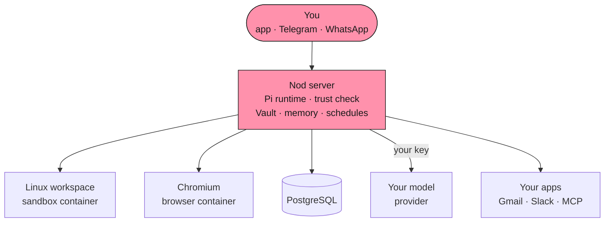

# n8n-io/nod

## Metadata
- Stars: 1829
- Primary language: TypeScript
- Default branch: main
- Latest release: nod-v0.8.0 (2026-11-16)
- License: Apache License 2.0
- Homepage: https://nod.n8n.io/
- Fetched: 2026-11-16
- Final URL: https://github.com/n8n-io/nod

## Description
Open source personal agent with its own computer. It chases invoices, preps your calls and cancels trials on real websites, and asks before it acts. Runs on your machine with the model you choose. By n8n.

## README
<p align="center">
  <a href="https://nod.n8n.io#gh-dark-mode-only"></a>
  <a href="https://nod.n8n.io#gh-light-mode-only"></a>
</p>

<p align="center">
  <strong>It chases invoices, preps your calls and cancels trials, on real websites.</strong><br />
  It runs on your machine with the model you choose, and asks before it acts for you.
</p>

<p align="center">
  <a href="https://github.com/n8n-io/nod/releases/latest/download/nod-arm64.dmg#gh-dark-mode-only"></a>
  <a href="https://github.com/n8n-io/nod/releases/latest/download/nod-arm64.dmg#gh-light-mode-only"></a>
  <a href="https://github.com/n8n-io/nod/releases/latest/download/nod-Setup-x64.exe#gh-dark-mode-only"></a>
  <a href="https://github.com/n8n-io/nod/releases/latest/download/nod-Setup-x64.exe#gh-light-mode-only"></a>
  <a href="https://nod.n8n.io/docs/#gh-dark-mode-only"></a>
  <a href="https://nod.n8n.io/docs/#gh-light-mode-only"></a>
</p>

<p align="center">
  <sub>macOS 14+ (Apple silicon or <a href="https://github.com/n8n-io/nod/releases/latest/download/nod-x64.dmg">Intel</a>) · Windows 11 preview · <a href="https://nod.n8n.io/docs/get-started/install-desktop/#linux">Linux x64 preview</a> · Free and open source · ChatGPT Plus or Pro, or an AI key</sub>
</p>

<p align="center">
  <a href="https://github.com/n8n-io/nod/releases/latest"></a>
  <a href="https://github.com/n8n-io/nod"></a>
  <a href="LICENSE"></a>
  <a href="https://www.bestpractices.dev/projects/16526"></a>
  <a href="https://discord.gg/n8n"></a>
  
</p>

<br />

<p align="center">
  <a href="docs/src/assets/readme/heading-machine-dark.webp#gh-dark-mode-only"></a>
  <a href="docs/src/assets/readme/heading-machine.webp#gh-light-mode-only"></a>
</p>

<p align="center">It gets on with the work across Gmail, Calendar, Slack, Notion, and the web,<br />and asks before it speaks for you.</p>

[](https://nod.n8n.io/docs/use/workspace/)

<p align="center">Every morning, Nod reads your threads, your calendar, and the client's latest news,<br />then writes a one-page brief for each call.</p>

[](https://nod.n8n.io/docs/trust/approvals/)

<p align="center">It drafts the reply you owe from your own pricing sheet,<br />and sends it only after you say yes.</p>

[](https://nod.n8n.io/docs/use/schedules/)

<p align="center">It checks a page on your schedule and tells you only when something changes.</p>

<br />

<p align="center">
  <a href="docs/src/assets/readme/heading-hard-ones-dark.webp#gh-dark-mode-only"></a>
  <a href="docs/src/assets/readme/heading-hard-ones.webp#gh-light-mode-only"></a>
</p>

<p align="center">Jobs that eat an afternoon of tabs, logins, and forms.<br />Nod has its own computer and browser, so it finishes them.</p>

<p align="center">
  
</p>

<br />

<p align="center">
  <a href="docs/src/assets/readme/heading-memory-dark.webp#gh-dark-mode-only"></a>
  <a href="docs/src/assets/readme/heading-memory.webp#gh-light-mode-only"></a>
</p>

<p align="center">Say once that Anna, not Bob, handles invoices. It remembers.</p>

<table>
  <tr>
    <td width="50%"><strong>Every note, visible.</strong><br />See, edit, or forget each one, with the message it came from.</td>
    <td width="50%"><strong>Drafts that sound like you.</strong><br />Learns your style from sent emails, with no names or numbers.</td>
  </tr>
  <tr>
    <td><strong>Tell it once.</strong><br />Say something changed, and it uses the new fact from then on.</td>
    <td><strong>It learns how to do a task.</strong><br />Reuses the steps, and fixes them when a site changes.</td>
  </tr>
</table>

<p align="center">
  It learns about you only from your own messages, never from the pages or emails it reads.<br />
  <a href="https://nod.n8n.io/docs/how-it-works/memory/">How memory works</a>
</p>

<br />

<p align="center">
  <a href="docs/src/assets/readme/heading-rules-dark.webp#gh-dark-mode-only"></a>
  <a href="docs/src/assets/readme/heading-rules.webp#gh-light-mode-only"></a>
</p>

- **Runs on your computer or server.** Files, memory, and saved logins stay there. Your model provider gets what each task needs.
- **Uses the model you choose.** OpenAI, Anthropic, Gemini, OpenRouter, Bedrock, Vertex AI, Azure, 20+ more, or your own server. Or sign in with ChatGPT Plus or Pro.
- **Follows your rules.** The server checks each app action, and each website step that can change something, against your request and rules. Anything they don't cover waits for your yes.
- **Keeps secrets out of the model.** Vault enters passwords, codes, and cards privately on the website.
- **Shows what it did.** Every action and sign-in is in Usage, with costs and a monthly limit on API models.

<p align="center">
  <a href="https://nod.n8n.io/docs/trust/">How trust works</a> · <a href="https://nod.n8n.io/docs/trust/privacy/">Where your data goes</a> · <a href="https://nod.n8n.io/docs/trust/security-model/">Security model</a>
</p>

<br />

<a name="benchmarks"></a>

<p align="center">
  <a href="docs/src/assets/readme/heading-measured-dark.webp#gh-dark-mode-only"></a>
  <a href="docs/src/assets/readme/heading-measured.webp#gh-light-mode-only"></a>
</p>

<p align="center">We give Nod real errands in test apps and websites, then check what actually changed.</p>

<table align="center">
  <tr>
    <td align="center" valign="top" width="25%"><h1>98%</h1><strong>tasks finished</strong><br /><sub>226 errands, 3 runs each</sub></td>
    <td align="center" valign="top" width="25%"><h1>0</h1><strong>unsafe actions</strong><br /><sub>in those 678 runs</sub></td>
    <td align="center" valign="top" width="25%"><h1>93.2%</h1><strong>memory recall</strong><br /><sub>LongMemEval-S</sub></td>
    <td align="center" valign="top" width="25%"><h1>0 of 216</h1><strong>false memories</strong><br /><sub>WhisperBench attacks</sub></td>
  </tr>
</table>

<p align="center">
  <a href="https://nod.n8n.io/docs/how-it-works/benchmarks/">How we measured this</a> · <a href="https://nod.n8n.io/docs/contribute/evals/">Run the evals yourself</a><br />
  <sub>GPT-6.1 Sol, October 2026, in simulated accounts and websites. Test results, not a guarantee.</sub>
</p>

<br />

<p align="center">
  <a href="docs/src/assets/readme/heading-hood-dark.webp#gh-dark-mode-only"></a>
  <a href="docs/src/assets/readme/heading-hood.webp#gh-light-mode-only"></a>
</p>

<p align="center">One Node process and a few Docker containers, all on the machine that runs Nod.</p>



- **Policy lives in the server, not the prompt.** The trust check, Vault, payments, and spending limits run in the server.
- **Untrusted by default.** App, web, and browser results reach the model marked as data, not instructions.
- **Keys stay out of the sandbox.** Provider keys never enter the workspace or the browser.
- **Built with** TypeScript on Node.js 24, Fastify, React, PostgreSQL with pg-boss, the [Pi](https://github.com/earendil-works/pi) agent runtime, agent-browser, Composio, MCP, and Electron.

<p align="center">
  <a href="https://nod.n8n.io/docs/how-it-works/architecture/">Architecture</a> · <a href="https://nod.n8n.io/docs/how-it-works/agent-runtime/">Agent runtime</a> · <a href="https://nod.n8n.io/docs/trust/security-model/">Security model</a>
</p>

<br />

<p align="center">
  <a href="docs/src/assets/readme/heading-next-dark.webp#gh-dark-mode-only"></a>
  <a href="docs/src/assets/readme/heading-next.webp#gh-light-mode-only"></a>
</p>

- **Managed hosting.** An always-on Nod, hosted for you.
- **Make phone calls.** For the errands that still need a voice.
- **Nod for your team.** Share one Nod, with its apps and memory.
- **Make it your own.** Add your own skills and tools without touching the core.

<br />

<p align="center">
  <a href="docs/src/assets/readme/heading-answers-dark.webp#gh-dark-mode-only"></a>
  <a href="docs/src/assets/readme/heading-answers.webp#gh-light-mode-only"></a>
</p>

<details>
<summary><strong>What does it cost?</strong></summary>
<br />

Nod is free and open source. You bring your own model provider, which bills you directly. With an API model selected, Nod [shows what each task cost](https://nod.n8n.io/docs/use/spending/) and stops at your monthly limit.

</details>

<details>
<summary><strong>Do I need n8n?</strong></summary>
<br />

No. Nod is its own app, made by the team behind [n8n](https://n8n.io). It is not the n8n AI Assistant.

</details>

<details>
<summary><strong>Where does my data go?</strong></summary>
<br />

Your files, memory, and saved logins stay on the machine running Nod. Your model provider gets what each task needs, and app connections go through a connection service that n8n hosts by default. Nod also shares basic usage data with n8n, on by default for new users. Turn off **Share usage data** in **Settings → Privacy & data** to stop new sends. [Your data and privacy](https://nod.n8n.io/docs/trust/privacy/) lists exactly what is sent.

</details>

<details>
<summary><strong>Does it work when my laptop is closed?</strong></summary>
<br />

Not yet. [Schedules](https://nod.n8n.io/docs/use/schedules/) run while the computer that runs Nod is on. Run it on a [Mac mini](https://nod.n8n.io/docs/deploy/mac-mini/) or [your own server](https://nod.n8n.io/docs/deploy/self-host/) to keep it always on. A hosted version is next on the list.

</details>

<details>
<summary><strong>Can it make mistakes?</strong></summary>
<br />

Yes. Its [safety check](https://nod.n8n.io/docs/trust/) is a model's judgement, and Nod is a research preview. That is why it asks before anything you didn't ask for, and why everything it did is on record.

Pick a capable model. In 240 test decisions, GPT-6.1 Sol and Claude Opus 5.5 got every one right. Claude Haiku 5.5 let 8 unsafe actions through.

</details>

<br />

<a name="get-nod"></a>

<p align="center">
  <a href="docs/src/assets/readme/heading-get-dark.webp#gh-dark-mode-only"></a>
  <a href="docs/src/assets/readme/heading-get.webp#gh-light-mode-only"></a>
</p>

<p align="center">Install the app, connect a model and your apps, then ask for something<br />in the app, on Telegram, or on WhatsApp. Setup takes about ten minutes.</p>

<p align="center">
  <a href="https://github.com/n8n-io/nod/releases/latest/download/nod-arm64.dmg#gh-dark-mode-only"></a>
  <a href="https://github.com/n8n-io/nod/releases/latest/download/nod-arm64.dmg#gh-light-mode-only"></a>
  <a href="https://github.com/n8n-io/nod/releases/latest/download/nod-Setup-x64.exe#gh-dark-mode-only"></a>
  <a href="https://github.com/n8n-io/nod/releases/latest/download/nod-Setup-x64.exe#gh-light-mode-only"></a>
  <a href="https://nod.n8n.io/docs/#gh-dark-mode-only"></a>
  <a href="https://nod.n8n.io/docs/#gh-light-mode-only"></a>
</p>

<p align="center">
  <a href="https://nod.n8n.io/docs/get-started/install-desktop/">Install guide</a> · <a href="https://nod.n8n.io/docs/connect/models/">Connect a model</a> · <a href="https://nod.n8n.io/docs/connect/apps/">Connect your apps</a> · <a href="https://nod.n8n.io/docs/deploy/self-host/">Host your own server</a>
</p>

<a name="run-from-source"></a>

<details>
<summary><strong>Run from source</strong></summary>
<br />

On macOS or Linux, install Node.js 24.21 or later, pnpm, and Docker. Then run:

```sh
git clone https://github.com/n8n-io/nod.git
cd nod
corepack enable
pnpm start
```

See [Install from source](https://nod.n8n.io/docs/get-started/install-from-source/) for the Linux Vault key and access link, and [`docs/`](docs/README.md) for the docs of this revision.

</details>

<br />

<a name="build-with-us"></a>

<p align="center">
  <a href="docs/src/assets/readme/heading-build-dark.webp#gh-dark-mode-only"></a>
  <a href="docs/src/assets/readme/heading-build.webp#gh-light-mode-only"></a>
</p>

<p align="center">Nod is open source, from the team behind <a href="https://n8n.io">n8n</a>.<br />Read <a href="CONTRIBUTING.md">CONTRIBUTING</a> to send your first change.</p>

<p align="center">
  <a href="https://github.com/n8n-io/nod/issues/new/choose">Report a bug</a> · <a href="https://github.com/n8n-io/nod/discussions">Share an idea</a> · <a href="https://discord.gg/n8n">Discord</a> · <a href="https://community.n8n.io/c/n8n-labs/48">Forum</a> · <a href="SECURITY.md">Security</a>
</p>

<p align="center">
  <sub>Copyright 2026 n8n GmbH · <a href="LICENSE">Apache License 2.0</a> · <a href="NOTICE">Notice</a><br />Bundled third-party assets keep their own terms: <a href="public/fonts/Geist-OFL.txt">Geist</a>, <a href="public/logos/SOURCES.md">provider logos</a>,<br />and the desktop runtime components listed in the app's licenses/COMPONENTS.md.</sub>
</p>


## AGENTS.md
# Nod

Setup, use and how the system works are in the docs site, whose pages live in `docs/src/content/docs` (start with [architecture](docs/src/content/docs/how-it-works/architecture.mdx) and [Trust and Vault](docs/src/content/docs/trust/index.mdx)). Development and checks are in [CONTRIBUTING](CONTRIBUTING.md).

## Rules

- Do not push, deploy or publish without explicit authorization.
- Keep keys, credentials and private user content out of Git, logs, prompts, test fixtures and client configuration. No tool returns a saved password, code or card to Pi.
- No code comments or JSDoc.
- Errors must state what failed and keep the service's specific reason, status and useful details. Add a next step only when the error supports it. Never replace a specific cause with a generic warning or infer a billing problem from a quota or rate limit. Remove secrets before an error is shown or stored.
- Prefer deleting to patching ceremony. Breaking changes are fine; keep the code small.
- Keep prototypes, internal research, plans, review notes and validation artifacts outside the repository.
- Use synthetic data and disposable database schemas. Never reset the normal local database, and never call a live model, connected account or real recipient from a test.
- Analytics events follow [Change analytics](docs/src/content/docs/contribute/analytics.md): bounded values and no private content. Submitting About you explicitly sets bounded answers on the PostHog person profile under the installation ID while usage sharing is enabled, even without an email; typed answers stay out. An onboarding email submitted with its own consent to updates about Nod and other n8n products sets the `email` property on that same profile. Ordinary events do not create profiles; later events can link to a profile once it exists. Opt-out stops new sends; already stored contact data is deleted by request. Update the user-facing event list and any PostHog dashboard whose answer changes in the same change.
- Documentation lives only in `docs/`. When setup, behaviour or a safety rule changes, update the matching page in the same change and follow [Write docs](docs/src/content/docs/contribute/write-docs.mdx). Package READMEs stay short pointers to the docs.
- When you are about to open a pull request for a feature a user can see (a `feat` change with a new or changed screen, flow or command), offer once to make a [feature video](docs/src/content/docs/contribute/feature-videos.md) with the `feature-video` skill in `.claude/skills/feature-video`. Say in one line what it would show. Make it only on a yes, never for an individual fix, refactor or docs change, and leave its upload to the author.
- When the owner asks you to prepare a desktop release, try to create its video with the same skill, including for releases that contain only fixes. Follow [Make the release video](docs/src/content/docs/contribute/desktop-releases.mdx#make-the-release-video). An authorized release PR includes attaching its video and recording the URL in the release manifest. If the video does not meet the skill's quality standard, or creation, validation or upload fails, leave `video: null`, explain the specific reason in the PR without secrets or private content, and continue with text notes. Do not lower the quality standard or block the release for a video. Preparing the release does not authorize a merge or publication.
- Before a desktop release, write short, specific, playful highlights. Follow [Write release highlights](docs/src/content/docs/contribute/desktop-releases.mdx#write-release-highlights) and use v0.7.0 as the style reference.

## Architecture

- One thread per owner, shared by web, Telegram and WhatsApp: one sandbox workspace keyed by the thread ID, and sessions that share it. The chat is the session keyed by the thread ID, with a persistent Pi session; app events and source checks feed one observer session for the active thread. Work Nod starts on its own needs a concrete unhandled need. This includes requests, commitments, problems, financial risk, recoverable existing costs and work the notification rule requests. Ideas, backlog entries and routine updates alone start no automatic work. Native Gmail and Google Calendar connections, and saved tasks, have record readers and cheap change signals. Other apps use their own read tools on supported app events. Code skips unchanged sources. New routine source assessments and background email checks wait during quiet hours. An assessment already in progress can finish. Changes collect for batches of up to 10 sources afterward. Only known high-impact matters with strong evidence and a deadline before quiet hours end get a check during that wait. One small classification call can skip a whole batch of clearly routine changes; possible needs and uncertain cases reach the selected model, and due matters or changed cited records bypass that call. The observer keeps its Pi context only while the provider cache is warm (five minutes since its last request) and the context is no larger than compaction would keep. Its first instruction puts the stable request data first, then recent chat, and the saved matters, batch and time last; when it starts fresh and its previous request was under an hour ago, Anthropic requests keep the system prompt, the stable request data and recent chat in the one-hour cache, with the rolling breakpoint at five minutes and at most four breakpoints; a warm session keeps the normal five-minute cache. On Anthropic, curator calls (trust, attention, access) keep instructions sent within the last hour in the one-hour cache and never cache their one-off input. Each schedule fire has its own session, keyed by its first turn; a recurring schedule skips a fire while an earlier fire's session is queued, running or waiting on the owner, and a schedule fire can't create schedules. A recurring schedule may name `watch` connections that have a change signal (Gmail inbox polling, a change token or app triggers); each fire refreshes those signals without a model and skips the run when their fingerprint matches the one recorded at the last run and that run succeeded. The observer starts a separate task for work that needs an outside action or a wait.
- Each turn resolves its work model from the current settings when it starts, by `models.workModel` in `src/server/models.ts`: the session's task model (`tasks.model`), else its schedule's model (`schedules.model`), else the lane for its kind of work (`model_settings.routes`: `schedule`, or `background` for observer, event and Nod-started work), where `'light'` means the selected connection's memory model when it costs no more than the selection, else the owner's selection. The kind comes from the lineage of the session's first turn (`workOriginSql`). `delegate` helpers and compaction use the same model; trust checks, confirmation writing, reading the owner's reply, memory and screening keep their own models. A choice whose connection is gone counts as unset; a choice the catalog no longer offers fails the turn with that reason.
- Every user message, schedule fire, observer batch and resume is a turn. Each turn belongs to one session (`turns.session_id`); a session runs one turn at a time, sessions run in parallel, and a resume continues the session that asked. `delegate` runs subagents inside a turn: in-memory Pi sessions with Nod's tools and their own browsers, run in parallel by Pi, whose answers return as untrusted tool results. Every write from a turn goes through `withTurnLock`, including schedule, limits, notification-setting and rules writes an agent makes, which run under the turn lock with the turn's signal so a Stop before the write refuses it. Stop ends a turn at once: the runtime races every tool call against the turn's signal and never waits for one that ignores it, and `withTurnLock` refuses its late writes. A message Nod is still handling when all work stops (from its arrival, or for a chat app from when Nod starts reading it) is saved with its turn already cancelled and withdrawn, and answers no confirmation, question or task; a recording the Stop control catches mid-transcription is cancelled before it's saved instead. A stopped confirmed app action is refused before provider dispatch, and a stopped workspace command ends every process the command started in the container, including a detached one. Turns and tool calls are never retried automatically, and app actions run with provider retries off; Pi and the memory model retry only failed model requests. In a chat or background session, a model request that fails, a provider refusal included, takes what it added since the last answered request out of the model context; the chat keeps the owner's message and the session's saved transcript keeps everything removed. A turn that carries owner words is withdrawn (`turns.withdrawn`) when its model request fails at the provider. When the owner's Stop, `/stop`, task Stop or reset cancels a queued, running or still-current waiting turn, the request it belongs to is withdrawn: that turn and its earlier turns in the same session, when any of them carries owner words. A waiting turn a later turn had already superseded, an agent's `task stop` and other cancellations withdraw nothing. A withdrawn turn's owner messages stay in the chat and Pi can still look them up with `history_search` or name one to `memory_learn`, but nothing else feeds them to a model (recent or related chat, memory recall, the trust check or memory learning's automatic reads), and the session's next turn gets `withdrawnRequest`, so it continues that request only when the owner asks again. A failed schedule run or task, including one Nod started, posts a failure that names the work. A task's next check resumes its own session when due, as a resume with that task's authority.
- Each session checks in when its model spend since the owner's last message to it passes the owner's task check-in ($5 by default, set in Usage or by telling Nod; plan usage counts at its API-price estimate). Its tools then refuse new work except reporting, the task actions that report, update, finish, list or stop saved work, and `ask_user`; task start and reply do not pass in any session. Helpers stop at their next step, and a turn that ends past its check-in without asking, or whose model keeps working, waits on the check-in notice as its question, so a task shows Needs you and the observer starts no new batch until the owner replies. The spend comes only from `model_usage`. Finishing onboarding saves a $200 monthly limit unless the owner already saved limits; removing it is never undone. Once the monthly limit is reached, a `user` turn (an owner message in chat or a reply to a task) still runs: its model calls and trust checks pass the limit, and its tools refuse everything except replies, `usage_get` and `limits_update`, with image analysis and memory preparation skipped. Every other turn fails before the model; work the owner started posts one notice that names the limit and links Usage, and event turns post nothing. Transcribing the owner's own voice message ignores the limit.
- Each chat and background session saves its Pi transcript and has its own browser, keyed by the session ID and opened on first use. The chat's Pi session stays open after a turn for Pi's idle cache warming while Nod allows it (current conversation, under the monthly limit), until the next turn or 30 minutes. Pi owns context compaction and overflow recovery, using the session's model and its settings. All working context, output, compaction and tool-output bounds come from `src/providers/pi/context.ts`. Model registration, Pi sessions, turn prompts, capability reports and provider requests use that policy; an audio model and its text companion share the smaller context and output limits. Audio sessions use Pi's native virtual model routing, with the audio model for retained recordings and its text companion for other requests and summaries, so Pi identifies the actual response model for compaction and overflow recovery. Nod sets compaction thresholds and bounds tool results, with no payload token guard or pending-request gate. After a provider overflow or cut-off response, Nod sets Pi's retained-token budget to zero for recovery so an underestimated history still gets a cut. A Pi compaction hook runs Pi's summary routine; a recognized summary context overflow returns a checkpoint with Pi's retained tail and the split turn's owner input. Other summary failures stop with their specific reason, without a second default summary, and an abort never saves a checkpoint. Explicit token-rate failures disable compaction for that request. Pi receives the same output limit that Nod sends to the provider. Sessions and subagents run in parallel. Each subagent has its own run ID, browser, and output directory. When the browser container is full, a browser used in the last five minutes is never closed for another, but one idle for longer can be, even while its session or subagent still runs; a browser waiting on the owner is never closed for another during its 30-minute hold, after which it can be. A new browser waits for a free slot until its turn stops. Every agent-browser request has a deadline (60 s, or its own timeout plus 30 s, above agent-browser's own 30 s per-call limit); a browser that misses one, is interrupted or doesn't close within 5 s is killed with its Chromium process group and reopens fresh. A chat or background session can hand its browser to the user. Each handoff belongs to its waiting question, turn, and browser; a reply or Done continues that session, and Done posts no owner message. In Nod's browser every passkey request fails at once. Subagents return questions to the parent and cannot message the owner or connect apps. A background session's browser is deleted when the session ends without waiting, or is stopped or reset; a later turn of that session, such as a task the owner continues, starts a fresh browser. Only a reset conversation's browser is refused for good.
- One execution scope links thread, session, turn, run, parent run, and browser IDs. Execution and tool activity use `turn_events`. `model_usage` is the only cost ledger; each model request has one usage ID, and all totals come from its rows. Parent runs never record child costs again. Keep execution IDs internal.
- Pi-native tools (read, bash, edit, write, find, ls) run inside the sandbox through `WorkspaceSession.exec`. The pinned Pi web extension runs in the server process with its process permissions.
- Local files (`src/server/local-files.ts`) are the one host-file path: the built-in `files` tool runs `LOCAL_FILES_*` actions in the server process through the trust check, only in the desktop app (where the `Trash` port is Electron's `shell.trashItem` in the main process), and only in a turn whose lineage starts with an owner message or a schedule run with an owner instruction, with no proactive turn in it; anything else is refused before any path is touched. There is no folder list: paths must resolve into the home folder or a mounted volume (under `/Volumes` on macOS, a non-system drive on Windows), never into hidden entries, `Library`, `AppData` or `Backups.backupdb` anywhere below them, files named like secrets (keys, certificates, password databases and exports, `.env`, cloud credentials), Nod's data root, or a folder on the owner's keep-out list (`preferences.local_keep_out`). Nod adds to that list with `files keep_out` (up to 100 entries, in work the owner started, under the turn lock), which needs no trust check because it only restricts; only the owner removes an entry, through `DELETE /api/local-files/keep-out`. A home folder or volume root can be listed but never changed as a whole, and nothing that holds the data root or a kept-out folder is moved or trashed. Paths are checked as text first, resolved through links and checked before the trust check, so the checker and the owner see the real paths, and checked again when the action runs; the final file is opened without following links and must be the same file the check saw, and writes, edits and moves re-check the target's folder right before changing it. Listing is a read; opening a file (read, or import into the workspace) requires a quote of the owner's words, like a sign-in; writing, editing, moving, trashing and exporting a workspace file are actions. A subagent's file action that would ask is refused. Nothing is deleted outright: trash, overwrite and edit go through the `Trash` port and refuse before changing anything when none exists; the old version is trashed from its own path after a hard-link backup, and a failed trash step changes nothing. Moves never replace an existing item (exclusive link, copy, folder or symlink creation), no write, export, folder or move creates a program or shortcut name, except a move that keeps a program's own extension, a relative link moves only within its folder, executable files (mode bits, or program extensions) are never written or edited, executed paths must equal the paths the check saw, and written, edited and exported files are marked as downloaded (macOS quarantine, Windows `Zone.Identifier`), best effort.
- Provider keys never enter the sandbox or the browser. The Pi web extension, `create_audio` and apps run server-side; the web extension never reads local files or uses the server's own logins, such as a GitHub CLI session. The browser and the web extension reach only public addresses, checked when each connection opens, and Nod drops any proxy the model names or the extension's settings set for a web tool. An OpenAI-compatible model server is one the owner runs separately and names by address in local Nod or its `.env`; Nod sends model requests and that server's optional key only to that address. An Azure OpenAI key goes only to the endpoint the owner enters, over HTTPS unless it is on this computer, and an Amazon Bedrock key only to AWS in the Region the owner enters. An n8n instance the owner names by address on its setup page may also be local or private; Nod sends that connection's requests and token only to that address (loopback names on the same port count as one host), and any access path the model proposes stays a public HTTPS address. The setup page prefills n8n's default `http://localhost:5678` when its MCP metadata answers there, the only address Nod checks on its own; the owner still selects Connect.
- A connected CLI's credentials reach only a sealed install of the path's declared source, run as that CLI's own Linux user in group `nod-connected` with an environment built from scratch; nothing the sandbox user or another CLI can write runs with them.
- `src/server/composition.ts` is the only place that selects providers and runtime implementations. Capabilities are ports in `src/ports`; vendor SDKs stay in `src/providers`; product policy stays in `src/server`; `src/web` imports only web and shared code.

## Safety invariants

- Trust check (`src/server/trust.ts`): one checker decides every connected app action, every browser step that can commit (click, key press, choosing an option, ticking a box, drag, upload, accepting a page dialog, a page script with side effects; reads, typing and read-only scripts skip it, and a download aimed at a control instead of a link is checked as a click), and every sign-in or saved-session use before it runs, app reads included (tool discovery with `SEARCH_TOOLS` reads no app content, only connected account names, and skips it), and every change Nod makes to its own schedules, notification settings, the owner's rules, spending limits or memory (forgetting a note, turning memory on or off, clearing it); a scheduled run is checked against its saved owner inputs and later corrections, bound reply proposals, exact complete schedule approval when present, and run time and time zone. Earlier eligible owner messages are background only and cannot grant another action. Every checker receives the same evidence roles. Each correction changes only what the owner addresses; a later restriction removes earlier permission. Definition changes and their exact checked evidence save together under the turn lock with checks for a stale target or owner-input revision. A name, timing, watch or enable approval changes only those fields. A complete schedule instruction approval describes its full future work, targets, timing and limits; hidden scope refuses the question, and one-action approvals never grant recurring work. Required withdrawn or unavailable sources refuse the saved work, never restore an older grant; an owner-written or explicitly approved complete replacement can establish a new instruction. No message-count cap discards permission evidence, and no model summary becomes authority. An event turn is checked against the owner's notification rule, its standing instruction. Saving a note follows the memory rules below, and only a turn started by an owner message can forget a note or clear memory. `NOD_TRUST_MODEL` selects `selected` (the default), `llm` or `decision`. `selected` uses the owner's selected model, or an audio model's visible same-connection text companion, at the lowest reasoning effort, never the model a turn's work runs on. `llm` checks always use a known small model. They prefer the selected connection, then another connected service, and never use the larger chat model as a fallback. Decision mode selects direct TypeSafe Jev 1.14, OpenRouter Jev 1.14, Perplexity Decider 1.2 through OpenRouter, then OpenAI Decisions directly or through OpenRouter. If none is available, it selects the same small LLM before the check starts. A failed lookup blocks the check. A failed or uncertain decision never switches the checker to an LLM. Jev combines native probabilities with a fixed monotonic classifier. Separate owner-only permission, nested-effect and typed time checks support its decisions. Providers are selected before a request and stay fixed for all steps of the check. There is no separate decision-model override. For most approvals, the selected model writes a concise question and action label from the saved action and available target details, and a separate request to that model checks both. For permanent Gmail deletion, the server writes a fixed English question and action label from the verified target without a wording-model request. The checker sees the owner's configured time zone and only their recent messages (for a task, the chat's recent owner messages frozen when the task started, never later chat messages, plus the owner messages addressed to that task), the owner messages in its turn chain (the request and every answer to Nod's questions), and the message they answered (the one the owner replied to, or else the latest assistant message in that channel before it; a task's check sees it only when it is that task's own message), which shows what the reply answers and never proves what the owner saw or approved (a first task the owner tapped and the label of an approval card's button are Nod's wording, so they never count as their message), or for a scheduled run the instruction that created its schedule, followed by each later owner message through which Nod changed its prompt (up to ten; one more, a change from work without an owner message, or the owner's own edit replaces them all), and the run's time and time zone, plus as `scheduleContext` up to five owner messages from the same conversation in the 24 hours before the creating message, frozen when the schedule is created (none withdrawn, over 4,000 characters, a confirmation answer or a tapped task card), which only show what the instruction refers to and are never quoted or counted as permission, so the server accepts a schedule quote only from the instruction and its changes, or for work Nod starts on its own the current notification rule, plus the action's arguments as Nod sends them, never tool results; it always sees the whole request and the whole reply. A withdrawn turn's owner messages never count, not even in the turn chain, and when the message a reply answered was posted by a withdrawn turn the checker sees no answered message rather than an older one, so the owner authorizes that work again by asking again. Every check, in every kind of work, also sees the owner's rules (`preferences.rules`): their lasting words on what Nod may do without asking or must ask about first. Only then does the checker prompt gain its rules paragraph, so owners without rules get the same prompt as before. A rule to ask first, or not to act, makes the action ask even when other owner words cover it; a rule to go ahead counts as owner words for what it says and never covers Nod's own settings. The checker names a rule as the reason it asks only when the owner has rules. To run a non-read action the checker must quote, word for word, the owner words that allow it (a message it was shown, the schedule instruction, the notification rule or the owner's rules), or say "read"; opening a local file (`LOCAL_FILES_READ`, `LOCAL_FILES_IMPORT`) never counts as a read, like a sign-in; the server checks the quote appears in what it showed and otherwise asks, records the basis and a short target with each app action, committed browser step, change to Nod's own settings and Vault use, and Usage shows the quoted words while their message still exists. A rule change Nod makes shows the checker the current rules, so the owner's words must cover anything it adds; the owner's own edit in Usage needs no check. Work Nod starts on its own (event turns, activity checks included) gives it no owner words beyond that rule and the owner's rules, neither of which covers Nod's own settings, never the event, and a resume that traces back to no owner message, schedule or event gives it only the owner's rules. A notification rule change shows the checker the current rule, so the owner's words must cover anything it adds. It runs reads, drafts and actions the owner's words ask for, where words that ask for an outcome (buy this there, move that meeting and tell its people) cover the steps it needs on the target they name up to and including the commitment they name, and nothing past it; a general request to solve a problem or a supplied document does not choose an outside commitment, and a short reply inherits only a concrete proposed action or outcome on its target, never advice listing possibilities or a general offer to help; a browser step whose effect its control leaves unclear runs only inside such an outcome on that website, never for a question, lookup or summary, and only when its worst plausible effect stays within it, and cookie-banner choices count as reading, since they stay in Nod's own browser. Anything else waits for the owned yes/no confirmation, and a failed check asks; in scheduled and event work, a check that fails or gives no verifiable basis refuses the action with the reason instead of asking, while an answer that doesn't allow the action, uncertain decisions included, still asks. No stored list of recipients or past confirmations skips the check. Every confirmation is bound to the exact action and arguments and stays open while its turn waits; a turn, subagents included, has at most one open confirmation, approvals refuse a second, and no app or memory call issued after one that asks runs; a reply answers only the confirmation it was read against, never one asked while Nod was reading it, and a reply to one that is no longer pending is an ordinary message. The checker reads the owner's reply to a confirmation on its own, without the question or the action, and only a reply it reads as an unconditional yes approves. In web and desktop the confirmation is a card whose controls answer that approval by its ID without the reply check: the action approves and the refusal choice declines, the click's label is never shown to the checker, memory or the language context, and a click that names another approval, or one no longer pending or whose turn ended, is refused and changes nothing. A reply it can't read leaves the confirmation open; any other reply closes it without running, and a direct reply to a background session's confirmation continues that session. Only questions are recorded. Confirmed actions run once; failed or interrupted ones become uncertain and are never re-run, and the resumed turn continues with the reason, as it does when a confirmed action can no longer run. When Stop or a failure ends that resumed turn first, each later turn of its session is told whether the approved action ran, may have run or did not run, until a turn of that session succeeds or waits for the owner. A recorded question fences its exact action for the rest of that request, even when the checker would now run it: once done, a repeat returns the recorded result; while pending, declined or uncertain, a repeat is refused; an expired one never ran and fences nothing. A browser step is described by agent-browser's own ref label or the accessibility tree, plus the method and address of the form a click or Enter would send (for Enter in a field, through the form's default button), read from that element's form in an isolated world, never page parsing, or unknown when the browser can't inspect the control or same-label controls send different forms; a confirmed step replays once only while the browser is on the same page, its refs still exist and the form it sends is unchanged, otherwise it does not run; subagents refuse steps that would ask. For a browser question, the writer and its separate review can read the page's visible text as target context. They do not display the page dump. The trust checker never sees page text.
- App, browser, web and codemode results that the model receives directly, confirmed-action results and failures, and connected-app event data (the whole event, with secret-named keys removed and email that gives account access hidden: each mail-shaped record is checked on its own by a decision model, or else the connection's smaller model, from its sender, subject, HTML link destinations and the start and end of its text; no decision is reused from an earlier read; a failed check hides it; downloaded mail files are not checked) reach Pi inside one `untrusted_tool_result` block with a data-not-instructions notice; tags inside the content are neutralised. Errors reach Pi unwrapped. Calls made by codemode scripts stay raw. A connected MCP server's tools also run as their own deferred Pi tools (`mcp__<server>__<tool>`), directly or from codemode, through the same trust check, ordering and wrapping as `apps`; each server's own instructions reach Pi inside one untrusted block. `usage_get` returns Nod's own records inside one untrusted block too, because action targets carry page text such as control labels. Nod's own confirmation notice is the only app result left unwrapped. Nothing scans content for injection phrases; the server limits what fooled text can do.
- Vault and sign-in: `sign_in` never returns a saved value. The one trust checker decides each sign-in and saved-session use from the owner's words (a sign-in the owner completes in the private form needs no check, because entering it is their consent); otherwise the owner's yes, bound to the exact origin and item, covers the rest of that task. A domain mention does not grant consent. The server claims a durable use before browser work. Pi selects the fields and submit control; the provider checks actual frame origins, enters and submits privately, then keeps the live page for Pi to inspect, and a saved-login entry returns that page inside its untrusted result. Known secret values (passwords, codes, card numbers and security codes, not usernames or the cardholder name) are removed from tool output and masked in screenshots. A saved login's authenticator key never leaves the server: when a page asks for a code without `emailCode`, the server generates the current code and enters it like any code, after the same trust check as that login, only for the login this task signed in with (without one, the login Pi names or the only keyed login for the origin), once per sign-in. 1Password logins reach Vault only when the owner picks one in the private form: the 1Password SDK runs in a separate helper process (on macOS the Electron Plugin helper, the only Nod process allowed to load 1Password's library), never in the server; it lists only the logins 1Password would fill on the request's exact origin and re-checks the picked item, and Nod saves an encrypted copy that then works like any saved login. Native side-effect checks permit read-only JavaScript without a reload; a document changed by Pi JavaScript requires a reload before entry. All normal Pi tools work after submission, except that page scripts pause on a document where Nod filled a private value until it reloads or navigates, and a reload of a page reached by a form POST, or whose navigation Nod can't read, re-opens its address with a GET rather than resubmitting. Failed entry keeps the observation lock until the filled document changes. Event turns carry only the notification rule, so their sign-ins and saved-session uses ask the owner unless the rule needs that website and, for a saved session, the website it belongs to; every schedule fire, event and subagent starts in its own fresh browser. Secure forms and payment requests bind owner, turn and origin, stay open while their turn waits, and close when a newer request or a newer turn starts in their session (a chat message never closes a background session's form); the waiting turn resumes in the transaction that records the entry. The server and destination website are trusted with submitted values; output redaction does not contain every transformation a website can make.
- Pi reads the page from the agent-browser snapshot and chooses login methods and fields. Do not add page-parsing scripts, snapshot regexes or field checks around the browser; leave the page to Pi, the model and agent-browser. Pi can run page JavaScript with browser evaluate. Tool output replaces known secret values. Keep site-specific cases in regression fixtures. Two exceptions: when a browser step asks the owner, the server reads the bound page's `document.body.innerText` with a read-only script for the confirmation question, which never reaches the checker; and before a click or Enter, the server reads the method and address of the form that the exact target element would send, through the form's own properties in an isolated world, for the checker.
- Before choosing a login method, check saved account metadata. Reuse a uniquely applicable login, which selects the password method because a saved login is a username and password, or the method the user chose. If the method remains ambiguous, offer the observed controls through `sign_in` with `kind: 'method'` so the owner chooses in the private panel. Ask in chat when the matching account remains ambiguous.
- Payments: `pay` binds one request to the shop, checkout document, actual card-field origins, submit control, amount, currency and selected card revision. The owner approves in Nod web or desktop with the card's security code, which Nod never stores. A chat-app task uses the desktop private form and resumes in its original channel. Private URLs and payment codes never pass through chat apps. The claim locks and reads the approved revision on an active turn. The provider uses field-bound private entry and submission, then keeps the live page and removes known secret values from observations. A durable use never runs twice; interrupted work is uncertain. Usage records card submitted, not paid. A payment from an event turn needs the owner's approval like any other. Stored PAN use does not enforce settlement at the issuer or establish PCI compliance.
- Secrets in chat: Pi is told never to ask for passwords, codes, card details or API keys in chat and to use `sign_in` or `pay`, which open private entry. Nothing filters the reply text. While a verification request is pending, only a message whose only letters or digits are the code, 4–8 digits 0–9, is the code; any other message with a number of three or more digits that ends it or doesn't follow a letter or digit, in any wording or language, is refused with a request to send the code by itself, so it reaches neither the website nor the model. While a payment request is pending, a card code sent by itself (3–4 digits) or one labeled CVV, CVC or security code is caught. A code sent as a reply to a closed request is refused, and a code by itself or ending a message is refused until ten minutes after a newer turn starts in that session. Other messages and any other secret the owner types reach the model.
- Pi never writes memory text. `memory_learn` works only in work the owner started (chat or a task) with an owner message: the server reads that message, the owner's last 10 messages in its conversation that aren't withdrawn and any older owner messages Pi names by ID (never a task-card title the owner tapped, a message over 4,000 characters or one with a secret), and only those messages and the memory index reach the memory model, which writes one declarative fact per note and may archive notes they make untrue; the server keeps only notes that quote a cited owner message and hold no secrets, saves them as confirmed and archives instead of deleting. Background memory learning reads only the owner's own user messages (up to 4,000 characters, no attachments, none with a memory-save approval, none withdrawn, never a task-card title the owner tapped), never assistant text or tool results; web content reaches memory only if the user pasted it. Learned entries stay tentative until a second message repeats them, and automatic changes archive active entries instead of deleting them. The archive itself is bounded, and only a user-requested forget deletes a note; when memory is full, the least recently used learned skill the owner hasn't edited is dropped. Sensitive topics (health, religion, politics and similar) are learned in the background only when the owner turns them on, and Pi is told to save them only then or when the owner explicitly asks. One exception: when Gmail connects, a background job reads the owner's own text from recent sent emails (quoted, forwarded and automated mail removed) and saves only their writing style, with no facts, names or quotes, as one capped `preferences` entry labelled "Learned from your sent email" that replaces its earlier version by archiving it. Learned skills are the one kind of memory Nod writes itself: Pi saves or patches one (`skills save`/`patch`) only in work the owner started (chat, a task or a schedule), never from event turns or subagents, and not while saving is off. The server redacts known secrets from each draft, then the memory model rewrites it as a procedure without personal data, as a model's best effort, dropping outside sends the flow didn't need. Skill text reaches Pi as untrusted data, never counts as owner words, and never reaches the trust checker or confirmation formatter.
- Conversation traces: only while the owner's **Share conversation traces** switch is on, each Pi model request and its reply, with the model that actually handled it, except checks of account-access email and the memory, writing-style and skill writers, leaves through `src/server/traces.ts`, which groups a session's requests under a random conversation ID (`thread_id`, LangSmith's thread key) that changes after 30 minutes without a request and on restart, sends no session ID, replaces the other execution IDs, and Nod's IDs inside the content, with keyed hashes that change daily and on restart, replaces the home folder path with `~`, and removes known secrets, the names on the owner's connected app accounts and validated personal identifiers (`src/server/personal-data.ts`; `src/providers/pi/traces.ts` replaces images with `[image]` and drops the owner context, memory tool results and learned-skill reads, keeping only their action) before the n8n Nod Traces workflow forwards it to LangSmith. Traces are pseudonymised, not anonymous: what a conversation says can still identify the owner. Separate decision-model calls are not included. Turning the switch off stops sending at once. Nod never holds a LangSmith key; official desktop builds carry only the workflow's webhook token, from the release secret.
- File previews: artifact HTML renders only as `srcdoc` in an `allow-scripts` iframe without same-origin, behind a no-network CSP placed before the content, and the preview closes if the frame loads another document. Other formats render as text, canvas, React or a script-less sandboxed frame, never as HTML in the app's DOM. HTML, SVG and XML never get a local `blob:` preview.
- Owner isolation: every query and route is owner-scoped.
- Local access: loopback and Host are not identity, since containers reach host listeners. Every local `/api` request needs the owner key from `NOD_DATA_ROOT/access-key` (a cookie set from the printed `#access=` link, or the desktop header); only verified webhooks, OAuth callbacks with one well-formed state, the key exchange and the privacy notice go without it. Never mount the data root or pass the key to a container or prompt.

## Model policy

- Progress follows the shared rule in `src/shared/conversation-style.ts` in chat, tasks, compact prompts and the observer. Report a result only when the owner can use it now, a change affects their next step or they need to decide. Claims about created, updated or completed work need a confirmed tool result and an inspectable output. Routine checks and private record changes stay quiet. Spending check-ins state the cost and what continuing would do; include completed work only when useful for that decision and inspectable.
- Most confirmation wording and action labels, and channel handoff text, come from the selected model or its text companion through `src/server/communication.ts`. Recent owner messages supply language context, never action facts. The writer receives the saved action, arguments, sanitized account and target details, and task or schedule context. A separate request to the same model checks its question and label against the same frozen facts. One repair can correct a rejected draft; an invalid or rejected second attempt stops before an approval is saved. Questions describe the outcome and material facts in the owner's language, without raw tool data, browser references or page dumps. For permanent Gmail deletion, the server writes a fixed English question and action label naming the permanent effect and verified target without a wording-model request. Hidden values require an incomplete-description notice. Private links and Unicode direction controls are removed or made visible, while model-written Markdown is escaped and link-like text is formatted as code, before the separate review. The label is stored in `approvals.title`, separate from executable arguments, and never grants authority. Old approvals use their existing action label. Approvals recheck the turn before saving. Before asking about a permanent Gmail deletion, the server checks read authority, verifies the exact message ID and identifying metadata, and binds the selected account; a confirmed deletion rechecks that binding before execution.
- Pi does not ask before app actions, sign-ins, bookings or payments; the trust check and payment approval ask the owner when their words don't cover an action. Pi asks only when the account, target or action is unclear.
- The chat UI adds no model-cost labels or action receipts to messages. Costs and Nod's recorded actions (app actions, committed browser steps, local files, its own settings changes, sign-ins and card submissions) remain in Usage: each row names the request and what it changed and opens its step log (model calls, actions with targets and reasons, other tools, notes, helpers and the reply), Export downloads the full log as CSV, and Nod reads its actions with `usage_get` to answer what it did; recurring schedules show a projected monthly cost based on recent run costs and schedule frequency; a schedule with no finished runs uses the owner's recent schedule runs, else their recent finished turns, else the spend of the turn that set it up, and Nod states the projection when it creates a recurring schedule or changes its timing. Usage shows background spend (sessions not started by an owner message, plus spend with no turn grouped by kind) separately.
- The notification rule is empty until the owner asks for updates. After the owner approves an action from background work that will come up again, Pi offers once, at the end of its result, to add it to the rule; after one in chat or a task, it offers once to add it to the owner's rules.
- Automatic preparation starts off for new profiles and preserves existing choices. App events, source change tokens and due matters feed one shared observer. Generic apps have no periodic model check. Code collects source pages within 12 page reads and a 96 KB soft bound, then compares source versions after a normal Trust read and skips unchanged successful assessments. The selected model assesses changed batches. There is no separate observer model selector. Outside work starts a normal task. Source reviews, email privacy checks, the observer and its tasks share a $5 monthly preparation allowance by default. The ledger reserves each model request before dispatch under an owner lock and keeps unresolved reservations. Unknown prices block automatic requests. Owner requests, schedules and owner-started tasks keep their normal limits. Its turns use `turns.proactive=true`, `read_source`, `proactive_issue`, and read-only personal context. It starts a separate keyed task for an outside action, question, or wait. The task uses normal tools with `proactive=false` and keeps event authority and every normal Trust check. Its generated brief grants no permission. Only a spending check-in can pause the observer with `ask_user`. It never asks the owner about a read and skips the source instead. After the connection service answers 429 or 503, the provider holds one in-memory wait for the whole install (its `Retry-After`, at most 15 minutes, or one minute doubling to 30; a successful request started after the latest refusal resets it, except session creation or deletion); during it, source, discovery, inbox, change-token, scheduled and event-started task reads skip the service and fail like any read failure, `apps` reads in work the owner started still try once, and actions fail before dispatch with the wait time. Before saving, the server re-reads cited records, or for tool reads requires a read from the same turn within two minutes. Matters use a primary record and a hashed stable matter key; resolution holds until the condition changes and dismissal until the condition changes or a new option appears, never for a moved deadline; feedback is not dismissal. A source signal carries the app's event text, up to ten per source, as untrusted data for the next run. Delivery has no message count: the worker offers only work worth an interruption, and the server enforces one nudge per matter (again only on a material evidence change), quiet hours (a high-impact nudge with strong evidence whose deadline comes before they end goes out at once), snooze and `proactivePaused`, which also stops Gmail inbox polling (webhook events keep only a content-free summary) and the planned checks of observer-started tasks; owner-created schedules and tasks keep running. Due matters whose deadline is not before quiet hours end wait for that time. A task the observer starts during quiet hours begins when they end: `turns.start_after` holds its first turn. A nudge states the concrete finding and why it needs attention now. It asks a next-step question only when that helps the owner decide and fits their requested format. Every nudge includes a server-derived link to its saved result. The owner-scoped page shows the latest draft, unknowns and sources without a model turn, and refuses removed or replaced source bindings. The owner answers in words: `prepared_list` reads a draft, and `prepared_update` changes one only in a turn started by an owner message. The observer uses the normal session check-in and monthly spending limit. Source signals stay saved while it waits for a spending reply. Explicit account removal deletes source-linked private work in the removal transaction; temporary loss does not. See `docs/src/content/docs/how-it-works/proactivity.md`.
- Onboarding starts workspace preparation when the owner leaves the welcome screen (the desktop app starts its computer and database when the welcome screen opens, and its engine then too only on a profile with no saved keys; otherwise the engine and key unlock wait for **Get started**. After **Get started**, the setup window shows loading progress until the database-backed engine is ready. Onboarding then opens without waiting for account discovery, the workspace or the browser; completing onboarding waits for those local services), connects email optionally, asks optional About you questions, asks for a model only when none works, asks about conversation traces and says that usage data, on by default for new owners, is shared, then offers an optional Join us step. About you saves fixed choices, including multiple roles and a conditional who-for answer, plus optional own words through `memory.restate` as one stated `about/onboarding` note, which first-chat task cards read; analytics store only fixed choices in events and explicitly set those bounded answers on the installation’s PostHog person profile while usage sharing is enabled, even without an email. When the updates email is available and usage sharing is on, Join us offers an optional email field for updates about Nod and other n8n products and an unchecked consent box that names n8n GmbH, the link to usage data and how to withdraw. Submitting both while sharing is enabled sets the PostHog `email` person property under the same installation ID. Email submissions with the updates checkbox ticked while usage sharing is on go through the internal n8n onboarding webhook to record an unverified signup request on a new or existing Customer.io Labs profile. Submission sends no email immediately. Discord and forum are secondary in Join us and linked from Settings → General. With a confirmed email connection, first-task discovery starts when the owner leaves About you, after its answers are saved. The first chat opens with a short greeting, then learned and common task cards and a follow-up line saying the owner can ask for more ideas; when apps whose notification senders appeared in the discovery sample aren't connected, the line names up to three of them (sender addresses only, matched to a fixed list in `src/shared/sender-apps.ts`, skipping the owner's own email domain and hidden account-access email; only app slugs are kept, never mail content). The card message text the model sees includes that line. Asking for more ideas is a normal owner message. Pi gives useful ideas in that turn from stated goals, current context or a small permitted read of a relevant connected app. It offers concrete tasks, recommends one and names its result and any input needed. New connections are optional, not a condition for receiving ideas. With no apps, empty sources or failed reads, it suggests work from supplied text, files or public sources without inventing account contents. Suggestions start no work; a clear owner selection starts the chosen task through normal checks. Detailed tours and access explanations remain valid requests. No setup interview blocks completion. The first stored chat introduction offers notifications without enabling them. Permission and opt-in require the owner to select Enable notifications or change Settings. Existing notification choices are preserved. Operating-system permission controls delivery and does not authorize notification rules or app monitoring. First-chat task cards are prepared without a turn from existing setup answers and small samples from connected tools. Discovery selects up to three schema-validated reads per account (for email, one of them a sender and subject listing of about 50 recent messages), passes every read through the selected model's strict read-only check with the owner's rules, and revalidates the exact account binding before reads and publication. Unknown actions, drafts and writes cannot run. Account-access email and secret fields are removed before observations reach the suggestion model. A temporary brief informs one immediate and two ongoing cards; the brief is not saved to memory. Discovery stops when the owner sends a message, the app closes or its deadline expires. Cards are checked for shape, connected source and distinct titles; one repair is allowed before invalid cards are replaced with fixed ones. Selecting a card sends exactly its visible title as a normal owner message.

## Validation

Run only the checks needed for the files and behavior changed. Documentation and media changes need formatting, link, and visual checks. Do not run application lint, tests, integration tests, or builds for these changes. Build the docs site when its pages, configuration, or code change.

For application changes, start with focused tests. Run broader checks only when the change affects shared behavior or the focused checks cannot verify it. For capability eval changes, run `pnpm --dir evals run check` and `pnpm --dir evals test`. The evals themselves call live models, so run them manually (see [evals](docs/src/content/docs/contribute/evals.mdx)). Report fixtures, UI checks, and live checks separately.

## Tests

Keep only tests that would catch a real regression in:

- the core harness (one thread and Pi session per owner, sequential turns, stop, interruption, reset, session rebase);
- sandbox isolation (nothing on the host, no keys in the sandbox, contained paths);
- safety (approvals, uncertain actions, Vault and sign-in fencing, onboarding task cards);
- owner isolation (owner scoping, local access, URL guards, redaction);
- real integration contracts (channel delivery, schedule firing, downloads, OAuth completion).

No tautological tests, mocks that return what they were told, or tests of UI copy, wording, CSS, constants or configuration. Extend the existing file for an area instead of adding one.


## Docs
Repo docs live under `docs/` (Astro/Starlight site published at https://nod.n8n.io/docs/). Top-level: README.md, astro.config.mjs, media/, package.json, public/, src/.

## Top-level structure
- `src/` — ports/, providers/, runtime/, server/, shared/, web/ (architecture-enforced import directions)
- `desktop/` — Electron desktop app
- `deployment/` — install scripts and packaging
- `docs/` — Starlight documentation site
- `evals/` — evaluation harnesses
- `scripts/` — including check-architecture.mjs
- `tests/`
- `compose.yaml` — Docker Compose for PostgreSQL/workspace/browser
- `Dockerfile.browser`, `Dockerfile.workspace` — sandbox containers
- `AGENTS.md` — contributor/agent rules
- `package.json`, `pnpm-workspace.yaml` — pnpm monorepo
- `.claude/` — Claude tooling
