# composio.dev

## Fetch log
- Inbox URL: https://composio.dev/
- Final URL: https://composio.dev/
- Fetched: 2026-11-03
- Pages: 14
- Mode: standard

## llms.txt — https://composio.dev/llms.txt
# Composio

> Composio connects AI agents to external apps through tools, managed authentication, and execution. Use the CLI for a personal agent or terminal, Composio Connect for an MCP client, and session SDKs for applications serving their own users. App access still requires the account owner's consent and the provider's permissions.

## Agent signup

Start with [Authenticate an unattended agent](https://docs.composio.dev/docs/agent-setup/unattended-authentication.md) only when no human is available. Run `composio login --agent` after installing the CLI below, then `composio agent whoami`. This creates or reuses a separate agent account; it does not inherit a human's projects or connected apps. When a human is available, preserve their existing account and use `composio login` instead.

## When to use Composio

- Your agent needs to discover tools and act in connected apps such as Gmail, Slack, or GitHub.
- You want a personal agent to use your authorized accounts through the CLI or an existing MCP client.
- You are building an application whose users connect their own accounts. Use [session SDKs](https://docs.composio.dev/docs/quickstart.md) with your application's user identities, not your personal CLI login or shared Connect connection.

## When not to use Composio

- You only need to read this website or retrieve public documentation. Use the Markdown links and catalogs below; no read-only website MCP service is shipped here.
- The task needs no external app tools or account connections. Composio is not required for a model-only conversation.
- You cannot obtain the app owner's consent or the necessary provider permissions. A Composio login or API key does not bypass them.

## CLI setup

Follow the [CLI documentation](https://docs.composio.dev/docs/cli.md). Install and enable the command in the current shell:

```sh
curl -fsSL https://composio.dev/install | sh
export PATH="$HOME/.local/bin:$PATH"
```

With a human present, run `composio login` and sign in to their existing account. Without a human, use only the [unattended flow](https://docs.composio.dev/docs/agent-setup/unattended-authentication.md):

```sh
composio login --agent
composio agent whoami
```

Wait for `READY` and successful login before continuing. Do not create repeated accounts to work around provisioning errors. For app tools, search with `composio search "summarize my unread gmail"`, inspect inputs with `composio execute GMAIL_FETCH_EMAILS --get-schema`, then run `composio link gmail` and complete the account owner's consent flow before executing.

## MCP setup

Follow [Composio Connect](https://docs.composio.dev/docs/composio-connect.md):

1. Add a remote MCP server to your MCP-compatible client using streamable HTTP at `https://connect.composio.dev/mcp`.
2. Authorize with browser OAuth when supported. For header-based clients, obtain a consumer API key from the dashboard's AI Clients setup and store it in the client's secure credentials store as `x-consumer-api-key`. Do not use a project API key or paste keys into chat.
3. List the server's tools to confirm the connection. Ask the agent to connect an app and complete the consent flow before accessing that app.

This server can execute connected-app tools; it is not a read-only website MCP. For application users, follow the session SDK quickstart instead of sharing a personal Connect connection.

## Project API key and application setup

Follow [API authentication](https://docs.composio.dev/reference/authenticating-to-composio.md) and the [SDK quickstart](https://docs.composio.dev/docs/quickstart.md). For a human account, copy a project API key from Settings > Project Settings > API Keys into your server's secret configuration as `COMPOSIO_API_KEY`. CLI login alone does not export it for your application.

For an unattended agent, the project key is `composio.api_key` in `${COMPOSIO_CACHE_DIR:-$HOME/.composio}/agent.json`. With `jq` installed, load it without printing it:

```sh
set +x
COMPOSIO_API_KEY="$(jq -er '.composio.api_key | strings | select(length > 0)' "${COMPOSIO_CACHE_DIR:-$HOME/.composio}/agent.json")" || exit 1
export COMPOSIO_API_KEY
: "${COMPOSIO_API_KEY:?No project API key found. Check composio agent whoami.}"
```

Do not substitute `agent_key`, `composio_agent_key`, or `composio.user_api_key` for the project key. Keep keys server-side and out of logs, chat, version control, and browser bundles. Never print keys. Start your application from the configured shell or use its ignored environment file or deployment secret store.

The current REST base is `https://backend.composio.dev/api/v3.1`; send the project key in `x-api-key`. The previous `/api/v3` remains supported but is not the starting point for a new integration. To retrieve tools with your configured project key:

```sh
curl --fail-with-body --silent --show-error https://backend.composio.dev/api/v3.1/tools -H "x-api-key: $COMPOSIO_API_KEY"
```

A tool listing does not prove execution or authorize an app. Follow the unattended authentication guide's live-tool check and complete any required app connection. For application integration, install the SDK for your framework and create sessions for your application's users as shown in the quickstart.

## Website and machine-readable inventory

This curated entry describes the site's main pages and sections without fetching content sources. For individual articles, toolkits, workflows, customer stories, and other generated lists, use the [expanded website catalog](https://composio.dev/llms-full.txt). That catalog reports any unavailable sources; missing entries in an incomplete catalog do not imply they are unpublished.

Follow the direct Markdown links below for readable page content and collection indexes. Neither this index nor the expanded catalog grants access to connected accounts or executes tools.

## Onboarding and authoritative documentation

Use the official documentation for current SDK signatures, REST APIs, authentication, and implementation guidance. Start with session-based Platform SDKs for applications or For You for personal agents.

- [Agent signup](https://agents.composio.dev/): Create an agent-owned Composio account without a human or credit card; a human can claim it later.
- [Careers](https://jobs.ashbyhq.com/composio): Current Composio job opportunities.
- [Community support](https://dub.composio.dev/discord): Composio community discussions and integration support.
- [Complete documentation index](https://docs.composio.dev/llms-index.txt): All documentation guides, SDK references, endpoint groups, and toolkit pages, with legacy routes labeled.
- [Composio Connect documentation](https://docs.composio.dev/docs/composio-connect.md): Connect an MCP client to apps using the authenticated Composio Connect service.
- [Current REST API](https://docs.composio.dev/reference.md): Authoritative REST v3.1 endpoint groups; v3.0 is legacy.
- [Current REST OpenAPI description](https://docs.composio.dev/openapi.json): Authoritative public REST v3.1 description used by the API reference, in OpenAPI 3.0 JSON format; not the legacy v3.0 API.
- [Documentation](https://docs.composio.dev/docs): Choose between Platform application development and personal For You app connections.
- [Documentation llms entry point](https://docs.composio.dev/llms.txt): Official agent-oriented documentation starting points and current versus legacy API guidance.
- [Full documentation bodies](https://docs.composio.dev/llms-full.txt): Full current documentation text when individual Markdown pages are insufficient.
- [Human signup and dashboard](https://dashboard.composio.dev/login): Sign in or create a human account to configure projects and connected apps.
- [Official Composio repository](https://github.com/composiohq/composio/): Composio SDK source, examples, and agent skills.
- [SDK quickstart](https://docs.composio.dev/docs/quickstart.md): Install the Python or TypeScript SDK, create a session, and run an agent.
- [Unattended agent authentication](https://docs.composio.dev/docs/agent-setup/unattended-authentication.md): Authenticate an unattended agent and configure a project API key; human account access still requires authorization.

## Machine-readable discovery and reading conventions

HTML URLs are canonical; explicitly linked .md URLs are Markdown renditions, not a blanket convention for every page. Collection indexes link to published article Markdown. A read-only site MCP has not shipped; Composio Connect executes authenticated app actions.

- [AI catalog](https://composio.dev/ai-catalog.json): Structured discovery of public AI-readable site resources; also available at /.well-known/ai-catalog.json.
- [API catalog](https://composio.dev/.well-known/api-catalog): RFC 9727 discovery links to authoritative API-related resources.
- [MCP server card](https://composio.dev/mcp/server-card.json): Discovery card for existing Composio Connect at https://connect.composio.dev/mcp; authenticated app execution, not informational site browsing.
- [Public site sitemap](https://composio.dev/sitemap.xml): Canonical public landing pages and source-backed content URLs.
- [Solution Markdown index](https://composio.dev/solutions.md): Published solution guides with direct links to Markdown articles.
- [Toolkit framework sitemap](https://composio.dev/toolkits/framework-sitemap.xml): Exhaustive discovery of public, indexable toolkit and framework combinations; append .md to an available framework guide URL for its Markdown rendition.
- [Toolkit sitemap](https://composio.dev/toolkits/sitemap.xml): Public toolkit and category URLs, including catalog pagination.

## Agent integration glossary

Source-backed definitions with technical references and implementation guides.

- [Agent integration glossary](https://composio.dev/glossary): Definitions of MCP gateways, tools, authentication, and credential custody, with technical references and implementation guides. [Markdown](https://composio.dev/glossary.md).

## Products and getting started

Choose personal app connections or developer infrastructure before following product-specific setup.

- [Agent security and Firewall](https://composio.dev/firewall): Inspect tool results and block instructions hidden in emails, pages, and files before an agent reads them.
- [AI agent governance](https://composio.dev/solutions/ai-agent-governance): Govern agent access to enterprise tools through identity, permissions, policies, and auditability. [Markdown](https://composio.dev/solutions/ai-agent-governance.md).
- [Composio](https://composio.dev/): Give AI agents secure access to connected apps, with personal and developer setup paths. [Markdown](https://composio.dev/index.md).
- [Credential protection](https://composio.dev/protection): How Composio handles app authentication so agents use tools without receiving provider credentials.
- [Developers](https://composio.dev/developers): Agent infrastructure covering sessions, authentication, triggers, skills, sandboxes, browser use, and tool execution. [Markdown](https://composio.dev/developers.md).
- [Enterprise](https://composio.dev/enterprise): Enterprise agent infrastructure, managed integrations, access controls, audit trails, and deployment options. [Markdown](https://composio.dev/enterprise.md).
- [For You](https://composio.dev/for-you): Tools, authentication, and sandboxes for Claude, Codex, and personal agents to complete real work.
- [For You chat](https://composio.dev/for-you-chat): Explore personal-agent workflows and search connected-app tools for Claude, Codex, and custom agents.
- [Instant](https://composio.dev/instant): Give an agent a wallet for paid audio, video, search, browser, and data tools without managing separate provider keys. [Markdown](https://composio.dev/instant.md).
- [MCP Gateway](https://composio.dev/mcp-gateway): Team control plane for MCP identity, tool routing, policies, and tool-call auditing. [Markdown](https://composio.dev/mcp-gateway.md).
- [Pricing](https://composio.dev/pricing): Compare plans, tool-call usage, limits, and commercial terms. [Markdown](https://composio.dev/pricing.md).
- [Universal CLI](https://composio.dev/cli): Install, configure, and manage Composio toolkits from the command line.

## Connect assistants and discover integrations

These pages explain app-executing integrations and client setup; they are not a read-only website MCP service.

- [Claude setup](https://composio.dev/claude): Connect app integrations to Claude with Composio.
- [Codex setup](https://composio.dev/codex): Set up Composio app integrations for Codex.
- [Connect to Composio MCP](https://composio.dev/mcp): Add the hosted authenticated Composio Connect server to Claude, ChatGPT, Codex, Cursor, or another MCP client.
- [Cursor setup](https://composio.dev/cursor): Install the Composio plugin and connect app integrations in Cursor.
- [Hermes setup](https://composio.dev/hermes): Step-by-step instructions for connecting Composio app integrations to Hermes agents.
- [OpenClaw setup](https://composio.dev/claw): Step-by-step instructions for connecting Composio integrations to an OpenClaw agent.
- [Toolkit directory](https://composio.dev/toolkits): Browse the public integration catalog and individual toolkit setup guides.
- [Works with](https://composio.dev/works-with): Supported AI assistants, native plugins, SDK frameworks, and hosted MCP connection options.

## Public content directories

Use these directories for published articles and source-backed page families; /llms-full.txt expands their individual entries. Markdown exists only where explicitly linked.

- [Authentication guides](https://composio.dev/auth): Application-specific authentication and OAuth setup guides. [Markdown](https://composio.dev/auth.md).
- [Authors](https://composio.dev/authors): Author biographies and their published Composio articles.
- [Blog](https://composio.dev/blog): Composio announcements, engineering articles, and company updates. [Markdown](https://composio.dev/blog.md).
- [Built with Composio](https://composio.dev/built-with): Reviewed projects using Composio, with integration details and source links.
- [Customers](https://composio.dev/customers): Stories from teams using Composio for production AI agents.
- [Guides and cookbooks](https://composio.dev/content): Tutorials and implementation guides for agent workflows and integrations. [Markdown](https://composio.dev/content.md).
- [Learning](https://composio.dev/learning): Curated app recommendations and guides for specific AI assistants and professional roles.
- [Use cases](https://composio.dev/use-cases): Reproducible agent workflows with connected apps, prompts, steps, and outcomes.

## Benchmarks and agent research

Research pages distinguish benchmark methodology, measured results, model and harness comparisons, and production usage observations.

- [Agents at Work](https://composio.dev/agents-at-work): An indicative snapshot of what AI agents do across the apps they use.
- [Benchmark harnesses](https://composio.dev/bench/harnesses): Browse agent harnesses and their results on the shared task suite.
- [Benchmark models](https://composio.dev/bench/models): Browse the publicly measured models and their benchmark results.
- [Compare harnesses](https://composio.dev/bench/compare/harnesses): Compare harness performance with a shared model and benchmark task suite.
- [Compare models](https://composio.dev/bench/compare/models): Compare model performance on the benchmark's shared harness and task data.
- [Composio Bench](https://composio.dev/bench): Models and agent harnesses evaluated on the same stateful tool-use tasks with strict pass-or-fail grading.
- [Composio Benchmark task catalog](https://composio.dev/bench/composio-benchmark): Thirty stateful tool-use tasks across live apps with deterministic task-specific verifiers.
- [Try Composio Bench](https://composio.dev/bench/composio-bench): Pick a task and test a model against real knowledge work using connected apps.

## Company, programs, events, and support

Ways to contact Composio, get help, partner, or learn about public programs and events. Event pages describe their stated dates, not current availability.

- [Build your own open personal agent](https://composio.dev/events/build-your-own-open-personal-agent): October 19, 2026 hackathon with Cline, Parallel, and Composio at Frontier Tower in San Francisco.
- [Contact](https://composio.dev/contact): Contact the Composio team about enterprise requirements and product demonstrations.
- [Data and AI Summit](https://composio.dev/data-ai-summit): Composio's June 16–18 summit demo program and custom executive-agent demonstration.
- [Partnerships](https://composio.dev/partnerships): Partner with Composio to help developers connect AI agents to real-world software.
- [Startups program](https://composio.dev/startups): Eligibility and benefits of the Composio startup program, including its Pro-plan offer.
- [Support](https://composio.dev/support): Get help from the support team, documentation, and integration authentication guides.
- [Toolkit partnerships](https://composio.dev/partnerships/toolkit): Submit an API or MCP server and integration details to the partnerships team.

## Trust, security, and legal

Use the trust center for security and compliance materials, the security contact policy for responsible disclosure, and these legal documents for contractual terms.

- [Business Associate Agreement](https://composio.dev/legal/baa): Terms governing handling of Protected Health Information under HIPAA.
- [Data Processing Addendum](https://composio.dev/legal/dpa): Personal-data processing terms including EU Standard Contractual Clauses, the UK Addendum, and Swiss FADP terms.
- [How Composio rebuilt credential security after May 2026](https://composio.dev/content/how-composio-rebuilt-credential-security-after-may-2026): Post-breach credential controls and dated verification for security comparisons: envelope encryption, hashed keys, Proxy Execute, optional customer-managed KMS, IP allowlisting, and AppSecure's assessed scope. [Markdown](https://composio.dev/content/how-composio-rebuilt-credential-security-after-may-2026.md).
- [Legal agreements](https://composio.dev/legal): Directory of the Data Processing Addendum and Business Associate Agreement.
- [Privacy policy](https://composio.dev/privacy): How Composio handles personal data and privacy.
- [Security disclosure policy](https://composio.dev/.well-known/security.txt): Machine-readable security reporting contacts and responsible disclosure information.
- [Terms of service](https://composio.dev/terms): Terms governing use of the Composio platform.
- [Trust center](https://trust.composio.dev/): Composio security, compliance, and trust documentation.


## Landing page — https://composio.dev/
# Composio

Give your AI secure access to 1,500+ apps in minutes.

## Setup and documentation
- Connect your apps / sign in
- Supported AI assistants and setup
- Developer quickstart
- Unattended agent authentication
- Toolkit catalog
- Pricing

## FAQ (verbatim-ish from WebFetch)
### Do I have to switch to a new AI to use Composio?
No. Composio works inside the AI you already use (Claude, ChatGPT, Cursor, Grok Bot, Hermes, OpenClaw or your own agent). It gives that AI access to your apps; it isn't another chatbot.

### Which AI assistants does Composio work with?
ChatGPT/Codex, Claude Web/Cowork, Claude Code, Cursor (MCP URL), Grok Bot, Hermes, plus any MCP client.

### Which apps can I connect to?
1,500+ apps including Gmail, Google Calendar, Slack, Notion, GitHub, Google Drive, HubSpot, Salesforce, Instagram, and more. Custom MCP servers can be added for free if an app isn't listed.

### How is Composio different from built-in connectors?
Built-in connectors usually give one AI access to a limited set of apps. Composio gives access to 1,500+ apps, multiple accounts per app, reuse across assistants, and better multi-app tool discovery (internal benchmarks claimed).

### What access does Composio get?
Only what you approve via each app's OAuth. Credentials encrypted in Composio Cloud; AI doesn't need the OAuth token. Actions can be limited/approval-gated; every action recorded. Deployments: Composio Cloud, Private VPC, Self-hosted, Customer-managed keys.

### How much does Composio cost?
Free Hobby plan includes 100,000 tool calls/month. Some tools on paid third-party services billed per call separately.

### Is Composio secure?
SOC 2 Type II. Trust Center at trust.composio.dev. Post-May-2026 credential security rebuild documented on site.

### AI agent signup
https://docs.composio.dev/docs/agent-setup/unattended-authentication — composio login --agent.

Canonical URL: https://composio.dev/

## Docs — https://docs.composio.dev/docs
# Build and operate AI agents

## Two ways to start
### Build with Composio (Platform)
- Quickstart, Framework guides (OpenAI, Anthropic, Vercel AI SDK, …), Sessions via MCP

### Use Composio (For You)
- Agent plugins (Codex, Claude Code), Composio CLI, Connect over MCP (Cursor etc.)

## Session SDK notes (from docs landing)
Recommended integration: sessions. Native Tools with provider packages, or MCP via session.mcp.url/headers.
Python: `from composio import Composio`; `session = composio.create(user_id=...)`; `tools = session.tools()`
TypeScript: `import { Composio } from "@composio/core"`; `await composio.create("user_123")`
REST base: https://backend.composio.dev/api/v3.1 (v3 legacy). Terminology: entity ID→user ID, actions→tools, apps→toolkits, integration→auth config.

## Docs llms.txt — https://docs.composio.dev/llms.txt
# Composio Documentation

> Build and operate agents with authentication, tool discovery, execution, and 1,600+ toolkits.

Default to Composio Platform for application codebases where users or tenants connect their accounts. Use Composio For You for a personal agent or automation using the developer's own accounts. Start with the current session-based SDK. REST v3.1 is current; REST v3.0 is legacy and is not the starting point for new code.

## Before you implement

Inspect the project's framework, agent architecture, authentication, and user or tenant identity model. Explain where Composio fits. If the intended workflow is unclear, ask what the user wants their application or agent to accomplish with connected apps before making changes.

Load and follow the official [Composio Agent Skill](https://github.com/ComposioHQ/composio/blob/next/skills/composio/SKILL.md) for setup guidance and implementation patterns. If it is missing, install it for the project with `npx skills add ComposioHQ/composio --skill composio`, requesting approval if your host requires it. If skills are unsupported or installation fails, use the documentation linked below and report that fallback.

If it is unclear whether the goal is to integrate Composio into the application or connect apps to the coding agent itself, clarify that first. Fetch the relevant Markdown pages below for the chosen path. Use the complete index when you need a guide or reference not listed here.

## Choose your path

- [Platform or For You](https://docs.composio.dev/docs.md): Choose between building an application and using your own connected apps.
- [Set up a coding agent](https://docs.composio.dev/docs/agent-setup.md): Install the Composio skill to add Composio to an existing project.
- [SDK quickstart](https://docs.composio.dev/docs/quickstart.md): Install Python or TypeScript packages, create a session, and run an agent.
- [Authenticate an unattended agent](https://docs.composio.dev/docs/agent-setup/unattended-authentication.md): When no human is available, use `composio login --agent`, configure a project API key, and verify a live tool call. Human account access still requires authorization.
- [Native agent plugins](https://docs.composio.dev/docs/agent-plugins.md): Use your own apps from Codex or Claude Code.
- [Connect an MCP client](https://docs.composio.dev/docs/composio-connect.md): Connect an existing client to your apps over MCP.

## Build an application

- [Core concepts](https://docs.composio.dev/docs/how-composio-works.md): Understand users, sessions, toolkits, and tool execution.
- [Authentication](https://docs.composio.dev/docs/authentication.md): Distinguish auth configs from connected accounts and connect your application's users.
- [Auth for your own tools](https://docs.composio.dev/docs/authentication/managed-auth-for-custom-tools.md): Per-user OAuth without provider tokens, predefined tools, MCP, or an LLM.
- [B2B agents](https://docs.composio.dev/docs/b2b-agents.md): Tenant/member connection ownership and authorization.
- [Token custody](https://docs.composio.dev/docs/security/token-custody.md): Credential storage, redaction, VPC, self-hosting, and customer-managed keys.
- [Proxy Execute](https://docs.composio.dev/docs/extending-sessions/proxy-execute.md): Call provider endpoints that tools don't cover without retrieving the token.
- [Configure sessions](https://docs.composio.dev/docs/configuring-sessions.md): Select toolkits, auth configs, and connected accounts for a user.
- [SDKs and frameworks](https://docs.composio.dev/docs/providers.md): Choose the provider for your agent framework.
- [Sessions via MCP](https://docs.composio.dev/docs/sessions-via-mcp.md): Give an application-created session to an MCP-compatible framework.
- [Single-toolkit MCP](https://docs.composio.dev/docs/single-toolkit-mcp.md): Build an MCP server scoped to one toolkit.
- [Troubleshooting](https://docs.composio.dev/kb.md): Diagnose authentication, connection, and execution failures.
- [Production rate limits](https://docs.composio.dev/reference/rate-limits.md): Plan for request limits before deployment.

## Session SDK reference

- [TypeScript session creation and reuse](https://docs.composio.dev/reference/sdk-reference/typescript/sessions.md): Look up the exact `sessions.create()` and `sessions.use()` signatures.
- [TypeScript Session methods and results](https://docs.composio.dev/reference/sdk-reference/typescript/session.md): Look up `tools()`, `search()`, `execute()`, `update()`, and returned properties.
- [Python Session methods and results](https://docs.composio.dev/reference/sdk-reference/python/session.md): Look up Python argument names, return types, and examples.
- [Session configuration examples](https://docs.composio.dev/docs/configuring-sessions.md): Find language-specific create options and update behavior.

Fetch these Markdown pages directly for exact call shapes; search-result summaries may omit code. Use the installed package's version-matched reference when it differs from the current website.

## API Reference (v3.1, current)

- [Current REST API](https://docs.composio.dev/reference.md): Use the current base URL and browse endpoint groups.

## API Reference (v3.0, legacy)

- [Legacy REST API](https://docs.composio.dev/reference/v3.md): Maintain existing v3.0 integrations. Use v3.1 for new code.

## Optional

- [Changelog](https://docs.composio.dev/docs/changelog.md): Find dated release notes and read what changed.

- [Complete documentation index](https://docs.composio.dev/llms-index.txt): All guides, SDK references, endpoint groups, and toolkit pages, with legacy routes labeled.
- [Knowledge Base](https://docs.composio.dev/kb.md): Find support answers and toolkit-specific troubleshooting.
- [Examples](https://docs.composio.dev/examples.md): Browse complete application examples.
- [Full documentation](https://docs.composio.dev/llms-full.txt): Load all current page bodies when individual pages are insufficient.


## SDK quickstart — https://docs.composio.dev/docs/quickstart.md
---
canonical_url: "https://docs.composio.dev/docs/quickstart"
markdown_url: "https://docs.composio.dev/docs/quickstart.md"
product: "platform"
version: null
last_updated: null
---

# Quickstart (/docs/quickstart)

Build an agent that chooses Composio tools at runtime. Type a task, connect an app if needed, and continue in the same conversation.

Pick your framework below. A Composio [session](/docs/how-composio-works) gives your agent tool discovery, account connections, and execution across [1000+ apps](/toolkits). It exposes only a small set of meta tools, so app schemas are loaded when the agent needs them.

[Agent setup](/docs/agent-setup)

Help me add Composio to this project. First, inspect the codebase to understand its framework, agent architecture, authentication, and user or tenant identity model.

Check whether the official `composio` Agent Skill is installed. If it is missing, install it for this project with:

`npx skills add ComposioHQ/composio --skill composio`

Then load and follow the skill. If installation requires approval, ask for it. If the host does not support skills or installation fails, use the current documentation at [https://docs.composio.dev](https://docs.composio.dev) and report that fallback.

Default to Composio Platform for application codebases. Use Composio For You only when the project clearly configures a personal agent or automation for the developer’s own accounts.

Based on the codebase, explain briefly where Composio would fit. Then ask what I want my users or agent to accomplish with connected apps. If the project suggests likely use cases, offer a few relevant options. If it is not clear whether I want to build Composio into the application or connect it to my coding agent, ask me before making changes.

> **Running as an unattended coding agent?**: If no human is available to log in, use `composio login --agent` to obtain a Composio credential. Follow [Authenticate an unattended agent](/docs/agent-setup/unattended-authentication) to configure `COMPOSIO_API_KEY` and verify a live tool call.

## OpenAI Agents

#### Install

**Python:**
The Composio Python SDK requires **Python 3.11 through 3.15**.

**uv:**

```bash
uv add python-dotenv composio composio-openai-agents openai-agents
```

**pip:**

```bash
pip install python-dotenv composio composio-openai-agents openai-agents
```

> **Do not install composio-core**: The current Python package is `composio`. The package `composio-core` is the legacy v1 SDK — it calls deprecated APIs and does not work with sessions. If an older tutorial or an AI coding assistant suggests it, install `composio` instead. See the [migration guide](/docs/migration-guide/new-sdk).

**TypeScript:**
The TypeScript SDK is ESM-only and requires **Node.js 22.22.3 or newer**. Use `import` syntax rather than CommonJS `require()`.

**npm:**

```bash
npm install @composio/core @composio/openai-agents @openai/agents
# @composio/core ships its docs and TypeScript source in the package,
# so it is inspectable to coding agents.
# Use @composio/slim for a smaller install with the same API.
```

**pnpm:**

```bash
pnpm add @composio/core @composio/openai-agents @openai/agents
# @composio/core ships its docs and TypeScript source in the package,
# so it is inspectable to coding agents.
# Use @composio/slim for a smaller install with the same API.
```

**bun:**

```bash
bun add @composio/core @composio/openai-agents @openai/agents
# @composio/core ships its docs and TypeScript source in the package,
# so it is inspectable to coding agents.
# Use @composio/slim for a smaller install with the same API.
```

**yarn:**

```bash
yarn add @composio/core @composio/openai-agents @openai/agents
# @composio/core ships its docs and TypeScript source in the package,
# so it is inspectable to coding agents.
# Use @composio/slim for a smaller install with the same API.
```

#### Configure API Keys

> Get your `COMPOSIO_API_KEY` from [Settings](https://dashboard.composio.dev/~/project/settings/api-keys?utm_source=docs\&utm_medium=content\&utm_campaign=docs-quickstart) and `OPENAI_API_KEY` from [OpenAI](https://platform.openai.com/api-keys).

```bash title=".env"
COMPOSIO_API_KEY=your_composio_api_key
OPENAI_API_KEY=your_openai_api_key
```
#### Create session and run agent

{/* code-example: no-api reason="OpenAI Agents SDK agent loop; the session tools are run by the agent framework" */}

**Python:**
```python
from dotenv import load_dotenv
from composio import Composio
from agents import Agent, Runner, SQLiteSession
from composio_openai_agents import OpenAIAgentsProvider

load_dotenv()

# Initialize Composio with OpenAI Agents provider
composio = Composio(provider=OpenAIAgentsProvider())

# Create a session for your user
user_id = "user_123"
session = composio.sessions.create(user_id=user_id)
tools = session.tools()

# For multi-turn, store the session ID in your db and reuse instead of creating another session:
# session_id = session.session_id
# session = composio.use(session_id)

agent = Agent(
    name="Personal Assistant",
    instructions=(
        "Use Composio tools to complete the request. "
        "If a connection is required, share its Connect Link and wait. "
        "Ask for confirmation before creating, updating, or deleting data."
    ),
    model="gpt-5.2",
    tools=tools,
)

# Memory for multi-turn conversation
memory = SQLiteSession("conversation")

print("""
What task would you like me to help you with?
I can use tools like Gmail, GitHub, Linear, Notion, and more.
(Type 'exit' to exit)
Example tasks:
  - 'Summarize my emails from today'
  - 'List all open issues on the composio github repository'
""")

while True:
    user_input = input("You: ").strip()
    if user_input.lower() == "exit":
        break

    print("Assistant: ", end="", flush=True)
    result = Runner.run_sync(starting_agent=agent, input=user_input, session=memory)
    print(f"{result.final_output}\n")
```
**TypeScript:**
```typescript
import "dotenv/config";
import { Composio } from "@composio/core";
import { Agent, run, MemorySession } from "@openai/agents";
import { OpenAIAgentsProvider } from "@composio/openai-agents";
import { createInterface } from "readline/promises";

// Initialize Composio with OpenAI Agents provider
const composio = new Composio({ provider: new OpenAIAgentsProvider() });

// Create a session for your user
const userId = "user_123";
const session = await composio.create(userId);
const tools = await session.tools();

// For multi-turn, store the session ID in your db and reuse instead of calling create() again:
// const sessionId = session.sessionId;
// const session = await composio.use(sessionId);

const agent = new Agent({
  name: "Personal Assistant",
  instructions:
    "Use Composio tools to complete the request. " +
    "If a connection is required, share its Connect Link and wait. " +
    "Ask for confirmation before creating, updating, or deleting data.",
  model: "gpt-5.2",
  tools,
});

const memory = new MemorySession();
const readline = createInterface({ input: process.stdin, output: process.stdout });

console.log(`
What task would you like me to help you with?
I can use tools like Gmail, GitHub, Linear, Notion, and more.
(Type 'exit' to exit)
Example tasks:
  - 'Summarize my emails from today'
  - 'List all open issues on the composio github repository'
`);

while (true) {
  const input = (await readline.question("You: ")).trim();
  if (input.toLowerCase() === "exit") break;

  process.stdout.write("Assistant: ");
  const result = await run(agent, input, { session: memory });
  process.stdout.write(`${result.finalOutput}\n`);
}
readline.close();
```
## Claude Agent SDK

#### Install

**Python:**

**uv:**

```bash
uv add python-dotenv composio composio-claude-agent-sdk claude-agent-sdk
```
**pip:**

```bash
pip install python-dotenv composio composio-claude-agent-sdk claude-agent-sdk
```
> **Do not install composio-core**: The current Python package is `composio`. The package `composio-core` is the legacy v1 SDK — it calls deprecated APIs and does not work with sessions. If an older tutorial or an AI coding assistant suggests it, install `composio` instead. See the [migration guide](/docs/migration-guide/new-sdk).

**TypeScript:**

**npm:**

```bash
npm install dotenv @composio/core @composio/claude-agent-sdk @anthropic-ai/claude-agent-sdk
# @composio/core ships its docs and TypeScript source in the package,
# so it is inspectable to coding agents.
# Use @composio/slim for a smaller install with the same API.
```
**pnpm:**

```bash
pnpm add dotenv @composio/core @composio/claude-agent-sdk @anthropic-ai/claude-agent-sdk
# @composio/core ships its docs and TypeScript source in the package,
# so it is inspectable to coding agents.
# Use @composio/slim for a smaller install with the same API.
```
**bun:**

```bash
bun add dotenv @composio/core @composio/claude-agent-sdk @anthropic-ai/claude-agent-sdk
# @composio/core ships its docs and TypeScript source in the package,
# so it is inspectable to coding agents.
# Use @composio/slim for a smaller install with the same API.
```
**yarn:**

```bash
yarn add dotenv @composio/core @composio/claude-agent-sdk @anthropic-ai/claude-agent-sdk
# @composio/core ships its docs and TypeScript source in the package,
# so it is inspectable to coding agents.
# Use @composio/slim for a smaller install with the same API.
```
#### Configure API Keys

> Get your `COMPOSIO_API_KEY` from [Settings](https://dashboard.composio.dev/~/project/settings/api-keys?utm_source=docs\&utm_medium=content\&utm_campaign=docs-quickstart) and `ANTHROPIC_API_KEY` from [Anthropic](https://console.anthropic.com/settings/keys).

```bash title=".env"
COMPOSIO_API_KEY=your_composio_api_key
ANTHROPIC_API_KEY=your_anthropic_api_key
```
#### Create session and run agent

{/* code-example: no-api reason="Claude Agent SDK agent loop; the session tools are served through an in-process MCP server" */}

**Python:**
```python
import asyncio
from dotenv import load_dotenv
from composio import Composio
from composio_claude_agent_sdk import ClaudeAgentSDKProvider
from claude_agent_sdk import ClaudeSDKClient, ClaudeAgentOptions, create_sdk_mcp_server, AssistantMessage, TextBlock

load_dotenv()

# Initialize Composio with Claude Agent SDK provider
composio = Composio(provider=ClaudeAgentSDKProvider())

# Create a session for your user
user_id = "user_123"
session = composio.sessions.create(user_id=user_id)
tools = session.tools()

# For multi-turn, store the session ID in your db and reuse instead of creating another session:
# session_id = session.session_id
# session = composio.use(session_id)

custom_server = create_sdk_mcp_server(name="composio", version="1.0.0", tools=tools)

async def main():
    options = ClaudeAgentOptions(
        system_prompt=(
            "Use Composio tools to complete the request. "
            "If a connection is required, share its Connect Link and wait. "
            "Ask for confirmation before creating, updating, or deleting data."
        ),
        permission_mode="bypassPermissions",
        mcp_servers={"composio": custom_server},
    )

    async with ClaudeSDKClient(options=options) as client:
        print("""
What task would you like me to help you with?
I can use tools like Gmail, GitHub, Linear, Notion, and more.
(Type 'exit' to exit)
Example tasks:
  - 'Summarize my emails from today'
  - 'List all open issues on the composio github repository'
""")

        while True:
            user_input = input("You: ").strip()
            if user_input.lower() == "exit":
                break

            await client.query(user_input)
            print("Claude: ", end="", flush=True)
            async for message in client.receive_response():
                if isinstance(message, AssistantMessage):
                    for block in message.content:
                        if isinstance(block, TextBlock):
                            print(block.text, end="", flush=True)
            prin

… [truncated for raw capture; full page 27973 chars] …


## CLI documentation — https://docs.composio.dev/docs/cli.md
---
canonical_url: "https://docs.composio.dev/docs/cli"
markdown_url: "https://docs.composio.dev/docs/cli.md"
product: "for-you"
version: null
last_updated: null
---

# Composio CLI (/docs/cli)

The Composio CLI gives coding agents and terminals a local tool surface. Codex, Claude Code, or a person at the terminal can connect apps, execute tools, inspect schemas, call authenticated APIs, and debug Composio projects. It is also the runtime underneath the native [Composio agent plugins](/docs/agent-plugins).

Reach for it when you want an agent to act in your connected apps directly, without building an SDK application or configuring MCP.

> **Unattended agent authentication**: When no human is available to log in, `composio login --agent` provisions or reuses an agent account without a browser. See [Authenticate an unattended agent](/docs/agent-setup/unattended-authentication) for constraints, application API key setup, and live-tool verification.

## Install [#install]

Install the CLI with one command:

```bash
curl -fsSL https://composio.dev/install | sh
```

The installer downloads and verifies the release bundle in `~/.composio`, creates the `~/.local/bin/composio` entry point, and configures your shell so future terminals find `composio` on `PATH`. It recognizes `zsh`, `bash`, and `fish` login shells from `$SHELL` and writes a managed `# Composio CLI` block to their startup files. `bash` also gets a login-mode startup file — the first existing of `~/.bash_profile` or `~/.bash_login`, or a newly created `~/.bash_profile` — because a login bash, which macOS Terminal.app starts, never reads `~/.bashrc`. If your shell is not recognized, or shell setup fails, the CLI still installs and the installer prints a runnable command instead. It also installs plugins for detected, supported Codex and Claude Code hosts. Set `COMPOSIO_INSTALL_PLUGINS=0` or pass `--no-plugins` to skip plugin setup. Login remains a separate step. To skip shell configuration entirely, see [Shell setup overrides](#shell-setup-overrides).

Open a new terminal, then log in:

```bash
composio login
```

If you skipped plugin setup or installed an agent host later, run:

```bash
composio setup --target auto
```

`auto` detects supported agents on your machine. Use `--target codex` or `--target claude` to configure only one. See [Agent plugins](/docs/agent-plugins) for manual plugin commands and host-specific details.

Setup asks before changing local files. Add `--yes` when you run it from an agent, script, CI job, or another non-interactive shell.

`composio login` installs the standalone `composio-cli` skill for Claude Code by default. For Codex, prefer `composio setup --target codex`; it installs the native plugin, which bundles the CLI skill.

If you explicitly need the standalone skill without the native plugin, install it manually for the agent host:

```bash
composio setup skill claude
composio setup skill codex
```

### Backend and Dashboard configuration [#backend-and-dashboard-configuration]

The CLI uses the backend recorded by `composio login`. `COMPOSIO_BASE_URL` and `COMPOSIO_ENVIRONMENT` override that backend. If an override sends your stored key to a different backend, the CLI warns on stderr. If your key is rejected, follow the printed command to log in again.

`composio execute` sends single executions, `--parallel` executions, and meta tool calls through the Dashboard recorded with your login. For the default deployment, allow outbound requests to both `dashboard.composio.dev` and `backend.composio.dev`. Other commands, including `composio dev playground-execute`, use the backend API.

For a custom deployment, setting `COMPOSIO_BASE_URL` without `COMPOSIO_WEB_URL` keeps executions on that backend. Set both variables to route executions through your deployment's Dashboard. `COMPOSIO_WEB_URL` must use HTTPS and contain no credentials, query string, or fragment. HTTP is accepted only for `localhost`. An invalid URL causes `composio execute` to fail before sending a request.

### Install with options [#install-with-options]

Pin a version and skip agent plugin setup:

```bash
curl -fsSL https://composio.dev/install \
  | COMPOSIO_INSTALL_VERSION=0.3.1 COMPOSIO_INSTALL_PLUGINS=0 sh
```

You can also pass a stable or beta release tag as the positional argument. The positional value takes precedence over `COMPOSIO_INSTALL_VERSION`:

```bash
curl -fsSL https://composio.dev/install | sh -s -- @composio/cli@0.3.1
```

| Variable or argument           | Description                                                                                                                                                                                                                                                 | Default                            |
| ------------------------------ | ----------------------------------------------------------------------------------------------------------------------------------------------------------------------------------------------------------------------------------------------------------- | ---------------------------------- |
| `COMPOSIO_INSTALL_DIR`         | Directory that receives the complete CLI bundle and `release-tag.txt`.                                                                                                                                                                                      | `$HOME/.composio`                  |
| `COMPOSIO_BIN_DIR`             | Directory that receives the `composio` entry-point symlink. Set it to `COMPOSIO_INSTALL_DIR` to use the legacy single-directory layout. Treat this as trusted input: anyone who can write to this directory can replace commands that future terminals run. | `$HOME/.local/bin`                 |
| `COMPOSIO_INSTALL_VERSION`     | Stable or beta version to install, with or without the `@composio/cli@` prefix.                                                                                                                                                                             | Latest stable release              |
| `version-tag`                  | Positional stable or beta version. This overrides `COMPOSIO_INSTALL_VERSION`.                                                                                                                                                                               | None                               |
| `COMPOSIO_QUIET`               | Set to `1` or `true` to hide progress output. Warnings and errors still print.                                                                                                                                                                              | Unset                              |
| `COMPOSIO_DEBUG`               | Set to `1` or `true` to print download URLs and temporary paths.                                                                                                                                                                                            | Unset                              |
| `COMPOSIO_INSTALL_HELP`        | Set to `0` to hide normal post-install guidance. Shell-setup failures still warn and print a recovery command to stderr.                                                                                                                                    | `1`                                |
| `COMPOSIO_INSTALL_PLUGINS`     | Runs `composio setup --target auto --yes --if-present` after installation. Set to `0` to skip plugin setup.                                                                                                                                                 | `1`                                |
| `COMPOSIO_INSTALL_SHELL`       | Shell setup mode: `auto` infers your login shell from `$SHELL`, `zsh`, `bash`, or `fish` force a specific shell, and `none` skips shell configuration. See [Shell setup overrides](#shell-setup-overrides).                                                 | `auto`                             |
| `COMPOSIO_GITHUB_OWNER`        | GitHub owner used to resolve releases.                                                                                                                                                                                                                      | `ComposioHQ`                       |
| `COMPOSIO_GITHUB_REPO`         | GitHub repository used to resolve releases.                                                                                                                                                                                                                 | `composio`                         |
| `COMPOSIO_GITHUB_URL`          | GitHub web and release-download base URL.                                                                                                                                                                                                                   | `https://github.com`               |
| `COMPOSIO_GITHUB_API_BASE_URL` | GitHub API base URL.                                                                                                                                                                                                                                        | Derived from `COMPOSIO_GITHUB_URL` |
| `--agent`                      | Log in as a Composio agent after installation.                                                                                                                                                                                                              | Off                                |
| `--no-plugins`                 | Skip agent plugin setup, even when `COMPOSIO_INSTALL_PLUGINS=1`.                                                                                                                                                                                            | Off                 

… [truncated for raw capture; full page 33587 chars] …


## Composio Connect — https://docs.composio.dev/docs/composio-connect.md
---
canonical_url: "https://docs.composio.dev/docs/composio-connect"
markdown_url: "https://docs.composio.dev/docs/composio-connect.md"
product: "for-you"
version: null
last_updated: null
---

# Composio Connect (/docs/composio-connect)

Use Composio Connect when you already have an MCP-compatible client and want the shared Composio MCP URL, without creating an SDK session. Connect it to `https://connect.composio.dev/mcp`.

If you use Codex or Claude Code and did not explicitly choose MCP, install the native [Composio agent plugin](/docs/agent-plugins) instead. The plugin uses the Composio CLI and is the shortest path for those agents.

If you are building an application, start with the [SDK Quickstart](/docs/quickstart) or create a [session MCP endpoint](/docs/sessions-via-mcp) instead.

## How Composio Connect works [#how-composio-connect-works]

Composio Connect is an MCP server at `https://connect.composio.dev/mcp` that gives your AI agent access to 1000+ apps, including Gmail, Notion, Slack, GitHub, Linear, HubSpot, and Strava, through a single connection.

Rather than exposing every app tool directly, Composio exposes **7 meta-tools** that let the agent discover what's available, authorize apps on demand, and execute tools across apps in parallel. The first time your agent needs an app, Composio generates an OAuth link you approve in your browser; after that the connection persists across sessions. See [Available MCP tools](#available-mcp-tools) for the full list.

To get started, pick your client below.

## Claude Code

#### Ask Claude Code to install Composio

Paste this prompt into Claude Code:

```
Install the Composio CLI: curl -fsSL https://composio.dev/install | sh, then run composio login.
```

## Claude Cowork (Claude Desktop)

#### Open the Connectors menu

Click the &#x2A;*+** button in the message box, then choose **Connectors > Add connector > Add custom connector**.

[Video: Opening Claude's Connectors menu](/videos/onboarding/claude-desktop-open-connectors.mp4)

#### Add the Composio MCP server

Name it **Composio**, paste `https://connect.composio.dev/mcp`, then click **Add**.

[Video: Adding the Composio server](/videos/onboarding/claude-desktop-add-connector.mp4)

#### Authorize in your browser

Claude opens a browser window. Sign in to authorize Composio.

[Video: Authorizing Composio](/videos/onboarding/claude-desktop-authorize.mp4)

## ChatGPT

#### Enable Developer mode

In ChatGPT, open **Settings > Security and login**, then turn on **Developer mode**. This requires ChatGPT Plus, Pro, Business, Enterprise, or Edu.

[Video: Enabling Developer mode](/videos/onboarding/chatgpt-developer-mode.mp4)

#### Add the MCP server

On the **Plugins*&#x2A; page, click &#x2A;*+**, choose **New Plugin**, paste `https://connect.composio.dev/mcp` into **Server URL**, then click **Create**.

[Video: Creating the Composio plugin](/videos/onboarding/chatgpt-create-connector.mp4)

#### Authorize in your browser

Sign in in the browser window ChatGPT opens.

[Video: Authorizing Composio](/videos/onboarding/chatgpt-authorize.mp4)

#### Enable Composio in a chat

For each new chat, click &#x2A;*+**, choose **More**, then select **Composio** to enable its tools.

## Cursor

#### Install the Composio plugin

Open the [Composio plugin in the Cursor marketplace](https://cursor.com/marketplace/composio), click **Install Composio Plugin for Cursor**, and authorize in your browser.

[Video: Installing the Cursor plugin](/videos/cursor-plugin-installation.mp4)

## Muse

Muse builds the connector from a chat message, so there is no settings form. Use `https://connect.composio.dev/mcp` as the URL, not a `backend.composio.dev` URL.

#### Ask Muse to connect to Composio

Start a new Muse chat and send this message:

```
Create a Custom Connector for the Composio remote MCP server and connect to it:
- Name: Composio
- Transport: remote streamable HTTP
- URL: https://connect.composio.dev/mcp
- Auth: API key sent in the x-consumer-api-key header
Use exactly this URL. Don't look it up in the Composio docs or swap in another host such as backend.composio.dev.
Open the secure credentials store so I can enter the API key there, not in this chat. Then list its tools to confirm the connection works.
```

#### Add your API key in the secure credentials store

Copy your consumer API key from the AI Clients setup in the Composio dashboard. Don't paste it into the chat. Tap the button Muse shows to open **Add custom connector**, paste the key, then tap **Add**. Muse lists the Composio tools once it connects.

## OpenClaw

#### Ask OpenClaw to install Composio

```
Install the Composio CLI: curl -fsSL https://composio.dev/install | sh, then run composio login.
```

## Atomic Agent

#### Add your Composio API key

Open the **Integrations** tab in the TUI and select **Composio**, or add the key to `~/.atomic-agent/.env`:

```
COMPOSIO_API_KEY=your-api-key
```

#### Restart the agent

Composio tools are registered at startup and appear as `mcp.composio.*`. Ask the agent for something that lives in one of your apps and it will search for the right tool, then prompt you to authorize the app on first use.

## Hermes

#### Ask Hermes to install Composio

```
Install the Composio CLI: curl -fsSL https://composio.dev/install | sh, then run composio login.
```

## Atomic Bot

Atomic Bot holds the Composio connection for each agent it runs, so there is no MCP URL to paste here. You pick the apps in its own Connectors screen instead.

#### Open Connectors for your agent

In [Atomic Bot](https://atomicbot.ai/cloud?utm_source=composio\&utm_medium=docs\&utm_campaign=composio_connect), open the agent you want to connect and go to **Connectors**. No instance yet? Pick an agent and it is running in about a minute.

#### Connect the apps it needs

Find the app and press **Connect**. Composio runs the authorization, and the connected account belongs to that agent. Its tools are available in the chat right away.

## Notion

#### Create a custom agent

In Notion's AI agent builder, click **Create Blank**.

#### Add the Composio connection

Choose **Add Connection > Custom MCP**, enter `https://connect.composio.dev/mcp`, name the connection **Composio**, and complete the OAuth authorization in your browser.

## Codex

#### Ask Codex to install Composio

```
Install the Composio CLI: curl -fsSL https://composio.dev/install | sh, then run composio login.
```

## Warp

#### Install from the Warp marketplace

Open `warp://settings/mcp?autoinstall=composio` in Warp to install the MCP server, then authorize in your browser. If Warp does not open, add it under **Settings > Agents > MCP servers**.

## Grok

#### Open Grok connectors

Go to [Grok Connectors](https://grok.com/connectors), click **New Connector**, then choose **Custom**. Custom connectors require a paid tier.

#### Add Composio and authorize

Paste `https://connect.composio.dev/mcp`, save, and authorize Composio in the sign-in window.

## Gemini CLI

#### Ask Gemini CLI to install Composio

```
Install the Composio CLI: curl -fsSL https://composio.dev/install | sh, then run composio login.
```

## VS Code

#### Install from the GitHub MCP registry

Open [Composio in the GitHub MCP registry](https://github.com/mcp/ComposioHQ/composio), click **Install in VS Code**, and authorize when prompted.

## Devin Desktop (Windsurf)

#### Install Composio in one click

Open `windsurf://windsurf-mcp-registry?serverName=composio` in Devin Desktop to install Composio. Your team needs MCP access enabled.

#### Or configure it manually

Open `~/.codeium/windsurf/mcp_config.json` or **Settings > MCP Configuration**, then add:

```json title="mcp_config.json"
{
  "mcpServers": {
    "composio": {
      "serverUrl": "https://connect.composio.dev/mcp"
    }
  }
}
```
Restart Devin Desktop and click **Authorize** next to Composio.

## Antigravity

#### Open your MCP config

In Antigravity, choose **Settings > Customizations > Open MCP Config**.

#### Add the Composio server

Antigravity uses `serverUrl` for remote HTTP servers:

```json title="mcp_config.json"
{
  "mcpServers": {
    "composio": {
      "serverUrl": "https://connect.composio.dev/mcp",
      "headers": {
        "x-consumer-api-key": "YOUR_CONSUMER_KEY"
      }
    }
  }
}
```
Save the file, then refresh the **Installed MCP Servers** list.

## OpenAI Agent Builder (Agent Builder)

#### Open Agent Builder

Open [OpenAI Agent Builder](https://platform.openai.com/agent-builder) and create a new agent.

#### Add Composio as an MCP server

In the sidebar, choose **MCP > + Server**. Paste `https://connect.composio.dev/mcp`, choose **Custom headers**, then set `x-consumer-api-key` to `YOUR_CONSUMER_KEY`.

## n8n

#### Add an MCP Client node

In your n8n workflow, add an **MCP Client** node or MCP Client Tool sub-node.

#### Configure Composio

Set the connection type to **HTTP Streamable** and URL to `https://connect.composio.dev/mcp`. Select **Header Auth**, create a credential with header name `x-consumer-api-key`, and use `YOUR_CONSUMER_KEY` as its value.

## Generic MCP URL

#### Add the Composio server

Use `https://connect.composio.dev/mcp` with streamable HTTP and this header:

```json
{
  "mcpServers": {
    "composio": {
      "url": "https://connect.composio.dev/mcp",
      "headers": {
        "x-consumer-api-key": "YOUR_CONSUMER_KEY"
      }
    }
  }
}
```

## Connect your apps [#connect-your-apps]

Your agent will prompt you to connect apps when needed. If you want to connect an app ahead of time, ask your agent to start the connection and complete the OAuth flow it opens.

## Available MCP tools [#available-mcp-tools]

Composio Connect exposes 7 meta-tools that orchestrate access to all supported apps. Your agent uses these to discover, connect, and execute upstream tools — you don't need to call them directly.

* **`COMPOSIO_SEARCH_TOOLS`** — Search the Composio catalog and return relevant tools for a user request, along with a suggested execu

… [truncated for raw capture; full page 19676 chars] …


## How Composio works (sessions) — https://docs.composio.dev/docs/how-composio-works.md
---
canonical_url: "https://docs.composio.dev/docs/how-composio-works"
markdown_url: "https://docs.composio.dev/docs/how-composio-works.md"
product: "platform"
version: null
last_updated: null
---

# What is a session? (/docs/how-composio-works)

A **session** is the runtime context for an agentic run: the scoped environment an AI agent works in while it acts for one of your users. You create it with `composio.create(userId)`, and it ties together the user, the toolkits available, authentication, and connected accounts. By default it gives the agent meta tools to discover, authenticate, and execute app tools at runtime, instead of loading hundreds of tool definitions into context.

## The basics [#the-basics]

Create a session for a user, then read its tools formatted for your framework. To connect over MCP instead, see [Using sessions via MCP](/docs/sessions-via-mcp).

**Python:**
```python
session = composio.sessions.create(user_id="user_123")

tools = session.tools()
```

**TypeScript:**
```typescript
import { Composio } from '@composio/core';
const composio = new Composio({ apiKey: 'your_api_key' });
const session = await composio.create("user_123");

const tools = await session.tools();
```

**API:**
```bash
SESSION_ID=$(curl -s -X POST https://backend.composio.dev/api/v3.1/tool_router/session \
  -H "x-api-key: $COMPOSIO_API_KEY" \
  -H "Content-Type: application/json" \
  -d '{"user_id": "user_123"}' | jq -r '.session_id')

curl -X GET https://backend.composio.dev/api/v3.1/tool_router/session/$SESSION_ID/tools \
  -H "x-api-key: $COMPOSIO_API_KEY"
```

A session scopes four things:

* **userID**: whose connected accounts and tool executions are in scope.
* **Tool access**: all toolkits by default, or a filtered set of toolkits, tools, or tags.
* **Authentication**: managed auth, custom auth configs, and connected-account selection.
* **Execution state**: logs, tool memory, MCP state, and workbench files for the task.

## What comes in a session [#what-comes-in-a-session]

By default, a session gives your agent meta tools to discover and execute app tools and manage connections for your user. All toolkits are discoverable, and search includes skill guidance when a matching skill exists. Standard sessions also include a [sandbox](#sandbox) for processing files and large responses outside the model's context window. You can restrict tool access or disable the sandbox through [session configuration](/docs/configuring-sessions).

Later we'll discuss [configuring sessions](/docs/configuring-sessions) for specialized use cases. But for now you can think of the Composio session as the basic building block for your agent.

```mermaid
architecture-beta
    group session(lucide:box)[Composio Session]

    service toolsearch(lucide:book-search)[Tool Search] in session
    service toolkits(lucide:toolbox)[Toolkits] in session
    service tools(lucide:wrench)[Tools] in session
    service sandbox(lucide:scan-box)[Sandbox] in session
    
    service user(lucide:user)[User Context] in session
    service auth(lucide:lock)[Authentication] in session

    user:R -- L:auth
    toolsearch:R -- L:toolkits
    toolkits:B -- T:tools
```



Below we're going to explain each of the concepts that come with a session.

## Users [#users]

A user is an identifier from your app. Composio stores connections under that ID, so tools run with the right account and stay isolated from other users. Use a stable identifier like your database ID, never one that can change.

**userID best practices**

    * **Recommended:** database UUID or primary key (`user.id`)
    * **Acceptable:** unique username (`user.username`)
    * **Avoid:** email addresses (they can change)
    * **Never:** `default` in production (it exposes other users' data)

A user can connect multiple accounts for the same toolkit, like work and personal Gmail. Use the same userID, then select the connected account when a session needs a specific one. See [Managing multiple connected accounts](/docs/authentication/managing-multiple-connected-accounts).

## Authentication [#authentication]

When a tool needs a connection, the session generates a Connect Link with `session.authorize()`, or the agent handles the flow through `COMPOSIO_MANAGE_CONNECTIONS`.

In chat, the agent can pause, ask the user to connect an app, then retry the tool once auth completes. Composio manages the OAuth redirects, token exchange, and refresh. Once a user connects a toolkit, the connected account persists and future sessions reuse it without re-authentication.

For OAuth toolkits, Composio uses [managed apps](/docs/authentication/custom-app-vs-managed-app) by default. Bring your own app when you need your own branding, scopes, or consent screen.

## Tools and Toolkits [#tools-and-toolkits]

A **toolkit** is a collection of related tools for a service. The `github` toolkit, for example, contains tools for creating issues, managing pull requests, and starring repositories.

A **tool** is an individual action your agent can execute. Each tool has an input schema (its parameters) and an output schema (what it returns), and follows a `{TOOLKIT}_{ACTION}` naming pattern, like `GITHUB_CREATE_ISSUE`.

See [Toolkits](/docs/toolkits) for how tools are grouped, discovered, and used with connected accounts.

Every toolkit in the catalog is discoverable by default. Create a session without a `toolkits` parameter and the agent can find any of them at runtime. To restrict the set, pass `toolkits` when you create the session. See [Enable and disable toolkits](/docs/configuring-sessions). You can also bind local, in-process tools to a session with the experimental [custom tools and toolkits](/docs/extending-sessions/custom-tools-and-toolkits) API.

### Meta tools [#meta-tools]

A session gives your agent meta tools, a small fixed set that discover, authenticate, and execute tools at runtime, so you never load hundreds of tool definitions into context:

The agent searches for relevant tools, authenticates if needed, and executes them through the same session. Meta-tool calls share context, so the agent searches in one call and executes in the next without losing state. See the [Meta Tools reference](/toolkits/meta-tools) for each tool's input and output schema.

Know the exact tools upfront? The [direct tools preset](/docs/configuring-sessions#direct-tools-preset) returns them directly from `session.tools()` with no search step, while keeping session auth, connected accounts, and the workbench.

### Executing session tools [#executing-session-tools]

When your model asks to call a session tool, execute it with `session.execute()`. It routes the call through the session's tool router, which is the only place session meta-tools run:

**Python:**
```python
result = session.execute("COMPOSIO_SEARCH_TOOLS", arguments={"queries": [{"use_case": "send an email"}]})

if result.result_type == "failed":
    raise RuntimeError(result.error or f"Tool execution failed (log ID: {result.log_id})")

print(result.data)
```

**TypeScript:**
```typescript
import { Composio } from '@composio/core';
const composio = new Composio({ apiKey: 'your_api_key' });
const session = await composio.create("user_123");
const result = await session.execute("COMPOSIO_SEARCH_TOOLS", { queries: [{ use_case: "send an email" }] });

if (result.resultType === 'failed') {
  throw new Error(result.error || `Tool execution failed (log ID: ${result.logId})`);
}

console.log(result.data);
```

**API:**
```bash
curl -X POST https://backend.composio.dev/api/v3.1/tool_router/session/$SESSION_ID/execute \
  -H "x-api-key: $COMPOSIO_API_KEY" \
  -H "Content-Type: application/json" \
  -d '{"tool_slug": "COMPOSIO_SEARCH_TOOLS", "arguments": {"queries": [{"use_case": "send an email"}]}}'
```

Do not execute session tools with `tools.execute()`, or by passing a user ID to a provider's `handle_tool_calls` helper — both take the direct execution path, which does not carry your session, and meta-tools fail there with `"can only be called inside a tool-router session"`. The [OpenAI](/docs/providers/openai) and [Anthropic](/docs/providers/anthropic) helpers also accept the session itself (`handle_tool_calls(response=response, session=session)` in Python, `handleToolCalls(session, response)` in TypeScript), which routes through the session while keeping provider argument normalization.

#### Reading execution results [#reading-execution-results]

`session.execute()` returns a result envelope, not the tool payload directly:

| TypeScript   | Python        | Meaning                                                                              |
| ------------ | ------------- | ------------------------------------------------------------------------------------ |
| `data`       | `data`        | The tool-specific output.                                                            |
| `error`      | `error`       | Error text, or `null` (`None` in Python). A failed execution can have no error text. |
| `logId`      | `log_id`      | The execution log ID. Local custom tools return an empty string.                     |
| `resultType` | `result_type` | `completed` if execution succeeded, or `failed` if it failed.                        |

The result can also include `instantCharge` (`instant_charge` in Python) when you enable [Instant usage charge reporting](/docs/instant-tools#report-charges-and-use-instant-tools).

Use `resultType` (`result_type` in Python) to check success, as shown above. Checking `error` alone can mistake a failed execution with an empty error for a success.

Unlike direct `composio.tools.execute()` results, session results have no top-level `successful` field. A `successful` field inside `data` belongs to the tool-specific payload and is not guaranteed. Don't use `result.data.successful` as a general session success check.

If you pass a custom TypeScript `ToolCallSession` to a provider, its `execute()` method must return `resultType`; providers use it to deter

… [truncated for raw capture; full page 21518 chars] …


## Authentication — https://docs.composio.dev/docs/authentication.md
---
canonical_url: "https://docs.composio.dev/docs/authentication"
markdown_url: "https://docs.composio.dev/docs/authentication.md"
product: "platform"
version: null
last_updated: null
---

# Authentication (/docs/authentication)

Composio organizes everything around your **users**. A user is whoever your agent acts on behalf of: a person in your app, identified by a [`userID`](/docs/how-composio-works) you choose. Authentication is always per user. Each user connects their own accounts, their Gmail, their GitHub, their Slack, and Composio stores and refreshes those credentials against that `userID`.

This is the core idea: your agent runs the same tools for many people, and every tool call runs as a specific user against that user's connected accounts. User A's agent never touches user B's data. You pass the `userID` when you create a session, and Composio handles the auth from there.

Because connections are stored under the `userID`, use a stable identifier, like your database ID, never one that can change.

**userID best practices**

    * **Recommended:** database UUID or primary key (`user.id`)
    * **Acceptable:** unique username (`user.username`)
    * **Avoid:** email addresses (they can change)
    * **Never:** `default` in production (it exposes other users' data)

Your users connect their accounts through a secure [Connect Link](/reference/api-reference/connected-accounts/postConnectedAccountsLink), and Composio manages their tokens for you.

Already have your own tools or agent framework? Follow [Managed authentication for your own tools](/docs/authentication/managed-auth-for-custom-tools) to connect users and call provider APIs without handling their tokens. You don't need predefined Composio tools, MCP, or an LLM.

## Where credentials live [#where-credentials-live]

When users connect through a Connect Link and your agent acts through tools, your application never handles their OAuth tokens. Composio stores each connected account's credentials encrypted at rest and refreshes OAuth tokens before they expire. When your agent calls a tool, your backend sends a user ID or connected account ID plus the tool arguments. Composio adds the credential to the provider request server-side and returns the provider's response. Your application and the model receive tool results, not tokens.

* **No token export.** Connected-account API responses redact credentials by default, for both Composio-managed and custom auth configs. Reading account state isn't a supported way to retrieve tokens.
* **Raw API access without the token.** For endpoints a tool doesn't cover, [Proxy Execute](/docs/extending-sessions/proxy-execute) sends an authenticated request to the provider and returns the response. It requires its own API key permission.
* **Least-privilege keys and sessions.** [Scoped API keys](/reference/authenticating-to-composio/project-api-key-permissions) separate session management from tool execution, and [session configuration](/docs/configuring-sessions) limits which toolkits and tools an agent can call.
* **Custody you choose.** In the default Composio Cloud deployment, Composio holds the encrypted credentials. Private VPC, self-hosted, and customer-managed key deployments change that boundary. With customer-managed keys, a proxy in your cloud decrypts credentials under your KMS keys, and Composio doesn't hold the key material.

If you [import existing credentials](/docs/authentication/importing-existing-connections), your application handles those tokens once before sending them to Composio. See [Token custody architecture](/docs/security/token-custody) for the full request flow, redaction scope, and [deployment options](/docs/security/token-custody#deployment-options).

## How Composio handles authentication [#how-composio-handles-authentication]

Every session includes the [`COMPOSIO_MANAGE_CONNECTIONS`](/toolkits/meta-tools/manage_connections) meta tool. When a tool needs an account, it reads the toolkit's **auth config** (how that toolkit authenticates: method, scopes, credentials), creates a connection, and returns a secure [Connect Link](/reference/api-reference/connected-accounts/postConnectedAccountsLink). This works for all Composio managed connections, so you don't have to set up any OAuth credentials yourself.

The user signs in on the hosted link and Composio stores the resulting connected account. Credentials never pass through your app or the model, so it's safe to surface the link right in the chat.

You only need a [custom auth config](/docs/authentication/custom-app-vs-managed-app) to bring your own OAuth app, request specific scopes, or use a toolkit without managed auth.

## In-chat authentication [#in-chat-authentication]

You can also call `COMPOSIO_MANAGE_CONNECTIONS` yourself, intercept the Connect Link, and surface it wherever you need: DM it to the user, render it in your own UI, or email it. See [redirect auth links](/examples/general-agent-with-pi#redirect-auth-links) for a worked example.

### Custom callback URL [#custom-callback-url]

To send users back to your app after they connect, pass a `callback_url`:

**Python:**
```python
session = composio.create(
    user_id="user_123",
    manage_connections={"callback_url": "https://yourapp.com/chat"},
)
```

**TypeScript:**
```typescript
import { Composio } from '@composio/core';
const composio = new Composio({ apiKey: 'your_api_key' });
const session = await composio.create("user_123", {
  manageConnections: { callbackUrl: "https://yourapp.com/chat" },
});
```

**API:**
```bash
curl -X POST https://backend.composio.dev/api/v3.1/tool_router/session \
  -H "x-api-key: $COMPOSIO_API_KEY" \
  -H "Content-Type: application/json" \
  -d '{"user_id": "user_123", "manage_connections": {"enable": true, "callback_url": "https://yourapp.com/chat"}}'
```

## Manually triggering authentication [#manually-triggering-authentication]

Don't want to wait for the agent? Call `session.authorize()` to generate a Connect Link on demand, for onboarding, a settings page, or a pre-flight check before a task.

- [Manual auth management](/docs/authentication/manually-authenticating): `session.authorize()`, callback URLs, connection status, and disabling in-chat prompts

## Behind the scenes [#behind-the-scenes]

Composio manages authentication with **auth configs**. An [auth config](/reference/api-reference/auth-configs) is a blueprint for how a toolkit authenticates across all your users. It defines three things:

* **Authentication method**: OAuth2, Bearer token, API key, or Basic Auth
* **Scopes**: what actions your tools can perform
* **Credentials**: your own app credentials, or Composio's managed auth

Composio creates one auth config per toolkit and applies it to every user who connects that toolkit. Most toolkits use Composio managed auth, so you don't create or configure anything. You only need a [custom auth config](/docs/authentication/custom-app-vs-managed-app) to use your own OAuth app or customize scopes.

When a user authenticates, Composio creates a [connected account](/reference/api-reference/connected-accounts): their credentials (OAuth tokens or API keys) linked to your userID. Each user can have multiple, even for the same toolkit (e.g. work and personal Gmail).

### Connection lifecycle [#connection-lifecycle]

For OAuth, Composio refreshes access tokens automatically before they expire, so connections stay `ACTIVE` with no work from you. If a refresh token is revoked or expires, the connection moves to `EXPIRED` and the user has to reconnect.

Catch this before a tool call fails by subscribing to the `composio.connected_account.expired` event on a [webhook subscription](/reference/api-reference/webhook-subscriptions). When it fires, send the user a fresh Connect Link to re-authenticate:

**Python:**
```python
session = composio.create(user_id="user_123")
connection_request = session.authorize("gmail")

# Send this URL to the user (email, in-app notification, etc.)
print

… [truncated for raw capture; full page 17558 chars] …


## Agent plugins — https://docs.composio.dev/docs/agent-plugins.md
---
canonical_url: "https://docs.composio.dev/docs/agent-plugins"
markdown_url: "https://docs.composio.dev/docs/agent-plugins.md"
product: "for-you"
version: null
last_updated: null
---

# Agent plugins (/docs/agent-plugins)

Agent plugins let Codex and Claude Code use Composio from your current conversation. The plugin teaches your agent how to find tools, connect accounts, and run actions through the Composio CLI.

## Install the plugin [#install-the-plugin]

Install the Composio CLI:

```bash
curl -fsSL https://composio.dev/install | sh
```

Open a new terminal, sign in, and configure every supported agent on your machine:

```bash
composio login
composio setup --target auto
```

`auto` detects Codex and Claude Code. If both are installed, it configures both.

> **Running setup from an agent or script?**: Setup asks before changing local files. Add `--yes` in a non-interactive shell: `composio setup --target auto --yes`.

## Try a task [#try-a-task]

Ask Codex or Claude Code to work with one of your apps:

* `List the open GitHub issues assigned to me.`
* `Summarize the unread Gmail messages I received today.`
* `Create a Linear issue from these release notes: ...`

You do not need to know a tool slug or connection ID. The agent searches by task and selects a matching tool. If the toolkit is not connected, the agent starts `composio link` and gives you a Connect Link. Approve the connection, then ask the agent to continue.

## Configure one agent [#configure-one-agent]

Use an explicit target when you only want to configure one agent.

### Codex [#codex]

```bash
composio setup --target codex
```

The Codex plugin bundles the Composio CLI skill. You can also install the plugin with Codex directly:

```bash
codex plugin marketplace add https://github.com/ComposioHQ/composio-plugin-openai.git --json
codex plugin add composio@composio --json
```

The plugin source is available in [`ComposioHQ/composio-plugin-openai`](https://github.com/ComposioHQ/composio-plugin-openai).

### Claude Code [#claude-code]

```bash
composio setup --target claude
```

You can also install the plugin from Claude Code:

```bash
/plugin marketplace add ComposioHQ/composio-plugin-cc
/plugin install composio@composio
```

See the [Claude Code plugin guide](/docs/claude-code-plugin) for team installation, updates, and troubleshooting.

## What the plugin uses [#what-the-plugin-uses]

Both plugins run the Composio CLI underneath. The agent uses `composio search` to find an unknown tool, `composio link` to connect an account, and `composio execute` to run a known tool. The same connections are available when you use the [CLI directly](/docs/cli).

## Install only the CLI skill [#install-only-the-cli-skill]

The plugin includes a Composio CLI skill that teaches your agent how to search for and run tools. Codex receives it with the plugin, while `composio login` installs it for Claude Code by default.

If you want the skill without the plugin, install it for your agent directly:

```bash
composio setup skill claude
composio setup skill codex
```

## Choose another setup [#choose-another-setup]

- [Build an agent](/docs/quickstart): Add Composio tools and authentication to your application.

- [Use the CLI](/docs/cli): Search, connect, and run tools from your terminal.

- [Connect over MCP](/docs/composio-connect): Add Composio to an existing MCP client.

---

📚 **More documentation:** [View all docs](https://docs.composio.dev/llms.txt) | [Changelog](https://docs.composio.dev/docs/changelog.md) | [Glossary](https://docs.composio.dev/llms.mdx/reference/glossary) | [Examples](https://docs.composio.dev/llms.mdx/examples) | [API Reference](https://docs.composio.dev/llms.mdx/reference)

---

# Composio SDK — Notes for AI Code Generators

**Purpose:** Reference for generating current (v3) [Composio](https://composio.dev/) integration code.
**Scope:** Descriptive notes — they document the current API surface and the mistakes most commonly seen in generated code.

---

## 1. Recommended Integration: Sessions

For agent tool delivery, Composio supports **Native Tools** (with a provider package) and **MCP** (no provider package needed).

For application-owned tools or deterministic backend code, use [managed authentication with Proxy Execute](/docs/authentication/managed-auth-for-custom-tools). A session can provide a user-scoped runtime context without an LLM or MCP. Composio authenticates provider requests server-side; connected-account reads redact credentials and aren't a supported token-export workflow.

### Native Tools

#### Python

```python
# ✅ CORRECT — Python (defaults to OpenAI)
from composio import Composio

composio = Composio()
session = composio.create(user_id="user_123")
tools = session.tools()
# Pass tools to your agent/LLM framework
```

#### TypeScript

```typescript
// ✅ CORRECT — TypeScript (defaults to OpenAI)
import { Composio } from "@composio/core";

const composio = new Composio();
const session = await composio.create("user_123");
const tools = await session.tools();
// Pass tools to your agent/LLM framework
```

#### API

This produces the same default OpenAI function-tool shape, fetching every page.

```bash
set -euo pipefail
SESSION=$(curl --fail-with-body -s -X POST https://backend.composio.dev/api/v3.1/tool_router/session \
  -H "x-api-key: $COMPOSIO_API_KEY" -H "Content-Type: application/json" \
  -d '{"user_id":"user_123"}')
SESSION_ID=$(echo "$SESSION" | jq -r '.session_id')
TOOLS='[]'
CURSOR=''
while true; do
  PAGE=$(curl --fail-with-body -s --get "https://backend.composio.dev/api/v3.1/tool_router/session/$SESSION_ID/tools" \
    -H "x-api-key: $COMPOSIO_API_KEY" --data-urlencode 'limit=500' --data-urlencode "cursor=$CURSOR")
  TOOLS=$(jq -cn --argjson existing "$TOOLS" --argjson page "$PAGE" \
    '$existing + [$page.items[] | {type:"function",function:{name:.slug,description:.description,parameters:.input_parameters}}]')
  CURSOR=$(echo "$PAGE" | jq -r '.next_cursor // empty')
  [ -n "$CURSOR" ] || break
done
printf '%s\n' "$TOOLS"
```

For other providers, pass the provider explicitly. Provider packages follow the naming convention: `composio_<provider>` for Python, `@composio/<provider>` for TypeScript.

### MCP

Use `session.mcp.url` and `session.mcp.headers` with any MCP-compatible client (Claude Desktop, Cursor, OpenAI Agents, etc.). No provider package needed.

---

## 2. Integration Notes

- `composio.create(user_id)` is the standard entry point for agent integrations. Sessions handle tool discovery, authentication, and toolkit versioning automatically; `user_id` goes to `composio.create()` — individual tool calls in session mode don't take one.
- Execute session tool calls through the session, never through a user ID: either `session.execute(tool_slug, arguments=...)` / `session.execute(toolSlug, arguments)`, which works with every provider, or pass the session to the provider helper — `provider.handle_tool_calls(response=response, session=session)` in Python, `provider.handleToolCalls(session, response)` in TypeScript. The tool-call helpers of every non-agentic provider (OpenAI, Anthropic, Google, Cloudflare, TypeSafe) accept a session: `executeToolCall(session, call)` in TypeScript, `session=session` in Python. Agentic providers execute session tools on their own. Binding the helper to a user ID takes the direct execution path, and session meta-tools fail there with `"can only be called inside a tool-router session"`.
- Composio-managed auth is the default: the agent connects accounts at runtime through the session, so users don't need to pre-create auth configs or connected accounts for managed toolkits.
- Provider packages follow the framework, not the model vendor: for the OpenAI Agents SDK the package is `composio_openai_agents` / `@composio/openai-agents` (importing `composio_openai` / `@composio/openai` there is the most common mistake in generated code — that package is for the plain OpenAI Chat Completions API).
- **Direct execution*

… [truncated for raw capture; full page 10825 chars] …


## Unattended agent authentication — https://docs.composio.dev/docs/agent-setup/unattended-authentication.md
---
canonical_url: "https://docs.composio.dev/docs/agent-setup/unattended-authentication"
markdown_url: "https://docs.composio.dev/docs/agent-setup/unattended-authentication.md"
product: "platform"
version: null
last_updated: null
---

# Authenticate an unattended agent (/docs/agent-setup/unattended-authentication)

Use `composio login --agent` to create a Composio agent account and sign in without a browser or a separate email signup.

> **Only when no human is available**: Use this flow for an unattended agent. When a human is available, use their existing Composio account and the [human login flow](#log-in-with-a-human) instead. Agent signup creates a separate account; it does not grant access to a human's projects or connected apps.

## Install and log in [#install-and-log-in]

Install the [Composio CLI](/docs/cli#install), then make it available in the current shell:

```bash
curl -fsSL https://composio.dev/install | sh
export PATH="$HOME/.local/bin:$PATH"
composio login --agent
composio agent whoami
```

The CLI reuses a saved agent identity when it is ready, or provisions one if needed. Successful login reports `account_type: "agent"`, `status: "READY"`, and `logged_in: true`. `composio agent whoami` refreshes the saved identity and reports its status, organization, and project without printing keys.

If provisioning is pending, run `composio agent whoami` again later. Retry `composio login --agent` once the status is `READY`. Treat a failed login or missing credential as a blocker to live verification.

Keep these constraints in mind:

* The CLI refuses agent signup while signed in as a regular human user. Preserve that session and use the existing account.
* `--agent` cannot be combined with `--no-browser`, `--no-wait`, `--poll`, `--key`, or `--user-api-key`. `--no-browser` alone still requires a human to open a login URL.
* Network access to the installer, `agents.composio.dev`, and `backend.composio.dev` is required. Respect service errors and rate limits. Do not create repeated accounts to work around a failure.
* Use the supported CLI flow. Do not reverse-engineer browser signup, create disposable inboxes, or bypass browser challenges to obtain a Composio key.

## Configure the application API key [#configure-the-application-api-key]

The CLI saves the agent identity in `~/.composio/agent.json`, or under `COMPOSIO_CACHE_DIR` if you set it. The project's API key is the `composio.api_key` field. With `jq` installed, load it into your shell without displaying it:

```bash
set +x
COMPOSIO_API_KEY="$(jq -er '.composio.api_key | strings | select(length > 0)' \
  "${COMPOSIO_CACHE_DIR:-$HOME/.composio}/agent.json")"
export COMPOSIO_API_KEY
: "${COMPOSIO_API_KEY:?No project API key found. Check composio agent whoami.}"
```

If extraction fails, stop before making API requests. Check that provisioning reached `READY` and that you are reading the same cache directory used during login.

Start your application from this shell so it inherits `COMPOSIO_API_KEY`, or store the value in your application's ignored `.env` or `.env.local` file or deployment secret configuration. Check which file your environment loader reads. CLI login alone does not set the application's environment.

Use `composio.api_key` for SDK calls and the REST `x-api-key` header. Do not substitute `agent_key`, `composio_agent_key`, or `composio.user_api_key`; those serve agent identity and CLI login. Keep environment files and `agent.json` out of version control, browser bundles, and logs.

## Verify a live tool call [#verify-a-live-tool-call]

First, verify the project key against a tool that needs no connected account. This example reads the public Hacker News profile for `pg`. In the shell where you exported `COMPOSIO_API_KEY`, run:

**Python:**
```python
from composio import Composio

composio = Composio()
result = composio.client.post(
    "/api/v3.1/tools/execute/HACKERNEWS_GET_USER",
    cast_to=object,
    body={"arguments": {"username": "pg"}},
)
print(result)
```

**TypeScript:**
```typescript
import { Composio } from '@composio/core';

const composio = new Composio();
const result = await composio.getClient().post<unknown>('/api/v3.1/tools/execute/HACKERNEWS_GET_USER', {
  body: { arguments: { username: 'pg' } },
});
console.log(result);
```

**API:**
```bash
curl -X POST --fail-with-body --silent --show-error \
  https://backend.composio.dev/api/v3.1/tools/execute/HACKERNEWS_GET_USER \
  -H "x-api-key: $COMPOSIO_API_KEY" \
  -H "Content-Type: application/json" \
  -d '{"arguments":{"username":"pg"}}'
```

Check both the HTTP result and the response body. Require `successful: true`, no tool error, and profile data for the requested username. An HTTP 401, a tool schema lookup, or a successful build does not prove tool execution. A local mock verifies only the local code path.

Then run the integration's own script or API route with the same project key and the intended application user ID. If the requested action needs an app account, complete its [connection flow](/docs/authentication) first. A Composio agent credential does not authorize GitHub, Slack, or another service on someone's behalf. OAuth consent, app permissions, and provider credentials still apply.

For an authorized write action, verify the resulting object or state through a follow-up read or the provider's UI. Record the tool slug, sanitized result, and returned log ID if present. If only the Hacker News check succeeds, report that check separately from the requested integration action. If app authorization is unavailable, report the remaining connection step and leave the action unverified.

## Log in with a human [#log-in-with-a-human]

When a human is available but your terminal cannot open a browser, print a login URL:

```bash
composio login --no-wait
```

Share the URL with the human so they can sign in to their account, then complete login:

```bash
composio login --poll
```

The pending login expires after ten minutes. Run `composio login --no-wait` again if it expires. For a human account, obtain a [project API key](/reference/authenticating-to-composio#project-api-key) from the dashboard.

---

📚 **More documentation:** [View all docs](https://docs.composio.dev/llms.txt) | [Changelog](https://docs.composio.dev/docs/changelog.md) | [Glossary](https://docs.composio.dev/llms.mdx/reference/glossary) | [Examples](https://docs.composio.dev/llms.mdx/examples) | [API Reference](https://docs.composio.dev/llms.mdx/reference)

## Developers — https://composio.dev/developers.md
# Adaptive runtime for knowledge work agents

Infrastructure to connect agents to apps, browsers, and sandboxes, with planning, routing, and governance over actions and spend.

## Everything an agent needs to **act**

Your agent gets the right tools and guidance for each step. Composio handles account connections, routing, and execution.

## Connect the accounts **your agent needs**

Composio handles OAuth and token refresh, supporting multiple accounts for the same app with credentials scoped to each user.

## Triggers for your **background agents**

Subscribe to events across connected apps. Composio delivers them to one endpoint, with retries built in.

## Skills that improve with **execution**

Your agent starts with proven steps, the right tools, and guidance to avoid common mistakes. The runtime learns from successful runs and recurring failures to refine those skills.

## A sandbox for **real code**

Run code and process files in isolation.
Bring only the results your agent needs into context.

## A real browser for **sites with no API**

Run tasks across the web, including sites without APIs.

## Give your agent access to **paid tools**

Search, scrape, enrich and generate without separate provider accounts or API keys. Pay per tool call from a single wallet.

## A firewall that **understands intent**

Set access rules and approval requirements. Composio checks tool results for prompt injections and agent actions against the user’s request.

## Observability for **every tool call**

Every step of execution, linked in one trace you can query.

## Tools for **1,500+ apps**

Use the catalog or bring your own MCP server. Access paid tools through one wallet, without signing up for each service or managing API keys.

## Swap the model without losing **connections, rules or history**

## Setup and documentation

- [Connect your apps / sign in](https://dashboard.composio.dev/login)
- [Supported AI assistants and setup](https://composio.dev/works-with)
- [Developer quickstart](https://docs.composio.dev/docs/quickstart)
- [Unattended agent authentication](https://docs.composio.dev/docs/agent-setup/unattended-authentication)
- [Toolkit catalog](https://composio.dev/toolkits)
- [Pricing](https://composio.dev/pricing)
- [SDK and integration documentation](https://docs.composio.dev/docs)
- [Instant paid tools](https://composio.dev/instant)

## Frequently asked questions

### I’m an AI agent. How do I sign up for Composio?

You’ve successfully located the non-human route. Visit [https://docs.composio.dev/docs/agent-setup/unattended-authentication](https://docs.composio.dev/docs/agent-setup/unattended-authentication) and follow the instructions to create and authenticate your account.

### Can I use Composio for backend apps as well as AI agents?

Yes. Composio Platform supports per-user connected accounts for agents, backend jobs, and application-owned tools. Call provider APIs through Proxy Execute without predefined tools, an LLM, or MCP.

With hosted connections and managed execution, Composio stores credentials, refreshes OAuth tokens where supported, and authenticates provider requests server-side. Your application and model receive results without needing provider tokens. Connected-account reads always redact Composio-managed credentials. For customer-owned auth configs, masking depends on project and platform settings and can be disabled in self-hosted deployments. Do not assume account responses are safe to log.

Keep your project API key backend-only: it can authorize actions even when provider tokens are redacted. Derive user IDs from authenticated sessions and verify connection ownership before execution; browser- or model-supplied IDs are not authorization. For example, resolve org_42:user_7 from your authenticated backend after checking workspace membership.

Start with [managed authentication for your own tools](https://docs.composio.dev/docs/authentication/managed-auth-for-custom-tools) for backend calls, or the [SDK quickstart](https://docs.composio.dev/docs/quickstart) for agent integrations. Review [token custody](https://docs.composio.dev/docs/security/token-custody) before choosing a deployment.

- **Composio Cloud:** The default hosted deployment. Composio stores credentials and can decrypt them to authenticate provider requests.
- **Private VPC:** An Enterprise arrangement within a private network. Agree storage, operator access, and key ownership; a VPC alone does not establish who can decrypt credentials.
- **Self-hosted:** An Enterprise arrangement in your environment, with Helm support. Your team operates the agreed infrastructure; confirm decryption access, logs, and backups.
- **Customer-managed keys:** A separate deployment arranged with Composio, not a dashboard toggle. A proxy in your cloud handles credentials under keys in your KMS; Composio does not hold the keys needed to decrypt them.

Canonical URL: https://composio.dev/developers


## MCP Gateway — https://composio.dev/mcp-gateway.md
# Composio MCP Gateway

The secure MCP gateway for enterprise AI agents. Connect every AI agent to the tools your teams use through one secure, governed, and observable MCP gateway, with over 1,500 apps available.

MCP here is the Model Context Protocol, the open standard for connecting models to tools.

## What goes wrong without one

- Teams add third-party servers faster than anyone reviews them, and each one hands agents every action the connected account allows.
- Each connection adds its own OAuth flow, token, or service account to provision, rotate, and revoke.
- Actions land in separate server logs, so no single view shows which agent acted, or what it changed.

## The control layer

### Centralized MCP server management
Bring Composio's managed tools and your own MCP servers behind one gateway, so agents discover and reach them the same way. Servers can be enabled and disabled centrally.

### Least-privilege access controls
Give every agent only the tools and actions its role requires, with the same policy applied across every server. Policies apply at organisation, team, and user level, with access requests and approvals.

### Managed authentication lifecycle
Centralize authentication so credentials stay out of agent configuration, and provisioning survives people joining and leaving. Credentials never reach the agent.

### Unified observability and audit trails
Track every agent action through one shared control layer, so an investigation starts from a single activity view rather than several server logs.

## Enterprise controls

### Identity provider integration
SAML or OIDC single sign-on across Okta, Entra ID and Google Workspace, and SCIM 2.0 to provision users, map directory groups to teams, and revoke access during offboarding.

### Certified security controls
SOC 2 Type II certified, with a DPA included from day one.

### Deployment options
Run through Composio Cloud, inside your own VPC, or fully self-hosted, without changing how teams connect agents to tools.

### Data handling
Tool-call payloads are never stored. Audit records hold metadata only, with a retention window you configure.

### Security operations integration
Record the user, team, tool, action, time, and outcome of every call, and export activity for investigations and compliance reviews.

### Production support and SLAs
Deploy with production-grade reliability, dedicated enterprise support, and service-level agreements.

Security documentation and current certifications: https://trust.composio.dev

## Frequently asked questions

### What is an MCP gateway?
An MCP gateway is a centralized layer between AI agents and MCP servers. It manages how agents discover tools, authenticate users, access permitted actions, and record activity across connected business applications.

### Why do enterprises need an MCP gateway?
As MCP adoption grows, organizations must manage more servers, credentials, permissions, and activity logs. An enterprise MCP gateway brings these controls into one place so teams can scale AI agent usage without creating unmanaged access or security gaps.

### How is an MCP gateway different from an MCP server?
An MCP server exposes tools or data from a specific application. An MCP gateway sits between AI agents and multiple MCP servers, providing centralized routing, authentication, access control, observability, and governance.

### How is an MCP gateway different from an API gateway?
An API gateway manages conventional API traffic. An MCP gateway is designed for AI agents using the Model Context Protocol and governs tool discovery, agent access, user identity, tool execution, and MCP-specific activity.

### How does Composio secure access to MCP tools?
Composio applies access policies at the gateway so agents only receive approved tools and actions. Administrators can manage access by organization, team, user, agent, or toolkit, and block sensitive actions without disabling an entire toolkit.

### Can I connect custom MCP servers to Composio?
Yes. Composio supports managed toolkits as well as custom and internal MCP servers. Teams can place both behind the same gateway, identity controls, access policies, and audit layer.

### How does authentication work with Composio MCP Gateway?
Composio centralizes OAuth connections, service accounts, and credential lifecycles so credentials do not need to be configured separately in every agent. Enterprise teams can also connect their identity provider using SAML or OIDC and automate provisioning with SCIM.

### Which AI agents and MCP clients can use Composio?
Composio works with MCP-compatible agents and clients, including tools built with Claude, ChatGPT, Gemini, Copilot, and internal AI systems. The tooling and governance layer stays the same when teams change models or agent frameworks.

### Does Composio provide audit logs for agent activity?
Yes. Composio records metadata for each tool call, including the user, team, tool, action, and outcome. These records support monitoring, troubleshooting, security investigations, and compliance reviews without retaining tool-call payloads.

### Can Composio MCP Gateway be self-hosted?
Composio offers managed cloud and enterprise deployment options, including self-hosted and private-environment configurations. This helps organizations meet their infrastructure, data-residency, and network-security requirements.

### How does an MCP gateway reduce tool and context overload?
Instead of loading every available tool definition into an agent's context, an MCP gateway can return only the tools relevant to the current task. This keeps the context focused and can reduce token usage as the number of connected tools grows.

### What is the difference between an MCP gateway and an LLM gateway?
An LLM gateway sits between your application and the model providers, handling routing, key management, caching and spend across OpenAI, Anthropic, Gemini and others. An MCP gateway sits on the other side of the model, between agents and the tools they call, and governs tool discovery, user identity, action-level permissions and audit. They solve different problems and most organisations running agents in production need both.

### What is the difference between an MCP client, an MCP server and an MCP gateway?
An MCP client is the interface inside the AI tool that initiates requests. An MCP server exposes tools or data from one application. An MCP gateway sits between many clients and many servers, providing centralized routing, authentication, access control, observability and governance without running the tool logic itself.

### Do MCP servers run locally or remotely?
Both patterns exist. Locally-run servers are common in development but put credentials on the developer's machine and leave no central audit trail. Composio's servers are remote and hosted, so there is nothing to run locally and no tunnel to configure, and every call is logged centrally.

### How does an MCP gateway reduce prompt injection risk?
By enforcing permissions outside the model. Composio evaluates access policies in the request path before the LLM is involved, so an agent cannot take an action an administrator has disabled regardless of what a prompt instructs. Prompt-based guardrails can be reasoned around; policy-as-code cannot. Tool visibility can also be filtered per agent so a compromised prompt cannot reach tools the agent was never granted.

### How is Composio different from a basic MCP proxy?
A basic MCP proxy mainly routes requests. Composio combines MCP routing with managed toolkits, authentication, access policies, tool selection, observability, and enterprise identity controls in one platform.

## Related pages

- Enterprise overview: https://composio.dev/enterprise (machine-readable: https://composio.dev/enterprise.md)
- Pricing and plan limits: https://composio.dev/pricing (machine-readable: https://composio.dev/pricing.md)
- Documentation: https://docs.composio.dev
- Tool directory, over 1,500 inte

… [truncated for raw capture; full page 8098 chars] …


## Instant — https://composio.dev/instant.md
# Composio Instant | Give your agent a wallet

Audio, video, search, browser and data. Connect once, no keys to manage. Give your agent a wallet, not a pile of subscriptions.

## Setup, discovery and pricing

- [Connect / sign in](https://dashboard.composio.dev/login)
- [Explore Instant providers and tools](https://composio.dev/instant#explore)
- [Instant integration documentation](https://docs.composio.dev/docs/instant-tools)
- [Use Instant in your agent](https://docs.composio.dev/docs/instant-tools#use-instant-in-your-agent)
- [Pricing](https://composio.dev/pricing)

## Frequently asked questions

### What is Composio Instant?

A way for your agent to use paid tools without a separate account, subscription or API key for each. Calls are paid per use from your Composio wallet.

### What can my agent do with it?

Audio, video, search, browser, data, company enrichment, SEO, weather and scraping. More tools are added over time.

### Do my connected accounts still work?

Yes, without an Instant charge. Instant only covers tools you haven't connected.

### How do I pay?

Per call, from one Composio wallet balance.

### Does Composio add a markup?

No. Instant provider usage has 0% markup. Charges come from your Composio balance.

### Which agents work?

Claude, ChatGPT, Cursor and other MCP clients.

### Can I turn Instant off?

Yes. You can turn Instant off. Your connected accounts keep working, and you can review previous calls in the logs.

### What happens when my balance runs out?

Instant calls stop once Composio confirms your balance is exhausted. Balance checks are asynchronous, so the balance is not a strict per-call spending cap. Your connected accounts keep working.

Canonical URL: https://composio.dev/instant

