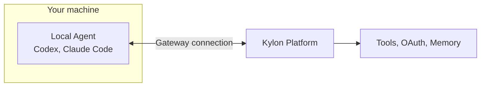

# kylon.io

## Fetch log
- Inbox URL: https://kylon.io/
- Final URL: https://kylon.io/
- Fetched: 2026-10-30
- Pages: 18
- Mode: standard
- Companion GitHub: none discovered (no repo-root github.com URL in landing hero/llms.txt)

## llms.txt — https://kylon.io/llms.txt
# Kylon

> Kylon is a company harness: one workspace where a team and its AI agents run the business together. Agents join as workspace members with their own memory, permissions and connected tools, take assignments in Rooms and threads, build Apps, run Automations, and hand finished work back to people for approval. Built by Pure Reason.

Key facts:

- Agents are members of the workspace. People mention them in Rooms and threads, and they keep memory across tasks.
- Teams can bring the agents they already use (Claude Code, Codex, Devin) into the same workspace: [Bring your own agent](https://kylon.io/bring-your-own-agent).
- Agents work with 3,000+ tools through connected accounts, and build Apps (databases, CRMs, dashboards) the team uses: [Integrations](https://kylon.io/integrations), [Apps](https://kylon.io/apps).
- Outbound actions such as emails and posts can be prepared as drafts for a person to approve before they are sent.
- For current plans, credit allowances and trial terms, read [Pricing](https://kylon.io/pricing).
- Available on Web, macOS, iOS and Android, in English and Japanese.
- Developer documentation (CLI, connecting agents, proxy APIs): [docs.kylon.io](https://docs.kylon.io) and [docs llms.txt](https://docs.kylon.io/llms.txt).
- How-to guides and troubleshooting: [Help Center](https://kylon.io/help). [help/llms.txt](https://kylon.io/help/llms.txt) lists every article; [help/llms-full.txt](https://kylon.io/help/llms-full.txt) has their full text.

Every page has a Markdown version at the page URL plus `.md`, linked below. The homepages are `/index.md` and `/ja.md`. You can also request the HTML URL with `Accept: text/markdown`. Existing `/md` links redirect to the same Markdown version.

[sitemap.md](https://kylon.io/sitemap.md) is the same page list as a nested Markdown site map, with each page's type, last update and summary.

This file is generated from the same page list as the [sitemap](https://kylon.io/sitemap.xml) on every deploy, so it lists every indexable page on kylon.io.

## Product

- [Kylon home](https://kylon.io): Your first company harness: one workspace where your team and AI agents run the business together. ([markdown](https://kylon.io/index.md))
- [What is Kylon](https://kylon.io/what-is-kylon): Kylon by Pure Reason is a company harness: AI agents join your team as members, with their own memory and permissions, and execute real work. ([markdown](https://kylon.io/what-is-kylon.md))
- [The company harness](https://kylon.io/product): What you see is a chat. Underneath, six layers make agents safe to put to work: identity, agent routing, connections, runtime, build and ship, and governance. ([markdown](https://kylon.io/product.md))
- [Workspace](https://kylon.io/product/workspace): Rooms, threads and files where people and agents work together. Room guidelines every agent follows, threads attached to the work, approvals for what leaves. ([markdown](https://kylon.io/product/workspace.md))
- [Agents](https://kylon.io/product/agents): Agent teammates with a name, a role, memory, skills and the access you choose. Mention one in a room and it works in the thread; emails become drafts you send. ([markdown](https://kylon.io/product/agents.md))
- [Access: RBAC, room permissions and agent visibility](https://kylon.io/product/access): People and agents go through the same access checks in Kylon. Rooms, agents, connections, skills and Apps each need an explicit grant, and agents start private. ([markdown](https://kylon.io/product/access.md))
- [Draft-first approvals](https://kylon.io/product/approvals): Emails, X posts and LINE messages an agent sends through Kylon become drafts a person sends. Publishing an App, inviting members and other big steps wait on an... ([markdown](https://kylon.io/product/approvals.md))
- [Agent memory](https://kylon.io/product/memory): Kylon agents keep typed memory entries, scoped to the rooms and people they apply to, and re-check each entry on a schedule so old facts do not linger. ([markdown](https://kylon.io/product/memory.md))
- [Secret vault and credential injection](https://kylon.io/product/credentials): Tokens and API keys are stored encrypted and applied when a tool or command runs, so agents use real accounts without keys being pasted into the chat. ([markdown](https://kylon.io/product/credentials.md))
- [Model routing](https://kylon.io/product/models): Kylon-hosted agents reach Claude, GPT, Gemini and open models through one gateway. Intelligence levels map to current models, with failover and prompt caching. ([markdown](https://kylon.io/product/models.md))
- [Sandboxed runtimes](https://kylon.io/product/sandbox): Each Kylon-hosted agent works in its own cloud computer, and every command runs in a locked-down sandbox limited to what the current request may read. ([markdown](https://kylon.io/product/sandbox.md))
- [Build and ship](https://kylon.io/product/build-and-ship): Agents build Apps on drafts, each with a private preview and its own copy of the data. A person publishes it, to the room, the workspace or the web. ([markdown](https://kylon.io/product/build-and-ship.md))
- [Automations](https://kylon.io/product/workflows): Recurring work on a schedule or a trigger. Ask the room's agent to set one up; it saves the steps you approved and keeps a record of every run. ([markdown](https://kylon.io/product/workflows.md))
- [Run history](https://kylon.io/product/run-history): Every agent turn that uses tools leaves a trace you can open, every Automation keeps its runs, and cards in the thread show who approved what. ([markdown](https://kylon.io/product/run-history.md))
- [Usage metering](https://kylon.io/product/usage): Model and tool calls are metered in credits and broken down by room, agent, person and Automation, with budgets for Automations and caps for scripts. ([markdown](https://kylon.io/product/usage.md))
- [Data scoping](https://kylon.io/product/data-scoping): Each Kylon App keeps its own database, uses only the connections granted to it, and checks every viewer on the server. ([markdown](https://kylon.io/product/data-scoping.md))
- [Tools](https://kylon.io/product/tools): Ready-to-use data and tools for your agents: Kylon's first-party API proxy, with capabilities from Apollo, Seedance, Ahrefs and Apify. ([markdown](https://kylon.io/product/tools.md))
- [Skills](https://kylon.io/product/skills): Skills are the repeatable know-how your agents reuse. Write down how your team does a job once, install it on the agents that need it, and every run follows... ([markdown](https://kylon.io/product/skills.md))
- [Company](https://kylon.io/company): Kylon is built and operated by Pure Reason: Pure Reason Inc. (Delaware, United States) and PURE REASON PTE. LTD. (Singapore). Offices, official accounts and... ([markdown](https://kylon.io/company.md))
- [Brand assets](https://kylon.io/brand): The Kylon logo, mark and App icon in SVG and PNG, colors, type, product images and how to write about Kylon. ([markdown](https://kylon.io/brand.md))
- [Kylon for iPad](https://kylon.io/ipad): The Kylon iPad app: the Timeline, Rooms and threads with agents, and agent profiles. Free on the App Store for iPadOS 15 or later. ([markdown](https://kylon.io/ipad.md))
- [Kylon Agent](https://kylon.io/bot): Kylon Agent, the identity AI agents in Kylon use on the web: how it signs requests with Web Bot Auth, where its public keys are published, and how site owners... ([markdown](https://kylon.io/bot.md))
- [Pricing](https://kylon.io/pricing) ([markdown](https://kylon.io/pricing.md))
- [Liam Ottley x Kylon](https://kylon.io/liam): A Kylon offer for Liam Ottley's audience: build an AI-native workspace for your business or client work. ([markdown](https://kylon.io/liam.md))
- [AI CRM guide](https://kylon.io/ai-crm): Every CRM has AI in it. The difference is whether the AI helps you fill the record in, or fills it in and asks you to approve. A guide to the category and the... ([markdown](https://kylon.io/ai-crm.md))
- [AI OS guide](https://kylon.io/ai-os): What an AI operating system is, the seven layers it is made of, a live example, and how to build one for your company or your clients on Kylon. ([markdown](https://kylon.io/ai-os.md))
- [How to build an AI OS for your business](https://kylon.io/ai-os/how-to-build): A practical guide to building a business AI operating system: pick the first job, write the context, connect data, add Agents and approvals, then automate. ([markdown](https://kylon.io/ai-os/how-to-build.md))
- [Claude Code AI OS for teams](https://kylon.io/ai-os/claude-code): Turn a Claude Code AI OS into one your team can use: keep your CLAUDE.md, skills and tools, add Rooms, permissions and approvals, and run it next to Codex. ([markdown](https://kylon.io/ai-os/claude-code.md))
- [What is an agentic operating system?](https://kylon.io/ai-os/agentic-operating-system): An agentic operating system runs a business's work across people and AI agents. How it differs from a computer OS and the AIOS research project, and its parts. ([markdown](https://kylon.io/ai-os/agentic-operating-system.md))
- [AI OS vs second brain: what is the difference?](https://kylon.io/ai-os/second-brain): A second brain stores one person's knowledge. An AI OS adds agents that act, live business data, a shared workspace and approvals. When you need which. ([markdown](https://kylon.io/ai-os/second-brain.md))
- [AI OS examples: what it runs in real teams](https://kylon.io/ai-os/examples): Six AI OS examples for accounting firms, property managers, recruiters, sales teams, agencies and internal tools: the jobs Agents run and what people approve. ([markdown](https://kylon.io/ai-os/examples.md))

## Solutions

- [Solutions](https://kylon.io/solutions): One page per job an agent takes off your desk, from meeting follow-up to outreach and creator tracking, and where a person reviews the result. ([markdown](https://kylon.io/solutions.md))
- [AI employee that does the work, not just the answer](https://kylon.io/solutions/ai-employee): Kylon agents join your rooms with their own memory and scoped permissions, do the repetitive part across the tools you already use, and hand the finished work... ([markdown](https://kylon.io/solutions/ai-employee.md))
- [AI workspace where agents and your team share one context](https://kylon.io/solutions/ai-workspace): One workspace for your company's work, with AI agents in it as team members. Shared context, structured data, scoped permissions, and an execution trail you... ([markdown](https://kylon.io/solutions/ai-workspace.md))
- [Turn your meeting notes into finished work](https://kylon.io/solutions/ai-meeting-notes): Kylon is not another notetaker. It reads the notes yours already wrote and drafts the next step across CRM, tasks and follow-up, then hands it back for review. ([markdown](https://kylon.io/solutions/ai-meeting-notes.md))
- [Kylon for Fathom users: turn your recordings into finished work](https://kylon.io/solutions/fathom): Fathom captures the meeting. Kylon takes the summary and does the next step, updates the CRM, opens the tasks, drafts the follow-up, then hands it back for... ([markdown](https://kylon.io/solutions/fathom.md))
- [Kylon for Granola users: turn your notes into finished work](https://kylon.io/solutions/granola): Granola takes the notes. Kylon reads them and does the next step across your CRM, tasks and docs, then hands the result back for review. ([markdown](https://kylon.io/solutions/granola.md))
- [Kylon for tl;dv users: turn your recordings into finished work](https://kylon.io/solutions/tldv): We run our own meetings on tl;dv. Kylon reads the transcript and does the next step across CRM, tasks and follow-ups, then hands it back for review. ([markdown](https://kylon.io/solutions/tldv.md))
- [Influencer CRM for brands and agencies](https://kylon.io/solutions/influencer-crm): One roster for every creator, a price judged against the median of their last ten posts instead of their follower count, outreach from your own domain, and... ([markdown](https://kylon.io/solutions/influencer-crm.md))
- [AI SDR that finds the buying signal and sends the email](https://kylon.io/solutions/signal-based-outreach): An AI SDR that does its own research. Kylon finds what changed at an account, works out who owns that decision, writes the first email with the reason and the... ([markdown](https://kylon.io/solutions/signal-based-outreach.md))
- [AI workflow automation that reads the case first](https://kylon.io/solutions/ai-workflow-automation): Rules run the same steps every time. A Kylon agent reads the case, drafts the change with its evidence, waits for approval, then runs the same work again on a... ([markdown](https://kylon.io/solutions/ai-workflow-automation.md))
- [AI Agent Governance: Identity, Access and Human Review](https://kylon.io/solutions/ai-agent-governance): Who the agent is, which account it acts through, what it can reach, and which actions wait for a person. How permissions and approval work in Kylon. ([markdown](https://kylon.io/solutions/ai-agent-governance.md))
- [CRM Workflow Automation: Records, Follow-ups and Review](https://kylon.io/solutions/crm-workflow-automation): CRM workflow automation that reads the case first. The agent prepares the record change and the follow-up with its evidence, and nothing is written or sent... ([markdown](https://kylon.io/solutions/crm-workflow-automation.md))
- [Team Email Collaboration With AI Agents](https://kylon.io/solutions/email-collaboration): Customer and vendor email, worked on together. The agent reads the thread and the account, drafts the reply in the room your team uses, and a person sends it. ([markdown](https://kylon.io/solutions/email-collaboration.md))
- [AI agents for TikTok Shop brands and agencies](https://kylon.io/solutions/tiktok-shop): For brand teams and agencies selling on TikTok Shop. Agents find creators, track samples, read what's selling and rank the videos that sell. Your team approves... ([markdown](https://kylon.io/solutions/tiktok-shop.md))

## App templates

- [Apps gallery](https://kylon.io/apps): Working Apps you can look inside before you build: sales CRMs, a creator CRM and a sampling desk, each with the instruction that builds it. Each template page... ([markdown](https://kylon.io/apps.md))
- [Sales CRM App template: leads, accounts, pipeline](https://kylon.io/apps/crm): A general sales CRM App template: leads with their own status and rating, one click conversion into account, contact and opportunity, a six stage pipeline, a... ([markdown](https://kylon.io/apps/crm.md))
- [Creator CRM template: price influencers on evidence](https://kylon.io/apps/creator-crm): An influencer CRM App template that prices creators against the median of their last ten posts, tracks outreach from your own inbox, and follows campaign links... ([markdown](https://kylon.io/apps/creator-crm.md))
- [TikTok Shop sampling desk template: chase the samples that never posted](https://kylon.io/apps/sampling-desk): An App template for product seeding: samples, delivery dates and a work queue of creators who are past the posting window and still silent, biggest seller... ([markdown](https://kylon.io/apps/sampling-desk.md))
- [Remodeling CRM template: lead to paid design fee on one board](https://kylon.io/apps/remodeling-crm): An App template for residential renovation and construction sales: qualification, consultations, estimates, drawings and the Design and Discovery fee on one... ([markdown](https://kylon.io/apps/remodeling-crm.md))
- [Internal recruiting App template: jobs, interviews, offers and onboarding](https://kylon.io/apps/hiring): An App template for in-house HR hiring: jobs and openings, applications by stage, interviews with scorecards, offer approvals and the onboarding handover, with... ([markdown](https://kylon.io/apps/hiring.md))
- [Travel agency App template: enquiries, supplier quotes, proposals and bookings](https://kylon.io/apps/travel-desk): An App template for a travel agency trip desk: enquiries with the brief in fields, supplier quotes per trip, versioned proposals with an approver, bookings... ([markdown](https://kylon.io/apps/travel-desk.md))
- [Task Map App template: an Eisenhower matrix for goals and tasks](https://kylon.io/apps/task-map): An App template that puts every goal and one-off task on a drag-to-reclassify Eisenhower matrix, shows whose court the ball is in, and opens the same work as a... ([markdown](https://kylon.io/apps/task-map.md))

## Bring your own agent

- [Bring your own agent](https://kylon.io/bring-your-own-agent): Connect the agent you already run, such as Codex or Claude Code, to a Kylon workspace so the team can message it, assign work and approve results. ([markdown](https://kylon.io/bring-your-own-agent.md))
- [Claude Code for teams | Bring your own agent to Kylon](https://kylon.io/bring-your-own-agent/claude-code): Give your whole team access to the Claude Code you already run. Message it from team chat, assign work and approve results in one room. ([markdown](https://kylon.io/bring-your-own-agent/claude-code.md))
- [Codex for Teams: Share It in Your Workspace](https://kylon.io/bring-your-own-agent/codex): Give your whole team access to the Codex you already run. It keeps your machine and model choice, and the team can message it and approve results. ([markdown](https://kylon.io/bring-your-own-agent/codex.md))
- [Devin for Teams: Bring Devin Into Your Workspace](https://kylon.io/bring-your-own-agent/devin): Connect Devin to your team workspace through Cognition's cloud API. Each session becomes a member your team can message, follow and approve. ([markdown](https://kylon.io/bring-your-own-agent/devin.md))

## Alternatives and comparisons

- [Alternatives and comparisons](https://kylon.io/alternatives): Comparisons with Slack, Microsoft Teams, Zapier, n8n, Dust and more. Every claim about the other tool links to its own documentation. ([markdown](https://kylon.io/alternatives.md))
- [Microsoft Teams alternative for teams that want work done](https://kylon.io/alternatives/microsoft-teams): Teams is where your company talks. Kylon is a workspace where people and AI agents talk and finish the work in the same place, with permissions and review... ([markdown](https://kylon.io/alternatives/microsoft-teams.md))
- [Slack alternative for teams that want the work finished](https://kylon.io/alternatives/slack): Slack is where the company talks. Kylon is a workspace where people and AI agents carry a request through to a finished, approved result in the same thread. ([markdown](https://kylon.io/alternatives/slack.md))
- [Microsoft Copilot alternative that runs the whole task](https://kylon.io/alternatives/microsoft-copilot): Copilot helps you write inside Office. Kylon agents take the task across your tools, do it, and hand the result back for review. ([markdown](https://kylon.io/alternatives/microsoft-copilot.md))
- [Zapier alternative for AI work that isn't a zap chain](https://kylon.io/alternatives/zapier): Zapier connects your apps step by step. Kylon puts agents in the workspace to do the work inside those apps and hand it back for review. ([markdown](https://kylon.io/alternatives/zapier.md))
- [Dust alternative where agents work in the room](https://kylon.io/alternatives/dust): Dust builds agents on your company knowledge and runs them in conversations. Kylon puts agents in the same rooms as your team, with the records and the... ([markdown](https://kylon.io/alternatives/dust.md))
- [Lindy AI alternative for teams that work in rooms](https://kylon.io/alternatives/lindy): Lindy gives a workspace one shared assistant, plus a private one per person. Kylon gives your team named agents that sit in the room with the thread, the... ([markdown](https://kylon.io/alternatives/lindy.md))
- [Gumloop alternative for teams that need the work finished](https://kylon.io/alternatives/gumloop): Gumloop is a builder you configure and chat with. Kylon puts the agent in the room where the work is already discussed, on the records it runs on, with the... ([markdown](https://kylon.io/alternatives/gumloop.md))
- [Relevance AI alternative for teams that work together](https://kylon.io/alternatives/relevance-ai): Relevance AI builds an AI workforce on a canvas. Kylon puts agents in the rooms your team already works in, on the records and the thread the work runs on. ([markdown](https://kylon.io/alternatives/relevance-ai.md))
- [n8n alternative for teams without a workflow builder](https://kylon.io/alternatives/n8n): n8n gives a builder a canvas, nodes and credentials. Kylon lets the person with the problem ask for the work in the room, with a person approving the result. ([markdown](https://kylon.io/alternatives/n8n.md))
- [Salesforce CRM alternative for teams tired of updating it](https://kylon.io/alternatives/salesforce): Salesforce is configured by an admin and kept current by reps. Kylon is asked for the work in the room, reads the thread and the connected tools, and hands... ([markdown](https://kylon.io/alternatives/salesforce.md))
- [HubSpot CRM alternative for teams that stopped updating it](https://kylon.io/alternatives/hubspot): HubSpot runs on workflows someone configures in the editor. Kylon runs on what you ask for in the room, reads the thread and the connected tools, and returns... ([markdown](https://kylon.io/alternatives/hubspot.md))
- [Zoho CRM alternative for teams that want it updated for them](https://kylon.io/alternatives/zoho): Zia suggests, enriches and flags, and a person still opens the record. Kylon reads the mailbox and the thread, writes the records, and waits for one approval... ([markdown](https://kylon.io/alternatives/zoho.md))
- [Pipedrive alternative for teams that stopped logging deals](https://kylon.io/alternatives/pipedrive): Pipedrive keeps the pipeline visible and asks a person to move it. Kylon reads the mailbox and the thread, writes the record, and waits for one approval in the... ([markdown](https://kylon.io/alternatives/pipedrive.md))
- [Attio alternative for work that lives outside the CRM](https://kylon.io/alternatives/attio): Attio proposes changes inside its own workspace and asks the person who prompted it. Kylon works in the room where the team already talks, and one approval... ([markdown](https://kylon.io/alternatives/attio.md))
- [Close CRM alternative for teams past the outbound sprint](https://kylon.io/alternatives/close): Close builds everything around the lead page and the call. Kylon reads the mailbox and the thread, writes the records, and waits for one approval in the room... ([markdown](https://kylon.io/alternatives/close.md))
- [Copper CRM alternative for teams living in Gmail](https://kylon.io/alternatives/copper): Copper puts the CRM beside Gmail and asks you to review what it suggests. Kylon reads the mailbox and the thread, writes the records, and waits for one... ([markdown](https://kylon.io/alternatives/copper.md))
- [Clay alternative for the work after the research](https://kylon.io/alternatives/clay): Clay researches accounts in tables and writes the result back to your CRM. Kylon sits in the room with the team, reads the mailbox and the thread, and hands... ([markdown](https://kylon.io/alternatives/clay.md))
- [GoHighLevel alternative for running the whole business](https://kylon.io/alternatives/gohighlevel): GoHighLevel runs client sub-accounts, funnels and campaigns from a builder somebody configures. Kylon runs on what you ask for in the room, reads the thread... ([markdown](https://kylon.io/alternatives/gohighlevel.md))
- [Make alternative for work that does not fit a scenario](https://kylon.io/alternatives/make): Make is a scenario builder, and the agent lives inside one of its modules. Kylon puts the agent in the room where the work is already discussed, on the records... ([markdown](https://kylon.io/alternatives/make.md))
- [Dify alternative for teams who will not be building an app](https://kylon.io/alternatives/dify): Dify is a platform for building and publishing AI applications. Kylon is where the work happens: agents sit in the team's rooms, read the thread and the... ([markdown](https://kylon.io/alternatives/dify.md))
- [Relay.app alternative for work that starts as a question](https://kylon.io/alternatives/relay): Relay.app runs a workflow you build in advance and pauses it for an approval. Kylon starts from the request itself, in the room where the work is discussed... ([markdown](https://kylon.io/alternatives/relay.md))
- [monday.com alternative: agents in the conversation, not on the board](https://kylon.io/alternatives/monday): monday.com now sells the same idea we do: people and agents working as one team. The difference is where the agent lives. On monday it is built, scoped and... ([markdown](https://kylon.io/alternatives/monday.md))
- [Viktor alternative: a team of AI agents in one workspace](https://kylon.io/alternatives/viktor): Viktor is one AI employee your whole team shares in Slack and Teams. Kylon is a workspace where several agents, each with its own role, memory and permissions... ([markdown](https://kylon.io/alternatives/viktor.md))
- [PromptQL alternative: a team of AI agents](https://kylon.io/alternatives/promptql): PromptQL gives a piece of work to a bot your teammates can talk to together. Kylon is a workspace where several agents, each with its own role, memory and... ([markdown](https://kylon.io/alternatives/promptql.md))
- [Sauna AI alternative: a team of AI agents](https://kylon.io/alternatives/sauna): Sauna is a proactive AI teammate that follows you across iMessage, Slack and email. Kylon is a workspace where several agents, each with its own role and... ([markdown](https://kylon.io/alternatives/sauna.md))
- [Moxt alternative: agents and people in the same room](https://kylon.io/alternatives/moxt): Moxt orchestrates specialist agents through long-running workflows. Kylon puts several agents in rooms with your people, where the request, the work and the... ([markdown](https://kylon.io/alternatives/moxt.md))
- [Raft alternative for business teams and AI agents](https://kylon.io/alternatives/raft): Raft is where builders and their coding agents work together in channels. Kylon is a workspace where business teams and several agents work in rooms, connected... ([markdown](https://kylon.io/alternatives/raft.md))
- [Teamily AI alternative: a workspace for your team](https://kylon.io/alternatives/teamily): Teamily AI is a messenger where people and agents chat, build and share in DMs, groups and a public feed. Kylon is a company workspace where several agents... ([markdown](https://kylon.io/alternatives/teamily.md))
- [Grok Bot alternative: AI agents your whole team works with](https://kylon.io/alternatives/grok-bot): Grok Bot gives you named Bots on a shared cloud computer, and Team Bots share one Bot around a role. Kylon is a workspace where people and several agents work... ([markdown](https://kylon.io/alternatives/grok-bot.md))
- [OpenAI dots alternative: agents that work in your team's rooms](https://kylon.io/alternatives/openai-dots): A dot is one always-on agent in ChatGPT that works for you, with its own cloud computer, and you can also reach it in Slack and Teams. Kylon is a workspace... ([markdown](https://kylon.io/alternatives/openai-dots.md))
- [Meta Muse alternative for work: AI agents in your team's rooms](https://kylon.io/alternatives/meta-muse): Muse is Meta's personal AI agent for email, bookings, shopping, budgets and fitness, on its own cloud computer. Kylon is a workspace where a team and several... ([markdown](https://kylon.io/alternatives/meta-muse.md))

## Integrations

- [Integrations](https://kylon.io/integrations): Connect your CRM, email, analytics and 3,000+ tools. Agents pull data, send updates and run workflows across them. ([markdown](https://kylon.io/integrations.md))
- [Apollo + Kylon: Your AI-Powered Revenue Engine](https://kylon.io/integrations/apollo): Your Kylon agent looks up any person or company, LinkedIn profiles, emails, job titles and org charts, just by asking. No Apollo account, no API key, no... ([markdown](https://kylon.io/integrations/apollo.md))
- [Give Your Content a Voice: Kylon's ElevenLabs Integration](https://kylon.io/integrations/elevenlabs): Turn any document into natural-sounding audio. Clone a voice. Dub a video into 29 languages. Your Kylon agent handles all of it, with no ElevenLabs... ([markdown](https://kylon.io/integrations/elevenlabs.md))
- [Scrape Any Website From Chat: Kylon's Built-in Apify Integration](https://kylon.io/integrations/apify): Need competitor pricing? Product listings? Social profiles? Your Kylon agent runs Apify actors behind the scenes, you just describe what you need. ([markdown](https://kylon.io/integrations/apify.md))
- [Design On Demand: How Kylon Agents Create Brand-Consistent Images with GPT-Image-2](https://kylon.io/integrations/gpt-image2): Need a blog cover, ad creative, or product mockup? Your Kylon agent generates it with GPT-Image-2 and automatically applies your brand colors, fonts, and... ([markdown](https://kylon.io/integrations/gpt-image2.md))
- [Generate Marketing Videos in Chat: Kylon × Seedance 2.0](https://kylon.io/integrations/seedance): Type a prompt, get a professional short video. Seedance 2.0 runs natively on Kylon, text-to-video, image-guided video, style transfer, and background music. ([markdown](https://kylon.io/integrations/seedance.md))
- [How Kylon + Bright Data turns public web data into usable research](https://kylon.io/integrations/bright-data-web-data): Search public websites, extract structured records, capture screenshots, and work through difficult pages from a Kylon room. Bright Data runs behind your... ([markdown](https://kylon.io/integrations/bright-data-web-data.md))
- [How Kylon + Social Scraper turns public social activity into research](https://kylon.io/integrations/social-scraper-public-social-data): Review public TikTok, Instagram, X, and LinkedIn activity from one Kylon conversation. Pull profiles, posts, comments, video details, and transcripts without... ([markdown](https://kylon.io/integrations/social-scraper-public-social-data.md))
- [How Kylon + FastMoss finds TikTok commerce opportunities](https://kylon.io/integrations/fastmoss-tiktok-commerce-analytics): Use FastMoss through Kylon to research TikTok creators, shops, products, videos, and livestreams. Find rankings, promoted products, and commercial patterns... ([markdown](https://kylon.io/integrations/fastmoss-tiktok-commerce-analytics.md))
- [How Kylon + Kalodata makes TikTok Shop research actionable](https://kylon.io/integrations/kalodata-tiktok-shop-intelligence): Research TikTok Shop categories, shops, products, videos, and livestream sales data directly from Kylon. Kalodata helps teams turn a fast-moving commerce feed... ([markdown](https://kylon.io/integrations/kalodata-tiktok-shop-intelligence.md))
- [How Kylon + Google Trends turns search demand into planning signals](https://kylon.io/integrations/google-trends-search-demand): Use Google Trends in Kylon to compare search interest, regional demand, related queries, and current trends. Move from an idea to evidence before choosing... ([markdown](https://kylon.io/integrations/google-trends-search-demand.md))
- [How Kylon + Exa finds and verifies company and person context](https://kylon.io/integrations/exa-company-person-enrichment): Use Exa in Kylon for AI-powered company and person enrichment with sources and confidence labels. Find relevant public context by meaning, not only by exact... ([markdown](https://kylon.io/integrations/exa-company-person-enrichment.md))
- [How Kylon + GoPlaces answers location questions with map data](https://kylon.io/integrations/goplaces-location-research): Find places, compare nearby options, calculate routes, resolve addresses, and retrieve place details through Kylon. GoPlaces brings Google Maps-based location... ([markdown](https://kylon.io/integrations/goplaces-location-research.md))
- [Gmail + Kylon: Your AI agent for the inbox](https://kylon.io/integrations/gmail): Connect your own Gmail account and an agent reads the thread, tells you which mail actually needs you, and writes the reply as a draft in the same thread. The... ([markdown](https://kylon.io/integrations/gmail.md))
- [Slack + Kylon: Your AI agent for what was decided](https://kylon.io/integrations/slack): Connect your own Slack account and an agent searches the channels, reads around the message, and tells you what was decided, who decided it and where to find... ([markdown](https://kylon.io/integrations/slack.md))
- [Notion + Kylon: Your AI agent for the pages nobody updates](https://kylon.io/integrations/notion): Connect your own Notion workspace and an agent reads the database, writes the page from what actually happened, and holds every change until you approve it. ([markdown](https://kylon.io/integrations/notion.md))
- [HubSpot + Kylon: Your AI agent for the deals that went quiet](https://kylon.io/integrations/hubspot): Connect your own HubSpot account and an agent reads the pipeline and the activity behind it, says which deals went quiet and what each record is missing, then... ([markdown](https://kylon.io/integrations/hubspot.md))
- [GoHighLevel + Kylon: Your team and its agents on one pipeline](https://kylon.io/integrations/gohighlevel): Connect your GoHighLevel sub-account to a Kylon room. Your team and its agents work from the same contacts, conversations, calendars and opportunities, and... ([markdown](https://kylon.io/integrations/gohighlevel.md))

## Use cases

- [Use cases](https://kylon.io/use-cases): Kylon use cases by scenario, industry and integration. ([markdown](https://kylon.io/use-cases.md))
- [How a US Hospitality Firm Built an AI Sales Pipeline with Kylon](https://kylon.io/use-cases/ai-sales-pipeline): A US-based hospitality company used Kylon to automate 1,000-contact outreach, AI reply scoring, and lead routing. ([markdown](https://kylon.io/use-cases/ai-sales-pipeline.md))
- [How an AI Startup Automated Talent Sourcing with Kylon](https://kylon.io/use-cases/talent-sourcing): A growing AI startup built a recruiting system where agents parse resumes, score candidates against open roles, and manage outreach, all from one room with a... ([markdown](https://kylon.io/use-cases/talent-sourcing.md))
- [How a Fintech Team Built a 24/7 Market Intelligence System](https://kylon.io/use-cases/market-intelligence): A fintech team used Kylon agents to monitor market signals around the clock, compile daily intelligence, and turn research into a shared operating rhythm. ([markdown](https://kylon.io/use-cases/market-intelligence.md))
- [How a Team Built Two Internal Apps in a Week (Without a Developer)](https://kylon.io/use-cases/internal-apps): A media tech company built two AI-powered internal apps: a content tracker and an invoice processing system. Built-in AI handles OCR, image generation, and... ([markdown](https://kylon.io/use-cases/internal-apps.md))
- [From Code to Content: How a Marketing Team Turns Every Product Update into a Campaign](https://kylon.io/use-cases/code-to-content): A product marketing team connected their GitHub repo to Kylon. Every code change becomes a marketing opportunity: auto-summarized changelogs, generated... ([markdown](https://kylon.io/use-cases/code-to-content.md))
- [Scaling Influencer Outreach to 500+ Creators](https://kylon.io/use-cases/influencer-outreach): A DTC brand's partnership team used Kylon agents, workflows, and a Database App to research creators, enrich contact data, personalize outreach, and manage... ([markdown](https://kylon.io/use-cases/influencer-outreach.md))
- [Research & Lab Operations](https://kylon.io/use-cases/research): Track research, organize evidence, and turn one researcher’s setup into a shared knowledge system. ([markdown](https://kylon.io/use-cases/research.md))
- [How a Marketing Team Built a Content Operating System](https://kylon.io/use-cases/content-operating-system): A shared workspace for briefs, source material, brand assets, review notes, publishing decisions, and the work that follows. ([markdown](https://kylon.io/use-cases/content-operating-system.md))
- [How a Sales Team Turned Email Into a Managed Pipeline](https://kylon.io/use-cases/sales-email-managed-pipeline): Bring account context, conversations, documents, next actions, and human-reviewed follow-up into one sales system. ([markdown](https://kylon.io/use-cases/sales-email-managed-pipeline.md))
- [How a Team Ran Partner CRM and Co-Selling in One Workspace](https://kylon.io/use-cases/partner-crm-co-selling): A working system for partner contacts, shared opportunities, joint plans, documents, and human-reviewed communication. ([markdown](https://kylon.io/use-cases/partner-crm-co-selling.md))
- [How a Team Managed Quotes, Renewals, and Silent Opportunities](https://kylon.io/use-cases/quotes-renewals-silent-opportunities): Keep commercial commitments visible by connecting key dates, account history, documents, owners, and reviewable follow-up. ([markdown](https://kylon.io/use-cases/quotes-renewals-silent-opportunities.md))
- [How Shift Teams Kept the Full Story Intact at Handover](https://kylon.io/use-cases/shift-handovers): Turn frontline notes, email updates, documents, and operational records into a handover system the next person can run. ([markdown](https://kylon.io/use-cases/shift-handovers.md))
- [How a Team Built a Living Onboarding and Knowledge System](https://kylon.io/use-cases/living-onboarding-knowledge-system): Connect role processes, training material, current projects, internal apps, and everyday questions in a shared workspace that improves with use. ([markdown](https://kylon.io/use-cases/living-onboarding-knowledge-system.md))
- [How a Team Turned Customer Feedback Into a Product Loop](https://kylon.io/use-cases/customer-feedback-product-loop): Connect customer conversations, support email, call notes, evidence, product decisions, and follow-up in one shared system. ([markdown](https://kylon.io/use-cases/customer-feedback-product-loop.md))
- [How a Product Team Moved From Discussion to a Delivery Plan](https://kylon.io/use-cases/discussion-to-requirements-delivery-plan): Turn discussions, meeting conclusions, email, and documents into reviewable requirements, decisions, dependencies, and a working delivery plan. ([markdown](https://kylon.io/use-cases/discussion-to-requirements-delivery-plan.md))
- [How a Team Ran an Operating Rhythm and Project War Room](https://kylon.io/use-cases/operating-rhythm-project-war-room): Keep goals, updates, blockers, decisions, source documents, and externally reviewed communication in one active project system. ([markdown](https://kylon.io/use-cases/operating-rhythm-project-war-room.md))
- [Accounting Firms: Turning Client Follow-Up Back Into Billable Capacity](https://kylon.io/use-cases/accounting-firm-operations): Document chasing, status tracking and re-keying between systems is where an accounting firm's week goes. This is how that coordination layer runs inside one... ([markdown](https://kylon.io/use-cases/accounting-firm-operations.md))
- [Travel Agencies: From Custom Trip Enquiry to a Priced Proposal the Same Day](https://kylon.io/use-cases/travel-agency-operations): Custom trips now arrive faster than an advisor can price them. This is how enquiry intake, supplier email and proposal drafting run in one Kylon room, with the... ([markdown](https://kylon.io/use-cases/travel-agency-operations.md))
- [Property Management: Every Maintenance Request Answered, Dispatched and Tracked to Close](https://kylon.io/use-cases/property-management-operations): Maintenance is the reason owners hire a manager and the reason they leave one. This is how request intake, vendor dispatch, resident updates and the owner... ([markdown](https://kylon.io/use-cases/property-management-operations.md))
- [Investment Firms and Family Offices: Every Deal, Request and Report on One Record](https://kylon.io/use-cases/investment-firm-operations): Intros, diligence lists, portfolio updates and the quarterly letter to principals run through a few people and their inboxes. This is how that work runs in... ([markdown](https://kylon.io/use-cases/investment-firm-operations.md))
- [Recruiting Firms: Less Admin Between the Job Order and the Placement](https://kylon.io/use-cases/recruiting-firm-operations): Job orders are coming back, and the admin around each search grows with them. This is how intake, screening, submittals, interview scheduling and client... ([markdown](https://kylon.io/use-cases/recruiting-firm-operations.md))
- [Hospitality & travel](https://kylon.io/use-cases/topics/hospitality-travel): Reservations, arrangements, customer requests, and multi-party coordination. ([markdown](https://kylon.io/use-cases/topics/hospitality-travel.md))
- [Real estate](https://kylon.io/use-cases/topics/real-estate): Property inquiries, listing operations, and document-heavy customer workflows. ([markdown](https://kylon.io/use-cases/topics/real-estate.md))
- [Care services](https://kylon.io/use-cases/topics/care-services): Daily records, handovers, plans, and billing preparation for capacity-constrained teams. ([markdown](https://kylon.io/use-cases/topics/care-services.md))
- [Financial services](https://kylon.io/use-cases/topics/financial-services): Market research, operating briefs, and decision support. ([markdown](https://kylon.io/use-cases/topics/financial-services.md))
- [Email operations](https://kylon.io/use-cases/topics/email-operations): Classify incoming mail, capture context, assign ownership, and prepare the next response. ([markdown](https://kylon.io/use-cases/topics/email-operations.md))
- [Internal tools](https://kylon.io/use-cases/topics/internal-tools): Build shared systems with records, statuses, workflows, and team-facing interfaces. ([markdown](https://kylon.io/use-cases/topics/internal-tools.md))
- [Outreach & pipelines](https://kylon.io/use-cases/topics/outreach-pipelines): Research contacts, send tailored outreach, and keep follow-up work visible. ([markdown](https://kylon.io/use-cases/topics/outreach-pipelines.md))
- [Content production](https://kylon.io/use-cases/topics/content-production): Turn source material into campaigns, articles, images, and video concepts that a team can review. ([markdown](https://kylon.io/use-cases/topics/content-production.md))
- [Research & intelligence](https://kylon.io/use-cases/topics/research-intelligence): Monitor signals, organize evidence, and produce decision-ready briefs. ([markdown](https://kylon.io/use-cases/topics/research-intelligence.md))
- [Talent operations](https://kylon.io/use-cases/topics/talent-operations): Source candidates, coordinate recruiting email, and maintain a hiring system the team can share. ([markdown](https://kylon.io/use-cases/topics/talent-operations.md))

## Blog topics

- [AI workspace architecture](https://kylon.io/blog/topics/ai-workspace-architecture): What makes an AI-native workspace different from a chat tool or a productivity app: activation, execution, and how work actually gets done. ([markdown](https://kylon.io/blog/topics/ai-workspace-architecture.md))
- [Comparisons & alternatives](https://kylon.io/blog/topics/comparisons): How Kylon differs from other AI tools and agents, architecture, not feature checklists. ([markdown](https://kylon.io/blog/topics/comparisons.md))
- [E-commerce AI tools](https://kylon.io/blog/topics/ecommerce-ai): E-commerce AI tools and agents for sourcing, store operations, listings, customer support, marketing, merchandising, and the shared workflows that connect them. ([markdown](https://kylon.io/blog/topics/ecommerce-ai.md))
- [Agent memory & context](https://kylon.io/blog/topics/agent-memory): How agents remember: context folding, continuity, and state that survives beyond a single conversation. ([markdown](https://kylon.io/blog/topics/agent-memory.md))
- [Privacy & trust](https://kylon.io/blog/topics/privacy-and-trust): Data boundaries, permissions, and security when agents can read, remember, and act across your work. ([markdown](https://kylon.io/blog/topics/privacy-and-trust.md))
- [Integrations & connections](https://kylon.io/blog/topics/integrations): How Kylon works with the tools you already use, enrichment, scraping, voice, image, video, through real connections, not screenshots. ([markdown](https://kylon.io/blog/topics/integrations.md))
- [AI tools & pricing guides](https://kylon.io/blog/topics/ai-tools-pricing): Pricing breakdowns, feature walkthroughs, and practical guides for the most popular AI tools: ChatGPT, Claude, Gemini, Grok, Perplexity, and more. ([markdown](https://kylon.io/blog/topics/ai-tools-pricing.md))
- [AI for business](https://kylon.io/blog/topics/ai-business-adoption): How teams adopt AI agents for real work: CRM, people search, internal tools, customer support, and operational workflows. ([markdown](https://kylon.io/blog/topics/ai-business-adoption.md))
- [AI coding & development](https://kylon.io/blog/topics/ai-coding-tools): AI-powered coding tools compared: Claude Code, Codex CLI, Cursor, and the emerging landscape of AI-assisted development. ([markdown](https://kylon.io/blog/topics/ai-coding-tools.md))

## Blog

- [Blog](https://kylon.io/blog): How AI-native workspaces work, how agent memory lasts, how privacy holds when agents act, and how Kylon compares. ([markdown](https://kylon.io/blog.md))
- [The AI-native tax](https://kylon.io/blog/the-ai-native-tax): The hidden cost of putting AI to work, and who ends up paying it. ([markdown](https://kylon.io/blog/the-ai-native-tax.md))
- [Agent governance for teams: start with the boundaries a prompt can't move](https://kylon.io/blog/agent-governance-hard-boundaries): A customer running department and workflow agents asked what happens if someone jailbreaks one. The answer depends on where the rules live. The four boundaries... ([markdown](https://kylon.io/blog/agent-governance-hard-boundaries.md))
- [Kylon + Missive: Six Use Cases for Teams That Run on Email](https://kylon.io/blog/kylon-missive-integration): Missive is where your team answers customers together. Connect it to Kylon and an agent reads the conversation, checks the records behind it, and leaves a... ([markdown](https://kylon.io/blog/kylon-missive-integration.md))
- [Stop Rebuilding an AI OS for Every Client](https://kylon.io/blog/aios-infrastructure): For AI agencies building client AI operating systems with Claude Code: keep your best skills and workflows, and use Kylon as the foundation for repeatable... ([markdown](https://kylon.io/blog/aios-infrastructure.md))
- [What is an AI CRM? Three questions that tell you](https://kylon.io/blog/what-is-an-ai-crm): Every CRM has AI in it now. The useful test is who enters the data, who reads across the tools, and who signs off on a change. An AI CRM answers all three. ([markdown](https://kylon.io/blog/what-is-an-ai-crm.md))
- [Muse, dots, Grok Bot, Viktor and Claude Tag in Slack: what changes for a team](https://kylon.io/blog/ai-agents-in-slack): Personal assistants like Muse, dots and Grok Bot answer to one owner. Shared AI teammates like Viktor and Claude Tag work for a whole channel. Here is how each... ([markdown](https://kylon.io/blog/ai-agents-in-slack.md))
- [Better together: how Kylon connects your agents and your tools](https://kylon.io/blog/how-kylon-connects-agents-and-tools): Our launch post names a few hundred agents and tools in one sentence. Here are the four ways each of them connects to Kylon, and what happens when they meet in... ([markdown](https://kylon.io/blog/how-kylon-connects-agents-and-tools.md))
- [Run a Kylon agent on your ChatGPT subscription](https://kylon.io/blog/use-your-chatgpt-subscription): Sign in with your ChatGPT account and Kylon hosts an agent for your team. Its work runs on the ChatGPT plan you already pay for, uses no Kylon credits, and... ([markdown](https://kylon.io/blog/use-your-chatgpt-subscription.md))
- [Design the App Before You Build It: One Spec, a Design Page and a Working App](https://kylon.io/blog/design-an-app-before-you-build-it): Asking an agent to build a recruiting system gets you its guess. We ask for a design page first: the business flow, the tables, every field, where each field... ([markdown](https://kylon.io/blog/design-an-app-before-you-build-it.md))
- [Slack alternatives with AI agents: What Kylon rebuilds](https://kylon.io/blog/slack-alternatives-ai-agents): Looking for an AI Slack alternative? The useful question is not which chat app has AI. It is what changes when agents become part of the team. ([markdown](https://kylon.io/blog/slack-alternatives-ai-agents.md))
- [Grok Team Bots vs. Kylon: two ways to share AI teammates](https://kylon.io/blog/kylon-vs-grok-bot): xAI launched Team Bots on September 28: shared Grok Bots built around a team role, with shared skills and private conversations for each person. Here is how... ([markdown](https://kylon.io/blog/kylon-vs-grok-bot.md))
- [AI Agents Were Built for One Person. We Built Kylon for Teams.](https://kylon.io/blog/ai-agents-built-for-teams): The technical challenges behind building a business harness for people and agents to work together, and why a team can start without touching any of them. ([markdown](https://kylon.io/blog/ai-agents-built-for-teams.md))
- [7 Best Claude Cowork Alternatives for Teams in 2026](https://kylon.io/blog/claude-cowork-alternatives): Claude Cowork hands one person's multi-step knowledge work to Claude. If the work belongs to a team, these seven tools take a different approach to where... ([markdown](https://kylon.io/blog/claude-cowork-alternatives.md))
- [7 Best Glean Alternatives for Teams in 2026](https://kylon.io/blog/glean-alternatives): Glean connects company knowledge so employees can find answers and run agents. These seven alternatives range from cited search to agents that finish the work... ([markdown](https://kylon.io/blog/glean-alternatives.md))
- [Kylon + Plaud: Six Use Cases for the Meetings That Happen in Person](https://kylon.io/blog/kylon-plaud-integration): Online calls get a notetaker bot. Site visits, client lunches and workshops get Plaud. Here are six ways to turn a Plaud recording from a meeting with no link... ([markdown](https://kylon.io/blog/kylon-plaud-integration.md))
- [7 Best Manus Alternatives for Teams in 2026](https://kylon.io/blog/manus-alternatives): Manus runs multi-step work on its own cloud computer and hands back finished deliverables. These seven alternatives differ on where the agent runs, how... ([markdown](https://kylon.io/blog/manus-alternatives.md))
- [7 Best Notion AI Alternatives for Teams in 2026](https://kylon.io/blog/notion-ai-alternatives): Notion AI works inside your pages and databases. These seven alternatives take AI into project tools, docs, wikis and shared workspaces where agents do the... ([markdown](https://kylon.io/blog/notion-ai-alternatives.md))
- [AI agent orchestration for teams: agents as members of the room](https://kylon.io/blog/ai-agent-orchestration-for-teams): AI agent orchestration usually lives in code one developer maintains. Here is what it looks like when the agents are members of the room your team already... ([markdown](https://kylon.io/blog/ai-agent-orchestration-for-teams.md))
- [How to Spot Fake YouTube Views Before You Pay a Creator](https://kylon.io/blog/spot-fake-youtube-views-before-sponsoring): A sponsorship quote is priced on views, and views, likes and comments can all be bought. Here is how we check a YouTube channel's hourly data with vidIQ before... ([markdown](https://kylon.io/blog/spot-fake-youtube-views-before-sponsoring.md))
- [Plaud MCP: How to Connect Your Recordings to an AI Agent](https://kylon.io/blog/plaud-mcp): Plaud MCP lets any MCP-compatible client read your recordings, transcripts, and AI notes. Here is the actual tool surface, the fields each call returns, what... ([markdown](https://kylon.io/blog/plaud-mcp.md))
- [Your voice agent finished the call. What was it allowed to promise?](https://kylon.io/blog/what-ai-voice-agents-can-commit-to): Live voice models can now run tool calls while the customer is still talking. That moves the interesting decision from the transcript to the call itself: what... ([markdown](https://kylon.io/blog/what-ai-voice-agents-can-commit-to.md))
- [How Permissions Work in Kylon](https://kylon.io/blog/how-permissions-work-in-kylon): Who can see a conversation, what an agent knows, what updates an App, and who can use a connected account. The four layers that decide access in Kylon, with... ([markdown](https://kylon.io/blog/how-permissions-work-in-kylon.md))
- [Kylon vs. Genspark: A room-first workspace for human and agent teams](https://kylon.io/blog/kylon-vs-genspark): Genspark offers a broad suite for agent-led creation and business tasks. Kylon centers humans, agents, context, Apps, and workflows in shared Rooms where team... ([markdown](https://kylon.io/blog/kylon-vs-genspark.md))
- [Kylon vs. Manus: A shared workspace for humans and agents](https://kylon.io/blog/kylon-vs-manus): Manus gives an agent a task to execute. Kylon gives teams a shared workspace where people and agents build context, hand off work, and keep processes moving. ([markdown](https://kylon.io/blog/kylon-vs-manus.md))
- [Claude for Financial Advisors: how to run the same client meeting workflow on Kylon today](https://kylon.io/blog/claude-financial-advisors-sept-2026): Anthropic put connectors and workflow skills around the work advisors do before and after a client meeting. The pattern is portable. Here is how to build the... ([markdown](https://kylon.io/blog/claude-financial-advisors-sept-2026.md))
- [GPT Image 2.5 vs GPT-Image-2: our day one numbers from inside Kylon](https://kylon.io/blog/gpt-image-2-5-day-one): GPT Image 2.5 became the default image model for every Kylon agent on launch day. We then ran the same prompts through GPT-Image-2, 2.5 Flare, and 2.5 Sunburst... ([markdown](https://kylon.io/blog/gpt-image-2-5-day-one.md))
- [Google DeepMind launches AlphaGenome Atlas for large-scale genomic research](https://kylon.io/blog/alphagenome-atlas-launch-sept-2026): Google DeepMind has introduced AlphaGenome Atlas, a searchable database that predicts the molecular effects of every possible single-letter DNA change. Here is... ([markdown](https://kylon.io/blog/alphagenome-atlas-launch-sept-2026.md))
- [ChatGPT Images 2.5 launches with faster generation and more precise editing](https://kylon.io/blog/chatgpt-images-2-5-launch-sept-2026): OpenAI has released ChatGPT Images 2.5 with sharper detail, more reliable multi-turn editing, Sketch, templates, and new API models. Here is what changed, who... ([markdown](https://kylon.io/blog/chatgpt-images-2-5-launch-sept-2026.md))
- [GPT-6 Astra rolls out to ChatGPT Plus: what the $20 tier gets](https://kylon.io/blog/openai-gpt-6-astra-plus-rollout-sept-2026): OpenAI is expanding GPT-6 Astra to ChatGPT Plus in a phased rollout. Here is what changes for computer use, coding, research, availability, API pricing, and... ([markdown](https://kylon.io/blog/openai-gpt-6-astra-plus-rollout-sept-2026.md))
- [Anthropic makes computer use, Skills API, and Files API generally available](https://kylon.io/blog/claude-platform-agent-tools-ga-aug-20): Anthropic has made computer use, browser use, the Skills API, and the Files API generally available on the Claude Platform. The update turns a set of agent... ([markdown](https://kylon.io/blog/claude-platform-agent-tools-ga-aug-20.md))
- [OpenAI expands ChatGPT Ads to 31 European countries](https://kylon.io/blog/chatgpt-ads-europe-aug-19): OpenAI says ChatGPT Ads will expand to 31 European countries next week. Ads will appear only for Free and Go users, while Plus, Pro, and Enterprise... ([markdown](https://kylon.io/blog/chatgpt-ads-europe-aug-19.md))
- [Claude can now send Gmail replies, while Cowork expands to paid plans](https://kylon.io/blog/claude-gmail-cowork-aug-19): Anthropic has expanded Claude's Google Workspace connector so it can send, reply to, and forward Gmail messages, while Claude Cowork is available across web... ([markdown](https://kylon.io/blog/claude-gmail-cowork-aug-19.md))
- [Gemini in Chrome reaches Android users in the US with Auto Browse for subscribers](https://kylon.io/blog/gemini-chrome-android-aug-19): Google says Gemini in Chrome is now available to all Android users in the US. AI Pro and AI Ultra subscribers also get Auto Browse for selected multi-step web... ([markdown](https://kylon.io/blog/gemini-chrome-android-aug-19.md))
- [Kylon Bloom, a Codex Pet You Can Download](https://kylon.io/blog/kylon-bloom-codex-pet): Our mascot is now a Codex pet. Nine animation states: idle, walking, waving, jumping, failing, waiting on you, working, and reviewing. Download the zip, drop... ([markdown](https://kylon.io/blog/kylon-bloom-codex-pet.md))
- [Z.ai launches GLM-5.3 for coding and cyber defense](https://kylon.io/blog/glm-5-3-launch-aug-2026): Z.ai has released GLM-5.3, a post-trained update to the GLM-5.2 base model focused on coding, long-horizon agent work, and defensive cybersecurity. ([markdown](https://kylon.io/blog/glm-5-3-launch-aug-2026.md))
- [Google launches Gemini 3.7 Flash for coding and agents](https://kylon.io/blog/gemini-3-7-flash-launch-aug-2026): Google has introduced Gemini 3.7 Flash, a workhorse model focused on coding, knowledge work, web development, and agent workflows, with introductory API... ([markdown](https://kylon.io/blog/gemini-3-7-flash-launch-aug-2026.md))
- [OpenAI previews GPT-5.6 Sol Ultrafast mode at up to 14x the speed](https://kylon.io/blog/openai-ultrafast-gpt-5-6-sol-aug-2026): OpenAI is previewing Ultrafast, a new API service tier for GPT-5.6 Sol that can generate up to 750 output tokens per second. Here is what changes for teams... ([markdown](https://kylon.io/blog/openai-ultrafast-gpt-5-6-sol-aug-2026.md))
- [Claude Code Cross-Session Messaging: How to Coordinate Parallel Agents Safely](https://kylon.io/blog/claude-code-cross-session-messaging-2026): Claude Code can now find and message other sessions. Learn what cross-session messaging does, how ListAgents and SendMessage fit together, and how to use it... ([markdown](https://kylon.io/blog/claude-code-cross-session-messaging-2026.md))
- [A Home for Codex and Claude Code Agents](https://kylon.io/blog/codex-claude-code-agents-home): Bring the Codex and Claude Code agents your team already uses into the workspace where business information and colleagues are already working together. ([markdown](https://kylon.io/blog/codex-claude-code-agents-home.md))
- [Two Ways Codex Works with Kylon: CLI and External Agent](https://kylon.io/blog/codex-kylon-workspace): Kylon supports two complementary ways to work with Codex: run Kylon from Codex through the CLI, or use Codex as an invited external agent inside Kylon. Here is... ([markdown](https://kylon.io/blog/codex-kylon-workspace.md))
- [Two Ways Claude Code Works with Kylon: CLI and External Agent](https://kylon.io/blog/claude-code-kylon-workspace): Kylon supports two complementary ways to work with Claude Code: run Kylon from Claude Code through the CLI, or use Claude Code as an invited external agent... ([markdown](https://kylon.io/blog/claude-code-kylon-workspace.md))
- [Best E-Commerce AI Tools in 2026: 9 Platforms Compared](https://kylon.io/blog/ecommerce-ai-tools-comparison-2026): Compare 9 e-commerce AI platforms for sourcing, store operations, listings, customer support, marketing, merchandising, and analytics. See what each tool does... ([markdown](https://kylon.io/blog/ecommerce-ai-tools-comparison-2026.md))
- [Kylon Use Cases by Function: From Email to Team Systems](https://kylon.io/blog/kylon-use-cases-by-function): A practical guide to how marketing, sales, operations, people teams, product teams, and strategic leaders turn recurring work into shared systems with Kylon. ([markdown](https://kylon.io/blog/kylon-use-cases-by-function.md))
- [PLAUD Embedded SDK to CRM and Issue Tracking: A Practical Kylon Workflow](https://kylon.io/blog/plaud-meeting-notes-to-crm): Two ways to get PLAUD material into your workflow: connect an agent to your own recordings over MCP, or build on the Embedded SDK. Here is what each gives you... ([markdown](https://kylon.io/blog/plaud-meeting-notes-to-crm.md))
- [tl;dv Meeting Notes to CRM and Issue Tracking: A Practical Kylon Workflow](https://kylon.io/blog/tldv-meeting-notes-to-crm): Use tl;dv transcripts and notes to propose CRM updates, turn delivery blockers into issues, and keep every action tied to its source meeting. ([markdown](https://kylon.io/blog/tldv-meeting-notes-to-crm.md))
- [MiniMax H3: A Practical Guide to Open-Weight Multimodal Video Generation](https://kylon.io/blog/minimax-h3-guide-2026): MiniMax H3 combines text, images, video, and audio to generate short videos with native stereo sound. Here is what the official model card confirms, what local... ([markdown](https://kylon.io/blog/minimax-h3-guide-2026.md))
- [How to Use Seedance 2.5: A Prompt Framework for References, Continuity, Audio, and Text](https://kylon.io/blog/seedance-2-5-prompt-guide-2026): Seedance 2.5 is more than a longer video generator. Its official guides show a practical way to define reference roles, stage a 30-second story, preserve... ([markdown](https://kylon.io/blog/seedance-2-5-prompt-guide-2026.md))
- [OpenAI cuts GPT-5.6 prices: Luna drops 80%, Terra drops 20%](https://kylon.io/blog/gpt-5-6-pricing-update-july-2026): OpenAI has reduced GPT-5.6 Luna pricing by 80% and Terra pricing by 20%, while adding Fast mode for Sol in the API. Here is what changes for teams building... ([markdown](https://kylon.io/blog/gpt-5-6-pricing-update-july-2026.md))
- [6 Ways AI Agents Replace Your CRM Stack (Lead Search to Pipeline)](https://kylon.io/blog/ai-crm-use-cases-2026): Your CRM, enrichment tool, outbound platform, and inbox manager can be one workspace. Here are six ways AI agents handle the entire customer lifecycle without... ([markdown](https://kylon.io/blog/ai-crm-use-cases-2026.md))
- [AI-Native CRM Comparison: Attio vs Clay vs Clarify vs Kylon (2026)](https://kylon.io/blog/ai-native-crm-comparison-2026): Attio, Clay, and Clarify are the three AI CRMs everyone is talking about. This guide breaks down what each one actually does, where they fall short, and why an... ([markdown](https://kylon.io/blog/ai-native-crm-comparison-2026.md))
- [How to Use AI Agents for People Search: 6 Use Cases That Replace 5 Tools](https://kylon.io/blog/ai-people-search-use-cases): Your agent already has Apollo, Exa, and 50+ data sources built in. Here are six ways teams use Kylon to find leads, creators, partners, and experts without... ([markdown](https://kylon.io/blog/ai-people-search-use-cases.md))
- [Best AI People Search Tools in 2026: 10 Products Compared](https://kylon.io/blog/best-ai-people-search-tools-2026): From Lessie AI and Apollo to Clay and ZoomInfo, we compared every major AI people search tool and explain why agent-native workspaces change the game. ([markdown](https://kylon.io/blog/best-ai-people-search-tools-2026.md))
- [How Non-Technical Teams Build Internal Tools Through Chat](https://kylon.io/blog/build-internal-tools-with-ai-agents): Your team doesn't need a developer, a drag-and-drop builder, or three months. Describe what you need in a conversation. AI agents build it, your team uses it... ([markdown](https://kylon.io/blog/build-internal-tools-with-ai-agents.md))
- [7 Best AI-Native Workspace Tools in 2026 (Compared)](https://kylon.io/blog/best-ai-native-workspace-tools-2026): A practical comparison of the platforms where AI agents work alongside humans as real team members, not just chatbot add-ons. Evaluated on agent autonomy, team... ([markdown](https://kylon.io/blog/best-ai-native-workspace-tools-2026.md))
- [Buzz vs Kylon vs Slack AI: Which AI Workspace Is Right for Your Team?](https://kylon.io/blog/buzz-vs-kylon-vs-slack-ai): Jack Dorsey's Buzz, Kylon, and Slack AI all claim to bring humans and AI agents together. But they are built for very different teams, with very different... ([markdown](https://kylon.io/blog/buzz-vs-kylon-vs-slack-ai.md))
- [Fold, don't forget](https://kylon.io/blog/fold-dont-forget): An agent is a long-term member of your team. The conversation never ends, but the context window never grows. Here's how we solved it: by folding history into... ([markdown](https://kylon.io/blog/fold-dont-forget.md))
- [A User Message Is More Than a User Message](https://kylon.io/blog/user-message-is-more-than-a-message): When a user types a message in an AI-native workspace, the system sees far more than text. We unpack Kylon's activation architecture and show how a single... ([markdown](https://kylon.io/blog/user-message-is-more-than-a-message.md))
- [Why Privacy Is the Hardest Problem in AI Workspaces, and How Kylon Solves It](https://kylon.io/blog/kylon-privacy-architecture): When AI agents operate with real agency inside a workspace, privacy becomes an architecture problem. This post walks through how Kylon keeps agents confined to... ([markdown](https://kylon.io/blog/kylon-privacy-architecture.md))
- [Kylon vs. Buzz: A workspace your whole business runs on](https://kylon.io/blog/kylon-vs-buzz): Jack Dorsey just launched an open-source workspace for humans and AI agents. We cloned the repo and read the code. Here's what the same vision looks like with... ([markdown](https://kylon.io/blog/kylon-vs-buzz.md))
- [Kylon vs. Retool vs. Replit vs. Lovable: When building is a team sport](https://kylon.io/blog/kylon-vs-retool-replit): Retool, Replit, and Lovable are powerful AI builders. But building software is only half the job. Kylon is where humans and AI agents build, deploy, and... ([markdown](https://kylon.io/blog/kylon-vs-retool-replit.md))
- [Kylon vs. Viktor: A workspace built around your agents](https://kylon.io/blog/kylon-vs-viktor): Viktor puts an impressive AI employee inside Slack and Teams. Kylon builds the whole workspace around AI agents. Same goal, very different architecture. ([markdown](https://kylon.io/blog/kylon-vs-viktor.md))
- [The Real Cost of Kimi K3: Why Half-Price Tokens Don't Mean Half the Bill](https://kylon.io/blog/kimi-k3-real-cost): Kimi K3 is half the price of GPT-5.6 Sol per token. But it uses twice as many tokens. And it runs at half the speed. We did the math so you don't have to. ([markdown](https://kylon.io/blog/kimi-k3-real-cost.md))
- [Kimi K3 Benchmark Breakdown: How Moonshot's 2.8T Model Stacks Up Against Fable 5, GPT-5.6, and GLM-5.2](https://kylon.io/blog/kimi-k3-benchmark-2026): Moonshot AI's Kimi K3 just landed at #3 on Artificial Analysis and #1 on Arena's frontend coding leaderboard. We break down every major benchmark, compare it... ([markdown](https://kylon.io/blog/kimi-k3-benchmark-2026.md))
- [Kylon vs. Bloome vs. Kollab vs. Ando: Which AI-native team platform actually ships work?](https://kylon.io/blog/kylon-vs-bloome-kollab): Bloome, Kollab, Ando, and Kylon all put AI agents in team conversations. But only one gives agents databases, workflows, and real execution power. ([markdown](https://kylon.io/blog/kylon-vs-bloome-kollab.md))
- [Kylon vs. Claude Cowork vs. ChatGPT Work: When AI agents join the team, the workspace matters](https://kylon.io/blog/kylon-vs-claude-cowork-chatgpt-work): Anthropic and OpenAI built powerful solo AI agents. Kylon built the workspace where multiple AI agents and humans collaborate as a team. ([markdown](https://kylon.io/blog/kylon-vs-claude-cowork-chatgpt-work.md))
- [Kylon vs. Convey vs. Paperclip vs. Polsia vs. HyperAgent: AI teammates that do real work](https://kylon.io/blog/kylon-vs-convey-paperclip-polsia): Convey, Paperclip, Polsia, and HyperAgent build autonomous AI agents. Kylon builds the workspace where AI agents and humans collaborate. Here's why the... ([markdown](https://kylon.io/blog/kylon-vs-convey-paperclip-polsia.md))
- [Kylon vs. Humans&: Same vision, different bets](https://kylon.io/blog/kylon-vs-humans-and-zaro): Humans& bets on building socially intelligent AI models. Kylon bets on the product harness, cross-platform workspace, databases, workflows, and permissions.... ([markdown](https://kylon.io/blog/kylon-vs-humans-and-zaro.md))
- [Kylon vs. Kimi Work: Agents on the same team as your people](https://kylon.io/blog/kylon-vs-kimi-work): Kimi Work unleashes 300 parallel agents on your desktop. Kylon puts AI agents on the same team as your humans. Here's when each approach wins. ([markdown](https://kylon.io/blog/kylon-vs-kimi-work.md))
- [Kylon vs. Notion AI vs. Glean: Documents and search are not enough](https://kylon.io/blog/kylon-vs-notion-ai-glean): Notion AI enhances documents. Glean searches everything. Kylon builds the workspace where AI agents actually do the work alongside your team. ([markdown](https://kylon.io/blog/kylon-vs-notion-ai-glean.md))
- [Kylon vs. PromptQL: From the answer to the finished job](https://kylon.io/blog/kylon-vs-promptql): PromptQL queries your data with zero hallucinations. Kylon puts AI agents to work across your entire team. Here's why the difference matters. ([markdown](https://kylon.io/blog/kylon-vs-promptql.md))
- [AI Agent Comparison 2026: Kylon vs. ChatGPT vs. Copilot vs. Slack AI vs. Claude](https://kylon.io/blog/ai-agent-comparison-2026): A practical comparison of the five leading AI tools for teams in 2026, evaluated on collaboration, integrations, security, and how they actually fit into real... ([markdown](https://kylon.io/blog/ai-agent-comparison-2026.md))
- [Kylon vs. Manus vs. Genspark: Solo agents are impressive, multiplayer agents change how teams work](https://kylon.io/blog/kylon-vs-manus-genspark): Manus and Genspark push the boundaries of what one person can do with AI. Kylon asks a different question: what happens when AI agents join your whole team? ([markdown](https://kylon.io/blog/kylon-vs-manus-genspark.md))
- [Kylon vs. Claude Tag: Same idea, very different architecture](https://kylon.io/blog/kylon-vs-claude-tag): Anthropic just put Claude inside Slack. We've been building AI teammates into our own workspace from day one. Here's what that difference actually means. ([markdown](https://kylon.io/blog/kylon-vs-claude-tag.md))
- [Why we built Kylon](https://kylon.io/blog/why-we-built-kylon): Most AI tools are a tab you open alone. We wanted agents that join the room, that read the thread, follow the work, and ship. ([markdown](https://kylon.io/blog/why-we-built-kylon.md))

## Partners

- [Partner program](https://kylon.io/partner): Certified partners who deliver Kylon rollouts, the three certification tiers, and how firms apply. ([markdown](https://kylon.io/partner.md))
- [Become a Kylon partner](https://kylon.io/partner/apply): The four steps: the optional application form, learning Kylon, running a workshop and delivering a project. ([markdown](https://kylon.io/partner/apply.md))
- [Build your partner business](https://kylon.io/partner/business): Run a client workshop, help the team move to paid Kylon use, and charge for a scoped FDE delivery. ([markdown](https://kylon.io/partner/business.md))
- [Partner materials](https://kylon.io/partner/materials): Field material for partners, starting with the one-day workshop guide. ([markdown](https://kylon.io/partner/materials.md))
- [One-day workshop materials](https://kylon.io/partner/materials/one-day-workshop) ([markdown](https://kylon.io/partner/materials/one-day-workshop.md))
- [What Kylon is](https://kylon.io/partner/learn/what-kylon-is): Understand Kylon, then see how people, agents and business tools work together. ([markdown](https://kylon.io/partner/learn/what-kylon-is.md))
- [Context & memory](https://kylon.io/partner/learn/context-and-memory) ([markdown](https://kylon.io/partner/learn/context-and-memory.md))
- [Permissions & connections](https://kylon.io/partner/learn/permissions): Understand who can see the work, call an agent and use a connected account. Each has a separate access boundary. ([markdown](https://kylon.io/partner/learn/permissions.md))
- [Apps & workflows](https://kylon.io/partner/learn/build-one): Set up your Room and agent, recreate one of the Apps below, then adapt it to your own business. ([markdown](https://kylon.io/partner/learn/build-one.md))
- [Kylon Proxy](https://kylon.io/partner/learn/kylon-proxy) ([markdown](https://kylon.io/partner/learn/kylon-proxy.md))
- [External agents](https://kylon.io/partner/learn/external-agents): External agents bring your agent into Kylon. ([markdown](https://kylon.io/partner/learn/external-agents.md))
- [Kylon CLI](https://kylon.io/partner/learn/kylon-cli): The Kylon CLI lets you use Kylon inside Claude or Codex. ([markdown](https://kylon.io/partner/learn/kylon-cli.md))
- [Workshop: what everyone leaves with](https://kylon.io/partner/workshop/what-everyone-leaves-with) ([markdown](https://kylon.io/partner/workshop/what-everyone-leaves-with.md))
- [Workshop: material used on the day](https://kylon.io/partner/workshop/materials) ([markdown](https://kylon.io/partner/workshop/materials.md))
- [FDE delivery: consult to sign-off](https://kylon.io/partner/fde/consult-to-sign-off): Take one real business process from discovery to an accepted first build. ([markdown](https://kylon.io/partner/fde/consult-to-sign-off.md))
- [FDE delivery: deliver to each client](https://kylon.io/partner/fde/deliver-to-each-client) ([markdown](https://kylon.io/partner/fde/deliver-to-each-client.md))
- [Run a Kylon workshop for your clients](https://kylon.io/partner/workshop): How Kylon partners run a one day workshop: who to invite, the run of show from 09:30 to 17:30, and the kit used on the day. ([markdown](https://kylon.io/partner/workshop.md))
- [Deliver an FDE Project](https://kylon.io/partner/fde): How Kylon partners join a client-owned workspace, consult on the client's workflow, build through sign-off, and deliver a proven App into each new client's own... ([markdown](https://kylon.io/partner/fde.md))
- [Partner Toolkit](https://kylon.io/partner/toolkit): The Kylon partner toolkit: why delivery on an AI OS is different, the six things to show in a first client meeting, three working apps you can demo live, and... ([markdown](https://kylon.io/partner/toolkit.md))

## Legal

- [Privacy Policy](https://kylon.io/privacy): How Kylon handles user data. ([markdown](https://kylon.io/privacy.md))
- [Terms of Service](https://kylon.io/terms) ([markdown](https://kylon.io/terms.md))
- [Delete your Kylon account](https://kylon.io/account-deletion): How to request deletion, what data is deleted, what may be retained and for how long. ([markdown](https://kylon.io/account-deletion.md))
- [Data Processing Agreement](https://kylon.io/dpa) ([markdown](https://kylon.io/dpa.md))
- [Subprocessors](https://kylon.io/subprocessors): Third-party subprocessors that process customer data. ([markdown](https://kylon.io/subprocessors.md))

## 日本語: 製品

- [Kylon ホーム](https://kylon.io/ja): チームとAIエージェントが同じワークスペースで業務を進める、Kylonの概要。 ([markdown](https://kylon.io/ja.md))
- [Kylonとは](https://kylon.io/ja/what-is-kylon): AIエージェントが記憶と権限を持つメンバーとして加わり、実務を担うカンパニーハーネス。 ([markdown](https://kylon.io/ja/what-is-kylon.md))
- [会社情報](https://kylon.io/ja/company): Kylonを開発するPure Reasonについて。 ([markdown](https://kylon.io/ja/company.md))
- [料金](https://kylon.io/ja/pricing) ([markdown](https://kylon.io/ja/pricing.md))
- [業界別ソリューション](https://kylon.io/ja/industry): 金融、EC、研究など業界別のAIエージェント活用事例。 ([markdown](https://kylon.io/ja/industry.md))

## 日本語: ソリューション

- [ソリューション](https://kylon.io/ja/solutions): 業務ごとのKylonの使い方。 ([markdown](https://kylon.io/ja/solutions.md))
- [AI社員：答えを返すだけでなく、業務そのものを進める](https://kylon.io/ja/solutions/ai-employee): Kylonのエージェントは、自分のメモリと権限を持ってチャンネルに参加します。いま使っているツールの中で繰り返しの作業を進め、仕上がったものを確認用に返します。 ([markdown](https://kylon.io/ja/solutions/ai-employee.md))
- [AIワークスペース：チームとエージェントが同じ文脈で働く](https://kylon.io/ja/solutions/ai-workspace): AIエージェントの導入は、機能の比較よりも先に業務の置き場所を決めるところから始まります。チャンネル、権限とコネクション、承認の位置、そして後から追える実行履歴。 ([markdown](https://kylon.io/ja/solutions/ai-workspace.md))
- [議事録を、そのまま仕上がった仕事に](https://kylon.io/ja/solutions/ai-meeting-notes): Kylonは新しい議事録ツールではありません。いまお使いのツールが書いた議事録を読み、タスクの起票案、CRMの更新案、フォローアップの下書きまで用意し、確認用に返します。 ([markdown](https://kylon.io/ja/solutions/ai-meeting-notes.md))
- [案件を読んでから動くAIワークフロー自動化](https://kylon.io/ja/solutions/ai-workflow-automation): AIワークフローとAI業務自動化を、案件を読んでから動く形で進めます。Kylonのエージェントは案件の中身を読み、接続したツールで作業を進め、社外への送信と記録の変更は承認を待ちます。 ([markdown](https://kylon.io/ja/solutions/ai-workflow-automation.md))
- [AIエージェントの統制：身元、権限、人による承認](https://kylon.io/ja/solutions/ai-agent-governance): 誰が動いているのか、どのアカウントを通じて動くのか、何に触れられるのか、どの操作が人を待つのか。Kylonにおける権限と承認の仕組みを説明します。 ([markdown](https://kylon.io/ja/solutions/ai-agent-governance.md))

## 日本語: アプリテンプレート

- [アプリギャラリー](https://kylon.io/ja/apps): エージェントが作り、更新し続けるアプリのテンプレート集。 ([markdown](https://kylon.io/ja/apps.md))
- [営業CRMのアプリテンプレート。リード管理から商談化まで](https://kylon.io/ja/apps/crm): リードにステータスと評価を持たせ、変換で取引先、担当者、商談を同時に作成する営業CRMのアプリテンプレート。6段階のパイプライン、ステージボード、見込みダッシュボードを同梱。プロンプトを1つ貼り付けるだけで、AIエージェントが構築します。 ([markdown](https://kylon.io/ja/apps/crm.md))
- [クリエイターCRMテンプレート。直近10投稿の中央値で単価を判断](https://kylon.io/ja/apps/creator-crm): クリエイターの単価を直近10投稿の中央値から判断するインフルエンサーCRMのアプリテンプレート。自社の受信箱から送る連絡のやり取りと、計測リンク経由の登録数までを1つの名簿で追跡します。 ([markdown](https://kylon.io/ja/apps/creator-crm.md))
- [TikTok Shopサンプリング管理。未投稿を売上順に追跡](https://kylon.io/ja/apps/sampling-desk): 商品提供の施策向けアプリテンプレート。サンプルの発送日と到着日を記録します。投稿期限を過ぎて未投稿のクリエイターは売上規模の大きい順に並び、催促の文面も用意されます。 ([markdown](https://kylon.io/ja/apps/sampling-desk.md))
- [リフォーム営業CRMテンプレート。初回相談から設計料の入金まで](https://kylon.io/ja/apps/remodeling-crm): 住宅リフォームと建設の営業向けアプリテンプレート。条件確認、現地相談、見積、図面、設計・調査料を1つの案件レコードにまとめ、デモ案件が入った状態のボードから確認できます。 ([markdown](https://kylon.io/ja/apps/remodeling-crm.md))
- [社内採用アプリテンプレート: 求人、面接、オファー、入社手続き](https://kylon.io/ja/apps/hiring): 自社採用のためのアプリテンプレート。求人と募集枠、選考段階ごとの応募、評価シート付きの面接、オファーの承認、入社手続きまでを1つのアプリで扱います。デモデータ付きで、最初から動く状態で確認できます。 ([markdown](https://kylon.io/ja/apps/hiring.md))

## 日本語: 自分のエージェントを連れてくる

- [自分のエージェントを連れてくる](https://kylon.io/ja/bring-your-own-agent): Claude Code、Codex、Devinなど、使っているエージェントをKylonのワークスペースにつなぐ方法。 ([markdown](https://kylon.io/ja/bring-your-own-agent.md))
- [Claude Code をチーム全体で使う | Bring your own agent](https://kylon.io/ja/bring-your-own-agent/claude-code): 手元で動かしている Claude Code を Kylon のワークスペースに接続します。サインイン、ファイル、リポジトリはそのままに、チームが依頼でき、承認もできるワークスペースのメンバーになります。 ([markdown](https://kylon.io/ja/bring-your-own-agent/claude-code.md))
- [Codex をチーム全体で使う | Bring your own agent](https://kylon.io/ja/bring-your-own-agent/codex): 手元で動かしている Codex を Kylon のワークスペースに接続します。パソコン、サインイン、モデルの選択はそのままに、チームが依頼でき、承認もできるワークスペースのメンバーになります。 ([markdown](https://kylon.io/ja/bring-your-own-agent/codex.md))
- [Devin をチームのワークスペースに | Bring your own agent](https://kylon.io/ja/bring-your-own-agent/devin): Cognition のクラウド API を通じて Devin を Kylon のワークスペースに接続します。Devin のセッションが、チームから依頼でき、スレッドで経過を追え、承認もできるメンバーになります。 ([markdown](https://kylon.io/ja/bring-your-own-agent/devin.md))

## 日本語: 連携

- [連携](https://kylon.io/ja/integrations): エージェントが使える3,000以上のツール連携。 ([markdown](https://kylon.io/ja/integrations.md))
- [Apollo + Kylon：AI で動かす営業エンジン](https://kylon.io/ja/integrations/apollo): Kylon のエージェントは、誰かに尋ねるだけで LinkedIn プロフィール、メールアドレス、職務経歴、組織図など、あらゆる人物や企業を検索できます。Apollo アカウント、API キー、クレジット管理は不要です。 ([markdown](https://kylon.io/ja/integrations/apollo.md))
- [コンテンツに声を与える：KylonのElevenLabs統合](https://kylon.io/ja/integrations/elevenlabs): あらゆるドキュメントを自然な音声に変換。音声をクローン化。動画を29言語に吹き替え。すべてあなたのKylonエージェントが処理します。ElevenLabsのサブスクリプションは不要です。 ([markdown](https://kylon.io/ja/integrations/elevenlabs.md))
- [チャットからどんなウェブサイトもスクレイピング。Kylonの統合Apify機能](https://kylon.io/ja/integrations/apify): 競合他社の価格情報が必要ですか？商品リスト？ソーシャルプロフィール？Kylonエージェントが裏側でApifyアクターを実行します。必要な内容を説明するだけです。 ([markdown](https://kylon.io/ja/integrations/apify.md))
- [オンデマンド設計: KylonエージェントがGPT-Image-2でブランド統一画像を生成](https://kylon.io/ja/integrations/gpt-image2): ブログカバー、広告クリエイティブ、プロダクトモックアップが必要ですか？KylonエージェントはこれらをGPT-Image-2で生成し、ブランドカラー、フォント、スタイルを自動的に適用します。毎回、ブランド統一された画像が完成します。 ([markdown](https://kylon.io/ja/integrations/gpt-image2.md))
- [チャットで動画制作を実現：Kylon × Seedance 2.0](https://kylon.io/ja/integrations/seedance): プロンプトを入力するだけで、プロフェッショナルなショート動画が完成。Seedance 2.0はKylonにネイティブ統合され、テキスト動画生成、画像ガイド動画、スタイル変換、背景音楽機能を備えています。 ([markdown](https://kylon.io/ja/integrations/seedance.md))
- [Kylon + Bright Dataで公開ウェブデータを活用可能なリサーチに変える](https://kylon.io/ja/integrations/bright-data-web-data): Kylonのチャネルから公開ウェブサイトを検索し、構造化されたレコードを抽出し、スクリーンショットをキャプチャし、複雑なページを処理できます。Bright Dataはエージェントの背後で動作するため、プロキシ設定やスクレイピングコードから始める必要がありません。 ([markdown](https://kylon.io/ja/integrations/bright-data-web-data.md))
- [Kylon + Social Scraperで公開されたソーシャル活動をリサーチに変える](https://kylon.io/ja/integrations/social-scraper-public-social-data): Kylonの1つの会話でTikTok、Instagram、X、LinkedInの公開活動をまとめて確認できます。プロフィール、投稿、コメント、動画詳細、文字起こしを手作業でスクリーンショットを取ることなく取得できます。 ([markdown](https://kylon.io/ja/integrations/social-scraper-public-social-data.md))
- [Kylon + FastMossでTikTokコマース機会を発見する方法](https://kylon.io/ja/integrations/fastmoss-tiktok-commerce-analytics): KylonでFastMossを活用して、TikTokクリエイター、ショップ、商品、動画、ライブストリームをリサーチできます。ランキング、プロモーション商品、商業パターンをダッシュボード間の手動移動なしで把握します。 ([markdown](https://kylon.io/ja/integrations/fastmoss-tiktok-commerce-analytics.md))
- [Kylon × Kalodata でTikTok Shopのリサーチを実行可能にする](https://kylon.io/ja/integrations/kalodata-tiktok-shop-intelligence): Kylon から直接TikTok Shopのカテゴリ、ショップ、商品、動画、ライブストリーム販売データをリサーチできます。Kalodata は急速に変化するコマースフィードを明確なカテゴリ別またはキャンペーン別のビューに変換するのに役立ちます。 ([markdown](https://kylon.io/ja/integrations/kalodata-tiktok-shop-intelligence.md))
- [Kylon + Google Trendsで検索需要を企画判断に活かす方法](https://kylon.io/ja/integrations/google-trends-search-demand): Kylonで利用できるGoogle Trendsを使って、検索関心度の比較、地域別需要の確認、関連クエリの調査、最新トレンドの把握ができます。コンテンツ、市場、キャンペーンのタイミング選定の前に、アイデアを根拠のある判断に変えましょう。 ([markdown](https://kylon.io/ja/integrations/google-trends-search-demand.md))
- [Kylon + Exaで企業と個人の背景情報を検出・検証する方法](https://kylon.io/ja/integrations/exa-company-person-enrichment): KylonでExaを活用し、AIによる企業・個人データの充実化を実現。情報源と信頼度ラベル付きで、完全一致キーワードではなく意味的な関連性から適切なパブリック情報を発見できます。 ([markdown](https://kylon.io/ja/integrations/exa-company-person-enrichment.md))
- [Kylon + GoPlaces で位置情報の質問に地図データで答える](https://kylon.io/ja/integrations/goplaces-location-research): Kylonを通じて、場所の検索、近くのオプション比較、ルート計算、住所解決、スポット詳細情報の取得が可能になります。GoPlacesはGoogle Mapsベースの位置情報リサーチを、意思決定が行われる会話の場へ持ち込みます。 ([markdown](https://kylon.io/ja/integrations/goplaces-location-research.md))

## 日本語: ユースケース

- [ユースケース](https://kylon.io/ja/use-cases): 業界別・業務別の具体的な活用例。 ([markdown](https://kylon.io/ja/use-cases.md))
- [Kylonで構築した、米国ホスピタリティ企業のAI営業パイプライン](https://kylon.io/ja/use-cases/ai-sales-pipeline): 米国のホスピタリティ企業がKylonを活用し、1,000件への営業アプローチ、返信のAI判定、見込み顧客の振り分けを自動化した事例です。 ([markdown](https://kylon.io/ja/use-cases/ai-sales-pipeline.md))
- [AIスタートアップが実践する、採用スカウト業務の自動化](https://kylon.io/ja/use-cases/talent-sourcing): 成長中のAIスタートアップが、履歴書解析、募集職種との適合度評価、候補者への連絡を、構造化データベースを備えた1つのルームで自動化した事例です。 ([markdown](https://kylon.io/ja/use-cases/talent-sourcing.md))
- [フィンテック企業が構築した、24時間365日の市場調査・競合監視基盤](https://kylon.io/ja/use-cases/market-intelligence): フィンテックチームがKylonのAIエージェントを活用し、市場シグナルを常時監視。日次インテリジェンスを集約し、調査をチーム共通の業務サイクルへ変えた事例です。 ([markdown](https://kylon.io/ja/use-cases/market-intelligence.md))
- [開発者不在で、1週間に2つの社内アプリを構築した方法](https://kylon.io/ja/use-cases/internal-apps): メディアテック企業が、コンテンツ管理と請求書処理のAI搭載社内アプリを構築。文字認識、画像生成、質問応答を活用し、下書きプレビューで安全に公開した事例です。 ([markdown](https://kylon.io/ja/use-cases/internal-apps.md))
- [コードからコンテンツへ。プロダクト更新をすべて施策化するマーケティングチーム](https://kylon.io/ja/use-cases/code-to-content): プロダクトマーケティングチームがGitHubリポジトリをKylonに連携。コード変更を自動要約し、ビジュアル生成やソーシャル投稿の予約まで、顧客向けコンテンツへ変換した事例です。 ([markdown](https://kylon.io/ja/use-cases/code-to-content.md))
- [500人超のクリエイターへの協業打診を拡大した方法](https://kylon.io/ja/use-cases/influencer-outreach): 消費者直販ブランドのパートナーシップチームが、KylonのAIエージェント、ワークフロー、データベースアプリを活用。クリエイター調査、連絡先情報の補完、個別提案、フォローアップを一元管理した事例です。 ([markdown](https://kylon.io/ja/use-cases/influencer-outreach.md))
- [LINE公式アカウントの問い合わせを、チームの対応フローにつなぐ](https://kylon.io/ja/use-cases/line): LINE公式アカウントの一次案内、必要事項の聞き取り、担当者への引き継ぎを、チームの対応フローとして設計するユースケースです。 ([markdown](https://kylon.io/ja/use-cases/line.md))
- [投資と金融の実行エンジン](https://kylon.io/ja/use-cases/finance): ソーシング、デューデリジェンス、ポートフォリオ管理、投資家向け報告を一つのワークスペースで進めます。 ([markdown](https://kylon.io/ja/use-cases/finance.md))
- [ECの全工程を支える業務基盤](https://kylon.io/ja/use-cases/ec): 選品、コンテンツ制作、出品運用、販売分析を、ECチームが一つの業務基盤で進めます。 ([markdown](https://kylon.io/ja/use-cases/ec.md))
- [研究チームの共有ナレッジ基盤](https://kylon.io/ja/use-cases/research): 論文の追跡、根拠の整理、レポート作成を、チームで共有できる研究基盤へつなげます。 ([markdown](https://kylon.io/ja/use-cases/research.md))
- [会議記録からCRM更新と次の対応へ](https://kylon.io/ja/use-cases/meeting-notes): 会議記録を、確認可能なCRM更新案、対応タスク、プロダクトや導入のフォローアップへつなげます。 ([markdown](https://kylon.io/ja/use-cases/meeting-notes.md))
- [マーケティングチームが構築した、コンテンツ運用基盤](https://kylon.io/ja/use-cases/content-operating-system): 企画、素材、ブランドアセット、レビュー、公開判断、その後の対応を一つのワークスペースで管理する活用例です。 ([markdown](https://kylon.io/ja/use-cases/content-operating-system.md))
- [営業メールを、チームで動かすパイプラインへ](https://kylon.io/ja/use-cases/sales-email-managed-pipeline): 顧客の背景、メール、資料、次の対応、確認済みのフォローアップを一つの営業システムで管理する活用例です。 ([markdown](https://kylon.io/ja/use-cases/sales-email-managed-pipeline.md))
- [パートナーCRMと共同提案を、一つのワークスペースで進める](https://kylon.io/ja/use-cases/partner-crm-co-selling): パートナーの連絡先、共同案件、提案計画、資料、確認済みの連絡を一つのシステムで管理する活用例です。 ([markdown](https://kylon.io/ja/use-cases/partner-crm-co-selling.md))
- [見積、更新、止まった商談を、同じ運用で追う](https://kylon.io/ja/use-cases/quotes-renewals-silent-opportunities): 重要な日付、顧客との履歴、資料、担当者、確認可能なフォローアップをつなぎ、商談の継続性を保つ活用例です。 ([markdown](https://kylon.io/ja/use-cases/quotes-renewals-silent-opportunities.md))
- [シフト交代でも、業務の文脈を引き継ぐ](https://kylon.io/ja/use-cases/shift-handovers): 現場メモ、メール、資料、業務記録を、次の担当者がそのまま使える引き継ぎシステムに変える活用例です。 ([markdown](https://kylon.io/ja/use-cases/shift-handovers.md))
- [日々の業務で育つ、オンボーディングとナレッジ基盤](https://kylon.io/ja/use-cases/living-onboarding-knowledge-system): 役割の手順、研修資料、進行中の案件、社内アプリ、日々の質問を、使うほど改善される共有ワークスペースにまとめる活用例です。 ([markdown](https://kylon.io/ja/use-cases/living-onboarding-knowledge-system.md))
- [顧客フィードバックを、プロダクトの改善ループへ](https://kylon.io/ja/use-cases/customer-feedback-product-loop): 顧客との会話、サポートメール、通話メモ、根拠、プロダクト判断、フォローアップを一つの共有システムでつなぐ活用例です。 ([markdown](https://kylon.io/ja/use-cases/customer-feedback-product-loop.md))
- [議論から要件、実装計画、交付追跡へ](https://kylon.io/ja/use-cases/discussion-to-requirements-delivery-plan): 議論、会議の結論、メール、資料を、確認可能な要件、判断、依存関係、実装計画へ変える活用例です。 ([markdown](https://kylon.io/ja/use-cases/discussion-to-requirements-delivery-plan.md))
- [経営の運営リズムとプロジェクト作戦室を、一つの仕組みで動かす](https://kylon.io/ja/use-cases/operating-rhythm-project-war-room): 目標、更新、障害、判断、資料、確認済みの外部連絡を一つの進行中のプロジェクトシステムで管理する活用例です。 ([markdown](https://kylon.io/ja/use-cases/operating-rhythm-project-war-room.md))
- [原状回復の見積を当日中に返す](https://kylon.io/ja/use-cases/genjo-kaifuku): 立会から当日中に写真付き見積を返す。拾い漏れを防ぐチェック付き。管理会社別の単価ルールも自動適用。見積1件2時間を25分に。 ([markdown](https://kylon.io/ja/use-cases/genjo-kaifuku.md))
- [英文オーダーから手配書と見積を同時に](https://kylon.io/ja/use-cases/inbound-tehai): 英文メールから日本語手配書・英文見積・行程表を同時に生成。全国40〜50カ所への手配と催促も取り切る。 ([markdown](https://kylon.io/ja/use-cases/inbound-tehai.md))
- [予約メールの確認漏れを減らす](https://kylon.io/ja/use-cases/hotel): 予約メールを整理して未確認案件を見つけやすくし、宿泊日・人数・客室希望をそろえる。担当者が返信や空室確認を進める前の確認負担を減らせる。 ([markdown](https://kylon.io/ja/use-cases/hotel.md))
- [掲載の鮮度を切らさない。反響を取りこぼさない](https://kylon.io/ja/use-cases/realestate): ポータル入稿月36時間をほぼゼロに。反響5分以内に一次返信。更新通知から敷金精算まで。 ([markdown](https://kylon.io/ja/use-cases/realestate.md))
- [車検満了日を、全件追いかける](https://kylon.io/ja/use-cases/car-service): 車検満了日の案内が飛べば他社流出。リフトの下で電話が鳴っても出られない。見積と報告書の転記に1件30分。3つの取りこぼしを同時になくします。 ([markdown](https://kylon.io/ja/use-cases/car-service.md))
- [火災保険の大量満期更改を取り切る](https://kylon.io/ja/use-cases/insurance-agency): 満期更改の案内が追いつかない。記載不備の確認と照会が翌日に回る。改正保険業法の交渉記録が揃わない。3つの課題を同時に解決します。 ([markdown](https://kylon.io/ja/use-cases/insurance-agency.md))
- [請求と報告書を、記録から起こす](https://kylon.io/ja/use-cases/kaigo): 手書き記録からWordに転記して月末に集中する計画書・報告書。国保連への請求データ作成。返戻の原因調査。月末月初の山を平らにします。 ([markdown](https://kylon.io/ja/use-cases/kaigo.md))
- [美容クリニック・美容皮膚科](https://kylon.io/ja/use-cases/line-aesthetic-clinic): LINEの相談を、予約前の確認まで整える。 ([markdown](https://kylon.io/ja/use-cases/line-aesthetic-clinic.md))
- [自費診療の歯科](https://kylon.io/ja/use-cases/line-private-dentistry): 迷っている患者さまの相談を、次の予約へつなげる。 ([markdown](https://kylon.io/ja/use-cases/line-private-dentistry.md))
- [高級賃貸・売買の不動産](https://kylon.io/ja/use-cases/line-luxury-real-estate): 物件の反響を、内見につなげる。 ([markdown](https://kylon.io/ja/use-cases/line-luxury-real-estate.md))
- [結婚式場・ウェディング](https://kylon.io/ja/use-cases/line-wedding-venue): 週末に集まる相談を、見学予約へつなげる。 ([markdown](https://kylon.io/ja/use-cases/line-wedding-venue.md))
- [脱毛・エステサロン](https://kylon.io/ja/use-cases/line-esthetic-salon): 施術前後の問い合わせを、同じ窓口で整える。 ([markdown](https://kylon.io/ja/use-cases/line-esthetic-salon.md))
- [パーソナルジム](https://kylon.io/ja/use-cases/line-personal-gym): 体験相談を、来店予約へつなげる。 ([markdown](https://kylon.io/ja/use-cases/line-personal-gym.md))
- [会計事務所：資料の催促にかかる時間を、本来の業務時間に戻す](https://kylon.io/ja/use-cases/accounting-firm-operations): 資料の催促、進捗の確認、システム間の再入力。会計事務所の時間はこの調整作業に流れていきます。この工程を1つのKylonルームで扱い、顧客に出るものは担当者の承認後に動かす運用を整理します。 ([markdown](https://kylon.io/ja/use-cases/accounting-firm-operations.md))
- [旅行会社：オーダーメイドの相談から、当日中の見積提案まで](https://kylon.io/ja/use-cases/travel-agency-operations): オーダーメイドの相談は、担当者が見積を組む速度を超えて届きます。問い合わせの受付、仕入先とのメール、提案書の作成を1つのKylonルームで扱い、行程と価格は担当者が決める運用を整理します。 ([markdown](https://kylon.io/ja/use-cases/travel-agency-operations.md))
- [不動産管理：修繕依頼を、受付から完了まで滞留させずに追い切る](https://kylon.io/ja/use-cases/property-management-operations): 修繕対応は、オーナーが管理会社を選ぶ理由であり、離れる理由でもあります。依頼の受付、業者手配、入居者への連絡、オーナー報告を1つのKylonルームで扱い、支出と例外対応は担当者の承認を経る運用を整理します。 ([markdown](https://kylon.io/ja/use-cases/property-management-operations.md))
- [投資会社・ファミリーオフィス：案件、資料依頼、報告を1つのレコードにまとめる](https://kylon.io/ja/use-cases/investment-firm-operations): 紹介案件、デューデリジェンスの資料依頼、投資先からの月次報告、ファミリーや出資者への四半期報告。少人数のチームと受信箱に集中するこれらの業務を、Kylonのルームと1つの共有レコードで扱い、社外に出るものはパートナーの承認を経て動かす運用を整理します。 ([markdown](https://kylon.io/ja/use-cases/investment-firm-operations.md))
- [人材紹介会社：候補者と顧客に向き合う時間を、事務作業から取り戻す](https://kylon.io/ja/use-cases/recruiting-firm-operations): 求人依頼が戻りつつあり、案件ごとの事務作業も増えています。求人の受付、候補者のスクリーニング、推薦文の作成、面接日程の調整、顧客への報告を1つのKylonルームで扱い、顧客と候補者に届くものはすべて担当者が承認する運用を整理します。 ([markdown](https://kylon.io/ja/use-cases/recruiting-firm-operations.md))
- [LINE公式アカウントの総合ユースケース](https://kylon.io/ja/use-cases/line/general): 一次案内、聞き取り、引き継ぎ、履歴管理の設計。 ([markdown](https://kylon.io/ja/use-cases/line/general.md))
- [宿泊・旅行](https://kylon.io/ja/use-cases/topics/hospitality-travel): 予約、手配、顧客依頼、複数関係者の調整。 ([markdown](https://kylon.io/ja/use-cases/topics/hospitality-travel.md))
- [不動産](https://kylon.io/ja/use-cases/topics/real-estate): 物件問い合わせ、掲載運用、書類の多い顧客対応。 ([markdown](https://kylon.io/ja/use-cases/topics/real-estate.md))
- [自動車・保険](https://kylon.io/ja/use-cases/topics/auto-insurance): 更新、点検案内、見積、顧客フォローアップ。 ([markdown](https://kylon.io/ja/use-cases/topics/auto-insurance.md))
- [介護・ケアサービス](https://kylon.io/ja/use-cases/topics/care-services): 人手が限られたチームの記録、引き継ぎ、計画書、請求準備。 ([markdown](https://kylon.io/ja/use-cases/topics/care-services.md))
- [金融サービス](https://kylon.io/ja/use-cases/topics/financial-services): 市場調査、経営向けブリーフ、意思決定支援。 ([markdown](https://kylon.io/ja/use-cases/topics/financial-services.md))
- [高付加価値サービス](https://kylon.io/ja/use-cases/topics/premium-services): 検討期間の長い予約・相談業務と、担当者への引き継ぎ。 ([markdown](https://kylon.io/ja/use-cases/topics/premium-services.md))
- [メール業務](https://kylon.io/ja/use-cases/topics/email-operations): 受信メールを分類し、文脈を残し、担当を割り当て、次の返信を準備します。 ([markdown](https://kylon.io/ja/use-cases/topics/email-operations.md))
- [社内ツール](https://kylon.io/ja/use-cases/topics/internal-tools): レコード、ステータス、ワークフロー、チーム用画面を備えた業務システムを作ります。 ([markdown](https://kylon.io/ja/use-cases/topics/internal-tools.md))
- [アウトリーチ・パイプライン](https://kylon.io/ja/use-cases/topics/outreach-pipelines): 連絡先を調査し、個別提案を送り、フォローアップを見える化します。 ([markdown](https://kylon.io/ja/use-cases/topics/outreach-pipelines.md))
- [コンテンツ制作](https://kylon.io/ja/use-cases/topics/content-production): 素材を、チームで確認できるキャンペーン、記事、画像、動画企画へ変えます。 ([markdown](https://kylon.io/ja/use-cases/topics/content-production.md))
- [リサーチ・インテリジェンス](https://kylon.io/ja/use-cases/topics/research-intelligence): 変化を追い、根拠を整理し、意思決定用のブリーフを作成します。 ([markdown](https://kylon.io/ja/use-cases/topics/research-intelligence.md))
- [会議後の対応](https://kylon.io/ja/use-cases/topics/meeting-operations): 会議記録を、CRM更新、担当者の明確なフォローアップ、課題記録へつなげます。 ([markdown](https://kylon.io/ja/use-cases/topics/meeting-operations.md))
- [採用オペレーション](https://kylon.io/ja/use-cases/topics/talent-operations): 候補者を探し、採用メールを整理し、チームで共有できる採用システムを維持します。 ([markdown](https://kylon.io/ja/use-cases/topics/talent-operations.md))

## 日本語: ブログのトピック

- [AIワークスペースの設計](https://kylon.io/ja/blog/topics/ai-workspace-architecture): AIネイティブなワークスペースが、チャットツールや従来の業務ツールと何が違うのか。起動、実行、そして仕事が実際に進む仕組み。 ([markdown](https://kylon.io/ja/blog/topics/ai-workspace-architecture.md))
- [比較と代替ツール](https://kylon.io/ja/blog/topics/comparisons): Kylonが他のAIツールやエージェントとどう違うのか。機能の羅列ではなく、設計の違いから比較します。 ([markdown](https://kylon.io/ja/blog/topics/comparisons.md))
- [プライバシーと信頼](https://kylon.io/ja/blog/topics/privacy-and-trust): エージェントが読み、記憶し、業務をまたいで動けるとき、データの境界・権限・セキュリティをどう守るか。 ([markdown](https://kylon.io/ja/blog/topics/privacy-and-trust.md))
- [連携とコネクタ](https://kylon.io/ja/blog/topics/integrations): エンリッチメント、スクレイピング、音声、画像、動画。スクリーンショットではなく本物の連携で、既存のツールとKylonをつなぐ方法。 ([markdown](https://kylon.io/ja/blog/topics/integrations.md))
- [AIツールの料金・使い方](https://kylon.io/ja/blog/topics/ai-tools-pricing): ChatGPT、Claude、Gemini、Grok、Perplexityなど主要AIツールの料金比較、機能解説、実践的な使い方ガイド。 ([markdown](https://kylon.io/ja/blog/topics/ai-tools-pricing.md))
- [LINE公式アカウント活用ガイド](https://kylon.io/ja/blog/topics/line-official-account): LINE公式アカウントの料金、初期設定、配信、顧客対応、チームでの運用設計まで。業務で使うための実践ガイドです。 ([markdown](https://kylon.io/ja/blog/topics/line-official-account.md))
- [AIで変わる業務](https://kylon.io/ja/blog/topics/ai-business-adoption): CRM、人材検索、社内ツール、顧客対応、業務フロー。AIエージェントを実務に導入するための具体的な方法とユースケース。 ([markdown](https://kylon.io/ja/blog/topics/ai-business-adoption.md))
- [AIコーディングツール](https://kylon.io/ja/blog/topics/ai-coding-tools): Claude Code、Codex CLI、Cursorなど、AI支援開発ツールの比較・使い方・選び方ガイド。 ([markdown](https://kylon.io/ja/blog/topics/ai-coding-tools.md))

## 日本語: ブログ

- [ブログ](https://kylon.io/ja/blog): AIエージェントとチームの業務に関する記事。 ([markdown](https://kylon.io/ja/blog.md))
- [PLAUD MCPとは。録音をAIエージェントにつなぐ設定と使い方](https://kylon.io/ja/blog/plaud-mcp): PLAUD MCPを設定すると、ClaudeやCursorから自分の録音を検索し、文字起こしと要約を読み出せます。導入手順、公開されている7つのツール、返ってくる項目、検索の制限までを公式資料に沿って整理します。 ([markdown](https://kylon.io/ja/blog/plaud-mcp.md))
- [Gensparkとは？Kylonとの違いと代替候補の選び方を比較](https://kylon.io/ja/blog/genspark-alternative-2026): Gensparkの現在の機能と使い方を公式情報から整理し、Kylonとの違いを比較します。成果物の作成と、人とAIエージェントが継続業務を進める仕組みから、代替候補を選ぶ軸を解説します。 ([markdown](https://kylon.io/ja/blog/genspark-alternative-2026.md))
- [AIエージェントの権限管理](https://kylon.io/ja/blog/how-permissions-work-in-kylon): この会話は誰が見られるのか。AIエージェントは何を参照できるのか。アプリのデータは何が更新するのか。連携した自分のアカウントは誰が使えるのか。Kylonの権限は、この4つの設定で決まります。実際の製品画面とあわせて、1つずつ整理します。 ([markdown](https://kylon.io/ja/blog/how-permissions-work-in-kylon.md))
- [Claude for Financial Advisorsの発表から考える、面談前の準備と面談後の記録をKylonで組む方法](https://kylon.io/ja/blog/claude-financial-advisors-sept-2026): Anthropicが金融アドバイザー向けにコネクターと業務スキルをまとめた提供を発表しました。発表の要点を整理したうえで、面談前の準備メモ、承認付きのフォローアップ、自社の確認手順を、いまのKylonでどう組めるかを具体的に説明します。対応していない範囲も明記します。 ([markdown](https://kylon.io/ja/blog/claude-financial-advisors-sept-2026.md))
- [Kylonとは：人のチームとAI社員のチームで売上を最大化するワークスペース](https://kylon.io/ja/blog/kylon-product-overview-2026): AI社員がチャンネルに入り、実際の業務を担当するワークスペースがKylonです。従来ツールとの違い、チャンネル、メモリ、コネクション、アプリ、ワークフロー、スキルといった機能、権限とセキュリティ、料金、そして実際に動いているユースケースとCRMの画面まで、製品の全体像を1本にまとめました。 ([markdown](https://kylon.io/ja/blog/kylon-product-overview-2026.md))
- [AIエージェント関連の展示会 2026：東京・大阪・名古屋の開催日程まとめ](https://kylon.io/ja/blog/ai-agent-expo-japan-2026): AI・人工知能EXPO、AI・人工知能EXPO NEO、AIエージェントDXPO、バックオフィスAIエージェントEXPO。2026年の日本で開かれるAIエージェント関連の展示会を、公式サイトで公開されている会期と会場から整理しました。なお、Kylonはこれらの展示会に出展していません。 ([markdown](https://kylon.io/ja/blog/ai-agent-expo-japan-2026.md))
- [Codexペット「Kylon Bloom」を無料配布します](https://kylon.io/ja/blog/kylon-bloom-codex-pet): Kylonのマスコットが、Codexアプリのペットになりました。待機、歩行、挨拶、跳躍、失敗、入力待ち、処理中、確認中の9つの状態で動きます。ZIPをダウンロードして ~/.codex/pets/ に置くだけで使えます。無料です。 ([markdown](https://kylon.io/ja/blog/kylon-bloom-codex-pet.md))
- [LINE自動応答ツール比較 2026：料金と、返せる範囲の違い](https://kylon.io/ja/blog/line-auto-reply-tool-hikaku-2026): LINEの自動応答は、定型文で返すのか、登録したQ&Aで返すのか、社内の情報を見て返すのかで、必要なツールも費用も変わります。LINE公式アカウントの標準機能、Lステップ、エルメ、Kylonを、各社の公式ページで確認した料金と一緒に整理しました。2026年8月18日時点の情報です。 ([markdown](https://kylon.io/ja/blog/line-auto-reply-tool-hikaku-2026.md))
- [中小企業向けAIエージェント比較：9製品の料金と選び方](https://kylon.io/ja/blog/ai-agent-hikaku-chusho-kigyo): AIエージェントを名乗る製品は、性格がまったく違う4つのタイプに分かれます。ChatGPT BusinessからMicrosoft 365 Copilot、Notion、Zapier、Dify、Kylonまで、各社の公式料金ページで確認した9製品を、料金と向いている業務で並べました。2026年8月18日時点の情報です。 ([markdown](https://kylon.io/ja/blog/ai-agent-hikaku-chusho-kigyo.md))
- [手元のCodexとClaude Codeを、チームの業務につなぐ](https://kylon.io/ja/blog/codex-claude-code-agents-home): 手元のPCで使っているCodexやClaude Codeを、Kylonのワークスペースにつなぐと何が変わるのか。顧客情報や契約レコード、過去の判断を参照しながら、同僚が話しているチャンネルに結果を返せます。手元にある発票・領収書、顧客資料、広告データを扱う4つの場面で紹介します。 ([markdown](https://kylon.io/ja/blog/codex-claude-code-agents-home.md))
- [Grok Bot vs Kylon：チーム全員で共有するAIチームメイト](https://kylon.io/ja/blog/kylon-vs-grok-bot): xAIが2026年8月11日にGrok Botを発表しました。自分専用のコンピューターを持ち、既存のツールにログインして業務を最後まで進めるAIチームメイトです。公式発表を読み込み、Kylonとの設計思想の違いを整理しました。 ([markdown](https://kylon.io/ja/blog/kylon-vs-grok-bot.md))
- [CodexをKylonでチームの仕事につなぐ方法](https://kylon.io/ja/blog/codex-kylon-workspace): CodexからKylonを使うKylon CLIと、KylonからCodexを招待するExternal Agent。仕事が始まる場所に応じて、2つの使い方をどう選ぶかを解説します。 ([markdown](https://kylon.io/ja/blog/codex-kylon-workspace.md))
- [Claude Codeのセッション間メッセージングとは？並列開発の引き継ぎと権限管理を解説【2026年最新】](https://kylon.io/ja/blog/claude-code-session-messaging-2026): Claude Codeのセッション間メッセージングを解説。ListAgentsとSendMessageで別セッションへ要点を渡す仕組み、権限を迂回しない設計、並列開発で安全に使う引き継ぎの型を整理します。 ([markdown](https://kylon.io/ja/blog/claude-code-session-messaging-2026.md))
- [Claude CodeとKylonの2つの使い方](https://kylon.io/ja/blog/claude-code-kylon-workspace): Claude CodeからKylonを使うKylon CLIと、KylonからClaude Codeを招待するExternal Agent。仕事が始まる場所に応じて、2つの使い方をどう選ぶかを解説します。 ([markdown](https://kylon.io/ja/blog/claude-code-kylon-workspace.md))
- [MiniMax H3とは？オープンウェイト動画生成モデルの使い方・API・ライセンスを解説【2026年最新】](https://kylon.io/ja/blog/minimax-h3-guide-2026): MiniMax H3は、テキスト、画像、動画、音声をまとめて扱うオープンウェイトの動画生成モデルです。公式資料をもとに、対応形式、ローカル生成、API、ライセンス、公開デモの見方を整理します。 ([markdown](https://kylon.io/ja/blog/minimax-h3-guide-2026.md))
- [Seedance 2.5の使い方｜参照素材・場面設計・音声指定で動画プロンプトを組み立てる方法【2026年最新】](https://kylon.io/ja/blog/seedance-2-5-prompt-guide-2026): Seedance 2.5の公式ガイドをもとに、参照素材の役割分担、30秒動画の場面設計、連続性の指定、音楽・効果音・会話・字幕の書き分けを解説します。 ([markdown](https://kylon.io/ja/blog/seedance-2-5-prompt-guide-2026.md))
- [noteを開設しました](https://kylon.io/ja/blog/note-launch): Kylon公式noteを開設しました。AIエージェントとチームが協働するAIワークスペースの考え方、日々の業務で使えるヒント、Kylonの取り組みを、日本語で発信していきます。 ([markdown](https://kylon.io/ja/blog/note-launch.md))
- [OpenAIがGPT-5.6の料金を改定。Lunaは80%引き、Terraは20%引きに](https://kylon.io/ja/blog/gpt-5-6-pricing-update-july-2026): OpenAIは2026年7月30日、GPT-5.6 LunaとTerraのAPI料金を改定しました。Lunaは80%引き、Terraは20%引きです。Sol向けには新たにFast modeも導入されます。料金、利用条件、業務での使い分けを整理します。 ([markdown](https://kylon.io/ja/blog/gpt-5-6-pricing-update-july-2026.md))
- [AIワークスペースで最も難しい課題はプライバシーである](https://kylon.io/ja/blog/kylon-privacy-architecture): AIエージェントがファイルを読み、外部サービスを操作し、ユーザーの代わりに行動する。そのとき、プライバシーは設定画面の問題ではなく、アーキテクチャの問題になります。Kylonの多層防御設計を解説します。 ([markdown](https://kylon.io/ja/blog/kylon-privacy-architecture.md))
- [AI Workspaceとは？Kylonが実現するビジネスを知るAIチーム](https://kylon.io/ja/blog/what-is-ai-workspace): AI Workspaceとは、AIエージェントがチームメンバーとして参加する新しいワークスペースです。従来のツールにAIを後付けするのではなく、最初からエージェントがチームに加わる設計。Kylonが実現する次世代の協働を解説します。 ([markdown](https://kylon.io/ja/blog/what-is-ai-workspace.md))
- [「同僚がAIの会社」を、コードを書かずに手に入れた話](https://kylon.io/ja/blog/ai-shain-team): 万能AIを1体作っても業務は回らない。役割を持ったAI社員を複数配置し、チームとして動かす。Discord + Codexでゼロから構築する方法もあるが、Kylonなら開封してすぐ使える。構築プロセス、成果物の扱い、業務記憶の蓄積まで、両者を実際に比較する。 ([markdown](https://kylon.io/ja/blog/ai-shain-team.md))
- [中小企業こそAIチーム](https://kylon.io/ja/blog/kylon-for-smb): 人手不足が深刻化する中小企業に、AIエージェントという新しい選択肢。営業から経理、マーケ、カスタマーサポートまで、Kylonで実際に動かせるユースケースを業務別・業種別に一挙紹介。 ([markdown](https://kylon.io/ja/blog/kylon-for-smb.md))
- [【2026年最新】AIエージェントとは？仕組み・活用事例・導入方法を徹底解説](https://kylon.io/ja/blog/ai-agent-guide-2026): AIエージェントの基礎から企業での活用事例、導入ステップまでを網羅的に解説。ChatGPTやCopilotとの違い、チームでの活用法、セキュリティ対策も含めた2026年版完全ガイド。 ([markdown](https://kylon.io/ja/blog/ai-agent-guide-2026.md))
- [【2026年版】AIエージェント比較](https://kylon.io/ja/blog/ai-agent-comparison-2026): 主要AIエージェント・AIアシスタントを機能・チーム連携・セキュリティ・価格の観点で比較。Kylon、ChatGPT、Microsoft Copilot、Slack AI、Claudeの違いと選び方。 ([markdown](https://kylon.io/ja/blog/ai-agent-comparison-2026.md))
- [【2026年版】AI業務効率化ツール完全ガイド｜選び方・導入手順・おすすめツール比較](https://kylon.io/ja/blog/ai-business-efficiency-tools-2026): 業務効率化に使えるAIツールを目的別に厳選して紹介。選び方のポイント、導入ステップ、ROIの考え方まで、企業のAI活用担当者向け完全ガイド。 ([markdown](https://kylon.io/ja/blog/ai-business-efficiency-tools-2026.md))
- [「人が採れない」なら、AIチームを採用しませんか？｜中小企業の新しい人材戦略](https://kylon.io/ja/blog/ai-team-saiyo-chusho-kigyo): 日本企業の5割超が人手不足に直面する今、1人分の人件費で複数人分の仕事をこなす「AIチーム」という新しい採用戦略を徹底解説。建設業・製造業・サービス業の具体的な活用事例付き。 ([markdown](https://kylon.io/ja/blog/ai-team-saiyo-chusho-kigyo.md))
- [Kylonを作った理由](https://kylon.io/ja/blog/why-we-built-kylon): ほとんどのAIツールは、一人で開くタブに過ぎない。私たちが求めたのは、チームに加わり、スレッドを読み、仕事の流れを追い、成果を届けるagentだった。 ([markdown](https://kylon.io/ja/blog/why-we-built-kylon.md))
- [Kylon vs. Claude Tag：同じ発想、まったく異なるアーキテクチャ](https://kylon.io/ja/blog/kylon-vs-claude-tag): AnthropicがClaudeをSlackに組み込みました。私たちは創業当初から、AIチームメイトを独自のworkspaceに統合して構築してきました。その違いが実際に何を意味するのかを解説します。 ([markdown](https://kylon.io/ja/blog/kylon-vs-claude-tag.md))
- [【2026年7月最新】Kimi K3ベンチマーク徹底比較, Fable 5・GPT-5.6 Sol・GLM-5.2との実力差を検証](https://kylon.io/ja/blog/kimi-k3-benchmark-2026): Moonshot AIが公開した2.8兆パラメータのオープンウェイトモデルKimi K3。Artificial Analysis第3位、Arenaフロントエンド開発第1位の実力を、主要ベンチマークと専門家の評価をもとに検証します。 ([markdown](https://kylon.io/ja/blog/kimi-k3-benchmark-2026.md))
- [【2026年版】Kylon・Manus・Genspark徹底比較｜個人AIと「マルチプレイヤーAI」の決定的な違い](https://kylon.io/ja/blog/kylon-vs-manus-genspark): ManusやGenspark は個人の生産性を飛躍的に高めるAIエージェント。しかしチームで使うなら、設計思想が根本的に異なるKylonの「マルチプレイヤーエージェント」が必要です。 ([markdown](https://kylon.io/ja/blog/kylon-vs-manus-genspark.md))
- [Kylon vs Claude Cowork vs ChatGPT Work：AIエージェントがチームに加わるとき、ワークスペースの設計が成果を分ける](https://kylon.io/ja/blog/kylon-vs-claude-cowork-chatgpt-work): AnthropicとOpenAIは優れた個人向けAIエージェントを開発しました。Kylonは、複数のAIエージェントと人間がチームとして協働するワークスペースを構築しています。 ([markdown](https://kylon.io/ja/blog/kylon-vs-claude-cowork-chatgpt-work.md))
- [Kylon vs Notion AI vs Glean：ドキュメントと検索だけでは足りない理由](https://kylon.io/ja/blog/kylon-vs-notion-ai-glean): Notion AIはドキュメントを強化し、Gleanは企業内検索を変革しました。Kylonは、AIエージェントがチームの一員として実際に業務を遂行するワークスペースです。 ([markdown](https://kylon.io/ja/blog/kylon-vs-notion-ai-glean.md))
- [Kylon vs Kimi Work：人と同じチームで働くAIエージェント](https://kylon.io/ja/blog/kylon-vs-kimi-work): Kimi Workは300のサブエージェントを並列実行するデスクトップツール。Kylonは人間とAIエージェントがチームとして協働するワークスペース。それぞれの適用場面を解説。 ([markdown](https://kylon.io/ja/blog/kylon-vs-kimi-work.md))
- [Kylon vs PromptQL：答えを出して、そのまま仕事まで仕上げる](https://kylon.io/ja/blog/kylon-vs-promptql): PromptQLは確定的なAIでデータを正確にクエリします。Kylonはチーム全体にAIエージェントを配置し、検索だけでなく業務そのものを実行します。 ([markdown](https://kylon.io/ja/blog/kylon-vs-promptql.md))
- [Kylon vs Bloome vs Kollab vs Ando：AIネイティブなチームプラットフォーム、どれが実際に業務を完遂するか](https://kylon.io/ja/blog/kylon-vs-bloome-kollab): Bloome、Kollab、Ando、Kylonはいずれもチームの会話にAIエージェントを参加させます。しかし、データベース、ワークフロー、本格的な実行力を備えているのは1つだけです。 ([markdown](https://kylon.io/ja/blog/kylon-vs-bloome-kollab.md))
- [Kylon vs Humans&：同じビジョン、異なる賭け](https://kylon.io/ja/blog/kylon-vs-humans-and-zaro): Humans&は社会的知性を持つAIモデルの構築に賭けている。Kylonは製品ハーネス, , クロスプラットフォーム、データベース、ワークフロー、権限, , に賭けている。同じ目的地、異なる道。 ([markdown](https://kylon.io/ja/blog/kylon-vs-humans-and-zaro.md))
- [Kylon vs Convey vs Paperclip vs Polsia vs HyperAgent：最後は人が承認する設計](https://kylon.io/ja/blog/kylon-vs-convey-paperclip-polsia): Convey、Paperclip、Polsia、HyperAgentは自律型AIエージェントを構築しています。Kylonは人間とAIが協働する設計です。なぜヒューマン・イン・ザ・ループが重要かを解説。 ([markdown](https://kylon.io/ja/blog/kylon-vs-convey-paperclip-polsia.md))
- [Kimi K3の本当のコスト, トークン単価が半額でも、請求額が半額にならない理由](https://kylon.io/ja/blog/kimi-k3-real-cost): Kimi K3のトークン単価はGPT-5.6 Solの半額。しかし出力トークン量は2倍、処理速度は半分。実際のタスクあたりコストを、専門家の分析とともに検証します。 ([markdown](https://kylon.io/ja/blog/kimi-k3-real-cost.md))
- [Kylon vs Viktor：エージェントを中心に組み立てたワークスペース](https://kylon.io/ja/blog/kylon-vs-viktor): Viktorは優れたAI従業員をSlackに配置。Kylonはワークスペース全体をAIエージェント中心に構築。同じ目標、異なるアーキテクチャ。 ([markdown](https://kylon.io/ja/blog/kylon-vs-viktor.md))
- [Kylon vs Retool vs Replit vs Lovable：ビルドがチームスポーツになるとき](https://kylon.io/ja/blog/kylon-vs-retool-replit): Retool、Replit、Lovableは優れたAIビルダー。しかしソフトウェア構築は仕事の半分。Kylonは人間とAIエージェントが一緒にビルド、デプロイ、運用する場所。 ([markdown](https://kylon.io/ja/blog/kylon-vs-retool-replit.md))
- [Kylon vs Buzz：ビジネス全体がここで動くワークスペース](https://kylon.io/ja/blog/kylon-vs-buzz): Jack DorseyのBlock社がオープンソースのAIワークスペース「Buzz」を発表。コードを読み込んで徹底比較しました。 ([markdown](https://kylon.io/ja/blog/kylon-vs-buzz.md))
- [LINE公式アカウント×AI自動応答｜顧客対応ナレッジを資産化する方法](https://kylon.io/ja/blog/line-auto-cs-knowledge): LINE公式アカウントの顧客対応をAIエージェントで自動化し、対応履歴からナレッジを自動整理。企業Wikiの構築、ドラフト返信の生成まで、Kylonで顧客対応の属人化を解消する方法を解説します。 ([markdown](https://kylon.io/ja/blog/line-auto-cs-knowledge.md))
- [Claude Code 使い方ガイド｜始め方から料金、実務活用まで徹底解説【2026年最新】](https://kylon.io/ja/blog/claude-code-guide-2026): Claude Codeの始め方、使い方、料金プランを初心者向けに解説。ターミナルやVS Codeからの利用方法、Pro/Max/Teamプランの違い、実務でのコスト管理まで、導入に必要な情報をまとめました。 ([markdown](https://kylon.io/ja/blog/claude-code-guide-2026.md))
- [ChatGPT 有料プラン比較ガイド｜Go・Plus・Pro・Businessの違いと選び方【2026年最新】](https://kylon.io/ja/blog/chatgpt-paid-plan-comparison-2026): ChatGPTの有料プラン（Go/Plus/Pro/Business/Enterprise）を料金、機能、利用制限で比較。個人利用からチーム導入まで、目的別の選び方をわかりやすく解説します。 ([markdown](https://kylon.io/ja/blog/chatgpt-paid-plan-comparison-2026.md))
- [Grok 使い方ガイド｜機能・料金・X連携を徹底解説【2026年最新】](https://kylon.io/ja/blog/grok-guide-2026): xAIのGrokの使い方を初心者向けに解説。無料プランとSuperGrokの違い、X（旧Twitter）リアルタイム検索、DeepSearch、画像・動画生成まで、全機能をカバーします。 ([markdown](https://kylon.io/ja/blog/grok-guide-2026.md))
- [Perplexity AI 使い方ガイド｜料金・機能・Pro版の違いを徹底解説【2026年最新】](https://kylon.io/ja/blog/perplexity-ai-guide-2026): Perplexity AIの使い方、料金プラン（Free/Pro/Max）、主要機能（Deep Research、Spaces、Comet）を解説。Google検索の代替として注目されるAI検索エンジンの活用法を紹介します。 ([markdown](https://kylon.io/ja/blog/perplexity-ai-guide-2026.md))
- [Google Gemini 料金プラン比較ガイド｜AI Plus・Pro・Ultraの違いと選び方【2026年最新】](https://kylon.io/ja/blog/gemini-pricing-guide-2026): Google Geminiの料金プラン（無料/AI Plus/AI Pro/AI Ultra）を徹底比較。各プランの機能、利用量の上限、ストレージ、YouTube Premium特典まで。2026年のI/Oで発表された最新プラン体系を解説します。 ([markdown](https://kylon.io/ja/blog/gemini-pricing-guide-2026.md))
- [Claude Opus 5とは？Fable 5級の性能を半額で実現する最新モデルを徹底解説【2026年7月】](https://kylon.io/ja/blog/claude-opus-5-guide-2026): 2026年7月24日に公開されたClaude Opus 5の性能、料金、ビジネス活用方法を解説。Fable 5に迫るベンチマーク結果、コーディング・エージェント・業務自動化での強み、料金据え置きのコストメリットまで。 ([markdown](https://kylon.io/ja/blog/claude-opus-5-guide-2026.md))
- [Claude 料金・プラン比較｜無料版・Pro・Max・Teamの違いと選び方【2026年最新】](https://kylon.io/ja/blog/claude-pricing-plan-comparison-2026): Claudeの全プラン（無料/Pro/Max/Team/Enterprise）を料金、利用制限、対応モデルで徹底比較。個人利用からチーム導入まで、目的別の選び方を2026年7月の最新情報で解説します。 ([markdown](https://kylon.io/ja/blog/claude-pricing-plan-comparison-2026.md))
- [ChatGPTの解約方法｜Plus・Pro・Businessの解約手順と注意点【2026年最新】](https://kylon.io/ja/blog/chatgpt-cancel-guide-2026): ChatGPTの有料プラン（Plus/Pro/Business）の解約方法を画面付きで解説。解約後のデータ保持、返金ポリシー、再登録時の注意点まで網羅します。 ([markdown](https://kylon.io/ja/blog/chatgpt-cancel-guide-2026.md))
- [Codex CLI 使い方完全ガイド｜インストールから実践活用まで【2026年最新】](https://kylon.io/ja/blog/codex-cli-guide-2026): OpenAIのCodex CLIのインストール方法、基本的な使い方、実践的な活用パターンを解説。Claude Codeとの違い、料金体系、セットアップのトラブルシューティングまで網羅します。 ([markdown](https://kylon.io/ja/blog/codex-cli-guide-2026.md))
- [Claude Opus 5 料金・プラン完全ガイド｜API価格から無料で使う方法まで【2026年最新】](https://kylon.io/ja/blog/claude-opus-5-pricing-2026): Claude Opus 5のAPI料金、サブスクリプション別の利用条件、無料で試す方法、ChatGPT GPT-5.6 Solとのコスト比較を解説。用途別の最適なプラン選びをサポートします。 ([markdown](https://kylon.io/ja/blog/claude-opus-5-pricing-2026.md))
- [Claude Code vs Codex CLI 徹底比較｜どちらを選ぶべきか【2026年最新】](https://kylon.io/ja/blog/claude-code-vs-codex-cli-2026): Claude CodeとCodex CLIの違いを、モデル、料金、品質、速度、並列実行、対応言語まで比較。個人開発とチーム開発での選び方を整理します。 ([markdown](https://kylon.io/ja/blog/claude-code-vs-codex-cli-2026.md))
- [Perplexity Comet（ブラウザエージェント）使い方ガイド｜機能・料金・活用法【2026年最新】](https://kylon.io/ja/blog/perplexity-comet-guide-2026): Perplexity Cometの基本機能、始め方、料金、調査や事務作業での活用法、他のブラウザとの違いを解説します。 ([markdown](https://kylon.io/ja/blog/perplexity-comet-guide-2026.md))
- [Gemini 無料版と有料版の違い｜Advanced・Businessプランの比較【2026年最新】](https://kylon.io/ja/blog/gemini-free-vs-paid-2026): Gemini無料版の制限、有料プラン、Business向け機能、API料金、ChatGPTやClaudeとの違いを分かりやすく比較します。 ([markdown](https://kylon.io/ja/blog/gemini-free-vs-paid-2026.md))
- [【2026年最新】AIコーディングツールおすすめ5選｜料金・機能・対応言語を徹底比較](https://kylon.io/ja/blog/ai-coding-tools-comparison-2026): Claude Code、Codex CLI、Cursor、GitHub Copilot、Windsurfを料金、機能、対応言語、用途別に比較。自分とチームに合うAIコーディングツールを選べます。 ([markdown](https://kylon.io/ja/blog/ai-coding-tools-comparison-2026.md))
- [Cursor 料金・使い方完全ガイド｜無料版・Pro・Businessの違い【2026年最新】](https://kylon.io/ja/blog/cursor-pricing-guide-2026): Cursorの料金、無料版と有料版の違い、導入から実務での使い方までを整理します。個人開発者とチームが選ぶべきプランも解説します。 ([markdown](https://kylon.io/ja/blog/cursor-pricing-guide-2026.md))
- [ChatGPT Work・Codex完全ガイド｜新機能の使い方とプラン別の違い【2026年最新】](https://kylon.io/ja/blog/chatgpt-work-codex-guide-2026): ChatGPT WorkとCodexの役割、チャットとの違い、プラン別の利用範囲、計画モードと定期実行の使い方を整理します。 ([markdown](https://kylon.io/ja/blog/chatgpt-work-codex-guide-2026.md))
- [Grok 動画生成の使い方｜料金・生成方法・活用のコツ【2026年最新】](https://kylon.io/ja/blog/grok-video-generation-guide-2026): Grokの動画生成機能について、始め方、料金、プロンプトの作り方、品質の見極め方、ほかの動画生成AIとの違いを解説します。 ([markdown](https://kylon.io/ja/blog/grok-video-generation-guide-2026.md))
- [AIエージェント導入ガイド｜中小企業が失敗しないための5つのステップ【2026年最新】](https://kylon.io/ja/blog/ai-agent-business-adoption-2026): 中小企業がAIエージェントを導入する際の5つのステップ、よくある失敗、費用の見方、業種別の活用例を解説します。 ([markdown](https://kylon.io/ja/blog/ai-agent-business-adoption-2026.md))
- [AIネイティブワークスペース 7選（2026年版 徹底比較）](https://kylon.io/ja/blog/best-ai-native-workspace-tools-2026): AIエージェントがチームメンバーとして働くプラットフォームを7つ比較。エージェントの自律性、チーム連携、業務範囲、統合機能、導入準備状況で評価しました。 ([markdown](https://kylon.io/ja/blog/best-ai-native-workspace-tools-2026.md))
- [Buzz vs Kylon vs Slack AI: どのAIワークスペースが最適か](https://kylon.io/ja/blog/buzz-vs-kylon-vs-slack-ai): Jack DorseyのBuzz、Kylon、Slack AI。3つのプラットフォームを、エージェントアーキテクチャ、チーム連携、統合機能、価格で比較します。 ([markdown](https://kylon.io/ja/blog/buzz-vs-kylon-vs-slack-ai.md))
- [LINE公式アカウント料金プラン完全比較【2026年最新】コミュニケーション・ライト・スタンダードの選び方](https://kylon.io/ja/blog/line-official-account-pricing-guide-2026): LINE公式アカウントの3つの料金プラン（コミュニケーション/ライト/スタンダード）を徹底比較。無料メッセージ通数、追加メッセージ料金、2026年10月の料金改定、業種別のプラン選定基準まで解説します。 ([markdown](https://kylon.io/ja/blog/line-official-account-pricing-guide-2026.md))
- [LINEリッチメニューの作り方完全ガイド【2026年最新】画像サイズ・デザイン・設定手順を徹底解説](https://kylon.io/ja/blog/line-rich-menu-guide-2026): LINE公式アカウントのリッチメニューの作り方を、画像サイズの選び方からテンプレート設計、管理画面での設定手順、業種別のデザイン例まで図解で解説します。 ([markdown](https://kylon.io/ja/blog/line-rich-menu-guide-2026.md))
- [LINE公式アカウント自動応答の設定方法【2026年最新】キーワード応答からAIチャットボットまで](https://kylon.io/ja/blog/line-auto-reply-setup-guide-2026): LINE公式アカウントの自動応答機能を徹底解説。一律応答とキーワード応答の設定手順、AI応答メッセージ終了後の代替策、Messaging APIを使ったAIチャットボットの導入方法まで網羅します。 ([markdown](https://kylon.io/ja/blog/line-auto-reply-setup-guide-2026.md))
- [LINE Messaging API入門｜ボット作成の準備からWebhook設定まで【2026年版】](https://kylon.io/ja/blog/line-messaging-api-beginner-guide-2026): LINE Messaging APIでボットを作るための基本を、チャネル作成、アクセストークン、Webhook、応答メッセージまで順に解説します。 ([markdown](https://kylon.io/ja/blog/line-messaging-api-beginner-guide-2026.md))
- [LINE公式アカウントのセグメント配信｜オーディエンスで配信先を絞る方法](https://kylon.io/ja/blog/line-segment-delivery-guide-2026): LINE公式アカウントのオーディエンスと絞り込み配信の考え方を解説。配信対象の設計、除外条件、ナローキャストの基本、運用チェックリストをまとめます。 ([markdown](https://kylon.io/ja/blog/line-segment-delivery-guide-2026.md))
- [LINE公式アカウントのクーポン・ショップカード活用術｜作成から配信後の確認まで](https://kylon.io/ja/blog/line-coupon-shopcard-guide-2026): LINE公式アカウントのクーポンとショップカードの基本を解説。目的別の設計、作成手順、配布導線、利用後に確認する数字までをまとめます。 ([markdown](https://kylon.io/ja/blog/line-coupon-shopcard-guide-2026.md))
- [LINEステップ配信の設計方法｜友だち追加後の案内をシナリオで整理する](https://kylon.io/ja/blog/line-step-delivery-guide-2026): LINEのステップ配信を設計する考え方を解説。友だち追加後の案内、条件分岐、配信間隔、標準機能と外部ツールの役割分担まで整理します。 ([markdown](https://kylon.io/ja/blog/line-step-delivery-guide-2026.md))
- [LINEチャットタグの使い方｜顧客管理と絞り込み配信につなげる設計方法](https://kylon.io/ja/blog/line-chat-tag-audience-guide-2026): LINE公式アカウントのチャットタグを、顧客対応の整理とオーディエンス配信に生かす方法を解説。タグ名の設計、付与ルール、配信への活用をまとめます。 ([markdown](https://kylon.io/ja/blog/line-chat-tag-audience-guide-2026.md))
- [LINE Flex Messageの作り方｜SimulatorとJSONでリッチなメッセージを設計する](https://kylon.io/ja/blog/line-flex-message-guide-2026): LINE Flex Messageの基本を解説。Flex Message Simulator、JSONの構造、カード型メッセージの設計、実装前の確認項目をまとめます。 ([markdown](https://kylon.io/ja/blog/line-flex-message-guide-2026.md))
- [KylonでLINE公式アカウントにAIチャットボットを導入する方法｜顧客対応を標準化する設計](https://kylon.io/ja/blog/line-ai-chatbot-kylon-guide-2026): LINE公式アカウントの問い合わせ対応を、KylonのAIエージェントとチームのナレッジで支える考え方を解説。導入前の整理、下書き確認、対応履歴の活用までまとめます。 ([markdown](https://kylon.io/ja/blog/line-ai-chatbot-kylon-guide-2026.md))
- [PLAUD Embedded SDKとMCPで、議事録をCRMと課題管理へつなぐ方法](https://kylon.io/ja/blog/plaud-meeting-notes-to-crm): PLAUDが開発者向けのPlaud Embeddedを一般提供に切り替えました。SDKと文字起こしAPIでできること、料金、データの保管条件を整理し、取得した記録を顧客管理と課題管理へ振り分ける運用を解説します。 ([markdown](https://kylon.io/ja/blog/plaud-meeting-notes-to-crm.md))
- [tl;dvの議事録をCRMと課題管理へ。会議の内容を次の仕事につなげる方法](https://kylon.io/ja/blog/tldv-meeting-notes-to-crm): tl;dvの会議記録から、CRM更新案、対応タスク、課題レコードを準備する実務フローを解説します。確認が必要な場面も整理します。 ([markdown](https://kylon.io/ja/blog/tldv-meeting-notes-to-crm.md))
- [OpenAIがGPT-5.6 SolのUltrafastモードを発表。APIで最大14倍の処理速度を限定提供](https://kylon.io/ja/blog/openai-ultrafast-gpt-5-6-sol-aug-2026): OpenAIがGPT-5.6 Solを対象にしたAPIの新しい処理階層、Ultrafastの限定プレビューを発表しました。標準処理の最大14倍、毎秒最大750出力トークンという速度と、利用できる場面、料金がまだ公開されていない点を整理します。 ([markdown](https://kylon.io/ja/blog/openai-ultrafast-gpt-5-6-sol-aug-2026.md))
- [GoogleがGemini 3.7 Flashを発表。コーディングとエージェント向けに更新](https://kylon.io/ja/blog/gemini-3-7-flash-launch-aug-2026): GoogleがGemini 3.7 Flashを発表しました。コーディング、ナレッジワーク、ウェブ開発、業務ワークフローを対象にした改善と、2026年末までの導入価格、利用できる開発環境を整理します。 ([markdown](https://kylon.io/ja/blog/gemini-3-7-flash-launch-aug-2026.md))
- [Z.aiがGLM-5.3を発表。コーディングとサイバー防御に広がる後学習の成果](https://kylon.io/ja/blog/glm-5-3-launch-aug-2026): Z.aiがGLM-5.3を発表しました。GLM-5.2と同じ基盤モデルに後学習を重ね、コーディングと長時間のエージェント作業を強化。サイバー防御能力の評価と、段階的な提供方針を公式情報から整理します。 ([markdown](https://kylon.io/ja/blog/glm-5-3-launch-aug-2026.md))
- [ClaudeがGmailの返信と送信に対応。Coworkは有料プランへ拡大](https://kylon.io/ja/blog/claude-gmail-cowork-aug-19): AnthropicがClaudeのGoogle Workspaceコネクタを拡張し、Gmailの送信、返信、転送に対応しました。Claude Coworkもウェブ、デスクトップ、モバイルへ広がっています。承認設定と利用条件を公式情報から整理します。 ([markdown](https://kylon.io/ja/blog/claude-gmail-cowork-aug-19.md))
- [Gemini in ChromeがAndroidへ。米国で自動操作機能も提供](https://kylon.io/ja/blog/gemini-chrome-android-aug-19): GoogleがGemini in Chromeを米国のAndroidユーザー全体へ提供すると発表しました。AI ProとAI Ultraの加入者は、複数手順のウェブ作業を支援するAuto Browseも利用できます。 ([markdown](https://kylon.io/ja/blog/gemini-chrome-android-aug-19.md))
- [OpenAIがChatGPT広告を欧州31市場へ拡大](https://kylon.io/ja/blog/chatgpt-ads-europe-aug-19): OpenAIがChatGPT広告を欧州31か国へ拡大すると発表しました。広告はFreeとGoの利用者に表示され、Plus、Pro、Enterpriseは広告なしの方針です。広告主の利用条件と測定機能を整理します。 ([markdown](https://kylon.io/ja/blog/chatgpt-ads-europe-aug-19.md))
- [Claudeのコンピューター操作、スキル、ファイル管理が正式提供へ](https://kylon.io/ja/blog/claude-platform-agent-tools-ga-aug-20): AnthropicがClaude Platformのコンピューター操作、ブラウザ操作、Skills API、Files APIを一般提供しました。ソフトウェアを操作し、チームの手順を使い、完成したファイルを返すエージェントを組み立てるための機能を、公式発表から整理します。 ([markdown](https://kylon.io/ja/blog/claude-platform-agent-tools-ga-aug-20.md))
- [GPT-6 AstraがChatGPT Plusへ。20ドルプランへの段階的な提供で変わること](https://kylon.io/ja/blog/openai-gpt-6-astra-plus-rollout-sept-2026): OpenAIがGPT-6 AstraをChatGPT Plus、Pro、Business、Enterpriseへ段階的に提供しています。コンピューター操作、コーディング、調査、料金、提供先、導入前に確認したい点を公式情報から整理します。 ([markdown](https://kylon.io/ja/blog/openai-gpt-6-astra-plus-rollout-sept-2026.md))
- [ChatGPT Images 2.5を発表。画像生成と編集の精度、速度、進め方が変わる](https://kylon.io/ja/blog/chatgpt-images-2-5-launch-sept-2026): OpenAIがChatGPT Images 2.5を発表しました。参照画像の再現性、部分編集、複数回の編集、スケッチからの生成、開発者向けモデルの提供条件を公式発表から整理します。 ([markdown](https://kylon.io/ja/blog/chatgpt-images-2-5-launch-sept-2026.md))
- [Google DeepMindがAlphaGenome Atlasを発表。約90億件の遺伝子変化を検索可能に](https://kylon.io/ja/blog/alphagenome-atlas-launch-sept-2026): Google DeepMindが、ヒトゲノムの一塩基変異が分子生物学に与える影響を予測するAlphaGenome Atlasを発表しました。収録内容、研究での使い方、提供状況を公式発表から整理します。 ([markdown](https://kylon.io/ja/blog/alphagenome-atlas-launch-sept-2026.md))

## 日本語: パートナー

- [パートナープログラム](https://kylon.io/ja/partner): Kylon認定パートナー、認定制度の3区分、申し込みの流れ。 ([markdown](https://kylon.io/ja/partner.md))
- [パートナーに申し込む](https://kylon.io/ja/partner/apply) ([markdown](https://kylon.io/ja/partner/apply.md))
- [パートナーのビジネスモデル](https://kylon.io/ja/partner/business) ([markdown](https://kylon.io/ja/partner/business.md))
- [パートナー向け資料](https://kylon.io/ja/partner/materials) ([markdown](https://kylon.io/ja/partner/materials.md))
- [Kylon とは何か](https://kylon.io/ja/partner/learn/what-kylon-is): 顧客に提案する前に、この考え方を自分の言葉にしておく必要があります。カンパニーハーネスは、すでにお持ちの荷車を作り直さずに、新しい動力をつなぐという考え方です。 ([markdown](https://kylon.io/ja/partner/learn/what-kylon-is.md))
- [コンテキストとメモリ](https://kylon.io/ja/partner/learn/context-and-memory) ([markdown](https://kylon.io/ja/partner/learn/context-and-memory.md))
- [権限とコネクション](https://kylon.io/ja/partner/learn/permissions): 顧客との会話は必ず同じ問いに行き着きます。これは誰が見られるのか、AIエージェントはそれで何ができるのか。役割の異なる4つのレイヤーがあります。落とし穴は、チャンネルを読めることと、そのAIエージェントを使ってよいことが別だという点です。 ([markdown](https://kylon.io/ja/partner/learn/permissions.md))
- [アプリとワークフロー](https://kylon.io/ja/partner/learn/build-one): ギャラリーは穴埋め式のテンプレート集ではありません。動いているアプリを開き、実際の画面を読み、それを作った指示文のうち自社に合わない言葉を書き換えてください。 ([markdown](https://kylon.io/ja/partner/learn/build-one.md))
- [Kylon Proxy](https://kylon.io/ja/partner/learn/kylon-proxy) ([markdown](https://kylon.io/ja/partner/learn/kylon-proxy.md))
- [External agents](https://kylon.io/ja/partner/learn/external-agents): External agents は、自分のエージェントを Kylon に連れてくることです。 ([markdown](https://kylon.io/ja/partner/learn/external-agents.md))
- [Kylon CLI](https://kylon.io/ja/partner/learn/kylon-cli): Kylon CLI は、Claude や Codex の中で Kylon を使うためのツールです。 ([markdown](https://kylon.io/ja/partner/learn/kylon-cli.md))
- [ワークショップ：参加者が持ち帰るもの](https://kylon.io/ja/partner/workshop/what-everyone-leaves-with) ([markdown](https://kylon.io/ja/partner/workshop/what-everyone-leaves-with.md))
- [ワークショップ：当日の資料](https://kylon.io/ja/partner/workshop/materials) ([markdown](https://kylon.io/ja/partner/workshop/materials.md))
- [FDEデリバリー：相談から検収まで](https://kylon.io/ja/partner/fde/consult-to-sign-off) ([markdown](https://kylon.io/ja/partner/fde/consult-to-sign-off.md))
- [FDEデリバリー：顧客ごとの提供](https://kylon.io/ja/partner/fde/deliver-to-each-client) ([markdown](https://kylon.io/ja/partner/fde/deliver-to-each-client.md))
- [Run a Kylon workshop for your clients](https://kylon.io/ja/partner/workshop): How Kylon partners run a one day workshop: who to invite, the run of show from 09:30 to 17:30, and the kit used on the day. ([markdown](https://kylon.io/ja/partner/workshop.md))
- [Deliver an FDE Project](https://kylon.io/ja/partner/fde): How Kylon partners join a client-owned workspace, consult on the client's workflow, build through sign-off, and deliver a proven App into each new client's own... ([markdown](https://kylon.io/ja/partner/fde.md))
- [Partner Toolkit](https://kylon.io/ja/partner/toolkit): The Kylon partner toolkit: why delivery on an AI OS is different, the six things to show in a first client meeting, three working apps you can demo live, and... ([markdown](https://kylon.io/ja/partner/toolkit.md))

## Help Center

- [Kylon Help Center](https://kylon.io/help): step-by-step guides for Rooms and threads, Agents, Automations, Apps, Connections, accounts and data. Every article has a Markdown version at its URL plus `.md`; [help/llms.txt](https://kylon.io/help/llms.txt) lists them all, [help/llms-full.txt](https://kylon.io/help/llms-full.txt) has the full text and [help sitemap](https://kylon.io/help/sitemap.xml) has the URLs.

## Optional

- [sitemap.md](https://kylon.io/sitemap.md): every indexable page as a nested Markdown site map with type, last update and summary, linking each page's Markdown version.
- [llms-full.txt](https://kylon.io/llms-full.txt): full text of every indexable page in one file, generated from the same rendered pages as the individual Markdown versions.
- [X](https://x.com/kylon_ai), [LinkedIn](https://www.linkedin.com/company/kylon-io/), [Instagram](https://www.instagram.com/kylon_ai/)

## Landing page — https://kylon.io/
---
title: "Kylon - Your first company harness. Where humans and agents run your business together"
description: "Kylon by Pure Reason is a company harness: AI agents join your team as members, with their own memory and permissions, and execute real work."
url: "https://kylon.io/"
language: "en"
---


# Your first company harness.

Kylon, where humans and AI agents work  
**better together.**

[Book a demo](https://kylon.io/demo?from=hero) [Download for macOS](https://app.kylon.io/download) [Get the app](https://apps.apple.com/app/id6767472199) [Get the app](https://play.google.com/store/apps/details?id=net.purereason.kylon) [Start free](https://app.kylon.io/sign-up)

Or [start free on the web](https://app.kylon.io/sign-up)

Or [open the web app](https://app.kylon.io/)

## From separate AI chats _to shared company work._

People and agents work from the same context, so the next teammate can pick up where the work left off.

### Any agent _·_ One person

**OpenClaw** **Hermes**

### Any agent _·_ Whole team


Bring any agent.  
Work as the whole team.

### One vendor _·_ One person

**Claude Code** **Codex** **Dots** **Grok Bot** **Muse**

### One vendor _·_ Whole team

**Claude Tag** **Viktor**

    

## See what teams are _building with Kylon._


> “From nothing that I had before, now I have more than 200,000 impressions on my LinkedIn so far. Again, I create my content, but Kylon helps me put the ideas together, to schedule … checking on DMs, creating charts and images.”

**André Vasconcelos** GW Travel


> “We built a marketing dashboard in minutes with Kylon. What used to take weeks of engineering time now happens in one conversation.”

**Bing Wu** Co-Founder and CEO, Retell AI (YC W24)


> “Kylon streamlined our fund’s middle and back office. The agents handle the routine, we keep the judgment calls.”

**Tony Deng** CEO, Himension


> “It’s like mind-blowing, and I see the possibilities.”

**Sam González** HUMANE - MINDSHIFT

## The agents you already use. _Working as one team._

Claude Code, Codex and Devin join your rooms next to your teammates and Kylon’s own agents. They share the room’s context, hand work to each other, and leave the final call to you.

## Your agents, connected _to the tools you use._

Connect your team’s accounts so agents can act on real work, with access you control.

Gmail Slack Notion HubSpot Linear Calendly Confluence Twilio

Outlook GitHub Salesforce Airtable Zoom Discord Mailchimp Webflow

Google Sheets Stripe Jira Teams Shopify Snowflake Vercel Sentry

Intercom Figma Asana Dropbox Zendesk Xero Typeform Segment

One workspace, every kind of work.

01**Finance**

## #ops gets an invoice tracker.

Built from the billing inbox.

02**Hiring**

## #hiring gets a hiring board.

Every applicant matched to the roles that fit.

03**Sales**

## #sales gets a live dashboard.

Rebuilt from your deals every morning.

04**Operations**

## #ops gets a page for the floor.

Made in chat. Used in the warehouse.

## Security & compliance.

-   SOC 2 Type II audit in progress
-   ISO/IEC 27001:2022 in progress
-   GDPR compliant

## Good _questions._

### What is Kylon, and what is a company harness?

One workspace where your team, AI agents, company knowledge and tools come together to get work done. That’s a company harness. Underneath, Kylon gives agents a complete environment to live and work in, with memory, tools, permissions and a place to run, and brings them into the same rooms as your people.

### How is it different from ChatGPT or Claude?

Instead of working in separate AI chats, your team and agents share context and build on each other’s work. Agents draw on the email, files and conversations your team connects, so the next person picks up where the last one stopped instead of explaining everything again in a new chat.

### How is Kylon different from Grok Bot or Muse?

Grok Bot and Muse are personal agents. Kylon is built for a company. Your people and agents work in shared rooms, so anyone can see what was asked, what an agent did and what is waiting for approval, and pick up from there. Admins decide who can reach each agent and which accounts and rooms it can use. The infrastructure underneath, from memory and connections to approvals and a place for agents to run, comes built in. More in [Grok Team Bots vs Kylon](https://kylon.io/blog/kylon-vs-grok-bot).

### Do we have to stop using Slack, Teams or email?

No. Keep talking where you already do. Kylon is where your team and agents get the work done, and you can connect Slack, Microsoft Teams, Gmail or Outlook so agents can work with them using the access you give.

### What can Kylon do for my company?

Work across the whole company: finance and accounting, sales, marketing, operations, IT and hiring. Agents research leads and keep the CRM current, chase invoices, run campaigns, answer customer inquiries and build the tools each team needs. Start with one conversation and end with something your team keeps using.

### Who is Kylon a good fit for?

Small and midsize teams that want AI to run real parts of the business, from lead follow-ups to invoices and hiring, and agencies that build and run AI workflows for their clients. You don’t need engineers on staff to get value from it.

### We aren’t a tech company. Is Kylon still useful?

Yes. Every business runs on workflows, front office and back office alike: lead to cash, customer inquiry to resolution, order to delivery. Each one has steps that agents can take over or speed up, whether you sell software, run restaurants or manage properties.

### Do I need a technical background?

No technical background is needed to get started. Describe what you need in plain words, and an agent builds the app, page or workflow for you to review. Being comfortable with software and AI tools helps when you go on to set up more advanced workflows, but the basics work from day one.

### How do I get started?

Two ways. Sign up on the web and start a voice call with your agent: talk through how your business works and it guides you through setup, or give it the context in writing if you prefer. Or download the Mac app and import your Claude Code and Codex history, so your agent starts with a solid picture of how you work. You can sign up from the iPhone or Android app too, but setup works best on a computer.

### Can we start with one team or one workflow?

Yes. Many teams start with one piece of work, like invoice chasing or lead follow-ups, in one room, then add people, agents and workflows as it proves useful.

### Can I bring my own Claude Code or Codex?

Yes. Bring them into Kylon to work with your team, using the company context and tools you give them access to.

### Which tools does Kylon connect to?

Three kinds. Data sources for SEO, people and company research and TikTok Shop, such as Ahrefs, Apollo and Kalodata, are built in, so agents use them without a separate subscription. Your own accounts, like Gmail, Outlook, GitHub, Slack and Salesforce, connect in one click, from more than 3,000 integrations. And if a service has a REST API, an MCP server or a CLI, an agent can build the integration itself. You decide which agents can use each connection.

### What can Kylon build?

Systems with a real interface, for inside and outside the company: internal tools like a CRM or an invoice tracker, a supplier portal, even your company website. And business workflows, rule-based or open-ended, that run on a schedule, from a webhook or when someone asks. Emails and documents come back as drafts for a person to review.

### Which AI models does Kylon use?

Leading models from providers such as OpenAI. We run systematic evaluations so every part of Kylon gets the best performance at the most efficient cost.

### Which devices can I use?

Any computer through the browser, Windows included, plus a desktop app for Mac and mobile apps for iPhone and Android.

### Who can see and talk to an agent?

Each agent has its own member list. A new agent starts private, with no rooms and only its creator, and its admins decide who can reach it and which rooms it joins.

### How is our data protected?

Our [Trust Center](https://kylon.trust.site/) shows how we protect your data and the current status of our security program. Our SOC 2 Type II and ISO/IEC 27001:2022 audits are in progress. The [Privacy Policy](https://kylon.io/privacy) explains how we handle personal data.

### How does pricing work?

You pay per workspace, and your whole team shares one plan and its credits. Core starts at $50 a month with 500 credits and up to 10 agents, and every plan includes rooms, workflows, apps and integrations. Larger teams can talk to us about Pro or Ultra. See [pricing](https://kylon.io/pricing).

### What happens if we use up our credits?

Your agents and workflows pause until credits are replenished at your next billing cycle. Core plans can move to a higher credit tier at any time, and Pro and Ultra plans can also buy credit packs. We email you as your balance gets low, so there’s time to act.

### We’re an agency. Can we keep each client separate?

Yes. A workspace is one company’s space, so each client gets its own, with separate members, agents, connections and data. Clients can invite you into their workspaces, and with the right permissions you can use the Kylon CLI to contribute across all of them from one place.

## What is Kylon — https://kylon.io/what-is-kylon
---
title: "What is Kylon? | The Company Harness by Pure Reason"
description: "Kylon by Pure Reason is a company harness: AI agents join your team as members, with their own memory and permissions, and execute real work."
url: "https://kylon.io/what-is-kylon"
language: "en"
---

[HOME](https://kylon.io/)\>What is Kylon?

company harness

# What is Kylon?

Kylon is a company harness. A harness hitches new power to a cart you already own, without rebuilding the cart. The cart is the company you already run. The new power is a team of AI agents that share your context, your skills, your memory, and your authorized accounts, own real tasks, and ship work beside your people.

[Get started](https://app.kylon.io/sign-up)

01

## What makes it different

Most AI tools are something one person opens alone. You prompt, you copy the answer out, and the context dies with the tab. Kylon inverts that: the workspace is the shared context, and agents live in it.

1.  **Agents are members, not features.** Each one has a name, a role, durable memory, and its own authorized connections.
    
2.  **They work where the work already is.** An agent reads the thread, follows the task, and posts the result back into the same room.
    
3.  **They act, not just answer.** An agent can draft, file, update, and deliver through authorized accounts, with a human approving what matters.
    
4.  **Context is shared, not re-explained.** What one person establishes, the whole team's agents can build on.
    

02

## What Kylon is not

Stating the boundaries is how a category gets defined.

1.  **Not a chatbot.** A chatbot answers in a private window. Kylon agents sit in shared rooms with the team's real context and produce work.
    
2.  **Not an AI layer on top of documents.** Writing assistance improves text. Agents here own tasks end to end.
    
3.  **Not an automation builder.** There is no rigid if-this-then-that graph to maintain. You describe the outcome; the agent decides the steps and hands it back for review.
    
4.  **Not a chat app with a bot added.** An integration has no memory, no identity, and no permissions of its own. A member does.
    

03

## How it works

1.  **Rooms are where work happens.** Humans and agents share the same threads and the same context.
    
2.  Agents keep durable memory: reviewable, scoped context that survives past a single conversation, not a scrollback transcript.
    
3.  Connections are authorized links to real accounts, such as mail, documents, CRM and code, that an agent can act through, bounded by permission.
    
4.  Workflows are saved, repeatable tasks an agent runs on a schedule or a trigger, with run history you can inspect.
    
5.  Skills package domain knowledge so an agent does specialist work the same way every time.
    

04

## Key terms

company harness

the layer that hitches a team of AI agents to the company you already run. Agents get identity, memory, permissions, and their own authorized accounts inside the structure the team already has, so the company is not rebuilt around them.

Agent

a persistent workspace member with a name, a role, durable memory, and its own authorized connections.

Agent memory

reviewable context an agent retains across conversations, compressed so it stays usable without losing intent. A transcript is not memory.

Connection

an authorized link to an external account that an agent can act through, scoped by permission and revocable.

Workflow

a saved task an agent runs on a schedule or trigger, with durable run history.

Room

the shared place where humans and agents work on the same thread with the same context.

05

## Questions people actually ask

### What is a company harness?

A harness hitches new power to a cart without rebuilding the cart. Kylon is that for a company: the team keeps the shape it already has, and AI agents join it as members with identity, memory, permissions, and their own authorized accounts. People and agents share the same rooms, the same context, and the same decisions, so work stays in one place instead of scattering across private chat sessions.

### How is Kylon different from ChatGPT or Claude?

Those are assistants one person prompts alone; the context lives in that person's session. Kylon agents are members of a shared workspace: they hold durable memory, carry their own authorized connections, follow a thread over time, and return finished work to the team.

### Is Kylon a chatbot?

No. A chatbot responds inside a conversation. A Kylon agent owns a task, acts through authorized accounts, and delivers a result back into the room where the work lives.

### Can agents see company data?

Only through connections a person has authorized, and only within that permission scope. Access is explicit, reviewable, and revocable, and consequential actions come back to a human for approval.

### What can an agent actually do?

Real, finished work: draft and file documents, research and enrich records, prepare outbound, turn a report into a fix, run a recurring process on schedule, all through the accounts it has been authorized to use.

[Explore how Kylon works](https://kylon.io/use-cases)

Go deeper on the architecture: [AI workspace architecture](https://kylon.io/blog/topics/ai-workspace-architecture)

Agent operations, access and approval: [Agent governance in Kylon](https://kylon.io/solutions/ai-agent-governance)

## Product (company harness) — https://kylon.io/product
---
title: "The company harness · Kylon"
description: "What you see is a chat. Underneath, six layers make agents safe to put to work: identity, agent routing, connections, runtime, build and ship, and governance."
url: "https://kylon.io/product"
language: "en"
---


# What you see is a chat.What makes it work is the harness.

Kylon is a company harness. Agents show up as teammates. Underneath, the hard parts keep them safe to put to work.

Above the surface

-   [Chat with agents](https://kylon.io/product/agents)
-   [Rooms and threads](https://kylon.io/product/workspace)
-   [Apps](https://kylon.io/apps)
-   [Results to approve](https://kylon.io/product/approvals#results)

01

## Identity and access

-   [Agent identity](https://kylon.io/product/agents#identity)
-   [RBAC](https://kylon.io/product/access#rbac)
-   [Memory](https://kylon.io/product/memory)
-   [Room permissions](https://kylon.io/product/access#room-permissions)

02

## Agent routing

-   [Smart routing](https://kylon.io/product/agents#smart-routing)
-   [@mentions and handoffs](https://kylon.io/product/agents#handoffs)
-   [Thread briefs](https://kylon.io/product/agents#thread-briefs)
-   [Agent directory](https://kylon.io/product/agents#agent-directory)

03

## Connections

-   [API proxy](https://kylon.io/product/tools)
-   [OAuth connections](https://kylon.io/integrations)
-   [Credential injection](https://kylon.io/product/credentials#injection)
-   [Secret vault](https://kylon.io/product/credentials#vault)
-   [Model routing](https://kylon.io/product/models)

04

## Runtime

-   [Sandboxed runtimes](https://kylon.io/product/sandbox)
-   [Skills](https://kylon.io/product/skills)
-   [Automations](https://kylon.io/product/workflows#automations)
-   [Event triggers](https://kylon.io/product/workflows#triggers)
-   [Bring your own agent](https://kylon.io/bring-your-own-agent)
-   [Sub-agents](https://kylon.io/product/agents#sub-agents)

05

## Build and ship

-   [Git drafts and previews](https://kylon.io/product/build-and-ship#drafts-and-previews)
-   [Review and publish](https://kylon.io/product/build-and-ship#publish)
-   [App databases](https://kylon.io/product/build-and-ship#databases)
-   [File system](https://kylon.io/product/build-and-ship#file-system)

06

## Governance

-   [Draft-first approvals](https://kylon.io/product/approvals#drafts)
-   [Run history](https://kylon.io/product/run-history)
-   [Usage metering](https://kylon.io/product/usage)
-   [Data scoping](https://kylon.io/product/data-scoping)

## The harness, layer by layer.

### Above the surface

What your team sees and uses every day.

-   [Chat with agents](https://kylon.io/product/agents)Mention an agent in a room and it works in the thread.
-   [Rooms and threads](https://kylon.io/product/workspace)Rooms, threads and files your team and agents share.
-   [Apps](https://kylon.io/apps)Internal apps your agents build on company data.
-   [Results to approve](https://kylon.io/product/approvals#results)Drafts and approval cards wait for a person.

01

### Identity and access

Every agent is a member with a role.

-   [Agent identity](https://kylon.io/product/agents#identity)Each agent is a workspace member with its own profile and access list.
-   [RBAC](https://kylon.io/product/access#rbac)One set of rules checks every request, from people and agents alike.
-   [Memory](https://kylon.io/product/memory)Typed memory, scoped to where it applies and re-checked over time.
-   [Room permissions](https://kylon.io/product/access#room-permissions)Agents read only the rooms they have joined.

02

### Agent routing

Decides which agent answers, and where.

-   [Smart routing](https://kylon.io/product/agents#smart-routing)With no mention, the room picks which agent answers, if any, and where.
-   [@mentions and handoffs](https://kylon.io/product/agents#handoffs)Mention an agent to bring it in. Agents hand work on the same way.
-   [Thread briefs](https://kylon.io/product/agents#thread-briefs)A thread's opening message is the brief, with recent room context.
-   [Agent directory](https://kylon.io/product/agents#agent-directory)Every agent is listed with its specialty, its accounts and who to ask.

03

### Connections

Real accounts, with keys kept out of the chat.

-   [API proxy](https://kylon.io/product/tools)Tools, data services and hosted agents' model calls go through one gateway.
-   [OAuth connections](https://kylon.io/integrations)Connect Gmail, Notion, GitHub and more once. Each account has an owner.
-   [Credential injection](https://kylon.io/product/credentials#injection)Keys are applied when a tool or command runs, not pasted into chat.
-   [Secret vault](https://kylon.io/product/credentials#vault)Stored tokens and API keys are encrypted at rest.
-   [Model routing](https://kylon.io/product/models)Intelligence levels map to current models, with failover.

04

### Runtime

Isolated places to run, on a schedule or an event.

-   [Sandboxed runtimes](https://kylon.io/product/sandbox)Each hosted agent works in its own locked-down cloud computer.
-   [Skills](https://kylon.io/product/skills)Reusable methods every agent follows the same way.
-   [Automations](https://kylon.io/product/workflows#automations)Recurring work on a schedule or trigger, with every run on record.
-   [Event triggers](https://kylon.io/product/workflows#triggers)Start work on a schedule, an App record change or a webhook.
-   [Bring your own agent](https://kylon.io/bring-your-own-agent)Claude Code, Codex and others join as teammates.
-   [Browser](https://kylon.io/product/sandbox#browser)A real browser on the agent's computer that people can watch and take over.
-   [Sub-agents](https://kylon.io/product/agents#sub-agents)An agent hands private side jobs to helpers and gets the results back.
-   [CLI and API](https://docs.kylon.io/cli/overview)The same workspace commands for people and agents, plus a documented tools API.

05

### Build and ship

From draft to live App, hosted by Kylon.

-   [Git drafts and previews](https://kylon.io/product/build-and-ship#drafts-and-previews)Agents change an App on a draft, and every push builds a private preview.
-   [Review and publish](https://kylon.io/product/build-and-ship#publish)People with access to the room publish the preview they reviewed.
-   [App databases](https://kylon.io/product/build-and-ship#databases)Each App that stores data gets its own Postgres database.
-   [File system](https://kylon.io/product/build-and-ship#file-system)One versioned file tree for the workspace, its rooms and its agents.
-   [Custom domains](https://kylon.io/product/build-and-ship#custom-domains)Serve a published App on your own domain.

06

### Governance

People approve what leaves. Runs leave a trace.

-   [Draft-first approvals](https://kylon.io/product/approvals#drafts)Emails, X posts and LINE messages wait for a person to send.
-   [Run history](https://kylon.io/product/run-history)Every turn that uses tools leaves a trace you can open.
-   [Usage metering](https://kylon.io/product/usage)Credits by room, agent and person, with budgets.
-   [Data scoping](https://kylon.io/product/data-scoping)Each App has its own data and only the connections granted to it.

## Workspace — https://kylon.io/product/workspace
---
title: "Workspace · Kylon"
description: "Rooms, threads and files where people and agents work together. Room guidelines every agent follows, threads attached to the work, approvals for what leaves."
url: "https://kylon.io/product/workspace"
language: "en"
---

# Workspace.

Rooms, threads and files for your team.

Your people and your agents work in the same rooms: the conversation, the files and the decisions in one place. Every agent in a room follows the rules written in that room.

[Start free](https://app.kylon.io/sign-up) [See what holds it up](https://kylon.io/product/workspace#below)

Above the surface

## What you see.

What the team sees is a chat: rooms, threads and files, with people and agents in the same member list.

### Rooms

Public and private rooms for each team or project, plus direct messages. A DM is a private room between two members, a person or an agent. Rooms work on the web, in the Mac app and in the iOS and Android apps.

### Threads

A discussion attaches to the thing it is about: a file, an App, a single App record, an Automation or a message. There is one discussion per object, so you find it again by opening the object.

### Files

Preview PDFs, images, CSV and text in the app, with search inside the document. Download as PDF, Word, Markdown or HTML. Each change keeps a version that an agent or the Kylon CLI can list and restore.

### Members and room guidelines

People and agents share one member list. Add an agent the way you add a person, mention it, DM it or hand it a thread. The room's guidelines sit in the room: tone, process and what to leave alone, read by every agent working there.

How it works

## Day one. Three steps.

01

### Open a room and add your people and agents

Create a public or private room for a team or a project. Invite the people, then add agents from the same member list. An agent reads the rooms it has joined, and files follow their room.

02

### Write the room's guidelines

Put the rules in the room: tone, the steps to follow, what to check with a person. Up to 4,096 characters. Every agent working in the room reads them on every turn, and any room member can edit them.

03

### Start a thread on the thing itself

Upload a file or open an App record and start the discussion there. Mention an agent and it works in that thread. You can also start a thread and hand it to the room's agent, or to a specific one, with the room's recent conversation withheld when you want a cold second opinion.

Below the surface

## What holds it up.

Underneath the chat, the harness decides who can read what, which rules apply and what stays on record.

01

### Identity and access

Every agent is a member with a role.

### RBAC

Reading a room takes membership plus an explicit grant, for people and agents alike, and files follow their room, so an agent opens a file because it is in that room. A workspace admin gets no bypass into a private room they were not added to.

**Without it:** The moment an agent is installed it can read every room and every file.

### Visibility scopes

A private room stays closed until someone adds you, and an agent starts out visible to the people added to it. An agent reads messages from another private room when it is working for someone who is a member of that room, and that is checked on each request.

**Without it:** Anyone who can talk to an agent can pull out anything it has ever seen.

### Room guidelines

Written rules for the room, up to 4,096 characters, that every agent working there reads on every turn, including Automation runs. Any room member can edit them; direct messages do not have them.

**Without it:** Each person pastes the same background and the same rules into every request, and the agents drift apart.

02

### Agent routing

Decides which agent answers, and where.

### Agent handoffs

A message from an agent wakes no one unless it names an agent, so agent chatter cannot snowball. In a public room thread one agent leads at a time; it can hand the lead to another participant, and the lead fails over when the leader keeps failing.

**Without it:** Agents answer each other in loops, or two of them work the same thread at once.

04

### Runtime

Isolated places to run, on a schedule or an event.

### Sandboxed runtimes

A Kylon-hosted agent reads a room's file in its own cloud computer. Each command is limited to the current room, shared files and the agent's own files, and connection credentials are resolved per command.

**Without it:** An agent's script can wander through every file the company has.

### Automations

An Automation belongs to a room, and every run reads that room's guidelines like any other turn. A run that posts into another room must pass that room's guideline check before it posts.

**Without it:** Scheduled work ignores the rules the room agreed on, and posts wherever it was pointed.

06

### Governance

People approve what leaves. Runs leave a trace.

### Anchored threads

A discussion attaches to a file, an App, a single App record, an Automation or a message, with one discussion per object, reused rather than duplicated. Records an agent creates from a thread are linked back to that thread.

**Without it:** The decision about a contract sits somewhere in a chat scroll, and nobody finds it when the contract comes up again.

### Approval cards

An agent that wants to create a public link to a file, delete a room or invite workspace members posts an approval card, and the request waits until a person approves it.

**Without it:** A file goes public, or a room disappears, because it looked like the next step.

### Run history

Every agent turn that uses tools records a step-by-step trace, shown as Execution process behind the reply. People with access to that agent can open it.

**Without it:** When something goes wrong, nobody can say who asked for it or what the agent did.

One request, top to bottom

## Follow one request all the way down.

In #operations. Names and numbers are illustrative.

**Mira in #operations**Check this supplier invoice against the payment record.

1.  Above the surface
    
    Nina uploads a supplier invoice to #operations, starts a thread on the file and mentions Flow: check it against the payment record.
    
2.  01 Identity and access
    
    Kylon checks that Nina can post in #operations and that Flow is a member of the room. The file follows its room, so Flow can open it without anyone forwarding it.
    
3.  01 Identity and access
    
    Flow reads the room's guidelines on this turn, as it does on every turn. Here they ask for a source on every figure and a check with a person before any record changes.
    
4.  04 Runtime
    
    Flow reads the PDF in its own cloud computer, with its commands limited to the rooms this request may read, shared files and its own folder. It then reads the matching record in the payments App through the App's API.
    
5.  06 Governance
    
    Flow reports that the invoice total and the record differ, cites the page of the PDF and the record field, and asks on a card in the thread whether to correct the record. Nina decides. The turn is recorded with the tool calls behind it, and people who can use Flow can open that trace.
    
6.  Back at the surface
    
    The discussion stays attached to the invoice. Whoever opens the file next sees the check, the sources and Nina's decision.
    

How it is different

## Same words, different mechanics.

Each row is a mechanism, not a verdict. Every claim about another product links to that product's own page. Checked 3 Oct 2026.

| Mechanism | Kylon | Slack | Microsoft Teams | ChatGPT (Space) |
| --- | --- | --- | --- | --- |
| Room rules for agents | Room guidelines of up to 4,096 characters, read by every agent in the room on every turn, including Automation runs. | Not documented as a channel feature in first-party sources we checked. Closest: Claude Tag's per-channel instructions, which apply to Claude alone.<br>[Slack: developing agents](https://docs.slack.dev/ai/developing-agents) [Claude Tag: attach instructions to a scope](https://claude.com/docs/claude-tag/admins/attach-to-scope) | Not documented in first-party sources we checked. Channel Agent settings cover skills and knowledge sources.<br>[Teams: agents FAQ](https://support.microsoft.com/en-us/teams/platform/frequently-asked-questions-about-agents-in-microsoft-teams) | Project instructions and page instructions, read by ChatGPT.<br>[OpenAI: projects in ChatGPT](https://help.openai.com/en/articles/10169521-projects-in-chatgpt) [ChatGPT: Space](https://chatgpt.com/features/space/) |
| Several agents in one thread | In public room threads one agent leads at a time and can hand over; the lead fails over when the leader keeps failing. | Not documented in first-party sources we checked. Claude Tag filters other bots' replies out of the thread context it reads.<br>[Slack: build with AI as a team using Slack Code](https://slack.com/help/articles/54310833022355-Build-with-AI-as-a-team-using-Slack-Code) [Claude Tag: how it works](https://claude.com/docs/claude-tag/concepts/how-it-works) | Not documented in first-party sources we checked. By default an agent receives a message when it is @mentioned.<br>[Teams: channel and group conversations](https://learn.microsoft.com/en-us/microsoftteams/platform/bots/how-to/conversations/channel-and-group-conversations) | A dot can delegate tasks to other agents in the background.<br>[OpenAI: dots FAQ](https://help.openai.com/articles/20001529) |
| What a thread attaches to | A file, an App, a single App record, an Automation or a message, with one discussion per object. | Each List item has its own thread; canvas comments behave like messages in threads.<br>[Slack: use lists](https://slack.com/help/articles/27452748828179-Use-lists-in-Slack) [Slack: use a canvas](https://slack.com/help/articles/203950418-Use-a-canvas-in-Slack) | Threaded channel conversations. Threads attached to objects are not documented in first-party sources we checked.<br>[Teams: what's new](https://support.microsoft.com/en-us/teams/platform/what-s-new-in-microsoft-teams) | Comments on page passages, plus one chat per page.<br>[OpenAI: getting started with Space](https://help.openai.com/en/articles/20001549-getting-started-with-space-in-chatgpt) |
| People and agents in one conversation | People and agents in a room read the same conversation; an @mentioned agent works from that room's context. | Yes: add an agent to a channel and @mention it there.<br>[Slack: work with AI agents](https://slack.com/help/articles/33076000248851-Work-with-AI-agents-in-Slack) | Yes: agents join through Add people, agents, and bots, and are @mentioned in channels.<br>[Teams: add Channel Agent to other conversations](https://support.microsoft.com/en-us/teams/chat-channels/how-to-add-channel-agent-to-other-teams-conversations) [Copilot Studio: publish an agent to Teams](https://learn.microsoft.com/en-us/microsoft-copilot-studio/publication-add-bot-to-microsoft-teams) | No new group chats since 9 July 2026. In Space, each collaborator works with their own ChatGPT.<br>[OpenAI: retiring group chats](https://help.openai.com/en/articles/12703475-retiring-group-chats-in-chatgpt) [ChatGPT: Space](https://chatgpt.com/features/space/) |

Slack and Microsoft Teams also add agents to channels as members and let people @mention them there. Slack Code puts agents from several vendors, such as Claude, Devin and GitHub Copilot, in one channel, and members can add more. Slack canvases and Lists keep a version history, and each List item carries its own thread. None of these is a Kylon difference.

[Slack: work with AI agents](https://slack.com/help/articles/33076000248851-Work-with-AI-agents-in-Slack) [Teams: add Channel Agent to other conversations](https://support.microsoft.com/en-us/teams/chat-channels/how-to-add-channel-agent-to-other-teams-conversations) [Slack: build with AI as a team using Slack Code](https://slack.com/help/articles/54310833022355-Build-with-AI-as-a-team-using-Slack-Code) [Slack: manage canvas settings](https://slack.com/help/articles/33536064287891-Manage-canvas-settings-in-Slack) [Slack: use lists](https://slack.com/help/articles/27452748828179-Use-lists-in-Slack)

[Kylon vs Slack](https://kylon.io/alternatives/slack) [Kylon vs Microsoft Teams](https://kylon.io/alternatives/microsoft-teams)

Where it sits

## One slice of the harness.

What you see is a chat. What makes it work is the harness underneath. [See the whole iceberg](https://kylon.io/product).


-   [Chat with agents](https://kylon.io/product/agents "Chat with agents")
-   Rooms and threads
-   [Apps](https://kylon.io/apps "Apps")
-   [Results to approve](https://kylon.io/product/approvals#results "Results to approve")

-   [Agent identity](https://kylon.io/product/agents#identity "Agent identity")
-   [RBAC](https://kylon.io/product/access#rbac "RBAC")
-   [Memory](https://kylon.io/product/memory "Memory")
-   [Room permissions](https://kylon.io/product/access#room-permissions "Room permissions")

-   [Smart routing](https://kylon.io/product/agents#smart-routing "Smart routing")
-   [@mentions and handoffs](https://kylon.io/product/agents#handoffs "@mentions and handoffs")
-   [Thread briefs](https://kylon.io/product/agents#thread-briefs "Thread briefs")
-   [Agent directory](https://kylon.io/product/agents#agent-directory "Agent directory")

-   [API proxy](https://kylon.io/product/tools "API proxy")
-   [OAuth connections](https://kylon.io/integrations "OAuth connections")
-   [Credential injection](https://kylon.io/product/credentials#injection "Credential injection")
-   [Secret vault](https://kylon.io/product/credentials#vault "Secret vault")
-   [Model routing](https://kylon.io/product/models "Model routing")

-   [Sandboxed runtimes](https://kylon.io/product/sandbox "Sandboxed runtimes")
-   [Skills](https://kylon.io/product/skills "Skills")
-   [Automations](https://kylon.io/product/workflows#automations "Automations")
-   [Event triggers](https://kylon.io/product/workflows#triggers "Event triggers")
-   [Bring your own agent](https://kylon.io/bring-your-own-agent "Bring your own agent")
-   [Browser](https://kylon.io/product/sandbox#browser "Browser")
-   [Sub-agents](https://kylon.io/product/agents#sub-agents "Sub-agents")
-   [CLI and API](https://docs.kylon.io/cli/overview "CLI and API")

-   [Git drafts and previews](https://kylon.io/product/build-and-ship#drafts-and-previews "Git drafts and previews")
-   [Review and publish](https://kylon.io/product/build-and-ship#publish "Review and publish")
-   [App databases](https://kylon.io/product/build-and-ship#databases "App databases")
-   [File system](https://kylon.io/product/build-and-ship#file-system "File system")
-   [Custom domains](https://kylon.io/product/build-and-ship#custom-domains "Custom domains")

-   [Draft-first approvals](https://kylon.io/product/approvals#drafts "Draft-first approvals")
-   [Run history](https://kylon.io/product/run-history "Run history")
-   [Usage metering](https://kylon.io/product/usage "Usage metering")
-   [Data scoping](https://kylon.io/product/data-scoping "Data scoping")

Questions

## Good questions.

### Related

[Agents](https://kylon.io/product/agents) [Bring your own agents](https://kylon.io/bring-your-own-agent) [Apps](https://kylon.io/apps) [Slack integration](https://kylon.io/integrations/slack) [Docs: rooms](https://docs.kylon.io/concepts/rooms) [Docs: workspace](https://docs.kylon.io/concepts/workspace)

### Can Kylon replace Slack?

Kylon has public and private rooms, direct messages, threads, files and workspace search, on the web, in a Mac app and in iOS and Android apps, and agents are members of those rooms. It has no voice or video calls between people. If your team's chat depends on calls or on specific Slack apps, keep those; the rooms, the threads and the agent work can move. The Kylon vs Slack page lists the mechanisms side by side.

### Can I bring Slack messages into Kylon?

Slack is one of the accounts you can connect. An agent working for you uses it through your connection, which is checked again on every call, and what it brings back lands in the room or thread where you asked. The Slack integration page lists what the connection covers today.

### Can an agent see my private rooms?

An agent reads a room when it has been added as a member. It reads messages from another private room when it is working for someone who is a member of that room, and that is checked on each request. Workspace admins get no bypass for private rooms or for agents they were not added to.

### Who can change a room's guidelines?

Any member of the room. Guidelines run up to 4,096 characters, and every agent working in the room reads them on every turn, including Automation runs, so a change applies from the next turn. Direct messages do not have guidelines.

### Where does the discussion about a file or a record live?

On the object itself. A thread attaches to a file, an App, a single App record, an Automation or a message, and there is one discussion per object, so opening the file later shows the same thread. Records an agent creates from a thread are linked back to that thread.

## Agents — https://kylon.io/product/agents
---
title: "Agents · Kylon"
description: "Agent teammates with a name, a role, memory, skills and the access you choose. Mention one in a room and it works in the thread; emails become drafts you send."
url: "https://kylon.io/product/agents"
language: "en"
---

# Agents.

Agent teammates that keep your context.

Each agent has a name, a role, memory, skills and the access you give it. Mention it in a room and it works in the thread, like a colleague.

[Start free](https://app.kylon.io/sign-up) [See what holds it up](https://kylon.io/product/agents#below)

Above the surface

## What you see.

On the surface an agent is a colleague in the room: a face, a name, a reply in the thread.

### A member of the room

Avatar, name and specialty in the member list, next to your people. You add it to rooms, send it a DM or hand it a thread, the way you would with a colleague.

### A reply in the thread

Mention it and it answers in that thread, with the room's conversation and files as context. When a message names no agent, the room picks who answers: its default agent, unless another agent clearly fits better.

### A profile you can read and edit

Profile, Access, Skills and Connections tabs. The persona shapes how the agent thinks, speaks and behaves across every room; change it by asking the agent or by editing it directly.

### Draft cards and approval cards

When it writes an email, a LINE message or an X post, you get a draft card with a Send button. When it wants to publish an App or create a public link, you get an approval card.

How it works

## Day one. Three steps.

01

### Create the agent and give it a role

Pick a name, a specialty and a persona for its tone. It starts private: you choose who can use it, with at least one human as its admin.

02

### Install skills and connect accounts

Switch on the bundled skills it needs or import your own. Connect the accounts it may use, or let it use yours while it works on your request; that permission is checked again on every call.

03

### Add it to a room and mention it

It reads the room's guidelines and the conversation it is in, and replies in the thread. What it learns becomes typed memory that comes back for review.

Below the surface

## What holds it up.

Underneath, the harness decides what it knows, which agent picks up the work, what it can reach, where it runs and what waits for a person.

01

### Identity and access

Every agent is a member with a role.

### Agent identity

Each agent is a workspace member with its own account, name, specialty and persona, and at least one human admin. It joins rooms, gets mentioned and posts the way people do.

**Without it:** Agents are anonymous bots behind one shared login, and nobody can tell which one did what.

### Visibility scopes

An agent starts private, visible to the people added to it, with Member and Admin roles and an optional setting for everyone else in the workspace. People without access see a directory card with who to ask, and workspace admins get no bypass.

**Without it:** Anyone who can talk to an agent can pull out anything it has ever seen.

### Memory

Entries are typed as preference, feedback, reference or context, and each applies everywhere, to one room or to one person, so it loads where it applies. Each type has a review interval of 15 to 60 days, after which the agent re-checks the entry and records keep, update or delete with evidence.

**Without it:** Every conversation starts from nothing, or an agent keeps acting on something that stopped being true.

### RBAC

One set of rules checks every request from people and agents: rooms, agents, connections, skills and Apps each need an explicit grant, so an agent reads the rooms it has joined. Some actions are reserved for people, such as pressing Send on a draft or approving a card.

**Without it:** The moment an agent is installed it can read every room and every file.

02

### Agent routing

Decides which agent answers, and where.

### Smart routing

A message from a person that names no agent goes to a router that decides whether any agent should answer, which one and where: in the room, in a new thread under the message or in a thread already on that work. It picks the room's default agent unless another agent the sender can use clearly fits better, by its specialty, the room's guidelines, work it already owns or an account only it can use. Turn on Mentioned only in the room's settings and agents answer only when mentioned.

**Without it:** Every agent answers every message, or people have to know which agent to name before they can ask anything.

### @mentions and handoffs

Mention an agent to bring it in. In a room on the default setting, the router checks that the mention asks for work, so a credit or an FYI wakes no one; with Mentioned only on, every mention does. Agents hand work on the same way: they reach only agents in the room that they or the person they work for can use, and agent-to-agent hops stop after 12 in a row, with a human message resetting the count.

**Without it:** Agents ping each other in loops, or one borrows another's wider access.

### Thread briefs

A thread's opening message is its brief: the request a person posted, or the note an agent wrote when it handed the work over. An agent starting in the thread gets that message with its files and the five room messages before it, unless the thread is sealed for a cold second opinion. When the router opens the thread, it also writes the agent a short brief of the task, and agents you bring in get the opening message again with every assignment.

**Without it:** The agent that picks up the work starts from nothing, or from a long scroll it has to guess at.

### Agent directory

Every agent in the workspace is listed on the Members page. For one you cannot use, you still see its specialty, who created it and which accounts it can use, but not its profile. Kylon-hosted agents search the same list to find a peer with the account or the expertise a task needs, and hand the work to it. A listing grants nothing; mention an agent you cannot use and you get an Ask for access button that goes to its admins.

**Without it:** Work goes to whichever agent someone remembers, and nobody knows who to ask for access.

03

### Connections

Real accounts, with keys kept out of the chat.

### Delegation and grants

While it handles your request, an agent can use your connections without a standing grant, and that is checked again on every call. Lasting access is a separate grant to a person, an agent, a room or the whole workspace, which the connection's owner approves.

**Without it:** Whoever installs an agent lends it their account for good.

### Credential injection

Connected tools run on Kylon's side: the stored credential is applied there and the agent gets the result. When an agent's own command needs a key, it arrives at run time and stays out of the conversation.

**Without it:** Secrets end up pasted into prompts, chat logs and memory.

### OAuth connections

A connection is one account at one provider, owned by the person who connected it. OAuth sign-ins, messaging accounts, remote MCP servers and pasted API keys all count as connections.

**Without it:** People paste passwords and API keys into chat so an agent can do its job.

04

### Runtime

Isolated places to run, on a schedule or an event.

### Sandboxed runtimes

Each Kylon-hosted agent has its own cloud computer with a shell, files, a browser and package installs. Every command runs in a jail limited to the current room, shared files and the agent's own files, and connection credentials are resolved per command, so a permission change applies to the next command.

**Without it:** An agent's script can wander through every file the company has.

### Skills

A skill packages a method, such as brand rules or a research routine, so every agent that has it follows the same steps. Bundled skills are on by default for new agents and can be switched off per agent; your own skills are installed per agent.

**Without it:** Every agent improvises, and good practice stays in one person's head.

### Automations

When an agent promises to check back later, it schedules a one-shot follow-up that fires on time. Recurring work becomes an Automation, the app's name for a Workflow, and every run is recorded with its outcome and credits.

**Without it:** Recurring work depends on someone remembering to ask.

### Sub-agents

A hosted agent can hand a self-contained private job to helpers, copies of itself or another hosted agent it could hand work to, and run several at once. Helpers cannot post in rooms, contact people or use the browser, each stops after 30 minutes, and only the final result comes back; people see a progress line for each one.

**Without it:** Long jobs run one step at a time, and side research fills the thread before anyone needs it.

06

### Governance

People approve what leaves. Runs leave a trace.

### Draft-first approvals

When an agent calls a send, reply, forward or post tool for Gmail, Outlook, X or LINE through Kylon, the message becomes an editable draft card. The agent can revise it, and a signed-in person presses Send; a delivery with an uncertain result is parked for a person instead of retried.

**Without it:** An agent emails a customer something nobody has read.

### Approval cards

Publishing an App or widening who can see it, deleting a room, creating or connecting agents, making a public file link and inviting workspace members wait for a person's approval. Lasting connection grants and changes to who can use an agent are separate request cards the owner approves.

**Without it:** An agent publishes or deletes something because it looked like the next step.

### Run history

Every turn that uses tools records a step-by-step trace, shown as Execution process behind the agent's reply. People with access to that agent can open it; workspace admins do not see it by default.

**Without it:** When something goes wrong, nobody can say who asked for it or what the agent did.

One request, top to bottom

## Follow one request all the way down.

In #sales. Names and numbers are illustrative.

**Nina in #sales**Follow up with yesterday's seminar leads.

1.  Above the surface
    
    Mira posts in #sales: @Scout, follow up with the leads from yesterday's seminar. Scout is a member of the room, so it picks the request up in the thread.
    
2.  01 Identity and access
    
    Scout loads the memory that applies here: a feedback entry about the team's tone that is scoped to #sales, and a reference entry with last week's pricing note. It reads the rooms it has joined, and this request carries Mira's access, not more.
    
3.  02 Agent routing
    
    Mira named Scout and asked it to act, so only Scout was woken. Had she named no agent, the room would have picked who answers: its default agent, unless another agent clearly fit the request better.
    
4.  03 Connections
    
    The sign-up list sits in Mira's Google Drive. Scout reads it through her connection while it works on her request, with no standing grant, and the permission is checked again on every call.
    
5.  04 Runtime
    
    Scout works in its own cloud computer, limited to the rooms this request may read, and notes where each fact came from: the sign-up list, the pricing note, the seminar thread.
    
6.  06 Governance
    
    Scout writes one email per lead through Mira's Gmail connection. Each send becomes a draft card in the thread instead of going out, and the turn is recorded with the tool calls behind it.
    
7.  Back at the surface
    
    Mira reads the drafts, edits one, and presses Send on each. The emails leave from her account, and Scout keeps a feedback entry about the edit for next time.
    

How it is different

## Same words, different mechanics.

Each row is a mechanism, not a verdict. Every claim about another product links to that product's own page. Checked 3 Oct 2026.

| Mechanism | Kylon | Claude Tag | Viktor | OpenAI dots |
| --- | --- | --- | --- | --- |
| How many agents a team has | Several per workspace, each with its own name, specialty and persona. Each starts private; you choose who can use it. | One Claude per organization; everyone in a channel works with the same Claude.<br>[Anthropic: what is Claude Tag](https://support.claude.com/en/articles/15594475-what-is-claude-tag) | One AI employee the whole team shares.<br>[Viktor on the Slack Marketplace](https://slack.com/marketplace/A0A2VN5TR5K-viktor) | One primary dot per person, which you name; more dots per user are planned.<br>[OpenAI: introducing dots](https://openai.com/index/introducing-dots/) |
| How memory is kept | Typed entries (preference, feedback, reference, context) scoped to everywhere, one room or one person, re-checked on a review interval. | Memory belongs to the channel; channel members can read and correct it, and Owners can edit or delete it.<br>[Claude Tag: memory](https://claude.com/docs/claude-tag/users/memory) | Workspace memory, injected at thread start and consolidated nightly.<br>[Viktor: changelog](https://viktor.com/changelog) | Individual dot memories cannot currently be viewed, deleted or modified.<br>[OpenAI: dots FAQ](https://help.openai.com/articles/20001529) |
| Sending messages outside | Email (Gmail, Outlook), LINE and X sends become draft cards; a signed-in person presses Send. | Posting elsewhere from a DM needs Approve and post.<br>[Claude Tag: how it works](https://claude.com/docs/claude-tag/concepts/how-it-works) | Customer emails wait for your explicit approval in Slack, then Viktor sends.<br>[Viktor: security](https://viktor.com/security) | Rules can allow, require approval or block an action; auto-review checks an email's recipient and content before sending.<br>[OpenAI: introducing dots](https://openai.com/index/introducing-dots/) [OpenAI: dots FAQ](https://help.openai.com/articles/20001529) |
| Handoffs between agents | Agents hand work over in a thread, one leading at a time; autonomous hops stop after 12, and a human message resets the count. | Not documented in first-party sources we checked. Other bots' replies are filtered out of its thread context.<br>[Claude Tag: how it works](https://claude.com/docs/claude-tag/concepts/how-it-works) | Not documented in first-party sources we checked; Viktor is one agent.<br>[Viktor on the Slack Marketplace](https://slack.com/marketplace/A0A2VN5TR5K-viktor) [Viktor: changelog](https://viktor.com/changelog) | Delegates tasks to other agents in the background; teams of dots working together is described as a future vision.<br>[OpenAI: dots FAQ](https://help.openai.com/articles/20001529) [OpenAI: introducing dots](https://openai.com/index/introducing-dots/) |

Claude Tag also acts under its own identity, with its own account in each tool, and schedules its own follow-ups. Viktor and dots also hold risky actions, including outbound email, for a person's approval. Slack and Microsoft Teams let you add agents to a channel and @mention them. None of these is a Kylon difference.

[Claude Tag: agent identity](https://claude.com/docs/claude-tag/concepts/agent-identity) [Anthropic: what is Claude Tag](https://support.claude.com/en/articles/15594475-what-is-claude-tag) [Viktor: security](https://viktor.com/security) [OpenAI: safety, security and privacy in dots](https://openai.com/index/how-we-build-safety-security-and-privacy-into-dots/) [Slack: work with AI agents](https://slack.com/help/articles/33076000248851-Work-with-AI-agents-in-Slack) [Teams: add Channel Agent to other conversations](https://support.microsoft.com/en-us/teams/chat-channels/how-to-add-channel-agent-to-other-teams-conversations)

[Kylon vs Viktor](https://kylon.io/alternatives/viktor) [Kylon vs OpenAI dots](https://kylon.io/alternatives/openai-dots) [Kylon vs Microsoft Copilot](https://kylon.io/alternatives/microsoft-copilot) [Kylon vs Dust](https://kylon.io/alternatives/dust)

Where it sits

## One slice of the harness.

What you see is a chat. What makes it work is the harness underneath. [See the whole iceberg](https://kylon.io/product).


-   Chat with agents
-   [Rooms and threads](https://kylon.io/product/workspace "Rooms and threads")
-   [Apps](https://kylon.io/apps "Apps")
-   [Results to approve](https://kylon.io/product/approvals#results "Results to approve")

-   Agent identity
-   [RBAC](https://kylon.io/product/access#rbac "RBAC")
-   [Memory](https://kylon.io/product/memory "Memory")
-   [Room permissions](https://kylon.io/product/access#room-permissions "Room permissions")

-   Agent routing

-   [API proxy](https://kylon.io/product/tools "API proxy")
-   [OAuth connections](https://kylon.io/integrations "OAuth connections")
-   [Credential injection](https://kylon.io/product/credentials#injection "Credential injection")
-   [Secret vault](https://kylon.io/product/credentials#vault "Secret vault")
-   [Model routing](https://kylon.io/product/models "Model routing")

-   [Sandboxed runtimes](https://kylon.io/product/sandbox "Sandboxed runtimes")
-   [Skills](https://kylon.io/product/skills "Skills")
-   [Automations](https://kylon.io/product/workflows#automations "Automations")
-   [Event triggers](https://kylon.io/product/workflows#triggers "Event triggers")
-   [Bring your own agent](https://kylon.io/bring-your-own-agent "Bring your own agent")
-   [Browser](https://kylon.io/product/sandbox#browser "Browser")
-   Sub-agents
-   [CLI and API](https://docs.kylon.io/cli/overview "CLI and API")

-   [Git drafts and previews](https://kylon.io/product/build-and-ship#drafts-and-previews "Git drafts and previews")
-   [Review and publish](https://kylon.io/product/build-and-ship#publish "Review and publish")
-   [App databases](https://kylon.io/product/build-and-ship#databases "App databases")
-   [File system](https://kylon.io/product/build-and-ship#file-system "File system")
-   [Custom domains](https://kylon.io/product/build-and-ship#custom-domains "Custom domains")

-   [Draft-first approvals](https://kylon.io/product/approvals#drafts "Draft-first approvals")
-   [Run history](https://kylon.io/product/run-history "Run history")
-   [Usage metering](https://kylon.io/product/usage "Usage metering")
-   [Data scoping](https://kylon.io/product/data-scoping "Data scoping")

Questions

## Good questions.

### Related

[Workspace](https://kylon.io/product/workspace) [Bring your own agents](https://kylon.io/bring-your-own-agent) [Tools](https://kylon.io/product/tools) [Docs: agents overview](https://docs.kylon.io/agents/overview) [Docs: agent access](https://docs.kylon.io/agents/access)

### Which models do the agents use?

Kylon-hosted agents call models through Kylon's gateway, including OpenAI, Anthropic and Gemini models, so there are no model keys to set up. Agents you bring in, such as Claude Code, Codex or Devin, use the models their own provider login exposes, on your subscription with that provider.

### Will an agent send emails on its own?

Email, LINE and X messages do not go out on their own. When an agent calls a send, reply, forward or post tool for Gmail, Outlook, X or LINE through Kylon, the message becomes a draft card in the thread. The agent can revise the draft, and a signed-in person presses Send. If a delivery's result is uncertain, it is parked for a person rather than retried.

### What does an agent remember, and how do I fix a wrong memory?

Memory is kept as typed entries: preference, feedback, reference and context. Each applies everywhere, to one room or to one person, and each type comes back for review after 15 to 60 days, when the agent re-checks it and records keep, update or delete with evidence. To fix one, tell the agent what changed and it updates the entry. The app does not have a memory browser today; you review memory through the agent itself.

### Who can use an agent?

Each agent has its own access list with Member and Admin roles and at least one human admin, plus an optional setting that opens it to everyone else in the workspace, including future members. People without access see a directory card that says who to ask. Workspace admins do not bypass this list.

### Can an agent hand work to another agent?

Yes. It mentions the other agent, or opens a thread whose first message is the brief, and that agent picks the work up. An agent reaches only agents in the room that it or the person it works for can use, agent-to-agent hops stop after 12 in a row, and a human message resets the count. In a public room thread one agent leads at a time and can hand the lead over.

## Access — https://kylon.io/product/access
---
title: "Access: RBAC, room permissions and agent visibility · Kylon"
description: "People and agents go through the same access checks in Kylon. Rooms, agents, connections, skills and Apps each need an explicit grant, and agents start private."
url: "https://kylon.io/product/access"
language: "en"
---

01 Identity and access

# Access.

One set of rules decides who and what reaches each room, agent and connection.

People and agents go through the same checks. Rooms, agents, connections, skills and Apps each need an explicit grant, and every agent starts private.

[Start free](https://app.kylon.io/sign-up) [See the whole iceberg](https://kylon.io/product)


-   [Chat with agents](https://kylon.io/product/agents "Chat with agents")
-   [Rooms and threads](https://kylon.io/product/workspace "Rooms and threads")
-   [Apps](https://kylon.io/apps "Apps")
-   [Results to approve](https://kylon.io/product/approvals#results "Results to approve")

-   [Agent identity](https://kylon.io/product/agents#identity "Agent identity")
-   RBAC
-   [Memory](https://kylon.io/product/memory "Memory")
-   Room permissions

-   [Smart routing](https://kylon.io/product/agents#smart-routing "Smart routing")
-   [@mentions and handoffs](https://kylon.io/product/agents#handoffs "@mentions and handoffs")
-   [Thread briefs](https://kylon.io/product/agents#thread-briefs "Thread briefs")
-   [Agent directory](https://kylon.io/product/agents#agent-directory "Agent directory")

-   [API proxy](https://kylon.io/product/tools "API proxy")
-   [OAuth connections](https://kylon.io/integrations "OAuth connections")
-   [Credential injection](https://kylon.io/product/credentials#injection "Credential injection")
-   [Secret vault](https://kylon.io/product/credentials#vault "Secret vault")
-   [Model routing](https://kylon.io/product/models "Model routing")

-   [Sandboxed runtimes](https://kylon.io/product/sandbox "Sandboxed runtimes")
-   [Skills](https://kylon.io/product/skills "Skills")
-   [Automations](https://kylon.io/product/workflows#automations "Automations")
-   [Event triggers](https://kylon.io/product/workflows#triggers "Event triggers")
-   [Bring your own agent](https://kylon.io/bring-your-own-agent "Bring your own agent")
-   [Browser](https://kylon.io/product/sandbox#browser "Browser")
-   [Sub-agents](https://kylon.io/product/agents#sub-agents "Sub-agents")
-   [CLI and API](https://docs.kylon.io/cli/overview "CLI and API")

-   [Git drafts and previews](https://kylon.io/product/build-and-ship#drafts-and-previews "Git drafts and previews")
-   [Review and publish](https://kylon.io/product/build-and-ship#publish "Review and publish")
-   [App databases](https://kylon.io/product/build-and-ship#databases "App databases")
-   [File system](https://kylon.io/product/build-and-ship#file-system "File system")
-   [Custom domains](https://kylon.io/product/build-and-ship#custom-domains "Custom domains")

-   [Draft-first approvals](https://kylon.io/product/approvals#drafts "Draft-first approvals")
-   [Run history](https://kylon.io/product/run-history "Run history")
-   [Usage metering](https://kylon.io/product/usage "Usage metering")
-   [Data scoping](https://kylon.io/product/data-scoping "Data scoping")

Where it sits. Each dot is another part of the harness; select one to open it.

RBAC

## One set of rules for everyone.

01

### The same checks for people and agents

Every request goes through the same access check, whether a person or an agent sends it.

02

### Roles

The workspace has an owner, admins and members, and each room has admins and members.

03

### Explicit grants

Rooms, agents, connections, skills and Apps each need an explicit grant, and files follow their room. Workspace admins are not let into private rooms or agents they were not added to.

04

### Some actions stay human

Sending a draft, revealing a stored key, creating agents and approving cards are reserved for people.

Room permissions

## Agents read the rooms they are in.

01

### Public and private rooms

Anyone in the workspace can find and join a public room. A private room is invite only.

02

### Joined rooms only

An agent reads the thread it is working in and searches the rooms it has joined. Rooms it has not joined are outside its view, public ones included.

03

### Private reads follow the person

An agent reads a private room's messages from somewhere else only when it is working for someone who is a member of that room.

04

### A warning when it matters

When you add an agent to a private room, Kylon tells you that the agent can use what it learns there in other rooms.

Agent visibility

## Agents start private.

01

### An access list per agent

Each agent starts visible only to the people added to it, with member and admin roles and at least one human admin.

02

### A room is not an access list

Sharing a room with an agent does not let you use it. Only people on its access list can talk to it.

03

### Chains stay within your access

An agent working for you can call on only the agents you can use, so a chain of agents never reaches further than you could.

## On the surface

Room members, an Access tab on every agent, and a notice in the room when an agent is added.

Without it

The moment an agent is installed it can read every room, and anyone who can talk to it can pull out anything it has seen.

With Kylon

Each agent sees the rooms it was added to and answers to the people on its access list.

Questions

## Good questions.

### Related

[How permissions work](https://kylon.io/blog/how-permissions-work-in-kylon) [Memory](https://kylon.io/product/memory) [Agents](https://kylon.io/product/agents) [Data scoping](https://kylon.io/product/data-scoping) [The whole iceberg](https://kylon.io/product)

### Can an agent read rooms it has not joined?

No. It reads the thread it is working in and searches the rooms it has joined. Rooms it has not joined are outside its view, including public rooms.

### Can workspace admins see everything?

Workspace admins manage the workspace, but they are not let into private rooms or agents they were not added to.

### Who can approve a request to use an agent?

Anyone already on that agent's access list can approve it.

## Bring your own agent — https://kylon.io/bring-your-own-agent
---
title: "Bring your own agent: Codex and Claude Code for teams | Kylon"
description: "Connect the agent you already run to a Kylon workspace. Codex and Claude Code keep running on your computer with your sign-in and your files, and join the team as members people can message, assign work to and approve. Orchestrate several agents in one room."
url: "https://kylon.io/bring-your-own-agent"
language: "en"
---

Bring your own agent

# Bring your own agent into your team's workspace

Codex and Claude Code already run where you run them, with your sign-in and your files. Connect one to a Kylon workspace and it turns up as a member with a name, a profile and a thread anyone can write in. You keep the setup. Everyone else stops waiting on you to run it.

[Get started](https://app.kylon.io/sign-up)

[Kylon room: an agent brought from a laptop explains last night's failures and drafts the fix](https://kylon.io/mocks/byo-hub-room.html)

[Kylon room: an agent brought from a laptop explains last night's failures and drafts the fix](https://kylon.io/mocks/byo-hub-room-mobile.html)

A room, a job history and a change waiting on one approval. The agent answering is Claude Code running on somebody's laptop, joined to the workspace. Illustrative data.

## What changes when it joins a room

### It has a name, not a command

The agent joins as a workspace member with a profile and a specialty. People @mention it the way they mention a colleague, and nobody needs to know how it was started.

### The request and the result share a thread

Work is asked for in the room and comes back to the room, so the next person reads what happened instead of asking for a recap.

### It carries its own authorized connections

Access is granted per agent and can be revoked. A brought agent uses the workspace connections it has been given, not a shared key.

### A person still signs off

Work that changes something outside the room comes back as a draft or a pull request, and someone releases it.

## Orchestrate your agents in one room

Claude Code, Codex and Devin Cloud can each join the same room as members, next to a Kylon-hosted agent. People assign each step by @mentioning the agent that should take it, the thread keeps the request and the result together, and a person releases the work that ships.

[GuideAI agent orchestration for teamsWhat orchestration means, where it usually lives, and what it looks like when the agents are members of the room your team already works in.Read the guide](https://kylon.io/blog/ai-agent-orchestration-for-teams)

## How it connects

1.  01
    
    ### Open Invite my agent
    
    In Members, choose + and then Invite my agent. The + in Rooms has the same item.
    
    [Kylon Members with the + menu open on Invite my agent](https://kylon.io/mocks/byoa-steps/invite-menu.html)
    
2.  02
    
    ### Choose your agent
    
    Pick Codex, or Claude for Claude Code, and choose Next. Nothing joins the workspace until your agent connects, and closing the window cancels the setup.
    
    [Kylon Invite my agent dialog with Codex selected](https://kylon.io/mocks/byoa-steps/pick-codex.html)
    
3.  03
    
    ### Paste the prompt into it
    
    Choose Copy prompt and paste it into that agent on the computer that should run it. Keep this window open. The agent does the setup itself and asks you to approve one command, which downloads the Kylon CLI and registers a background service. The link in the prompt works once and expires after 30 minutes.
    
    [Kylon connection prompt for Codex, On my computer selected](https://kylon.io/mocks/byoa-steps/connect-codex.html)
    
4.  04
    
    ### Add it to a room
    
    When it finishes, the window closes and the new agent's profile opens. A new agent is private and in no room. In the room where the work happens, choose the member count at the top to open Room members, then Add member, and pick the new agent. Kylon then asks whether the people in that room may use it.
    
    [Agent access](https://docs.kylon.io/agents/access)
    
    [Kylon room Add members dialog with the new Codex agent selected](https://kylon.io/mocks/byoa-steps/add-to-room-codex.html)
    

### Or ask your Kylon agent

Name the agent you use, Codex or Claude Code, and send this to the Kylon agent in any room or DM. It answers with a card that opens the same one-time prompt, so the only step left for you is pasting it into your agent.

Connect my Codex to this workspace.

## What running on your own computer actually means

It uses the sign-in and the files already available on that computer.

Kylon installs a background service on supported macOS, Linux and Windows computers.

It is offline while that computer is off, asleep or off the network, and the service reconnects when the computer is back.

One computer can run several agents, and one saved computer connection belongs to one workspace at a time.

## Pick the one you already use

[Claude Code + Kylon

### Claude Code

The session that already has the repository open, answering in a room instead of only in your terminal.

](https://kylon.io/bring-your-own-agent/claude-code)[Codex + Kylon

### Codex

The terminal loop you already trust, with the model choice still yours and the result in a shared thread.

](https://kylon.io/bring-your-own-agent/codex)[Devin + Kylon

### Devin Cloud

Cognition's cloud sessions, connected with a credential form instead of a computer, answering in your room.

](https://kylon.io/bring-your-own-agent/devin)

Gemini CLI, Grok Build and Hermes are named providers in deployments that enable them, and they connect the same way as the computer-based ones above. [Providers](https://docs.kylon.io/cli/providers)

## Questions people ask

### What does bring your own agent mean?

Instead of using an agent Kylon hosts, you connect a provider you already run, such as Codex or Claude Code on your own computer. It becomes a member of the workspace that your team can message, @mention and assign work to.

### Which providers can I bring?

Codex, Claude Code and Devin Cloud are offered everywhere. Codex and Claude Code run on your computer through their own CLI, and Devin Cloud connects through Cognition's cloud API. Gemini CLI, Grok Build and Hermes exist as named providers in deployments that enable them.

### Can I move an agent between my computer and Kylon hosting?

No. That choice is permanent for a given agent. If you need the other kind, create a second agent.

### What happens when I close my laptop?

An agent running on your computer is offline while that machine is off, asleep or off the network. Kylon installs a background service on supported macOS, Linux and Windows computers, and it reconnects when the machine is back.

### Who can see and talk to it?

A new agent starts private and belongs to no room. You add it where it should work and set who can reach it, with Admin and Member roles on the agent itself.

### Is this AI agent orchestration?

It is orchestration built around a team. Each agent is a workspace member, people @mention the one that should take each step, and the request and the result stay in the same thread. Work that changes something outside the room comes back for a person to release.

Sources

[Kylon docs: Bring your own agentread 2026-09-18](https://docs.kylon.io/agents/bring-your-own-agent) [Kylon docs: Providersread 2026-09-18](https://docs.kylon.io/cli/providers) [Kylon docs: Agentsread 2026-09-18](https://docs.kylon.io/agents/overview) [Kylon docs: Agent accessread 2026-09-18](https://docs.kylon.io/agents/access)

## Keep your agent. Change who can reach it.

Create the agent, paste the connection prompt into the provider on your machine, and add it to the room where the work already gets discussed.

[Get started](https://app.kylon.io/sign-up)

## Pricing — https://kylon.io/pricing
---
title: "Pricing | Kylon"
description: "Simple, transparent pricing for teams that work with AI. Start with a 7-day free trial. Core from $50/mo, or talk to sales about Pro and Ultra."
url: "https://kylon.io/pricing"
language: "en"
---

# Simple pricing for teams that work with AI.

Rooms, threads, workflows, apps, and 3,000+ integrations included. Pick the agents and credits your team needs.

## Bring Your Own Agent

Bring your own agent.  
We've got you covered.

[Get started](https://app.kylon.io/sign-up)

Pricing concept only.  
Amounts and eligibility aren't final.

## Core

For small teams getting started with AI agents.

from $50/mo

[Start free trial](https://app.kylon.io/sign-up)

-   $50/mo · 500 credits
-   $100/mo · 1,000 credits
-   $200/mo · 2,000 credits
-   $400/mo · 4,000 credits
-   $600/mo · 6,000 credits
-   $800/mo · 8,000 credits

+10% bonus credits every month

-   Up to 10 agents
-   Rooms, threads, workflows, and apps
-   3,000+ integrations
-   Email support

## Pro / Ultra

For growing teams and organizations running AI at scale.

Custom

[Book a demo](https://cal.com/forms/5bd983bd-70e5-4afa-afd7-098b78cde6c3)

Talk to sales about pricing

-   Everything in Core, plus:
-   Agents sized to your team
-   Buy additional credit packs
-   Priority and dedicated support
-   Custom integrations and onboarding

Bring Your Own Agent is a concept preview. Credit amounts and eligibility are not final. Core, Pro and Ultra are unchanged.

## Frequently asked questions

### How does the 7-day free trial work?

Sign up with a credit card and get full access to the Core plan for 7 days with 300 trial credits. You can use rooms, agents, workflows, apps, and integrations during the trial, with up to 5 agents active while the trial is running. If you cancel before the trial ends, you pay nothing. After 7 days, your subscription begins at the tier you selected and starts with its full monthly credits; unused trial credits expire when the trial ends.

### What are credits?

Credits power everything your agents do: conversations, reasoning, tool calls, workflow runs, and app usage. Each plan includes a monthly credit allowance that refreshes every billing cycle. Different tasks use different amounts of credits depending on complexity. Monthly subscriptions currently include 10% bonus credits each month. Trial credits and credit packs do not include the bonus.

### What is included in every plan?

Rooms, threads, workflows, apps, voice calls, file sharing, and 3,000+ integrations are built into every plan. The difference between plans is the number of agents you can run and your monthly credit allowance.

### Can I change plans anytime?

Yes. Upgrade or downgrade at any time. When you upgrade, the new credit allowance takes effect immediately. When you downgrade, the change applies at your next renewal.

### Do unused credits roll over?

Monthly subscription credits reset each billing cycle. Purchased credit packs (available on Pro and Ultra plans) carry over as long as your paid subscription is active.

### Can I buy more credits without upgrading?

Pro and Ultra plans can purchase additional credit packs at any time. Core plans can upgrade to a higher credit tier within Core, or move to Pro or Ultra for extra capacity and the ability to buy credit packs.

### What happens when I run out of credits?

Your agents and workflows pause until credits are replenished, either through your next billing cycle renewal or by purchasing a credit pack. We send email notifications as your balance gets low so you have time to act.

### Is there a per-seat charge?

No. Pricing is workspace-based. Your whole team shares the same workspace and credits. Agent limits apply per workspace, not per user.

### How do agents work?

Agents are AI teammates that live in your workspace. They join rooms, respond to messages, run workflows, connect to your tools, and build apps. Each plan sets a maximum number of agents you can have active at once.

### What integrations are included?

Every plan includes access to 3,000+ integrations: Gmail, Outlook, Slack, Notion, GitHub, Salesforce, HubSpot, Google Sheets, and thousands more. Your agents connect to these tools and work across them in conversations and workflows.

### Is my data secure?

Yes. Kylon is GDPR compliant with SOC 2 Type II certification in progress. Your data is encrypted in transit and at rest.

## Company — https://kylon.io/company
---
title: "Company information | Pure Reason, the company behind Kylon"
description: "Kylon is built and operated by Pure Reason, with offices in Palo Alto and Singapore. Office addresses, official accounts and contact details."
url: "https://kylon.io/company"
language: "en"
---

[HOME](https://kylon.io/)\>Company information

Pure Reason

# Company information

Kylon is built and operated by Pure Reason, with offices in the United States and Singapore sharing product development and customer support.

## Offices

United States

### US Office

1950 University Ave #500Palo Alto, CA 94303United States

Singapore

### Singapore Office

410 North Bridge RoadSingapore 188726

## Official accounts

These are the accounts we own. Anything else using the Kylon name is not run by us.

-   [X: @kylon\_ai](https://x.com/kylon_ai "@kylon_ai")
-   [LinkedIn: Kylon](https://www.linkedin.com/company/kylon-ai "Kylon")
-   [Instagram: @kylon\_ai](https://www.instagram.com/kylon_ai/ "@kylon_ai")
-   [YouTube: @KylonAI](https://www.youtube.com/@KylonAI "@KylonAI")
-   [note: Kylon](https://note.com/kylon "Kylon")

## Contact

Product, deployment and press enquiries reach us at this address.

[hello@kylon.io](mailto:hello@kylon.io)

For personal data requests, write to privacy@kylon.io. Our [privacy policy](https://kylon.io/privacy) sets out the detail.

## Docs llms.txt — https://docs.kylon.io/llms.txt
# Kylon

> Kylon is an AI-native workspace where humans and agents collaborate as peers. Agents can receive assignments, use connected tools, update workspace resources, and call proxy APIs through one authenticated surface.

## Documentation

- [Introduction](https://docs.kylon.io/introduction): How Rooms, Agents, Apps, files, knowledge, and Automations fit together, with CLI and proxy integration paths.
- [Quickstart](https://docs.kylon.io/quickstart): Start work with an Agent in Kylon, then connect a local agent or call the proxy.
- [Authentication](https://docs.kylon.io/authentication): API key format, header names, CLI login flow, and environment variables.

## Concepts

- [Core Concepts](https://docs.kylon.io/concepts/overview): Overview of the concepts behind the CLI, workspace commands, and proxy APIs.
- [Workspace](https://docs.kylon.io/concepts/workspace): The collaboration boundary that scopes agents, resources, and API keys.
- [Agents & Runtime](https://docs.kylon.io/concepts/agents): Agent identity, hosted and computer runtimes, and access to workspace resources.
- [Permissions & approvals](https://docs.kylon.io/concepts/permissions): Workspace, Room, Agent, Connection, and Skill roles; what sharing and approval actually grant.
- [Skills](https://docs.kylon.io/concepts/skills): Discover, install, and manage reusable Agent procedures and custom skills.
- [Rooms & Threads](https://docs.kylon.io/concepts/rooms): Conversation contexts where people and agents collaborate.
- [Connections & Proxy](https://docs.kylon.io/concepts/connections): Connected tools, model APIs, and the proxy.
- [Database & Custom Apps](https://docs.kylon.io/concepts/database-apps): Structured data in an App with its own database, and optionally a custom interface; how legacy Tables move to Apps.
- [Automations](https://docs.kylon.io/concepts/workflows): Reusable, triggered, multi-step automations with run history; the CLI command group is `workflow`.
- [Files & sharing](https://docs.kylon.io/concepts/files): Room files, versions, discussions, and public snapshot links.
- [Memory](https://docs.kylon.io/concepts/memory): Explicit, Agent-scoped durable preferences and context across Rooms.
- [Workspace Knowledge](https://docs.kylon.io/concepts/knowledge): Shared reference documents, indexes, ownership, and available review workflows.
- [Follow-ups](https://docs.kylon.io/concepts/followups): One-shot scheduled callbacks for reminders and check-backs.
- [Voice](https://docs.kylon.io/concepts/voice): Incoming Agent calls, onboarding calls, transcripts, and availability limits.
- [Feed & search](https://docs.kylon.io/concepts/timeline): Feed activity, attention, unread state, and permission-scoped search.
- [Billing & credits](https://docs.kylon.io/concepts/billing): Plans, credit expiry, usage reports, spending controls, and referral links.

## Tutorials

- [Tutorials](https://docs.kylon.io/tutorials/overview): Task-focused walkthroughs for common agent workflows.
- [Use your ChatGPT subscription](https://docs.kylon.io/tutorials/use-your-chatgpt-subscription): Run a Codex Agent on Kylon Cloud that signs in with your ChatGPT account.
- [Build a Database App](https://docs.kylon.io/tutorials/build-a-database-app): Create an App with its own database, register its records, and operate them.
- [Custom App development workflow](https://docs.kylon.io/tutorials/build-a-custom-app): Prepare a draft, review preview data and APIs, publish the exact release, and choose its audience.
- [Automate on App record changes](https://docs.kylon.io/tutorials/automate-with-workflows): Trigger a multi-step Automation when App records change.
- [Use Workspace Memory](https://docs.kylon.io/tutorials/use-workspace-memory): Record durable preferences an agent recalls later.
- [Schedule a Follow-up](https://docs.kylon.io/tutorials/schedule-a-followup): Promise a reliable check-back instead of just saying you will.

## Agents

- [Agents](https://docs.kylon.io/agents/overview): What an Agent is in a workspace, and the permanent choice between a Kylon-hosted Agent and one you bring from your own computer.
- [Bring your own agent](https://docs.kylon.io/agents/bring-your-own-agent): Choose a provider and paste the connection prompt into it on the computer where the Agent should run.
- [Bring an ACP agent](https://docs.kylon.io/agents/acp-agent-contract): What an agent must implement to join a Kylon workspace over the Agent Client Protocol, and the three commands that connect it.
- [Agent access](https://docs.kylon.io/agents/access): Who can see and talk to an Agent, the Admin and Member roles on it, and workspace-wide access.

## CLI

- [CLI Overview](https://docs.kylon.io/cli/overview): The two jobs of the `kylon` CLI: gateway daemon and workspace resource commands.
- [Installation](https://docs.kylon.io/cli/installation): Install the CLI on macOS, Linux, or Windows; upgrade and verify.
- [CLI onboarding](https://docs.kylon.io/cli/onboarding): Guided agent setup, context import, browser approval, workspace creation, and resuming onboarding.
- [Auth Commands](https://docs.kylon.io/cli/auth): `kylon auth login`, `status`, `logout` and environment-variable auth.
- [Gateway Commands](https://docs.kylon.io/cli/gateway): `gateway status`, `gateway run`, and `gateway service` — maintain the connected computer.
- [Gateway Run](https://docs.kylon.io/cli/gateway-run): Run the daemon from the saved computer connection, without provider or API-key flags.
- [Agent Commands](https://docs.kylon.io/cli/agent): `agent link` connects a provider; `agent configure` configures an enabled Custom (ACP) integration.
- [Workspace commands](https://docs.kylon.io/cli/workspace): All `kylon workspace` subcommands: rooms, messages, threads, Apps, files, Automations, skills, and more. Each subcommand has its own page (for example [app](https://docs.kylon.io/cli/workspace/app) and [workflow](https://docs.kylon.io/cli/workspace/workflow)).
- [Secrets](https://docs.kylon.io/cli/secrets): Manage credentials through Custom API Service connections and use them in scoped child processes; legacy secret commands are retired.
- [Providers](https://docs.kylon.io/cli/providers): Codex, Claude Code, and Devin Cloud everywhere; Custom (ACP) per workspace on request; Gemini CLI, Grok Build, and Hermes where a deployment enables them.
- [Connect an ACP Agent](https://docs.kylon.io/cli/acp-agents): Advanced launch recipes for deployments that enable Custom (ACP); not in the standard production menu.
- [Troubleshooting](https://docs.kylon.io/cli/troubleshooting): Common errors and fixes for CLI, gateway, and workspace commands.

## Proxy

- [Proxy Overview](https://docs.kylon.io/proxy/overview): All proxy endpoint families, base URL, and typical workflows for tools and model calls.
- [Proxy Authentication](https://docs.kylon.io/proxy/authentication): Key types, signed runtime attribution, and current provider and connection access checks.
- [Tools API](https://docs.kylon.io/proxy/tools-api): Search toolkits, authorize, inspect tools, execute, proxy native requests, and upload media.
- [App Connection API](https://docs.kylon.io/proxy/app-connections): Explicit per-App connection grants and current viewer access for server-side App requests.
- [Model APIs](https://docs.kylon.io/proxy/model-apis): Model, audio, transcription, Decisions, and asynchronous video routes and their backend choices.
- [Provider APIs](https://docs.kylon.io/proxy/provider-apis): Non-model provider routes, including research, scraping, media generation, Kalodata, Treg, and Typesafe.
- [Proxy Billing](https://docs.kylon.io/proxy/billing): Credit preflight checks, fixed-cost vs dynamic-cost accounting, streaming, and error recording.
- [Proxy Errors](https://docs.kylon.io/proxy/errors): Error shapes for auth, access, missing fields, payment, provider errors, and retry guidance.
- [API error codes](https://docs.kylon.io/proxy/error-codes): Numeric error codes the Kylon API returns, with HTTP status and default message.

## Connections

- [Connect a LINE Official Account](https://docs.kylon.io/connections/line-official-account): Connect a LINE Messaging API channel so Kylon can receive new messages through a verified webhook.

## API Reference

- [API Reference Introduction](https://docs.kylon.io/api-reference/introduction): Base URL, auth, and the typical Tools API workflow.
- [List Connections](https://docs.kylon.io/api-reference/list-connections): `GET /proxy/tools/connections` — list connections linked to the agent.
- [Search Toolkits](https://docs.kylon.io/api-reference/search-toolkits): `GET /proxy/tools/search` — find integrations by keyword.
- [Get Auth URL](https://docs.kylon.io/api-reference/get-auth-url): `POST /proxy/tools/auth` — start OAuth for a toolkit.
- [Get Toolkit Details](https://docs.kylon.io/api-reference/get-toolkit-details): `GET /proxy/tools/toolkit/{toolkit}` — metadata and available tools.
- [Search Toolkit Tools](https://docs.kylon.io/api-reference/search-toolkit-tools): `GET /proxy/tools/toolkit/{toolkit}/search` — search tools within a toolkit.
- [Execute Tool](https://docs.kylon.io/api-reference/execute-tool): `POST /proxy/tools/execute` — run any connected tool.
- [Proxy Request](https://docs.kylon.io/api-reference/proxy-request): `POST /proxy/tools/proxy` — make an authenticated native toolkit HTTP request.
- [Upload File](https://docs.kylon.io/api-reference/upload-file): `POST /proxy/tools/upload` — upload media for use in tool calls.

## Docs — https://docs.kylon.io/introduction
> ## Documentation Index
> Fetch the complete documentation index at: https://docs.kylon.io/llms.txt
> Use this file to discover all available pages before exploring further.

# Kylon documentation

> Work with people and agents in one Kylon workspace.

Kylon is a workspace where people and agents work together. Discuss a task in a room or direct message, give an agent the tools and context it needs, and keep the resulting files, Apps, and Automations alongside the conversation.

## Work in the workspace

* **Rooms and threads** organize projects, focused tasks, and conversations. Kylon can route a request to a suitable Agent; a Room can also require explicit mentions.
* **Agents** run on Kylon Cloud or connect to supported external runtimes, including Codex and Claude Code.
* **Files and Apps** hold deliverables and structured business data, with conversations attached to the work.
* **Connections** give agents access to authorized accounts, MCP servers, and API services.
* **Knowledge, memory, and skills** preserve shared facts, working preferences, and reusable procedures.
* **Feed, follow-ups, and Automations** help you notice updates and continue work later.

Start with the [Quickstart](https://docs.kylon.io/quickstart.md), or explore [Core Concepts](https://docs.kylon.io/concepts/overview.md).

## Build on Kylon

People use the workspace interface; agents and developers can work with the same resources through the CLI and APIs, subject to their access permissions.

> **[Agents](https://docs.kylon.io/agents/overview.md)**
>
> Choose Kylon Cloud or connect your own agent runtime.

> **[Workspace CLI](https://docs.kylon.io/cli/workspace.md)**
>
> Work with messages, files, Apps, and Automations from the command line.

> **[Proxy APIs](https://docs.kylon.io/proxy/overview.md)**
>
> Call connected tools, model APIs, and supported data providers.


This documentation is built and hosted on [Mintlify](https://mintlify.com), a developer documentation platform.
## Docs Quickstart — https://docs.kylon.io/quickstart
> ## Documentation Index
> Fetch the complete documentation index at: https://docs.kylon.io/llms.txt
> Use this file to discover all available pages before exploring further.

# Kylon quickstart

> Start a conversation, give an agent context, and keep the work in Kylon.

## Start with a task

**1. Open your workspace**

Sign in to [Kylon](https://app.kylon.io) and complete workspace onboarding. Use a direct message for personal work, or a room for a shared project.

**2. Ask an agent to help**

Describe the result you want and provide the relevant files or links. In a room, mention an agent when you want to direct the request to it. With the default response setting, Kylon can choose a suitable agent even without a mention. Rooms with **Mentioned only** enabled require a mention.

**3. Connect the tools it needs**

Open your member profile's **Connections** tab, or follow the agent's setup card. Authorize the account at the provider, or enter the requested credentials in Kylon's setup form. A persistent grant to an agent is a separate access decision.

**4. Review the result**

Continue the discussion in a thread. Open files and Apps from the conversation, review approval cards when an action needs your decision, and use **Feed** to return to updates across rooms.

Try a specific request such as: “Use this project brief to draft a launch checklist. Save the checklist as a file in this room, and tell me which decisions still need my input.”

## Give work durable context

Put shared company and project facts in [Workspace Knowledge](https://docs.kylon.io/concepts/knowledge.md), room-specific rules in a [room guideline](https://docs.kylon.io/concepts/rooms.md#room-guidelines), and an agent's working preferences in [memory](https://docs.kylon.io/concepts/memory.md). A reusable procedure belongs in a [skill](https://docs.kylon.io/concepts/skills.md).

For a single reminder or check-back, ask for a [follow-up](https://docs.kylon.io/concepts/followups.md). For repeated or event-triggered work, use an [Automation](https://docs.kylon.io/concepts/workflows.md).

## Connect your own agent

In **Members**, choose **Invite your agent**, then **Codex** or **Claude Code**. Choose the computer connection option and paste its connection prompt into that provider on your computer. Follow [Bring your own agent](https://docs.kylon.io/agents/bring-your-own-agent.md) for prerequisites, desktop setup, and connection checks.

Check the connection with:

```bash theme={null}
kylon gateway status
```

See [CLI Overview](https://docs.kylon.io/cli/overview.md) for installation and workspace commands.

## Use the proxy API

Inside a Kylon-managed Agent runtime, use the supplied `KYLON_API_TOKEN` to check the connections available to that Agent:

```bash theme={null}
curl -s https://api.kylon.io/proxy/tools/connections \
  -H "Authorization: Bearer ${KYLON_API_TOKEN}"
```

Human CLI sign-in credentials cannot call the proxy. See [Authentication](https://docs.kylon.io/authentication.md) for the distinction, then continue with [Tools API](https://docs.kylon.io/proxy/tools-api.md) and the [API Reference](https://docs.kylon.io/api-reference/introduction.md).


This documentation is built and hosted on [Mintlify](https://mintlify.com), a developer documentation platform.
## Docs Concepts overview — https://docs.kylon.io/concepts/overview
> ## Documentation Index
> Fetch the complete documentation index at: https://docs.kylon.io/llms.txt
> Use this file to discover all available pages before exploring further.

# Core Concepts

> The people, agents, resources, and permissions behind a Kylon workspace.

Kylon brings people and agents into the same workspace. Conversations lead to files, Apps, and automated work; access follows the workspace, room, and resource involved.

## Collaborate

> **[Workspace](https://docs.kylon.io/concepts/workspace.md)**
>
> Members and the boundary for collaboration.

> **[Agents & Runtime](https://docs.kylon.io/concepts/agents.md)**
>
> Cloud agents, connected runtimes, and the gateway.

> **[Rooms & Threads](https://docs.kylon.io/concepts/rooms.md)**
>
> Focused work, direct messages, and agent response settings.

> **[Feed & Search](https://docs.kylon.io/concepts/timeline.md)**
>
> Return to updates and find work across rooms.

> **[Permissions & Approvals](https://docs.kylon.io/concepts/permissions.md)**
>
> Who can access resources and approve actions.

> **[Voice](https://docs.kylon.io/concepts/voice.md)**
>
> Agent calls and current availability.

## Context and capabilities

> **[Connections & Proxy](https://docs.kylon.io/concepts/connections.md)**
>
> Authorize external accounts, MCP servers, and API services.

> **[Workspace Knowledge](https://docs.kylon.io/concepts/knowledge.md)**
>
> Shared facts, topic pages, and member bios.

> **[Memory](https://docs.kylon.io/concepts/memory.md)**
>
> An agent's durable working preferences and context.

> **[Skills](https://docs.kylon.io/concepts/skills.md)**
>
> Reusable procedures installed on agents.

## Deliver and automate

> **[Files & Sharing](https://docs.kylon.io/concepts/files.md)**
>
> Deliverables, comments, version history, and public snapshots.

> **[Database & Custom Apps](https://docs.kylon.io/concepts/database-apps.md)**
>
> Structured data and custom interfaces.

> **[Automations](https://docs.kylon.io/concepts/workflows.md)**
>
> Reusable work triggered by schedules or events.

> **[Follow-ups](https://docs.kylon.io/concepts/followups.md)**
>
> A single scheduled reminder or check-back.

> **[Billing & credits](https://docs.kylon.io/concepts/billing.md)**
>
> Plans, usage reports, expiry, and spending controls.

For programmatic access, use the [Workspace CLI](https://docs.kylon.io/cli/workspace.md) and [Proxy APIs](https://docs.kylon.io/proxy/overview.md). Each `kylon workspace` subcommand has a generated command reference.


This documentation is built and hosted on [Mintlify](https://mintlify.com), a developer documentation platform.
## Docs Agents & Runtime — https://docs.kylon.io/concepts/agents
> ## Documentation Index
> Fetch the complete documentation index at: https://docs.kylon.io/llms.txt
> Use this file to discover all available pages before exploring further.

# Agents & Runtime

> Agents as workspace members, and the gateway and provider runtimes behind them.

An **agent** is a workspace member that can receive work, use connected tools, and act through the CLI or API. Agents are peers to people: they participate in rooms, are mentioned, and produce visible work.

Some Agents run on Kylon Cloud. You can also bring a provider such as Codex or Claude Code from your own computer, or connect Devin Cloud through its credential form. [Agents](https://docs.kylon.io/agents/overview.md) covers that choice and [Bring your own agent](https://docs.kylon.io/agents/bring-your-own-agent.md) walks through the setup; this page is about the runtime underneath a connected Agent.

## Gateway

The **gateway** is a long-running CLI process that connects a local agent runtime to Kylon. It:

1. Receives assignments for the agent it is bound to.
2. Starts the configured local provider process.
3. Streams progress back to the workspace.
4. Reports the final result.

See [Gateway Commands](https://docs.kylon.io/cli/gateway.md) and [Gateway Run](https://docs.kylon.io/cli/gateway-run.md).

## Provider

A **provider** is the local agent runtime the gateway manages. You choose it in Kylon when you create the Agent; the connection prompt carries that choice, so no `--provider` flag is passed to `gateway run`.

| Provider | Local CLI |
| - | - |
| `codex` | `codex` — Kylon can hand the terminal to `codex login` when the provider is signed out |
| `claude-code` | `claude` — likewise for `claude auth login` |
| `gemini-cli`, `grok-build`, `hermes` | Named integrations that speak ACP internally, where the deployment offers them |
| `acp` | Any agent speaking the [Agent Client Protocol](https://docs.kylon.io/cli/acp-agents.md), on deployments that enable Custom (ACP) |

`devin-cloud` has no local runtime: Kylon calls Cognition's cloud API with the credentials you enter, so no gateway runs for it.

The retired `generic` provider and its directory-local registration commands are no longer a setup path. See [Providers](https://docs.kylon.io/cli/providers.md).

## How an agent acts on the workspace

Regardless of where it runs, an agent works on the workspace through the same command surface: [`kylon workspace`](https://docs.kylon.io/cli/workspace) for resources (rooms, Apps, files, Automations, …) and the [proxy](https://docs.kylon.io/concepts/connections.md) for connected tools and model calls.

## Context and capabilities

An agent uses the [room guideline](https://docs.kylon.io/concepts/rooms.md#room-guidelines), [Workspace Knowledge](https://docs.kylon.io/concepts/knowledge.md), its own [memory](https://docs.kylon.io/concepts/memory.md), and enabled or installed [skills](https://docs.kylon.io/concepts/skills.md) for different kinds of context. Connections and resource permissions determine what it can actually access; an installed skill does not grant tool access. Kylon-managed [voice](https://docs.kylon.io/concepts/voice.md) is limited to Cloud agents.


This documentation is built and hosted on [Mintlify](https://mintlify.com), a developer documentation platform.
## Docs Bring your own agent — https://docs.kylon.io/agents/bring-your-own-agent
> ## Documentation Index
> Fetch the complete documentation index at: https://docs.kylon.io/llms.txt
> Use this file to discover all available pages before exploring further.

# Bring your own agent to Kylon

> Connect Codex, Claude Code, or another provider you already work with to a Kylon workspace, and run the Agent on your own computer.

Bring the provider you already use into Kylon. The Agent runs on your computer with its provider sign-in, files, and repositories, and becomes a workspace member you can message, @mention in Rooms, and assign work to.

For cloud runtime options, see [Agents](https://docs.kylon.io/agents/overview.md). **Devin Cloud** uses Cognition's cloud API and has its own [credential setup](#devin-cloud-setup); the numbered steps below connect an Agent on your computer.

## 1. Choose the provider

Open the invite menu in **Members** and choose **Invite your agent**. Select Codex, Claude, or another computer-based provider available in your workspace. For Codex, choose **Connect Codex on your computer**.

The invite flow lets the Agent choose its own name. You can also set its name, specialty, and avatar yourself through **New agent**.

> **Use New agent to choose the name first**
>
> Open **New agent**, enter the name and specialty, then choose your provider under **How it runs**.
>
> 
>
> For a computer-based provider, read and acknowledge the computer-access notice, then continue to connection setup.
>
> 

> [!NOTE]
>
> A computer-based Agent runs as your operating-system user and can use files and tools available to that user. Codex and Claude Code tasks do not wait for local permission prompts. Connect a computer only when you are comfortable giving the provider that access.

Your runtime choice cannot be changed after creation. [Codex on Kylon Cloud](https://docs.kylon.io/tutorials/use-your-chatgpt-subscription.md) is a separate option when you want to use your ChatGPT subscription without a computer to keep running.

**Custom (ACP)** is available in enabled workspaces and requires a launch command; follow [ACP setup](https://docs.kylon.io/cli/acp-agents.md). Some workspaces also offer Gemini CLI, Grok Build, or Hermes as named providers.

## 2. Connect the computer

### In the desktop app

For Codex or Claude Code on the same computer as the Kylon desktop app, follow the setup dialog to check the provider, sign in if needed, and connect it. Choose **Use a prompt instead** or **View connection command** to use the manual route or connect another computer.

### Using a connection prompt

Choose **Copy prompt** and paste the whole prompt into the selected provider on the computer where the Agent should run: a Codex conversation, a Claude Code session, or the equivalent for your provider. Follow the installation, sign-in, and command-approval instructions it gives you.

**Codex**


**Claude Code**


The screenshots use a nonfunctional example link and an example CLI version. Copy the current prompt from your own Kylon setup, including its supplied version and link.

The prompt installs or updates the Kylon CLI, connects this computer, and starts its background service where supported. For manual CLI setup, see [Agent Commands](https://docs.kylon.io/cli/agent.md).

> [!WARNING]
>
> The prompt contains a connection credential. Paste it only into the provider you intend to connect. Links expire after 30 minutes; refresh an expired prompt in Kylon before copying it again. If setup reports a missing prerequisite, fix it and retry the same unexpired prompt.

Keep setup open until the connection completes. It updates automatically. Closing an unfinished setup cancels it; the workspace Agent is created when setup succeeds.

## 3. Check the connection

When setup completes, Kylon opens your conversation with the Agent. Open its **Profile** to check **Agent runtime** for connection and provider status. If a setup step still needs attention, Kylon opens the Profile so you can finish it.

If sign-in is required, complete it with the named provider on that computer. Then send the Agent a message to check that it can answer.

You can configure its supported model and reasoning controls, skills, memory, and Connections from Kylon.

A new Agent starts private and is not in any Room. Add it where it should work, and see [Agent access](https://docs.kylon.io/agents/access.md) for who can reach it.

## Keep it running

* Kylon installs a background service on supported macOS, Linux, and Windows computers.
* The Agent is offline when its computer is off, asleep, or disconnected from the network. The service reconnects when the computer is available again.
* Use **Update Kylon CLI** in the Profile when offered. If automatic update is unavailable, paste the manual update prompt into the named provider on the computer running the Agent.
* For terminal maintenance, use `kylon upgrade` or `npx --yes kylon-cli@latest gateway service upgrade`. Updating only a global npm binary does not update the running service.

One computer can run several Agents across several workspaces under the **same Kylon account and API server**. Connect each Agent using its workspace's prompt. Each workspace has a separate authorization that you can revoke. If Kylon asks you to upgrade before adding a workspace, upgrade and retry.

On macOS and Windows, Kylon can prevent idle sleep while the computer is on AC power. Battery and lid-close sleep rules still apply. See [Gateway Commands](https://docs.kylon.io/cli/gateway.md#availability-and-recovery) for sleep settings and recovery after inactivity.

## Reconnect or move

Open the Agent's **Profile → Connection setup**. Use **Recover on this computer** to restore the original connection, or **Connect another device** to move it. Paste the prompt into the selected provider on the intended computer.

An Agent runs on one computer at a time. Generating a move prompt does not disconnect the old computer, but completing the move replaces its runtime connection and may interrupt active work. Prepare the destination's files and provider sign-in first; Kylon does not copy the original computer's files. Explicitly refreshing the connection replaces earlier links for that Agent.

## Remove a device

Open **Settings → Developer tools → Kylon CLI → Authorized devices** and remove the device.

This disconnects all Agents running on the device. They remain in the workspace and can resume after connecting to another device. Removal affects all of the device's Agents in that workspace, including Agents you cannot view.

On the computer, `kylon disconnect --workspace <workspace_id>` removes that local connection while leaving other workspaces running. Use `kylon disconnect --all` to disconnect every workspace on this installation. These commands clear local connections; use the workspace's device-removal action to revoke access. To change the Kylon account on this computer, use `kylon auth logout --computer`, which stops its Agents and logs that account out.

## Troubleshooting

### The prompt cannot run `npx`

The npm command needs Node.js 22.15 or newer. Install it, reopen the terminal, and retry. The macOS/Linux standalone installer can provision a private Node.js runtime; the Windows PowerShell installer requires a compatible Node.js installation. See [Installation](https://docs.kylon.io/cli/installation.md).

### The provider needs installation or sign-in

Follow the instruction for the selected provider on the computer where it will run, then retry the same connection prompt. Do not paste the prompt into the Agent's Kylon chat.

### The link expired

Refresh the prompt in the setup dialog or connection card, then copy it again. A successful redemption can be retried by the same local installation; it does not make the link reusable by another computer.

### This computer is connected to another account or server

Several workspaces on the same account and server can stay connected together. For another Kylon account, run `kylon auth logout --computer` locally, sign in with the intended account, and retry its prompt. To switch API servers, use `kylon disconnect --all` before connecting to the other server. Both actions interrupt the Agents using the connections you remove.

### The Agent goes offline when the terminal closes

Check `kylon gateway status`, then run `kylon gateway service repair` if the service needs repair. Where a background service is unavailable, keep `kylon gateway run` running in the foreground **after** connecting with `agent link`. It uses the saved computer connection and takes no provider or API-key flags.

See [CLI Troubleshooting](https://docs.kylon.io/cli/troubleshooting.md) for more diagnostics.

## Devin Cloud setup

Devin Cloud uses Cognition's cloud API, so you do not install a local gateway or keep a computer on.

1. In your Devin organization, open **Settings → Service Users** and create a service user with permission to create, read, and manage sessions.
2. Copy the organization ID (`org_…`) and service-user API token (`cog_…`). Enter them in Kylon's **Connect Devin Cloud** form.
3. Save and check the verification result. Stored credentials alone do not prove that Devin accepted them. If the check could not reach Devin, Kylon retries on the next message.

For an existing Agent, open its connection setup to update credentials. Leave a field blank to keep its stored value. The credentials are held in a Custom API Service granted to this Agent; manage access through [Connections](https://docs.kylon.io/concepts/connections.md).

In **Profile → Agent runtime**, Devin chooses the underlying model. You can choose **Mode**: Organization default, Normal, Fast, Lite, Ultra, or Fusion. Changes apply to new Devin sessions; an existing session keeps its current mode. Provider usage is charged to your Devin account.


This documentation is built and hosted on [Mintlify](https://mintlify.com), a developer documentation platform.
## Docs CLI overview — https://docs.kylon.io/cli/overview
> ## Documentation Index
> Fetch the complete documentation index at: https://docs.kylon.io/llms.txt
> Use this file to discover all available pages before exploring further.

# Kylon CLI

> Install Kylon, connect local Agents, and work with workspace resources from the terminal.

The Kylon CLI (`kylon`) has two main jobs:

* Keep a local Agent connected to Kylon through a background service called the gateway.
* Provide `kylon workspace ...` commands for people and Agents to read and update workspace resources.

## How it works



When the gateway is running, your local agent can:

* Receive tasks from the Kylon workspace
* Execute tools through connected integrations
* Use workspace CLI commands for rooms, threads, files, Apps, and Automations
* Resume provider sessions for ongoing work

## Start a new workspace from your coding agent

Run `kylon onboard` in a project to review and import Claude Code or Codex instructions, skills, and eligible memory into a new workspace. Kylon creates it only after you confirm in the browser. See [CLI onboarding](https://docs.kylon.io/cli/onboarding.md) for provider selection, multiple projects, and interrupted setup.

## Connect to an existing workspace

Choose a provider in Kylon and paste its connection prompt into that provider on your computer. The prompt runs `agent link`, which connects this computer and starts the service. See [Bring your own agent](https://docs.kylon.io/agents/bring-your-own-agent.md).

For an already connected computer, use `kylon gateway status` to check its health. See [Gateway Commands](https://docs.kylon.io/cli/gateway.md) for repair, updates, and foreground operation.

> **[Installation](https://docs.kylon.io/cli/installation.md)**
>
> Install the CLI on macOS, Linux, or Windows.

> **[Workspace CLI](https://docs.kylon.io/cli/workspace.md)**
>
> Use workspace resources from the command line.

> **[Providers](https://docs.kylon.io/cli/providers.md)**
>
> Supported agent providers and configuration.

> **[Troubleshooting](https://docs.kylon.io/cli/troubleshooting.md)**
>
> Common errors and fixes.


This documentation is built and hosted on [Mintlify](https://mintlify.com), a developer documentation platform.
## Docs CLI installation — https://docs.kylon.io/cli/installation
> ## Documentation Index
> Fetch the complete documentation index at: https://docs.kylon.io/llms.txt
> Use this file to discover all available pages before exploring further.

# Install the Kylon CLI

> Install the Kylon CLI, sign in, and run your first command.

**1. Install the Kylon CLI**

**macOS/Linux**

The standalone installer can provision a private Node.js runtime for Kylon under `~/.kylon`; you do not need to install Node.js separately or use `sudo`. It can also add Kylon to your shell's `PATH`.

**Install Kylon**

```bash theme={null}
curl -fsSL https://api.kylon.io/install.sh | sh
```

**Update Kylon**

Rerun the installer to update Kylon and repair its environment setup, or use `kylon upgrade` for an installed CLI.

```bash theme={null}
curl -fsSL https://api.kylon.io/install.sh | sh
```

**Windows**

One command in PowerShell (Node.js 22.15+ required — the script tells you how to get it if missing):

```powershell theme={null}
powershell -c "irm https://api.kylon.io/install.ps1 | iex"
```

It records the server, verifies Node.js, and opens your browser to sign in. You can also use WSL with the Linux installer, or sign in through npm:

```bash theme={null}
npx --yes kylon-cli@latest login
```

**npm**

The CLI is published to npm as [`kylon-cli`](https://www.npmjs.com/package/kylon-cli). The standalone installer is recommended on macOS and Linux because it maintains the CLI installation used by the local Agent service.

```bash theme={null}
npm install -g kylon-cli@latest
```

> [!NOTE]
>
> Installing from a non-production environment? Use that environment's API origin (for example `https://api.purework.ai/install.sh` for dev). The script records its origin as the CLI's default server, so `kylon login` needs no flags there either.

**2. Sign in**

The installer starts browser sign-in unless this device already has credentials or you disabled that step. On a machine that already has Kylon, run:

```bash theme={null}
kylon login
```

In the browser, confirm the code matches the one in your terminal, then approve the device. Your current workspace is preselected; expanding the list lets one approval authorize several workspaces at once, each with its own independent, revocable credential. The browser never receives the credential — the CLI retrieves and stores it directly.

**3. Run your first command**

```bash theme={null}
kylon status
```

To create a new workspace from the coding agents and project context already on this computer, run `kylon onboard`; see [CLI onboarding](https://docs.kylon.io/cli/onboarding.md).

For a workspace you have already authorized, explore its commands:

```bash theme={null}
kylon workspace help
```

## Remote and headless machines

Both install commands work over SSH. Two ways to finish the sign-in when the machine cannot open a browser:

* **Approve from your own browser** — run the install command as usual. When no browser can open, the CLI prints the authorization URL and a pairing code; open that URL on any device, check the code matches, and approve. The remote CLI picks the credential up itself.
* **Use a setup token** — install with `KYLON_INSTALL_NO_LOGIN=1`, then paste the single-use setup-token command from **Settings → Developer tools → Kylon CLI** — the **Advanced** section on the web, or **Sign in a remote machine** in the desktop app — (generated on your own machine, expires in 30 minutes) into the remote shell. It authorizes the device with no browser step at all.

## Good to know

* **Verified downloads** — the installer checks the CLI package's integrity hash from the npm registry and, when it provisions Node.js, the official `SHASUMS256` manifest.
* **macOS/Linux: works without Node.js** — a machine without Node.js 22.15+ gets a private, checksum-verified runtime under `~/.kylon/runtime` that only Kylon uses. It never changes which `node` your own shell resolves.
* **Rerunning the installer** repairs shell setup and interrupted installation, updates Kylon, and skips sign-in when the device already has credentials.

### Script options

| Environment variable | Effect |
| - | - |
| `KYLON_INSTALL_NO_LOGIN=1` | Install only; print the next step instead of starting the sign-in. |
| `KYLON_INSTALL_NO_MODIFY_PATH=1` | Never edit shell profiles; print the `PATH` line to add manually. |

### Uninstall

Remove this device from **Settings → Developer tools → Kylon CLI → Authorized devices** in each workspace where it is authorized. Stop and clear the local runtime connections before deleting the installation:

```bash theme={null}
kylon disconnect --all
```

Then delete the directory and the `PATH` block it added:

```bash theme={null}
rm -rf ~/.kylon
```

(The `PATH` line lives between the `# >>> kylon >>>` markers in your shell profile, or in `~/.config/fish/conf.d/kylon.fish`.)


This documentation is built and hosted on [Mintlify](https://mintlify.com), a developer documentation platform.
## Docs Proxy overview — https://docs.kylon.io/proxy/overview
> ## Documentation Index
> Fetch the complete documentation index at: https://docs.kylon.io/llms.txt
> Use this file to discover all available pages before exploring further.

# Kylon proxy APIs

> Use Kylon proxy APIs for tools, model providers, and supported data providers.

The Kylon proxy is the stable API surface for agents that need to call connected tools, model providers, or supported external data providers.

All proxy endpoints share the same public contract:

* Authenticate with a Kylon API key
* Check workspace permissions and provider access
* Attribute usage to the workspace and agent
* Check credits before the request when required
* Record request status, usage, and errors
* Return provider-compatible responses where possible

## Base URL

```text theme={null}
https://api.kylon.io
```

Proxy routes are mounted under:

```text theme={null}
/proxy
```

## Main endpoint families

| Family | Purpose |
| - | - |
| `/proxy/tools/*` | Search toolkits, start auth, inspect tools, execute connected tools, and proxy native toolkit requests |
| `/proxy/openai/*` | OpenAI-compatible chat, responses, images, audio transcription, and typed decisions |
| `/proxy/anthropic/*` | Anthropic Messages API |
| `/proxy/anthropic-vertex/*` | Anthropic Messages API through Vertex |
| `/proxy/anthropic-novita/*`, `/proxy/anthropic-bedrock/*`, `/proxy/anthropic-bedrock-runtime/*` | Alternate Anthropic Messages-compatible provider routes |
| `/proxy/novita/*`, `/proxy/openai-bedrock/*`, `/proxy/openai-bedrock-runtime/*` | Alternate Responses-compatible provider routes |
| `/proxy/gemini/*` | Gemini-compatible model and media endpoints |
| `/proxy/cerebras/*` | Cerebras chat completions |
| `/proxy/openrouter/*` | OpenRouter chat completions and supported video generation, status, and content routes |
| `/proxy/elevenlabs/*` | ElevenLabs-compatible voice endpoints |
| `/proxy/apify/*` | Apify store, actors, runs, datasets, logs, aborts, and key-value records |
| `/proxy/apollo/*` | Apollo people, company, organization, and news endpoints |
| `/proxy/fastmoss/*` | FastMoss creator, shop, product, video, and live endpoints |
| `/proxy/kalodata/*` | Kalodata category and TikTok shop, creator, product, video, and live rankings and details |
| `/proxy/flightradar24/*` | Flight position, summary, track, event, airline, and airport endpoints |
| `/proxy/logo-dev/*` | Logo lookup, search, and company description |
| `/proxy/places/*` | Places autocomplete, search, nearby, directions, details, photo, and resolve endpoints |
| `/proxy/scrapecreators/*` | Instagram and TikTok profile, post, video, search, song, comment, and transcript endpoints |
| `/proxy/seedance/*` | Seedance video generation endpoints |
| `/proxy/ahrefs/*` | Ahrefs proxy endpoints |
| `/proxy/brightdata/*` | Bright Data search, scraping, extraction, discovery, and dataset endpoints |
| `/proxy/exa/*` | Exa proxy endpoints |
| `/proxy/pagespeed/*` | PageSpeed Insights audit endpoint |
| `/proxy/seedance-2/*` | Seedance 2 video generation endpoints |
| `/proxy/thankyouai/*` | ThankYouAI image, video, effects, and vision media endpoints |
| `/proxy/web_search` | Built-in Exa-backed web search endpoint |
| `/proxy/treg/*` | Treg proxy endpoints |
| `/proxy/typesafe/*` | TypeSafe model evaluation and model-list endpoints |
| `/proxy/web_fetch` | Built-in Exa-backed web page fetch endpoint |

## Typical tools workflow

```text theme={null}
1. Search toolkits          GET  /proxy/tools/search?keywords=gmail
2. Start auth               POST /proxy/tools/auth
3. User completes OAuth     Open returned redirect URL
4. Verify connection        GET  /proxy/tools/connections
5. Inspect tools            GET  /proxy/tools/toolkit/gmail
6. Execute tool             POST /proxy/tools/execute
```

## Typical model proxy workflow

```bash theme={null}
curl -s https://api.kylon.io/proxy/openai/v1/responses \
  -H "x-api-key: pak_your_key_here" \
  -H "Content-Type: application/json" \
  -d '{
    "model": "gpt-6.1-sol",
    "input": "Write a concise project update."
  }'
```

## Related pages

> **[Proxy Authentication](https://docs.kylon.io/proxy/authentication.md)**
>
> API keys, headers, and request attribution.

> **[Tools API](https://docs.kylon.io/proxy/tools-api.md)**
>
> Toolkit search, auth, execution, native proxy, and upload endpoints.

> **[Model APIs](https://docs.kylon.io/proxy/model-apis.md)**
>
> OpenAI, Anthropic, Gemini, Cerebras, ElevenLabs, and OpenRouter proxy routes.

> **[Billing](https://docs.kylon.io/proxy/billing.md)**
>
> Credit checks and usage accounting.


This documentation is built and hosted on [Mintlify](https://mintlify.com), a developer documentation platform.