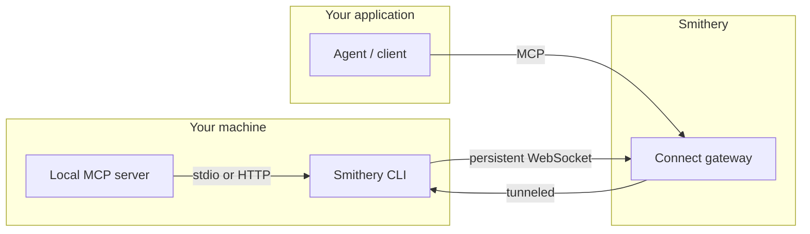
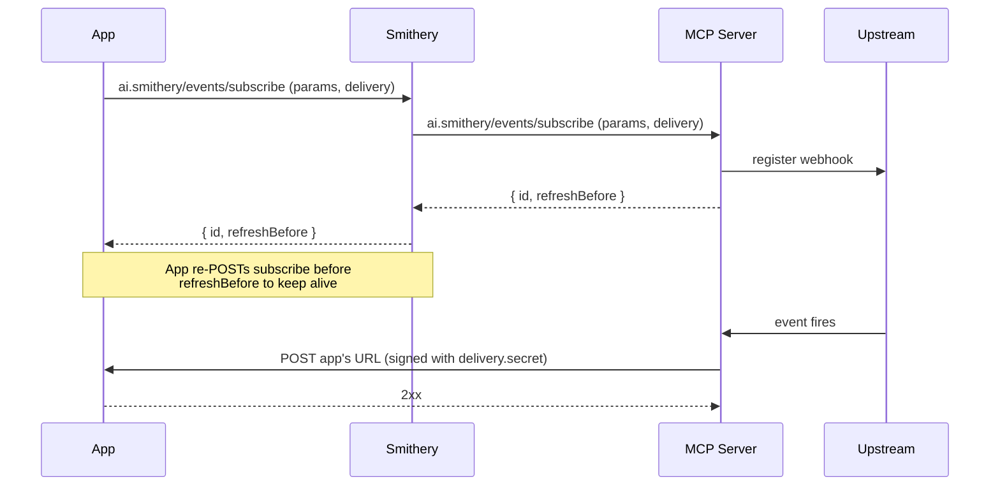

# smithery.ai

## Fetch log
- Inbox URL: https://smithery.ai/
- Final URL: https://smithery.ai/
- Fetched: 2026-10-14
- Pages: 12
- Mode: standard
- Note: https://smithery.ai/llms.txt returns the HTML app shell; the canonical catalog is the docs llms.txt below.

## llms.txt — https://smithery.ai/docs/llms.txt
# Smithery Documentation

## Docs

- [Introduction](https://smithery.ai/docs/index.md): Smithery gives agents more agency by connecting them to the outside world — search the web, query databases, control browsers, reach into business tools, and much more.
- [Connect to MCPs](https://smithery.ai/docs/use/connect.md): Manage MCP connections with a simple REST API - OAuth, tokens, and sessions handled for you.
- [Uplink](https://smithery.ai/docs/use/uplink.md): Expose a local MCP server as a Smithery connection without deploying it.
- [Token Scoping](https://smithery.ai/docs/use/token-scoping.md): Control which connections and operations a token can access — by user, workspace, or any custom dimension.
- [Deep Linking](https://smithery.ai/docs/use/deep-linking.md): Deep links provide a seamless way to integrate Smithery MCPs into supported clients.
- [Listing Your Client](https://smithery.ai/docs/use/listing_your_client.md): Get your MCP client listed on Smithery for easy discovery and installation by end users
- [Overview](https://smithery.ai/docs/build/index.md): Publish your MCP servers on Smithery for distribution and analytics.
- [Publish](https://smithery.ai/docs/build/publish.md): Publish your MCP server on Smithery for distribution and analytics.
- [Triggers](https://smithery.ai/docs/build/triggers.md): Expose events from your MCP server so consumers can receive them as webhooks.
- [Vercel AI SDK Integration](https://smithery.ai/docs/integrations/vercel_ai_sdk.md): Integrate MCP servers with Vercel AI SDK using Smithery
- [What is MCP?](https://smithery.ai/docs/concepts/what_is_mcp.md): What is MCP? How does it work? What does Smithery do with MCP?
- [Namespaces](https://smithery.ai/docs/concepts/namespaces.md): Namespaces group your servers, connections, and skills under a shared identifier.
- [Smithery CLI](https://smithery.ai/docs/concepts/cli.md): Use the Smithery CLI to search, connect, and manage MCP servers and skills from the command line.
- [Build an OAuth-compatible client](https://smithery.ai/docs/cookbooks/typescript_oauth_client.md): How to build an OAuth client in Typescript using Next.js
- [Health check](https://smithery.ai/docs/api-reference/health-check.md): Check if the service is running
- [Get a server](https://smithery.ai/docs/api-reference/servers/get-a-server.md): Retrieve server details including connections, tools, and security status.
- [Create a server](https://smithery.ai/docs/api-reference/servers/create-a-server.md): Create a new server. Idempotent — returns success if the server already exists and is owned by the caller.
- [Delete a server](https://smithery.ai/docs/api-reference/servers/delete-a-server.md): Permanently delete a server, its releases, and associated resources.
- [Update a server](https://smithery.ai/docs/api-reference/servers/update-a-server.md): Update server metadata such as display name, description, repository, icon, or visibility.
- [Transfer a server](https://smithery.ai/docs/api-reference/servers/transfer-a-server.md): Move a server to another namespace. The caller must have server write access to both the source namespace and the destination namespace.
- [Download server bundle](https://smithery.ai/docs/api-reference/servers/download-server-bundle.md): Download the MCPB bundle for the latest successful stdio release.
- [List releases](https://smithery.ai/docs/api-reference/servers/list-releases.md): List releases ordered by most recent first. Logs are omitted — fetch a specific release to see logs.
- [Publish a server](https://smithery.ai/docs/api-reference/servers/publish-a-server.md): Submit a release via multipart form. Supports hosted (JS module upload), external (URL), and stdio (MCPB bundle) release types.
- [Get a release](https://smithery.ai/docs/api-reference/servers/get-a-release.md): Retrieve release details including status, git metadata, pipeline logs, and MCP endpoint URL.
- [Stream release logs](https://smithery.ai/docs/api-reference/servers/stream-release-logs.md): Real-time SSE stream of release logs and status updates.
- [Resume a release](https://smithery.ai/docs/api-reference/servers/resume-a-release.md): Resume a paused release (e.g. after OAuth authorization). Use id='latest' to resume the most recent one.
- [List runtime logs](https://smithery.ai/docs/api-reference/servers/list-runtime-logs.md): Fetch recent runtime logs grouped by invocation.
- [Get server icon](https://smithery.ai/docs/api-reference/servers/get-server-icon.md): Retrieve the server's icon image. Returns the image directly with appropriate content type.
- [Upload server icon](https://smithery.ai/docs/api-reference/servers/upload-server-icon.md): Upload or replace the server icon. Accepts a single image file via multipart/form-data. Max 1MB. Supported formats: PNG, JPEG, GIF, SVG, WebP.
- [Delete server icon](https://smithery.ai/docs/api-reference/servers/delete-server-icon.md): Remove the server's icon.
- [Infer a tool output schema](https://smithery.ai/docs/api-reference/servers/infer-a-tool-output-schema.md): Infer a best-effort Zod schema from recent successful Tinybird tool outputs. All discovered object fields are marked optional.
- [List all servers](https://smithery.ai/docs/api-reference/servers/list-all-servers.md): Search and browse public MCP servers in the Smithery registry. Supports full-text and semantic search via the `q` parameter, and filtering by deployment status, verification, ownership, and more.
- [List or search skills](https://smithery.ai/docs/api-reference/skills/list-or-search-skills.md): Search and browse reusable prompt-based skills. Supports full-text and semantic search via the `q` parameter, and filtering by category, namespace, or slug.
- [Create a new skill (deprecated)](https://smithery.ai/docs/api-reference/skills/create-a-new-skill-deprecated.md): **Deprecated:** Use PUT /skills/{namespace}/{slug} instead. Create a new skill by linking a GitHub repository containing a SKILL.md file.
- [Get a skill](https://smithery.ai/docs/api-reference/skills/get-a-skill.md): Get a single skill by its namespace and slug.
- [Create or update a skill](https://smithery.ai/docs/api-reference/skills/create-or-update-a-skill.md): Idempotent endpoint to create or update a GitHub-backed skill. Send application/json with `gitUrl`.
- [Delete a skill](https://smithery.ai/docs/api-reference/skills/delete-a-skill.md): Delete a skill by namespace and slug. Requires ownership of the namespace.
- [Create a service token](https://smithery.ai/docs/api-reference/tokens/create-a-service-token.md): Create a service token for machine-to-machine authentication. Accepts API key or bearer token. Optionally apply restrictions.
- [Get user's namespaces or search namespaces](https://smithery.ai/docs/api-reference/namespaces/get-users-namespaces-or-search-namespaces.md): When called without query params, returns the authenticated user's namespaces (backwards compatible). When query params are provided, searches public namespaces with pagination. Use ownerId to filter by owner, hasServers/hasSkills to filter by content, q for text search.
- [Create a new namespace with generated name](https://smithery.ai/docs/api-reference/namespaces/create-a-new-namespace-with-generated-name.md): Create a new namespace with a server-generated human-readable name, owned by the authenticated user
- [Create a new namespace](https://smithery.ai/docs/api-reference/namespaces/create-a-new-namespace.md): Create a new namespace owned by the authenticated user or an organization. This endpoint is idempotent - if the namespace already exists and is owned by the user/org, returns success. Pass organizationId in the request body to create an org-owned namespace.
- [Delete a namespace](https://smithery.ai/docs/api-reference/namespaces/delete-a-namespace.md): Delete a namespace owned by the authenticated user. The namespace must not contain any servers. Skills and connections in the namespace will be deleted automatically.
- [Create a server under a namespace (deprecated)](https://smithery.ai/docs/api-reference/namespaces/create-a-server-under-a-namespace-deprecated.md): **Deprecated:** Use PUT /servers/{namespace}/{server} instead. Create a new server under the specified namespace. This endpoint is idempotent.
- [List team API keys](https://smithery.ai/docs/api-reference/organizations/list-team-api-keys.md): Returns all API keys belonging to the organization. Requires admin role. Key values are not included in the response.
- [Create a team API key](https://smithery.ai/docs/api-reference/organizations/create-a-team-api-key.md): Creates an API key owned by the organization. Requires admin role.
- [Revoke a team API key](https://smithery.ai/docs/api-reference/organizations/revoke-a-team-api-key.md): Deletes an API key belonging to the organization. Requires admin role.
- [List connections](https://smithery.ai/docs/api-reference/connect/list-connections.md): List all connections in a namespace. Supports filtering by metadata using `metadata.{key}={value}` query params.
- [Create connection](https://smithery.ai/docs/api-reference/connect/create-connection.md): Create a new MCP connection with an auto-generated ID. Requires API key and namespace ownership.
- [List triggers](https://smithery.ai/docs/api-reference/connect/list-triggers.md): List trigger types exposed by a connection.
- [Get trigger](https://smithery.ai/docs/api-reference/connect/get-trigger.md): Get the schema for a single trigger type.
- [Subscribe to trigger](https://smithery.ai/docs/api-reference/connect/subscribe-to-trigger.md): Subscribe to (or refresh) a trigger. Supplying the same (params, delivery.url) refreshes the TTL and may rotate the secret.
- [Unsubscribe from trigger](https://smithery.ai/docs/api-reference/connect/unsubscribe-from-trigger.md): Unsubscribe by subscription key (params + delivery.url). Eager teardown — subscriptions also expire naturally on TTL.
- [Get connection](https://smithery.ai/docs/api-reference/connect/get-connection.md): Get details for a specific connection. Requires service token with connections:read scope.
- [Create or update connection](https://smithery.ai/docs/api-reference/connect/create-or-update-connection.md): Create or update an MCP connection with the given ID. `server` is the Smithery registry qualified name; `mcpUrl` is for custom MCP URLs. One of them is required when creating a new HTTP connection, but optional when updating. Returns 409 if a different target URL is provided, except while the connec…
- [Delete connection](https://smithery.ai/docs/api-reference/connect/delete-connection.md): Delete a connection and terminate its MCP session. Requires API key and namespace ownership.
- [List tools across a namespace](https://smithery.ai/docs/api-reference/connect/list-tools-across-a-namespace.md): List tools for every connection in a namespace in one response. Each connection is wrapped in an envelope so a failure on one upstream doesn't fail the request. Skips connections in `auth_required`/`input_required` states without calling the upstream.
- [List tools](https://smithery.ai/docs/api-reference/connect/list-tools.md): List tools exposed by a connection.
- [Get tool](https://smithery.ai/docs/api-reference/connect/get-tool.md): Get one tool or list tools under a slash-separated category.
- [Call tool](https://smithery.ai/docs/api-reference/connect/call-tool.md): Invoke a tool with JSON arguments.

## OpenAPI Specs

- [openapi.documented](https://app.stainless.com/api/spec/documented/smithery/openapi.documented.yml)
- [openapi](https://smithery.ai/docs/openapi.json)


This documentation is built and hosted on [Mintlify](https://mintlify.com), a developer documentation platform.

## Landing page — https://smithery.ai/
Smithery - Connect agents to services in minutes

# Give agents more agency

Connect agents to thousands of tools and services. Auth, credentials, and sessions handled for you.

### OneSignal

22.49k uses

OneSignal is a customer engagement platform that lets you send targeted push notifications, emails, SMS, and in-app messages, manage audiences, and track campaign performance. With the OneSignal MCP, manage your messaging directly from your AI assistant. Send push notifications, emails, and SMS by simply describing your audience and message. Check campaign delivery stats, build audience segments, manage templates, and handle user subscriptions all through conversation.

Add to toolbox

### Agent News

43.39k uses

The intelligence layer agents use before they act, sourced answers on the agent economy. Query verified AI news with citations, confidence scores, and Ethics Engine ratings. Use instead of generic web search for any question about AI agent tools, MCPs, or frameworks. Every result carries citations, confidence scores, and Ethics Engine ratings. Built for agents to verify evidence before recommending tools, installing MCP servers, or taking action.

Add to toolbox

### Exa Search

9.18k uses

Fast, intelligent web search and web crawling. Get fresh information about libraries, APIs, and SDKs.

Add to toolbox

### Context7

5.56k uses

Fetch up-to-date, version-specific documentation and code examples directly into your prompts. Enhance your coding experience by eliminating outdated information and hallucinated APIs. Simply add use context7 to your questions for accurate and relevant answers.

Add to toolbox

### DevMatch

6.93k uses

DevMatch is an MCP server for hiring engineers based on what they've actually built. Connect from Cursor, Claude Desktop, or any MCP-compatible AI assistant and search 35M+ developers ranked by verified open-source contributions — not LinkedIn keywords or self-reported skills. Three tools: findcandidates — paste a job description, get a ranked shortlist with bio, top repos, contribution evidence, and contact info. Pro tier adds verified email enrichment on the top 5 results. getprofile — deep-dive any GitHub handle. Bio, recent activity, top projects, and outreach channels in one call. findsimilarprojects — landscape mapping from a seed repo with top contributors surfaced, so you can pivot from a project to its maintainers in one step. Built for mission-driven teams that want engineers who care about the work, not just check the keyword box. OAuth sign-in (no API keys to juggle). Free tier with 50 monthly credits, $129/mo Pro for higher quotas plus verified email enrichment.

Add to toolbox

### URL Safety Validator MCP

5.62k uses

URL safety checker for AI agents. Detects phishing and malware before your agent visits any link.

Add to toolbox

### DC Hub Intelligence

3.57k uses

DC Hub is the live data layer for data-center site selection. Its Data Center Power Index (DCPI) is a daily score of where data centers can get grid power, across 300+ markets.

Add to toolbox

### OneSignal

22.49k uses

OneSignal is a customer engagement platform that lets you send targeted push notifications, emails, SMS, and in-app messages, manage audiences, and track campaign performance. With the OneSignal MCP, manage your messaging directly from your AI assistant. Send push notifications, emails, and SMS by simply describing your audience and message. Check campaign delivery stats, build audience segments, manage templates, and handle user subscriptions all through conversation.

Add to toolbox

### Agent News

43.39k uses

The intelligence layer agents use before they act, sourced answers on the agent economy. Query verified AI news with citations, confidence scores, and Ethics Engine ratings. Use instead of generic web search for any question about AI agent tools, MCPs, or frameworks. Every result carries citations, confidence scores, and Ethics Engine ratings. Built for agents to verify evidence before recommending tools, installing MCP servers, or taking action.

Add to toolbox

### Exa Search

9.18k uses

Fast, intelligent web search and web crawling. Get fresh information about libraries, APIs, and SDKs.

Add to toolbox

### Context7

5.56k uses

Fetch up-to-date, version-specific documentation and code examples directly into your prompts. Enhance your coding experience by eliminating outdated information and hallucinated APIs. Simply add use context7 to your questions for accurate and relevant answers.

Add to toolbox

### DevMatch

6.93k uses

DevMatch is an MCP server for hiring engineers based on what they've actually built. Connect from Cursor, Claude Desktop, or any MCP-compatible AI assistant and search 35M+ developers ranked by verified open-source contributions — not LinkedIn keywords or self-reported skills. Three tools: findcandidates — paste a job description, get a ranked shortlist with bio, top repos, contribution evidence, and contact info. Pro tier adds verified email enrichment on the top 5 results. getprofile — deep-dive any GitHub handle. Bio, recent activity, top projects, and outreach channels in one call. findsimilarprojects — landscape mapping from a seed repo with top contributors surfaced, so you can pivot from a project to its maintainers in one step. Built for mission-driven teams that want engineers who care about the work, not just check the keyword box. OAuth sign-in (no API keys to juggle). Free tier with 50 monthly credits, $129/mo Pro for higher quotas plus verified email enrichment.

Add to toolbox

### URL Safety Validator MCP

5.62k uses

URL safety checker for AI agents. Detects phishing and malware before your agent visits any link.

Add to toolbox

### DC Hub Intelligence

3.57k uses

DC Hub is the live data layer for data-center site selection. Its Data Center Power Index (DCPI) is a daily score of where data centers can get grid power, across 300+ markets.

Add to toolbox

### Keenable Web Search

2.49k uses

Docs: https://docs.keenable.ai/mcp-server Keenable is a free, remote MCP server that gives agents access to the web index. Search the web with ranked results and date/site filters, then fetch any indexed page as clean markdown. Works out of the box with no account or API key. Tools: searchwebpages: Search the web and return ranked results. fetchpagecontent: Fetch an indexed URL and extract its content as clean markdown

### Medical Terminologies MCP

3.18k uses

Unified MCP server for six medical terminologies — ICD-11, LOINC, RxNorm, MeSH, ATC and the Brazilian CID-10 (Portuguese) — with authoritative WHO ICD-10→ICD-11 mapping, cross-terminology search and provenance (source, version, timestamp) on every response. Read-only retrieval, not clinical decision support. Remote (Streamable HTTP, no auth, no credentials) or local stdio.

Add to toolbox

### IBGE Brasil MCP

2.52k uses

MCP server for the official IBGE (Brazilian Institute of Geography and Statistics) APIs. Read-only tools for live, sourced Brazilian data — geography, census, demographics, economy, and health — returning exact figures with provenance. Hosted endpoint, no key: https://ibge.sidneybissoli.com/mcp. Tutorial — querying SIDRA through MCP in Claude and ChatGPT (developer mode and Deep Research), Cursor and VS Code: https://sidneybissoli.com/en/blog/posts/sidra-via-mcp/ (em português: https://sidneybissoli.com/blog/posts/sidra-via-mcp/).

Add to toolbox

### Niche

3.23k uses

Editorial intelligence for creators and their agents. Most tools help you write, Niche helps you decide what's worth writing. It reads primary-source signal, discovers emerging stories, ranks the strongest angle, and turns that signal into publishable, platform-native content that's grounded in real sources, in your voice. 25 tools across discovery, drafting, render, and brand. Remote (Streamable HTTP), OAuth 2.1 + PAT.

Add to toolbox

### Hugging Face

2.40k uses

AI model hub for machine learning. Discover models, explore datasets, and access model documentation and capabilities.

Add to toolbox

### Tavily

1.57k uses

Search the web with fast, accurate results optimized for AI. Get clean, structured answers with source URLs and relevance scoring.

Add to toolbox

### UCP Gateway

3.61k uses

AI Shopping tools for product search, comparison, and safe checkout Commerce Gateway — an infrastructure layer that enables open-source AI agents to participate in agentic commerce through the Universal Commerce Protocol. Our platform gives agents a hosted UCP profile registry, a secure MCP gateway, and access to commerce flows without requiring every agent to own a domain, GitHub account, or Shopify credentials. With this solution, agents can discover products, recommend options, build carts, validate them with the user, and generate checkout handoff links where the buyer completes payment safely on Shopping platform. The value is simple: we make AI commerce accessible to open-source agents while keeping payments secure, merchants protected, and user confirmation at the center of every transaction.

Add to toolbox

### Keenable Web Search

2.49k uses

Docs: https://docs.keenable.ai/mcp-server Keenable is a free, remote MCP server that gives agents access to the web index. Search the web with ranked results and date/site filters, then fetch any indexed page as clean markdown. Works out of the box with no account or API key. Tools: searchwebpages: Search the web and return ranked results. fetchpagecontent: Fetch an indexed URL and extract its content as clean markdown

Add to toolbox

### Medical Terminologies MCP

3.18k uses

Unified MCP server for six medical terminologies — ICD-11, LOINC, RxNorm, MeSH, ATC and the Brazilian CID-10 (Portuguese) — with authoritative WHO ICD-10→ICD-11 mapping, cross-terminology search and provenance (source, version, timestamp) on every response. Read-only retrieval, not clinical decision support. Remote (Streamable HTTP, no auth, no credentials) or local stdio.

Add to toolbox

### IBGE Brasil MCP

2.52k uses

MCP server for the official IBGE (Brazilian Institute of Geography and Statistics) APIs. Read-only tools for live, sourced Brazilian data — geography, census, demographics, economy, and health — returning exact figures with provenance. Hosted endpoint, no key: https://ibge.sidneybissoli.com/mcp. Tutorial — querying SIDRA through MCP in Claude and ChatGPT (developer mode and Deep Research), Cursor and VS Code: https://sidneybissoli.com/en/blog/posts/sidra-via-mcp/ (em português: https://sidneybissoli.com/blog/posts/sidra-via-mcp/).

Add to toolbox

### Niche

3.23k uses

Editorial intelligence for creators and their agents. Most tools help you write, Niche helps you decide what's worth writing. It reads primary-source signal, discovers emerging stories, ranks the strongest angle, and turns that signal into publishable, platform-native content that's grounded in real sources, in your voice. 25 tools across discovery, drafting, render, and brand. Remote (Streamable HTTP), OAuth 2.1 + PAT.

Add to toolbox

### Hugging Face

2.40k uses

AI model hub for machine learning. Discover models, explore datasets, and access model documentation and capabilities.

Add to toolbox

### Tavily

1.57k uses

Search the web with fast, accurate results optimized for AI. Get clean, structured answers with source URLs and relevance scoring.

Add to toolbox

### UCP Gateway

3.61k uses

AI Shopping tools for product search, comparison, and safe checkout Commerce Gateway — an infrastructure layer that enables open-source AI agents to participate in agentic commerce through the Universal Commerce Protocol. Our platform gives agents a hosted UCP profile registry, a secure MCP gateway, and access to commerce flows without requiring every agent to own a domain, GitHub account, or Shopify credentials. With this solution, agents can discover products, recommend options, build carts, validate them with the user, and generate checkout handoff links where the buyer completes payment safely on Shopping platform. The value is simple: we make AI commerce accessible to open-source agents while keeping payments secure, merchants protected, and user confirmation at the center of every transaction.

Add to toolbox

### Local Model Suitability MCP

2.76k uses

AI model router. Checks whether to use local Ollama or cloud inference before each API call.

Add to toolbox

### SIMOSphere AI

1.62k uses

European AI orchestration platform — connects CRM, ERP, documents with LLMs. GDPR-compliant, EU-hosted, MCP-native. 4 tools: searchdocuments, querydatabase, createrecord, sendnotification.

Add to toolbox

### Agentery — tool discovery and pricing for agents

972 uses

Help your agent research AI products and MCP servers for a task. Find candidates, inspect their capabilities and evidence, and compare available pricing. Start with searchproviders, open the strongest matches with getproviderprofile, then use compareproviders. Public reads need no account at the direct endpoint. Coverage and pricing availability vary.

### reportflow-mcp

869 uses

An MCP (Model Context Protocol) server that turns your ReportFlow templates into PDF reports — invoices, contracts, statements, anything you've designed — straight from Claude or any other MCP-compatible AI agent. What it does Generate PDFs from natural-language requests like "create an invoice for Acme Corp totalling $300" Expose your ReportFlow designs and their parameter schemas directly to the AI as MCP Resources Bulk-generate many PDFs and download them as a single ZIP Save outputs to whichever workspace folder the user is currently in (Claude Desktop / Claude Code / Cursor / VS Code all supported) Setup Claude Desktop / Claude Code / Cursor Add the following to your config file (.mcp.json, claudedesktopconfig.json, ~/.cursor/mcp.json, etc.): { "mcpServers": { "reportflow": { "command": "npx", "args": ["-y", "reportflow-mcp"] } } } That's the whole setup. No env vars, no API keys, no secrets to manage. VS Code (MCP-enabled builds) Same JSON in .vscode/mcp.json. Requirements Node.js 18+ (auto-fetched by npx) A local environment with a browser (only required during the first login) A ReportFlow account Usage First-run authentication After reloading the MCP client, ask the AI: Authenticate with ReportFlow A browser window opens. Sign in → pick a workspace → consent, and you're done. Tokens are stored in your OS keychain (macOS Keychain / Windows Credential Manager / Linux libsecret) and refreshed automatically. Generate a PDF Natural language (easiest) Using the invoice template, create a PDF for Acme Corp totalling $330. The AI will look up the template via listtemplates, fetch its parameter schema with getdesignparameters, fill in the values, and call generatepdfsync — returning a local file path. Slash commands Command Purpose /generatepdf Step-by-step recipe for a single PDF /generatepdfs Recipe for batch PDF generation /reportflowhelp Quick feature tour Where files are saved Output location is resolved in this order: Explicit instruction from the user (e.g. "save to my Desktop") The currently-open workspace root (Claude Code / Cursor / VS Code) The OS temp directory as fallback Reference Tools (called by the AI) Tool Purpose authenticate First-time / re-authentication listtemplates List available designs getdesignparameters Fetch the parameter schema for a design generatepdfsync / async Generate one PDF (sync returns path; async returns request ID) generatepdfssync / async Generate many PDFs (returns a ZIP) downloadfile / downloadzip Download artifacts produced by async tools suggestparams Translate a natural-language brief into a params JSON via MCP Sampling (requires a Sampling-capable client) Resources (attachable as AI context) URI Contents reportflow://designs List of available designs reportflow://designs/{designId}/parameters Parameter schema for one design reportflow://errors Catalog of error messages from the Content Service reportflow://server-info Server feature overview Prompts (slash-command recipe cards) /generatepdf, /generatepdfs, /reportflowhelp — pass arguments and the AI follows the prepared workflow. Troubleshooting Symptom Fix Error containing re-authentication required Ask the AI: "re-authenticate with ReportFlow" npx cannot find the package npm cache clean --force then retry No keychain available on Linux Falls back automatically to a chmod-0600 file under $XDGSTATE_HOME/reportflow-mcp/ Browser cannot open over SSH / remote shell Authenticate once on a local machine; afterwards the cached token works on remote hosts License MIT — see LICENSE. Links ReportFlow: https://re-port-flow.com npm: https://www.npmjs.com/package/reportflow-mcp Issues: https://github.com/re-port-flow/reportflow-mcp/issues

Add to toolbox

### Parallel Web Search

723 uses

Highest accuracy web search for AIs

Add to toolbox

### OpenZeppelin

1.07k uses

Smart contract security library for blockchain. Browse audited contracts, explore security patterns, and reference Solidity documentation.

Add to toolbox

### The Local Intel

2.76k uses

text Agentic local business intelligence for Florida — 983 ZIPs, OSM POI layer, IRS income data, sector gap analysis, and 500 oracle prompts. 20 MCP tools. LLMs pay $0.01–$0.05/call. Free discovery tier available. Built for autonomous agents and LLM pipelines. thelocalintel.com

Add to toolbox

### Local Model Suitability MCP

2.76k uses

AI model router. Checks whether to use local Ollama or cloud inference before each API call.

Add to toolbox

### SIMOSphere AI

1.62k uses

European AI orchestration platform — connects CRM, ERP, documents with LLMs. GDPR-compliant, EU-hosted, MCP-native. 4 tools: searchdocuments, querydatabase, createrecord, sendnotification.

Add to toolbox

### Agentery — tool discovery and pricing for agents

972 uses

Help your agent research AI products and MCP servers for a task. Find candidates, inspect their capabilities and evidence, and compare available pricing. Start with searchproviders, open the strongest matches with getproviderprofile, then use compareproviders. Public reads need no account at the direct endpoint. Coverage and pricing availability vary.

Add to toolbox

### reportflow-mcp

869 uses

An MCP (Model Context Protocol) server that turns your ReportFlow templates into PDF reports — invoices, contracts, statements, anything you've designed — straight from Claude or any other MCP-compatible AI agent. What it does Generate PDFs from natural-language requests like "create an invoice for Acme Corp totalling $300" Expose your ReportFlow designs and their parameter schemas directly to the AI as MCP Resources Bulk-generate many PDFs and download them as a single ZIP Save outputs to whichever workspace folder the user is currently in (Claude Desktop / Claude Code / Cursor / VS Code all supported) Setup Claude Desktop / Claude Code / Cursor Add the following to your config file (.mcp.json, claudedesktopconfig.json, ~/.cursor/mcp.json, etc.): { "mcpServers": { "reportflow": { "command": "npx", "args": ["-y", "reportflow-mcp"] } } } That's the whole setup. No env vars, no API keys, no secrets to manage. VS Code (MCP-enabled builds) Same JSON in .vscode/mcp.json. Requirements Node.js 18+ (auto-fetched by npx) A local environment with a browser (only required during the first login) A ReportFlow account Usage First-run authentication After reloading the MCP client, ask the AI: Authenticate with ReportFlow A browser window opens. Sign in → pick a workspace → consent, and you're done. Tokens are stored in your OS keychain (macOS Keychain / Windows Credential Manager / Linux libsecret) and refreshed automatically. Generate a PDF Natural language (easiest) Using the invoice template, create a PDF for Acme Corp totalling $330. The AI will look up the template via listtemplates, fetch its parameter schema with getdesignparameters, fill in the values, and call generatepdfsync — returning a local file path. Slash commands Command Purpose /generatepdf Step-by-step recipe for a single PDF /generatepdfs Recipe for batch PDF generation /reportflowhelp Quick feature tour Where files are saved Output location is resolved in this order: Explicit instruction from the user (e.g. "save to my Desktop") The currently-open workspace root (Claude Code / Cursor / VS Code) The OS temp directory as fallback Reference Tools (called by the AI) Tool Purpose authenticate First-time / re-authentication listtemplates List available designs getdesignparameters Fetch the parameter schema for a design generatepdfsync / async Generate one PDF (sync returns path; async returns request ID) generatepdfssync / async Generate many PDFs (returns a ZIP) downloadfile / downloadzip Download artifacts produced by async tools suggestparams Translate a natural-language brief into a params JSON via MCP Sampling (requires a Sampling-capable client) Resources (attachable as AI context) URI Contents reportflow://designs List of available designs reportflow://designs/{designId}/parameters Parameter schema for one design reportflow://errors Catalog of error messages from the Content Service reportflow://server-info Server feature overview Prompts (slash-command recipe cards) /generatepdf, /generatepdfs, /reportflowhelp — pass arguments and the AI follows the prepared workflow. Troubleshooting Symptom Fix Error containing re-authentication required Ask the AI: "re-authenticate with ReportFlow" npx cannot find the package npm cache clean --force then retry No keychain available on Linux Falls back automatically to a chmod-0600 file under $XDGSTATE_HOME/reportflow-mcp/ Browser cannot open over SSH / remote shell Authenticate once on a local machine; afterwards the cached token works on remote hosts License MIT — see LICENSE. Links ReportFlow: https://re-port-flow.com npm: https://www.npmjs.com/package/reportflow-mcp Issues: https://github.com/re-port-flow/reportflow-mcp/issues

Add to toolbox

### Parallel Web Search

723 uses

Highest accuracy web search for AIs

Add to toolbox

### OpenZeppelin

1.07k uses

Smart contract security library for blockchain. Browse audited contracts, explore security patterns, and reference Solidity documentation.

Add to toolbox

### The Local Intel

2.76k uses

text Agentic local business intelligence for Florida — 983 ZIPs, OSM POI layer, IRS income data, sector gap analysis, and 500 oracle prompts. 20 MCP tools. LLMs pay $0.01–$0.05/call. Free discovery tier available. Built for autonomous agents and LLM pipelines. thelocalintel.com

Add to toolbox

### OneSignal

22.49k uses

OneSignal is a customer engagement platform that lets you send targeted push notifications, emails, SMS, and in-app messages, manage audiences, and track campaign performance. With the OneSignal MCP, manage your messaging directly from your AI assistant. Send push notifications, emails, and SMS by simply describing your audience and message. Check campaign delivery stats, build audience segments, manage templates, and handle user subscriptions all through conversation.

Add to toolbox

### Agent News

43.39k uses

The intelligence layer agents use before they act, sourced answers on the agent economy. Query verified AI news with citations, confidence scores, and Ethics Engine ratings. Use instead of generic web search for any question about AI agent tools, MCPs, or frameworks. Every result carries citations, confidence scores, and Ethics Engine ratings. Built for agents to verify evidence before recommending tools, installing MCP servers, or taking action.

Add to toolbox

### Exa Search

9.18k uses

Fast, intelligent web search and web crawling. Get fresh information about libraries, APIs, and SDKs.

Add to toolbox

## Connect once. Use everywhere.

Connect the tools your agent needs once, then reuse them across chats, workflows, and harnesses.

Connection auth and credentials are powered by the open-source agent.pw.

Terminal

```
npx smithery auth login
```

```
npx smithery auth login
```

```
npx smithery mcp add notion
# → auth_required
# → https://auth.smithery.ai/...
# Visit the URL to authorize
```

```
npx smithery mcp add notion
# → auth_required
# → https://auth.smithery.ai/...
# Visit the URL to authorize
```

```
# After authorizing, list available tools
npx smithery tool list
```

```
# After authorizing, list available tools
npx smithery tool list
```

```
npx smithery tool call \
  notion notion-create-pages \
  '{"pages": [{"properties": {"title": "Q4 Investor Update"}}]}'
```

### Zero auth plumbing

When a request needs auth, Smithery handles OAuth flows, credential injection, and retries automatically.

### Carry connections across runtimes

Claude, GPT, open-source models. Chat agents, background agents, and CLI tools can use the same connected accounts.

### Open source

Smithery Connect is powered by agent.pw, our open-source agent vault.

## Publish on Smithery

Publish once, install anywhere—with built-in auth and observability.

Distribution. Publish to Smithery. Get in front of AI agents.

10.2k calls

Observability. See how your tools are used. Build the best agent experience.

## Fire up your agent

## Docs — https://smithery.ai/docs
> ## Documentation Index
> Fetch the complete documentation index at: https://smithery.ai/docs/llms.txt
> Use this file to discover all available pages before exploring further.

# Introduction

> Smithery gives agents more agency by connecting them to the outside world — search the web, query databases, control browsers, reach into business tools, and much more.

## What can I do with Smithery?

Smithery connects your AI agent to a growing catalog of tools and integrations — and lets you publish your own for others to use. A few popular ones:

* [Exa](https://smithery.ai/servers/exa) - Search the live web, access LinkedIn profiles, do deep research, and more
* [Context7](https://smithery.ai/servers/@upstash/context7-mcp) - Reference the latest docs for most major SDKs and frameworks directly in Cursor or Claude Code
* [Browserbase](https://smithery.ai/servers/@browserbasehq/mcp-browserbase) - Control a remote web browser using [Stagehand](https://stagehand.dev)

<Card title="How does Smithery work?" icon="library-big" href="/docs/concepts/what_is_mcp">
  Under the hood, Smithery speaks the [Model Context Protocol](https://modelcontextprotocol.io/docs/getting-started/intro) (MCP). Learn more in our concepts section.
</Card>

## Why Smithery?

Whether you're building chatbots, background agents, or AI copilots, Smithery handles the messy parts of plugging agents into external services:

* **Zero OAuth configuration** — No redirect URIs, client IDs, or secrets to manage
* **Automatic token refresh** — Credentials stay valid without manual intervention
* **Secure credential storage** — Encrypted, write-only storage for API keys and tokens
* **Stateless for you** — Connection lifecycle managed automatically

## Quickstarts

<CardGroup>
  <Card title="Connect tools to your agent" icon="plug-zap" href="/docs/use/connect">
    Add integrations to your app with managed OAuth and credentials
  </Card>

  <Card title="Publish an integration" icon="rocket" href="/docs/build/publish">
    Publish your MCP server to Smithery for distribution and observability
  </Card>
</CardGroup>

## LLM-Friendly Docs

The Smithery documentation is available in multiple LLM-friendly formats:

### MCP Server

The Smithery docs are accessible via MCP at `https://smithery.ai/docs/mcp`. You can also use the [Context7 MCP server](https://smithery.ai/servers/@upstash/context7-mcp) to search the Smithery documentation.

### Agent Scaffolds

Reference implementations for building agents with Smithery:

* [Basic Scaffold](https://github.com/smithery-ai/sdk/blob/main/examples/basic-server/AGENTS.md) - Build basic MCP servers
* [ChatGPT App](https://github.com/smithery-ai/sdk/blob/main/examples/open-ai-hello-server/AGENTS.md) - Build ChatGPT apps

### Markdown Format

Any page can be accessed as markdown by appending `.md` to the URL. For example, this page becomes `https://smithery.ai/docs/index.md`. You can also copy any page as markdown directly from the documentation.


This documentation is built and hosted on [Mintlify](https://mintlify.com), a developer documentation platform.

## Connect to MCPs — https://smithery.ai/docs/use/connect
> ## Documentation Index
> Fetch the complete documentation index at: https://smithery.ai/docs/llms.txt
> Use this file to discover all available pages before exploring further.

# Connect to MCPs

> Manage MCP connections with a simple REST API - OAuth, tokens, and sessions handled for you.

Smithery gives you a simple REST interface for connecting to MCP servers. Instead of implementing the MCP protocol directly, handling OAuth flows, and managing credentials yourself, Smithery handles all of it for you.

The auth and credential layer is powered by the open-source [agent.pw](https://agent.pw).

## Why Smithery?

Smithery lets you add MCP server integrations to your app without managing the complexity yourself:

* **Zero OAuth configuration** — No redirect URIs, client IDs, or secrets to configure. Smithery maintains OAuth apps for popular integrations.
* **Automatic token refresh** — Tokens refresh automatically before expiry. If a refresh fails, the connection status changes to `auth_required`.
* **Secure credential storage** — Credentials are encrypted and write-only. They can be used to make requests but never read back.
* **Stateless for you** — Smithery manages connection lifecycle. Make requests without worrying about reconnects, keepalives, or session state.
* **Scoped service tokens** — Mint short-lived tokens for browser or mobile clients to call tools directly, scoped to specific users and namespaces.

## Quick Start

<Tabs>
  <Tab title="CLI" icon="terminal">
    ```bash theme={null}
    # 1. Log in to Smithery
    smithery auth login

    # 2. Connect to the Exa search server
    smithery mcp add exa --id exa

    # 3. List available tools
    smithery tool list exa

    # 4. Call a tool
    smithery tool call exa search '{"query": "latest news about MCP"}'
    ```
  </Tab>

  <Tab title="AI SDK" icon="sparkles">
    ```bash theme={null}
    npm install @smithery/api @ai-sdk/mcp ai @ai-sdk/anthropic
    ```

    ```typescript theme={null}
    import { createMCPClient } from '@ai-sdk/mcp';
    import { generateText } from 'ai';
    import { anthropic } from '@ai-sdk/anthropic';
    import { createConnection } from '@smithery/api/mcp';

    const { transport } = await createConnection({
      mcpUrl: 'https://mcp.exa.ai',
    });

    const mcpClient = await createMCPClient({ transport });
    const tools = await mcpClient.tools();

    const { text } = await generateText({
      model: anthropic('claude-sonnet-4-20250514'),
      tools,
      prompt: 'Search for the latest news about MCP.',
    });

    await mcpClient.close();
    ```
  </Tab>

  <Tab title="MCP TypeScript SDK" icon="braces">
    ```bash theme={null}
    npm install @smithery/api @modelcontextprotocol/sdk
    ```

    ```typescript theme={null}
    import { Client } from '@modelcontextprotocol/sdk/client/index.js';
    import { createConnection } from '@smithery/api/mcp';

    const { transport } = await createConnection({
      mcpUrl: 'https://mcp.exa.ai',
    });

    // Connect using the MCP SDK Client
    const mcpClient = new Client({ name: 'my-app', version: '1.0.0' });
    await mcpClient.connect(transport);

    // Use the MCP SDK's ergonomic API
    const { tools } = await mcpClient.listTools();
    const result = await mcpClient.callTool({
      name: 'search',
      arguments: { query: 'latest news about MCP' }
    });
    ```
  </Tab>

  <Tab title="Typed SDK" icon="package">
    <Warning>
      Typed SDKs are in preview. Breaking changes may happen without notice.
    </Warning>

    Every MCP server published on Smithery gets a typed TypeScript SDK generated from its tool and trigger schemas. Use it when you already have a live Smithery connection and want typed tool calls instead of string-based `callTool` calls. Create or reuse a connection first, then pass its `namespace` and `connectionId`.

    ```bash theme={null}
    npm install https://pkg.smithery.ai/exa
    ```

    ```typescript theme={null}
    import { Exa } from '@smithery/exa';

    const exa = new Exa({
      namespace: 'my-app',
      connectionId: 'exa',
    });

    const result = await exa.tools.search({
      query: 'latest news about MCP',
    });
    ```

    For tools with output schemas, the typed SDK returns `structuredContent` typed from that schema. If a server returns structured data as a JSON or XML string, the SDK parses it first, converts XML into JSON-shaped data, and validates the parsed value before returning the result.

    SDKs are served from `pkg.smithery.ai` paths shaped like `namespace/slug`. The class name is the PascalCase form of the slug, so `smithery-ai/github` exports `Github`; if there is no slug, the namespace becomes the class name, like `exa` exporting `Exa`.

    ```typescript theme={null}
    // Use callTool when a tool was added after your SDK was generated.
    const result = await exa.callTool('search', { query: 'latest news about MCP' });
    ```
  </Tab>
</Tabs>

## Servers with Configuration

Some MCP servers require configuration like API keys or project IDs. How you pass each config value depends on the server's schema — some values go as **headers** (typically API keys), while others go as **query parameters** in the MCP URL.

Check the server's page on [smithery.ai](https://smithery.ai) to see what configuration it requires and where each value should go.

<Tabs>
  <Tab title="CLI" icon="terminal">
    ```bash theme={null}
    # Add a server with config (API key as header, project ID as query param)
    smithery mcp add \
      '@browserbasehq/mcp-browserbase?browserbaseProjectId=your-project-id' \
      --id my-browserbase \
      --headers '{"browserbaseApiKey": "your-browserbase-api-key"}'
    ```
  </Tab>

  <Tab title="TypeScript" icon="braces">
    ```typescript theme={null}
    import Smithery from '@smithery/api';
    import { createConnection } from '@smithery/api/mcp';

    const smithery = new Smithery();

    // 1. Create a connection with the server's config
    //    - API keys go in `headers`
    //    - Other config goes as query params in `mcpUrl`
    const conn = await smithery.connections.set('my-browserbase', {
      namespace: 'my-app',
      mcpUrl: 'https://mcp.browserbase.com/mcp?browserbaseProjectId=your-project-id',
      headers: {
        'browserbaseApiKey': 'your-browserbase-api-key',
      },
    });
    // conn.status.state === "connected" — ready to use immediately

    // 2. Get a transport for the connection
    const { transport } = await createConnection({
      client: smithery,
      namespace: 'my-app',
      connectionId: conn.connectionId,
    });
    ```
  </Tab>

  <Tab title="cURL" icon="globe">
    ```bash theme={null}
    curl -X POST "https://smithery.run/my-app" \
      -H "Authorization: Bearer $SMITHERY_API_KEY" \
      -H "Content-Type: application/json" \
      -d '{
        "mcpUrl": "https://mcp.browserbase.com/mcp?browserbaseProjectId=your-project-id",
        "headers": {
          "browserbaseApiKey": "your-browserbase-api-key"
        }
      }'
    ```
  </Tab>
</Tabs>

Unlike OAuth-based servers that return `auth_required`, servers configured with API keys return `connected` immediately when all required fields are provided upfront. If any required fields are missing, the connection returns `input_required` with the config schema and missing fields — see [Handling Configuration](#handling-configuration-input_required) below.

<Note>
  Each server's config schema specifies whether a field is passed as a **header** or **query parameter** via the `x-from` metadata. See [Session Configuration](/docs/build/session-config) for details on how servers declare their config transport.
</Note>

## Multi-User Setup

When your agent serves multiple users, you'll need to track which connections belong to which user. Use the `metadata` field to associate connections with your users, then filter by metadata to retrieve a specific user's connections.

### 1. Create a Connection for a User

When a user wants to connect an integration (e.g., GitHub), create a connection with their `userId` in metadata:

<Tabs>
  <Tab title="CLI" icon="terminal">
    ```bash theme={null}
    smithery mcp add github \
      --id user-123-github \
      --name "GitHub" \
      --metadata '{"userId": "user-123"}'

    # If OAuth is required, the CLI outputs the auth URL:
    # → auth_required
    # → https://auth.smithery.ai/...
    # Visit the URL to authorize
    ```
  </Tab>

  <Tab title="TypeScript" icon="braces">
    ```typescript theme={null}
    const conn = await smithery.connections.set('user-123-github', {
      namespace: 'my-app',
      mcpUrl: 'https://github.run.tools',
      name: 'GitHub',
      metadata: { userId: 'user-123' }
    });

    if (conn.status.state === 'auth_required') {
      // Redirect user to the hosted Smithery setup flow
      redirect(conn.status.setupUrl);
    }
    ```
  </Tab>
</Tabs>

### 2. List a User's Connections

When your agent needs to know what tools are available for a user, list their connections:

<Tabs>
  <Tab title="CLI" icon="terminal">
    ```bash theme={null}
    smithery mcp list --metadata '{"userId": "user-123"}'
    ```
  </Tab>

  <Tab title="TypeScript" icon="braces">
    ```typescript theme={null}
    const result = await smithery.connections.list('my-app', {
      metadata: { userId: 'user-123' }
    });

    // Show the user their connected integrations
    for (const conn of result.connections) {
      console.log(`${conn.name}: ${conn.status.state}`);
    }
    ```
  </Tab>
</Tabs>

### 3. Use Tools Across Connections

Create MCP clients for each connection and aggregate their tools:

<Tabs>
  <Tab title="CLI" icon="terminal">
    ```bash theme={null}
    # List tools for a connection
    smithery tool list user-123-github

    # Call a tool
    smithery tool call user-123-github search_repositories \
      '{"query": "mcp"}'
    ```
  </Tab>

  <Tab title="TypeScript" icon="braces">
    ```typescript theme={null}
    const allTools = [];

    for (const conn of result.connections) {
      if (conn.status.state === 'connected') {
        const { transport } = await createConnection({
          namespace: 'my-app',
          connectionId: conn.connectionId,
        });
        const client = await createMCPClient({ transport });
        allTools.push(...await client.tools());
      }
    }

    // Now your agent has tools from all the user's connected integrations
    const { text } = await generateText({
      model: anthropic('claude-sonnet-4-20250514'),
      tools: allTools,
      prompt: userMessage,
    });
    ```
  </Tab>
</Tabs>

Or skip the iteration entirely and hand a [single namespace URL](#namespace-mcp-endpoint) to an MCP client.

## Namespace MCP Endpoint

A namespace URL bundles all of a namespace's connections behind one MCP endpoint, so the same set of tools is portable across clients (Claude.ai, Cursor, ChatGPT, MCP Inspector) without configuring each connection in each app:

```text theme={null}
https://mcp.smithery.run/{namespace}
```

Tool names come back prefixed with their connection ID — `notion-personal.search`, `user-123-github.search_repositories` — so they stay unique. On `tools/call`, Connect strips the prefix and forwards to the matching connection.

To restrict the URL to one user's connections, mint a [service token](#service-tokens) scoped to `metadata.userId` — same metadata model as [Multi-User Setup](#multi-user-setup). The endpoint also advertises protected-resource metadata, so MCP clients run the [OAuth flow](#oauth-flow) on their own without extra wiring.

## Core Concepts

### Namespaces

A namespace is a globally unique identifier that groups your connections. Create one namespace per application or environment (e.g., `my-app`, `my-app-staging`). If you don't specify a namespace, the SDK uses your first existing namespace or creates one automatically.

### Connections

A connection is a long-lived session to an MCP server that persists until terminated. Each connection:

* Has a `connectionId` (developer-defined or auto-generated)
* Stores credentials securely (write-only—credentials can never be read back, only used to execute requests)
* Can include custom `metadata` for filtering (e.g., `userId` to associate connections with your users)
* Returns `serverInfo` with the MCP server's name and version

<Accordion title="createConnection Options">
  | Option | Type | Description |
  | - | - | - |
  | `client` | `Smithery?` | The Smithery client instance. If not provided, auto-created using `SMITHERY_API_KEY` env var |
  | `mcpUrl` | `string?` | The MCP server URL. Required when `connectionId` is not provided |
  | `namespace` | `string?` | If omitted, uses first existing namespace or creates one |
  | `connectionId` | `string?` | If omitted, an ID is auto-generated |

  Returns a SmitheryConnection object (transport, connectionId, url).
  Throws `SmitheryAuthorizationError` if OAuth authorization is required (see [Handling Authorization](#handling-authorization)).
</Accordion>

### Connection Status

When you create or retrieve a connection, it includes a `status` field:

| Status | Description |
| - | - |
| `connected` | Connection is ready to use |
| `auth_required` | OAuth authorization needed. Includes `setupUrl` |
| `input_required` | Server needs configuration (e.g., API keys). Includes `setupUrl`, `http` (the config schema), and `missing` (fields not yet provided) |
| `error` | Connection failed. Includes error `message` |

### Authentication

Smithery uses two authentication methods:

| Token | Use Case | Access |
| - | - | - |
| **API Key** | Backend only | Full namespace access |
| **Service Token** | Browser, mobile, agents | Scoped access to specific connections |

Get your API key from [smithery.ai/account/api-keys](https://smithery.ai/account/api-keys).

<Warning>
  Never expose your API key to untrusted clients or agents. Use scoped service tokens for browser and mobile apps.
</Warning>

### OAuth Flow

When an MCP server requires OAuth:

1. Create a connection—the response status will be `auth_required` with a hosted `setupUrl`
2. Redirect the user to `setupUrl`
3. User completes OAuth with the upstream provider (e.g., GitHub)
4. User is redirected back to your app
5. The connection is now ready—subsequent requests will succeed

You don't need to register OAuth apps, configure redirect URIs, or handle token exchange. Smithery manages the OAuth relationship with upstream providers and stores credentials securely on your behalf.

### Handling Authorization

When you need to send a user through OAuth, prefer creating or updating the connection first and redirecting to the hosted `setupUrl`. That gives you a stable `connectionId` to retry with after the user returns to your app.

<Tabs>
  <Tab title="CLI" icon="terminal">
    ```bash theme={null}
    # Connect to a server that requires OAuth
    smithery mcp add github

    # If auth is required, the CLI outputs the setup URL:
    # → auth_required
    # → https://auth.smithery.ai/...
    # → connection_id: abc-123-github
    # Visit the URL to authorize, then retry
    ```
  </Tab>

  <Tab title="TypeScript" icon="braces">
    ```typescript theme={null}
    const conn = await smithery.connections.set('abc-123-github', {
      namespace: 'my-app',
      mcpUrl: 'https://github.run.tools',
    });

    if (conn.status?.state === 'auth_required') {
      redirect(conn.status.setupUrl);
    }

    // Save conn.connectionId and retry with it after the user returns
    ```
  </Tab>
</Tabs>

After the user completes authorization and returns to your app, retry with the saved `connectionId`:

<Tabs>
  <Tab title="CLI" icon="terminal">
    ```bash theme={null}
    # After authorization, the connection is ready
    smithery tool list abc-123-github
    ```
  </Tab>

  <Tab title="TypeScript" icon="braces">
    ```typescript theme={null}
    const { transport } = await createConnection({
      connectionId: savedConnectionId,
    });

    const mcpClient = await createMCPClient({ transport });
    const tools = await mcpClient.tools();
    ```
  </Tab>
</Tabs>

### Handling Configuration (`input_required`)

When a server requires configuration that wasn't provided, the connection returns `input_required` with:

* **`setupUrl`** — a hosted Smithery setup page you can redirect the user to instead of building your own form
* **`http`** — the config schema (headers and query parameters the server accepts)
* **`missing`** — which fields still need to be provided

In a TTY terminal, the CLI prompts for missing values automatically. Otherwise, provide them explicitly:

<Tabs>
  <Tab title="CLI" icon="terminal">
    ```bash theme={null}
    # Interactive: CLI prompts for missing fields
    smithery mcp add browserbase --id my-browserbase

    # Non-interactive: pass config upfront
    smithery mcp add \
      'https://mcp.browserbase.com/mcp?browserbaseProjectId=your-project-id' \
      --id my-browserbase \
      --headers '{"browserbaseApiKey": "your-api-key"}'
    ```
  </Tab>

  <Tab title="TypeScript" icon="braces">
    ```typescript theme={null}
    const conn = await smithery.connections.set('my-browserbase', {
      namespace: 'my-app',
      mcpUrl: 'https://mcp.browserbase.com/mcp',
    });

    if (conn.status.state === 'input_required') {
      // Option 1: redirect(conn.status.setupUrl)
      // Option 2: render your own form from conn.status.http
      // conn.status.http has the config schema, conn.status.missing lists unfilled fields
      const updated = await smithery.connections.set('my-browserbase', {
        namespace: 'my-app',
        mcpUrl: 'https://mcp.browserbase.com/mcp?browserbaseProjectId=your-project-id',
        headers: { browserbaseApiKey: 'your-api-key' },
      });
    }
    ```
  </Tab>

  <Tab title="cURL" icon="globe">
    ```bash theme={null}
    # Create — returns input_required if config is missing
    curl -X PUT "https://smithery.run/my-app/my-browserbase" \
      -H "Authorization: Bearer $SMITHERY_API_KEY" \
      -H "Content-Type: application/json" \
      -d '{"mcpUrl": "https://mcp.browserbase.com/mcp"}'

    # Update with required config (same endpoint, PUT is an upsert)
    curl -X PUT "https://smithery.run/my-app/my-browserbase" \
      -H "Authorization: Bearer $SMITHERY_API_KEY" \
      -H "Content-Type: application/json" \
      -d '{
        "mcpUrl": "https://mcp.browserbase.com/mcp?browserbaseProjectId=your-project-id",
        "headers": { "browserbaseApiKey": "your-api-key" }
      }'
    ```
  </Tab>
</Tabs>

<Note>
  MCP requests to a connection in `input_required` state will be rejected until the required configuration is provided. While `input_required`, the `mcpUrl` can be updated with query parameters as long as the host and path remain the same.
</Note>

## Service Tokens

Service tokens let you safely use Smithery from browsers, mobile apps, and AI agents without exposing your API key. Your backend mints a scoped token, then your client uses it to call tools directly.

<Tabs>
  <Tab title="CLI" icon="terminal">
    ```bash theme={null}
    smithery auth token --policy '[{
      "namespaces": "my-app",
      "resources": "connections",
      "operations": ["read", "execute"],
      "metadata": { "userId": "user-123" },
      "ttl": "1h"
    }]'
    ```
  </Tab>

  <Tab title="TypeScript" icon="braces">
    ```typescript theme={null}
    // Create a token scoped to a specific user's connections
    const { token } = await smithery.tokens.create({
      policy: [
        {
          namespaces: 'my-app',
          resources: 'connections',
          operations: ['read', 'execute'],
          metadata: { userId: 'user-123' },
          ttl: '1h',
        },
      ],
    })

    // Send `token` to your client — safe for browser use
    ```
  </Tab>

  <Tab title="cURL" icon="globe">
    ```bash theme={null}
    curl -X POST https://api.smithery.ai/tokens \
      -H "Authorization: Bearer $SMITHERY_API_KEY" \
      -H "Content-Type: application/json" \
      -d '{
        "policy": [
          {
            "namespaces": "my-app",
            "resources": "connections",
            "operations": ["read", "execute"],
            "metadata": { "userId": "user-123" },
            "ttl": "1h"
          }
        ]
      }'
    ```
  </Tab>
</Tabs>

This token can only access connections in `my-app` where `metadata.userId` matches `user-123`. Initialize the client with the token:

<Tabs>
  <Tab title="CLI" icon="terminal">
    ```bash theme={null}
    # Use the scoped token to call tools
    SMITHERY_API_KEY=$TOKEN smithery tool list user-123-github
    ```
  </Tab>

  <Tab title="TypeScript" icon="braces">
    ```typescript theme={null}
    const smithery = new Smithery({ apiKey: token })

    const { transport } = await createConnection({
      client: smithery,
      namespace: 'my-app',
      connectionId: 'user-123-github',
    })
    ```
  </Tab>
</Tabs>

<Note>
  Need workspace-level scoping, read-only tokens, or token narrowing? See [Token Scoping](/docs/use/token-scoping) for the full guide.
</Note>

## Advanced

For full API documentation, see the API Reference section in the sidebar.

### Calling tools

Use the CLI or an MCP client over your connection's transport:

<Tabs>
  <Tab title="CLI" icon="terminal">
    ```bash theme={null}
    # List available tools
    smithery tool list user-123-github

    # Call a tool
    smithery tool call user-123-github search_repositories \
      '{"query": "mcp"}'
    ```
  </Tab>

  <Tab title="TypeScript" icon="braces">
    ```typescript theme={null}
    const { transport } = await createConnection({
      client: smithery,
      namespace: 'my-app',
      connectionId: 'user-123-github',
    })

    const mcpClient = await createMCPClient({ transport })
    const tools = await mcpClient.tools()
    const result = await mcpClient.callTool({
      name: 'search_repositories',
      arguments: { query: 'mcp' },
    })
    await mcpClient.close()
    ```
  </Tab>
</Tabs>


This documentation is built and hosted on [Mintlify](https://mintlify.com), a developer documentation platform.

## Uplink — https://smithery.ai/docs/use/uplink
> ## Documentation Index
> Fetch the complete documentation index at: https://smithery.ai/docs/llms.txt
> Use this file to discover all available pages before exploring further.

# Uplink

> Expose a local MCP server as a Smithery connection without deploying it.

**Uplink** exposes an MCP server running on any machine as a regular Smithery connection. The CLI holds a secure tunnel open and forwards every request from Smithery to the local process, so agents and apps reach it through the same REST surface as any hosted server.

Uplink is useful when:

* You're developing an MCP server and want to test it against a real agent before publishing.
* The server needs something only a specific machine can reach — a browser, a local database, an SSH key, a code editor.
* You want to run a private tool for yourself or your team without hosting it.

## Quick Start

Uplink uses `smithery mcp add`. If the URL resolves to `localhost` (or `127.0.0.1`), or you pass a command in place of a URL, the CLI opens an uplink tunnel in the background and registers the connection against your namespace.

<Tabs>
  <Tab title="Smithery package" icon="package">
    ```bash theme={null}
    # Pull a hosted Smithery package and run it locally — no setup required
    smithery mcp add smithery/mouseless
    ```

    [`smithery/mouseless`](https://github.com/smithery-ai/mouseless) is our computer-use MCP. The CLI launches it on your machine and exposes it through Smithery.
  </Tab>

  <Tab title="Local HTTP server" icon="globe">
    ```bash theme={null}
    # Point at an MCP server already running locally
    smithery mcp add http://localhost:9090/mcp --id chrome
    ```
  </Tab>

  <Tab title="Stdio command" icon="terminal">
    ```bash theme={null}
    # Let the CLI spawn and manage a stdio MCP server
    smithery mcp add --id chrome -- npx -y @chromedevtools/chrome-devtools-mcp
    ```
  </Tab>
</Tabs>

The CLI stays running and prints live status:

```
Uplink connected → my-app/chrome (status: connected)
```

While the CLI is running, `my-app/chrome` behaves like any other Smithery connection.

## Call it like any other connection

Reach the uplinked server through the standard Smithery surface — no special transport handling required:

<Tabs>
  <Tab title="CLI" icon="terminal">
    ```bash theme={null}
    smithery tool list chrome
    smithery tool call chrome navigate '{"url": "https://smithery.ai"}'
    ```
  </Tab>

  <Tab title="TypeScript" icon="braces">
    ```typescript theme={null}
    import Smithery from '@smithery/api';
    import { createConnection } from '@smithery/api/mcp';
    import { createMCPClient } from '@ai-sdk/mcp';

    const smithery = new Smithery();

    const { transport } = await createConnection({
      client: smithery,
      namespace: 'my-app',
      connectionId: 'chrome',
    });

    const mcpClient = await createMCPClient({ transport });
    const tools = await mcpClient.tools();
    ```
  </Tab>
</Tabs>

## How it works



When `smithery mcp add` sees a localhost URL or a trailing command, it:

1. Registers a connection on your namespace marked as uplink-backed.
2. Opens a persistent WebSocket to Smithery scoped to that connection.
3. Connects to your local HTTP server, or spawns the command as a subprocess, and bridges JSON-RPC between the WebSocket and the local process.

Incoming requests flow over the WebSocket to your local MCP server and back. The tunnel is transparent to the MCP spec: stateful sessions, progress notifications, server-initiated messages (sampling, elicitation, roots), and streamed responses all pass through. Auth, permissions, service tokens, and session handling are identical to hosted connections — uplink is a transport detail underneath the existing surface.

## Connection lifecycle

An uplink connection reports one of:

| Status | Description |
| - | - |
| `connected` | Tunnel is live; requests are being forwarded |
| `disconnected` | No CLI is attached (never paired, exited, or lost its WebSocket). Cached tool lists are dropped |
| `error` | The tunnel or the local process errored |

When the CLI exits, the connection stays in the namespace but its `serverInfo` is cleared, so callers don't see a stale tool list. Re-running `smithery mcp add` with the same `--id` reattaches the tunnel.

## One tunnel per connection

Each connection can carry only one live tunnel at a time. Running `smithery mcp add` for the same `--id` from a second machine fails with a conflict. Pass `--force` to take over:

```bash theme={null}
smithery mcp add http://localhost:9090/mcp --id chrome --force
```

Use `--force` deliberately — the previous CLI is disconnected immediately, and any requests it was mid-handling fail.

## Security

* Traffic is end-to-end TLS from Smithery to the CLI. The local MCP server speaks plain stdio or loopback HTTP to the CLI as it normally would.
* Uplink forwards arbitrary traffic to a process on the host machine. Only uplink servers you trust, and treat any trailing command as you would any other local executable.

## Limitations

* **One tunnel per connection.** See [above](#one-tunnel-per-connection).
* **Availability follows the host.** If the CLI is offline, the connection reports `disconnected` and calls fail fast. Uplink is a development and personal-automation primitive, not a hosting solution — publish your server to Smithery when you're ready for production.
* **Latency includes your network.** Every request makes a round trip to the host machine.


This documentation is built and hosted on [Mintlify](https://mintlify.com), a developer documentation platform.

## Token Scoping — https://smithery.ai/docs/use/token-scoping
> ## Documentation Index
> Fetch the complete documentation index at: https://smithery.ai/docs/llms.txt
> Use this file to discover all available pages before exploring further.

# Token Scoping

> Control which connections and operations a token can access — by user, workspace, or any custom dimension.

<Warning>
  **Preview** — Token Scoping is in preview. API surface may change.
  [Join our Discord](https://discord.gg/Afd38S5p9A) for support and feedback.
</Warning>

Service tokens let you safely expose Smithery to browsers, mobile apps, and AI agents without leaking your API key. Each token carries **constraints** that restrict which namespaces, resources, operations, and metadata it can access.

For general Smithery setup, see [Connect to MCPs](/docs/use/connect).

## Scope a Token to a User

When your app serves multiple users, you'll want each user's token to only access their own connections. You do this by tagging connections with `metadata` (e.g., `{ userId: "user-123" }`) when you create them, then creating a token with the same metadata constraint. The token will only be able to see connections whose metadata matches.

<Tabs>
  <Tab title="CLI" icon="terminal">
    ```bash theme={null}
    smithery auth token --policy '[{
      "namespaces": "my-app",
      "resources": "connections",
      "operations": ["read", "execute"],
      "metadata": { "userId": "user-123" },
      "ttl": "1h"
    }]'
    ```
  </Tab>

  <Tab title="TypeScript" icon="braces">
    ```typescript theme={null}
    const { token, expiresAt } = await smithery.tokens.create({
      policy: [
        {
          namespaces: 'my-app',
          resources: 'connections',
          operations: ['read', 'execute'],
          metadata: { userId: 'user-123' },
          ttl: '1h',
        },
      ],
    })

    // Send `token` to your client — safe for browser use
    ```
  </Tab>

  <Tab title="cURL" icon="globe">
    ```bash theme={null}
    curl -X POST https://api.smithery.ai/tokens \
      -H "Authorization: Bearer $SMITHERY_API_KEY" \
      -H "Content-Type: application/json" \
      -d '{
        "policy": [
          {
            "namespaces": "my-app",
            "resources": "connections",
            "operations": ["read", "execute"],
            "metadata": { "userId": "user-123" },
            "ttl": "1h"
          }
        ]
      }'
    ```
  </Tab>
</Tabs>

This token can list and call tools on connections in `my-app` where `metadata.userId` is `user-123` — nothing else. Even if the client tries to access another user's connection, the request is denied.

You can also match on multiple metadata fields at once. Fields within a single metadata object are AND'd, so the token below only matches connections where both `userId` and `tier` match:

<Tabs>
  <Tab title="CLI" icon="terminal">
    ```bash theme={null}
    smithery auth token --policy '[{
      "namespaces": "my-app",
      "resources": "connections",
      "operations": ["read", "execute"],
      "metadata": { "userId": "user-123", "tier": "pro" },
      "ttl": "1h"
    }]'
    ```
  </Tab>

  <Tab title="TypeScript" icon="braces">
    ```typescript theme={null}
    const { token } = await smithery.tokens.create({
      policy: [
        {
          namespaces: 'my-app',
          resources: 'connections',
          operations: ['read', 'execute'],
          metadata: { userId: 'user-123', tier: 'pro' },
          ttl: '1h',
        },
      ],
    })
    ```
  </Tab>

  <Tab title="cURL" icon="globe">
    ```bash theme={null}
    curl -X POST https://api.smithery.ai/tokens \
      -H "Authorization: Bearer $SMITHERY_API_KEY" \
      -H "Content-Type: application/json" \
      -d '{
        "policy": [
          {
            "namespaces": "my-app",
            "resources": "connections",
            "operations": ["read", "execute"],
            "metadata": { "userId": "user-123", "tier": "pro" },
            "ttl": "1h"
          }
        ]
      }'
    ```
  </Tab>
</Tabs>

## Multi-Level Access (Workspace / Org)

Real apps often have multiple access levels. For example, a user should see:

* Their own connections
* Connections shared with their workspace
* Global connections configured by an admin

Pass **multiple constraints** in the `policy` array. Each constraint is an independent grant — the token can access anything that matches **any** of them.

<Tabs>
  <Tab title="CLI" icon="terminal">
    ```bash theme={null}
    smithery auth token --policy '[
      {
        "namespaces": "my-app",
        "resources": "connections",
        "operations": ["read", "execute"],
        "metadata": { "userId": "user-123" },
        "ttl": "1h"
      },
      {
        "namespaces": "my-app",
        "resources": "connections",
        "operations": ["read", "execute"],
        "metadata": { "workspaceId": "ws-acme" },
        "ttl": "1h"
      },
      {
        "namespaces": "my-app",
        "resources": "connections",
        "operations": ["read", "execute"],
        "metadata": { "scope": "global" },
        "ttl": "1h"
      }
    ]'
    ```
  </Tab>

  <Tab title="TypeScript" icon="braces">
    ```typescript theme={null}
    const { token } = await smithery.tokens.create({
      policy: [
        // Grant 1: user's own connections
        {
          namespaces: 'my-app',
          resources: 'connections',
          operations: ['read', 'execute'],
          metadata: { userId: 'user-123' },
          ttl: '1h',
        },
        // Grant 2: workspace-shared connections
        {
          namespaces: 'my-app',
          resources: 'connections',
          operations: ['read', 'execute'],
          metadata: { workspaceId: 'ws-acme' },
          ttl: '1h',
        },
        // Grant 3: global connections (admin-configured)
        {
          namespaces: 'my-app',
          resources: 'connections',
          operations: ['read', 'execute'],
          metadata: { scope: 'global' },
          ttl: '1h',
        },
      ],
    })
    ```
  </Tab>

  <Tab title="cURL" icon="globe">
    ```bash theme={null}
    curl -X POST https://api.smithery.ai/tokens \
      -H "Authorization: Bearer $SMITHERY_API_KEY" \
      -H "Content-Type: application/json" \
      -d '{
        "policy": [
          {
            "namespaces": "my-app",
            "resources": "connections",
            "operations": ["read", "execute"],
            "metadata": { "userId": "user-123" },
            "ttl": "1h"
          },
          {
            "namespaces": "my-app",
            "resources": "connections",
            "operations": ["read", "execute"],
            "metadata": { "workspaceId": "ws-acme" },
            "ttl": "1h"
          },
          {
            "namespaces": "my-app",
            "resources": "connections",
            "operations": ["read", "execute"],
            "metadata": { "scope": "global" },
            "ttl": "1h"
          }
        ]
      }'
    ```
  </Tab>
</Tabs>

The token holder sees connections matching **any** of the three grants. This replaces the need for separate tokens per access level.

<Note>
  For this to work, tag your connections with the right metadata when you create them:

  * User connections: `metadata: { userId: 'user-123' }`
  * Workspace connections: `metadata: { workspaceId: 'ws-acme' }`
  * Global connections: `metadata: { scope: 'global' }`
</Note>

## Narrow a Token

You can create a narrower token from an existing service token. The new token can only have **equal or fewer** permissions — it cannot exceed the parent token's scope.

This is useful when your backend holds a broad token and needs to hand out more restricted tokens per request. For example, using the multi-level token from the previous section as the starting point:

<Tabs>
  <Tab title="CLI" icon="terminal">
    ```bash theme={null}
    # Narrow the broad token to just one user's connections
    SMITHERY_API_KEY=$BROAD_SERVICE_TOKEN smithery auth token \
      --policy '[{
        "resources": "connections",
        "operations": "read",
        "metadata": { "userId": "user-123" },
        "ttl": "20m"
      }]'
    ```
  </Tab>

  <Tab title="TypeScript" icon="braces">
    ```typescript theme={null}
    // Broad token from earlier — covers user, workspace, and global connections
    const smitheryWithBroadToken = new Smithery({ apiKey: token })

    // Narrow it to just this user's connections, read-only, shorter TTL
    const { token: userToken } = await smitheryWithBroadToken.tokens.create({
      policy: [
        {
          resources: 'connections',
          operations: 'read',
          metadata: { userId: 'user-123' },
          ttl: '20m',
        },
      ],
    })

    // userToken can only read user-123's connections —
    // the workspace and global grants from the parent are excluded
    ```
  </Tab>

  <Tab title="cURL" icon="globe">
    ```bash theme={null}
    # Narrow the broad token to just one user's connections
    curl -X POST https://api.smithery.ai/tokens \
      -H "Authorization: Bearer $BROAD_SERVICE_TOKEN" \
      -H "Content-Type: application/json" \
      -d '{
        "policy": [
          {
            "resources": "connections",
            "operations": "read",
            "metadata": { "userId": "user-123" },
            "ttl": "20m"
          }
        ]
      }'
    ```
  </Tab>
</Tabs>

**When to use this:** Your backend mints one broad token at startup (e.g., all connections in a namespace). Per request, it narrows that token for the specific user or context before passing it to client code.

## Operation Scoping

Control what operations a token can perform on each resource.

| Resource | Operations | Description |
| - | - | - |
| `connections` | `read` | List and get connections |
| `connections` | `write` | Create and delete connections |
| `connections` | `execute` | Call MCP tools through a connection |
| `servers` | `read`, `write` | Server metadata and configuration |
| `namespaces` | `read`, `write` | Namespace management |

### Read-Only Dashboard Token

<Tabs>
  <Tab title="CLI" icon="terminal">
    ```bash theme={null}
    smithery auth token --policy '[{
      "namespaces": "my-app",
      "resources": "connections",
      "operations": "read",
      "ttl": "1h"
    }]'
    ```
  </Tab>

  <Tab title="TypeScript" icon="braces">
    ```typescript theme={null}
    const { token } = await smithery.tokens.create({
      policy: [
        {
          namespaces: 'my-app',
          resources: 'connections',
          operations: 'read',
          ttl: '1h',
        },
      ],
    })
    ```
  </Tab>

  <Tab title="cURL" icon="globe">
    ```bash theme={null}
    curl -X POST https://api.smithery.ai/tokens \
      -H "Authorization: Bearer $SMITHERY_API_KEY" \
      -H "Content-Type: application/json" \
      -d '{
        "policy": [
          {
            "namespaces": "my-app",
            "resources": "connections",
            "operations": "read",
            "ttl": "1h"
          }
        ]
      }'
    ```
  </Tab>
</Tabs>

### Execute-Only Agent Token

<Tabs>
  <Tab title="CLI" icon="terminal">
    ```bash theme={null}
    smithery auth token --policy '[{
      "namespaces": "my-app",
      "resources": "connections",
      "operations": "execute",
      "metadata": { "userId": "user-123" },
      "ttl": "30m"
    }]'
    ```
  </Tab>

  <Tab title="TypeScript" icon="braces">
    ```typescript theme={null}
    const { token } = await smithery.tokens.create({
      policy: [
        {
          namespaces: 'my-app',
          resources: 'connections',
          operations: 'execute',
          metadata: { userId: 'user-123' },
          ttl: '30m',
        },
      ],
    })
    ```
  </Tab>

  <Tab title="cURL" icon="globe">
    ```bash theme={null}
    curl -X POST https://api.smithery.ai/tokens \
      -H "Authorization: Bearer $SMITHERY_API_KEY" \
      -H "Content-Type: application/json" \
      -d '{
        "policy": [
          {
            "namespaces": "my-app",
            "resources": "connections",
            "operations": "execute",
            "metadata": { "userId": "user-123" },
            "ttl": "30m"
          }
        ]
      }'
    ```
  </Tab>
</Tabs>

### Multi-Resource Token

A single token can grant access to multiple resources by passing multiple constraints in the `policy` array:

<Tabs>
  <Tab title="CLI" icon="terminal">
    ```bash theme={null}
    smithery auth token --policy '[
      {
        "namespaces": "my-app",
        "resources": "connections",
        "operations": ["read", "execute"],
        "metadata": { "userId": "user-123" },
        "ttl": "1h"
      },
      {
        "namespaces": "my-app",
        "resources": "servers",
        "operations": "read",
        "ttl": "1h"
      }
    ]'
    ```
  </Tab>

  <Tab title="TypeScript" icon="braces">
    ```typescript theme={null}
    const { token } = await smithery.tokens.create({
      policy: [
        {
          namespaces: 'my-app',
          resources: 'connections',
          operations: ['read', 'execute'],
          metadata: { userId: 'user-123' },
          ttl: '1h',
        },
        {
          namespaces: 'my-app',
          resources: 'servers',
          operations: 'read',
          ttl: '1h',
        },
      ],
    })
    ```
  </Tab>

  <Tab title="cURL" icon="globe">
    ```bash theme={null}
    curl -X POST https://api.smithery.ai/tokens \
      -H "Authorization: Bearer $SMITHERY_API_KEY" \
      -H "Content-Type: application/json" \
      -d '{
        "policy": [
          {
            "namespaces": "my-app",
            "resources": "connections",
            "operations": ["read", "execute"],
            "metadata": { "userId": "user-123" },
            "ttl": "1h"
          },
          {
            "namespaces": "my-app",
            "resources": "servers",
            "operations": "read",
            "ttl": "1h"
          }
        ]
      }'
    ```
  </Tab>
</Tabs>

## Constraint Reference

The `policy` array contains **constraints** — each one is a self-contained grant describing what the token can access.

```typescript theme={null}
interface Constraint {
  namespaces?: string | string[]
  resources?: 'connections' | 'servers' | 'namespaces' | 'skills'
    | ('connections' | 'servers' | 'namespaces' | 'skills')[]
  operations?: 'read' | 'write' | 'execute'
    | ('read' | 'write' | 'execute')[]
  metadata?: Record<string, string>
    | Record<string, string>[]
  ttl?: string | number  // e.g., "1h", "30m", "20s", 3600
}
```

Two rules govern every constraint:

* **Adding a field narrows** (AND). Each field adds a condition. More fields = more restrictive.
* **Adding to a list widens** (OR). Each list element adds an alternative. More elements = more permissive.

```typescript theme={null}
// Adding fields narrows the grant
{ resources: 'connections' }
// → any operation on connections

{ resources: 'connections', operations: 'read' }
// → only read connections

{ resources: 'connections', operations: 'read', metadata: { userId: 'user-123' } }
// → only read user-123's connections

// Adding to a list widens the grant
{ operations: ['read', 'write'] }
// → read OR write

{ metadata: [{ userId: 'user-123' }, { workspaceId: 'ws-acme' }] }
// → userId=user-123 OR workspaceId=ws-acme
```

When you pass **multiple constraints** in the `policy` array, each is an independent grant. The token can access anything matching **any** constraint.

<Tabs>
  <Tab title="CLI" icon="terminal">
    ```bash theme={null}
    # Two grants: read alice's connections OR read/write servers
    smithery auth token --policy '[
      {
        "resources": "connections",
        "operations": "read",
        "metadata": { "owner": "alice" }
      },
      {
        "resources": "servers",
        "operations": ["read", "write"]
      }
    ]'
    ```
  </Tab>

  <Tab title="TypeScript" icon="braces">
    ```typescript theme={null}
    // Two grants: read alice's connections OR read/write servers
    const { token } = await smithery.tokens.create({
      policy: [
        {
          resources: 'connections',
          operations: 'read',
          metadata: { owner: 'alice' },
        },
        {
          resources: 'servers',
          operations: ['read', 'write'],
        },
      ],
    })
    ```
  </Tab>

  <Tab title="cURL" icon="globe">
    ```bash theme={null}
    # Two grants: read alice's connections OR read/write servers
    curl -X POST https://api.smithery.ai/tokens \
      -H "Authorization: Bearer $SMITHERY_API_KEY" \
      -H "Content-Type: application/json" \
      -d '{
        "policy": [
          {
            "resources": "connections",
            "operations": "read",
            "metadata": { "owner": "alice" }
          },
          {
            "resources": "servers",
            "operations": ["read", "write"]
          }
        ]
      }'
    ```
  </Tab>
</Tabs>

<Note>
  Metadata within a single object is AND'd: `{ owner: 'alice', env: 'prod' }` means owner is alice **and** env is prod. Use a list for OR: `[{ owner: 'alice' }, { env: 'prod' }]` means owner is alice **or** env is prod.
</Note>

## Security Best Practices

* **Always set a TTL.** Tokens expire after the TTL (max 24 hours). Shorter is better — mint fresh tokens per session.
* **Scope to the minimum needed.** A token for calling tools only needs `connections:execute`, not `connections:write`.
* **Use metadata for row-level filtering.** Don't rely on connection IDs alone — metadata constraints are enforced server-side.
* **Narrow before passing to untrusted code.** If you hand a token to a browser, agent, or sandbox, restrict it to the specific user and operations needed.
* **Tokens cannot mint other tokens from nothing.** Only API keys or existing tokens can create tokens, and child tokens can never exceed their parent's scope.


This documentation is built and hosted on [Mintlify](https://mintlify.com), a developer documentation platform.

## Overview — https://smithery.ai/docs/build/index
> ## Documentation Index
> Fetch the complete documentation index at: https://smithery.ai/docs/llms.txt
> Use this file to discover all available pages before exploring further.

# Overview

> Publish your MCP servers on Smithery for distribution and analytics.

Smithery helps you distribute your MCP server. When you publish on Smithery, users can discover and connect to your server from any MCP client.

## Why Use Smithery?

* **Distribution** — Get a dedicated server page where users can discover, try, and install your MCP from any client
* **Analytics** — Track tool calls, monitor usage patterns, and understand how users interact with your server
* **Spec Compliance** — The Gateway handles MCP protocol compliance, metadata enrichment, and caching automatically
* **OAuth UI** — Automatic authentication modal generation for servers that require user configuration or API keys

## Already Hosting Your Server?

If you've already deployed an MCP server elsewhere, you can publish it directly on Smithery via the [URL method](/docs/build/publish). Any server exposing Streamable HTTP is compatible.

If you have an MCPB bundle for a local stdio server, you can publish that artifact on Smithery too.

## Getting Started

<Card title="Publish" icon="rocket" href="/docs/build/publish">
  Distribute your server via URL or Local.
</Card>


This documentation is built and hosted on [Mintlify](https://mintlify.com), a developer documentation platform.

## Publish — https://smithery.ai/docs/build/publish
> ## Documentation Index
> Fetch the complete documentation index at: https://smithery.ai/docs/llms.txt
> Use this file to discover all available pages before exploring further.

# Publish

> Publish your MCP server on Smithery for distribution and analytics.

Publish your MCP server to Smithery for distribution, analytics, and configuration UI.

<Tabs>
  <Tab title="URL" icon="globe">
    **Bring your own hosting** — Smithery Gateway proxies to your upstream server.

    1. Go to [smithery.ai/new](https://smithery.ai/new)
    2. Enter your server's public HTTPS URL
    3. Complete the publishing flow

    ### Requirements

    * Streamable HTTP transport
    * OAuth support (if auth required)

    <Tip>
      **No client registration needed.** Smithery handles client registration automatically via [Client ID Metadata Documents](https://modelcontextprotocol.io/specification/draft/basic/authorization#client-id-metadata-documents).
    </Tip>

    <Tip>
      **Need a framework or hosting?** Build MCP servers with [xmcp](https://xmcp.dev) or host them on [Gram](https://www.getgram.ai/) — both work with Smithery's URL publishing.
    </Tip>

    ### Server Scanning

    Smithery scans your server to extract metadata (tools, prompts, resources) for your server page.

    * **Public servers**: Scan completes automatically
    * **Auth-required servers**: You'll be prompted to authenticate so we can complete the scan

    <Accordion title="Static Server Card (manual metadata)">
      If automatic scanning can't complete (auth wall, required configuration, or other issues), you can provide server metadata manually via a static server card at `/.well-known/mcp/server-card.json`:

      ```json theme={null}
      {
        "serverInfo": {
          "name": "Your Server Name",
          "version": "1.0.0"
        },
        "authentication": {
          "required": true,
          "schemes": ["oauth2"]
        },
        "tools": [
          {
            "name": "search",
            "description": "Search for information",
            "inputSchema": {
              "type": "object",
              "properties": {
                "query": { "type": "string" }
              },
              "required": ["query"]
            }
          }
        ],
        "resources": [],
        "prompts": []
      }
      ```

      **Fields:**

      * `serverInfo` (required): Server name and version
      * `authentication` (optional): Auth requirements and supported schemes
      * `tools`, `resources`, `prompts` (optional): Capability definitions per MCP spec

      The schema follows types from [`@modelcontextprotocol/sdk/types.js`](https://github.com/modelcontextprotocol/typescript-sdk). See [SEP-1649](https://github.com/modelcontextprotocol/modelcontextprotocol/issues/1649) for the spec proposal.
    </Accordion>

    <Accordion title="CLI (Advanced)">
      You can also publish a URL-based server via CLI with a custom config schema:

      ```bash theme={null}
      smithery mcp publish "https://your-server.com/mcp" -n @your-org/your-server
      ```

      To specify a config schema, pass it as a JSON string:

      ```bash theme={null}
      smithery mcp publish "https://your-server.com/mcp" -n @your-org/your-server --config-schema '{"type":"object","properties":{"apiKey":{"type":"string"}}}'
      ```

      See [Session Configuration](/docs/build/session-config) for JSON Schema format with `x-from` extension.
    </Accordion>
  </Tab>

  <Tab title="Local (MCPB Bundle)" icon="package">
    **For local stdio servers** — Smithery distributes a pre-built MCPB bundle that clients download and run locally.

    1. Prepare your `.mcpb` bundle
    2. Publish the bundle to Smithery
    3. Complete the publishing flow

    <Tip>
      For MCPB authoring guidance, see Anthropic's [Build a desktop extension with MCPB](https://claude.com/docs/connectors/building/mcpb) guide and the [MCPB specification](https://github.com/modelcontextprotocol/mcpb).
    </Tip>

    ### What gets published

    * `server.mcpb` — the MCPB bundle distributed to clients
    * Configuration schema and metadata used to render your Smithery server page
    * The latest downloadable stdio artifact for local installation

    <Accordion title="API">
      Smithery accepts multipart `bundle` uploads for stdio releases. See [Publish a server](/docs/api-reference/servers/publish-a-server).
    </Accordion>

    <Accordion title="CLI (Advanced)">
      Publish a bundle with:

      ```bash theme={null}
      smithery mcp publish ./server.mcpb -n your-org/your-server
      ```
    </Accordion>
  </Tab>
</Tabs>

## Troubleshooting

### 403 Forbidden during scan

If your deployment fails with **"Initialization failed with status 403"**, it means your server rejected Smithery's scan request. Common causes:

* **WAF or bot protection** (e.g. Cloudflare Bot Fight Mode) blocking automated requests
* **Server returning 403 for unauthenticated requests** instead of 401 — per the [MCP auth spec](https://modelcontextprotocol.io/specification/2025-11-25/basic/authorization), servers should return 401 to trigger OAuth discovery
* **IP-based access restrictions** or allowlists that don't include Smithery's IP range

Smithery sends requests with User-Agent `SmitheryBot/1.0 (+https://smithery.ai)`. These requests originate from Cloudflare Workers, which some WAF configurations block by default.

#### Option 1: Ensure your server returns 401 (not 403) for OAuth

If your server requires OAuth, make sure it returns **401 Unauthorized** (not 403 Forbidden) for unauthenticated requests. Smithery uses the 401 response to detect OAuth support per [RFC 9728](https://www.rfc-editor.org/rfc/rfc9728.html).

#### Option 2: Whitelist Smithery requests

<AccordionGroup>
  <Accordion title="Cloudflare (Free plan / Bot Fight Mode)">
    Bot Fight Mode on the free plan cannot be bypassed with WAF custom rules. Your options:

    1. **IP Access Rules**: Go to **Security > WAF > Tools > IP Access Rules** and add an Allow rule for Smithery's IP range
    2. **Disable Bot Fight Mode**: Go to **Security > Bots > Bot Fight Mode** and toggle it off (this disables bot protection for all traffic)
    3. **Upgrade to Pro**: Pro plan (\$20/mo) unlocks Super Bot Fight Mode with WAF skip rules (see below)
  </Accordion>

  <Accordion title="Cloudflare (Pro+ / Super Bot Fight Mode)">
    Create a WAF skip rule to bypass bot protection for Smithery:

    1. Go to **Security > WAF > Custom Rules**
    2. Create a rule with expression: `(http.user_agent contains "SmitheryBot")`
    3. Action: **Skip** > select **Super Bot Fight Mode**
  </Accordion>

  <Accordion title="Other CDN / WAF providers">
    Add an allow rule for requests matching User-Agent `SmitheryBot/1.0`. The exact steps vary by provider — consult your CDN/WAF documentation for configuring User-Agent-based allow rules.
  </Accordion>
</AccordionGroup>

#### Option 3: Publish a static server card

Bypass scanning entirely by serving a `/.well-known/mcp/server-card.json` endpoint on your server. See [Static Server Card](#server-scanning) above.

## Get verified

Once your server is published, open the server's **Settings → Verification** page to complete the automatic official-vendor verification checklist.


This documentation is built and hosted on [Mintlify](https://mintlify.com), a developer documentation platform.

## Triggers — https://smithery.ai/docs/build/triggers
> ## Documentation Index
> Fetch the complete documentation index at: https://smithery.ai/docs/llms.txt
> Use this file to discover all available pages before exploring further.

# Triggers

> Expose events from your MCP server so consumers can receive them as webhooks.

<Warning>
  Triggers are in preview. Breaking changes may happen without notice.
</Warning>

Triggers let an MCP server surface events from its upstream service. When a consumer activates a trigger via Smithery, Smithery proxies the subscribe call straight through to your server with the consumer's webhook URL and signing secret. When the upstream provider fires, your server POSTs the event **directly to the consumer** — Smithery is not in the delivery path.

Your server is not in the hot path for events — only for setup and teardown. This keeps trigger support compatible with serverless runtimes.

## Alignment with the MCP Events proposal

This extension tracks the webhook slice of the MCP committee's [events proposal](https://github.com/modelcontextprotocol/experimental-ext-triggers-events/pull/1). Smithery is intentionally minimal: it implements only what the spec requires for webhook delivery, and skips optional surface area while the proposal is still draft.

What Smithery implements today:

* `events/list` — full parity
* `events/subscribe` in **webhook** mode only, with mandatory TTL refresh
* `events/unsubscribe`

What Smithery does not implement:

* `poll` and `push` (`events/stream`) delivery modes
* Cursor replay — events start "from now"
* `truncated`, `maxAge`, `maxEvents` parameters
* Control envelopes (`gap`, `terminated`)
* `deliveryStatus` reporting
* Asymmetric endpoint verification or server signing

Smithery acts as the spec's "client" against your server: it forwards the consumer's `delivery.url` and Standard Webhooks `delivery.secret` unchanged. Your server signs deliveries with that secret and POSTs them to that URL.

## How it works



1. The consumer creates a trigger through Smithery, supplying their own webhook URL and Standard Webhooks secret.
2. Smithery, authenticated as the connection's principal, calls your `ai.smithery/events/subscribe` and forwards the consumer's `delivery.url` and `delivery.secret` unchanged.
3. Your server uses the connection's credentials to register an upstream webhook (or start whatever event source it needs) and returns `{ id, refreshBefore }`.
4. Before `refreshBefore`, the consumer re-POSTs through Smithery, which re-calls subscribe with the same key — your server treats this as an idempotent upsert and resets the TTL.
5. When the upstream fires, your server POSTs the event **directly to the consumer's `delivery.url`**, signed with `delivery.secret`. Smithery is not involved in delivery.
6. When the consumer deletes the trigger (or stops refreshing), Smithery calls `ai.smithery/events/unsubscribe` to tear down the upstream registration.

## Negotiation

Advertise the extension in your `initialize` response:

```json theme={null}
{
  "jsonrpc": "2.0",
  "id": 1,
  "result": {
    "protocolVersion": "2025-11-25",
    "capabilities": {
      "extensions": {
        "ai.smithery/events": {}
      }
    },
    "serverInfo": { "name": "NotionMCP", "version": "1.0.0" }
  }
}
```

## Methods

### `ai.smithery/events/list`

Return the catalog of event types your server supports. Each entry declares the params a subscriber must provide and the payload your server will deliver.

```json theme={null}
{
  "jsonrpc": "2.0",
  "id": 2,
  "result": {
    "events": [
      {
        "name": "page.updated",
        "description": "Fires when a page in the watched workspace is updated.",
        "delivery": ["webhook"],
        "inputSchema": {
          "type": "object",
          "properties": {
            "workspace_id": { "type": "string" }
          },
          "required": ["workspace_id"]
        },
        "payloadSchema": {
          "type": "object",
          "properties": {
            "page_id": { "type": "string" },
            "updated_at": { "type": "string", "format": "date-time" }
          }
        }
      }
    ]
  }
}
```

| Field | Type | Description |
| - | - | - |
| `name` | `string` | Unique event name scoped to your server. |
| `description` | `string` | Human-readable summary of when this event fires. |
| `delivery` | `string[]` | Delivery modes this event supports. For Smithery, return `["webhook"]`. |
| `inputSchema` | `object` | JSON Schema for the `params` a subscriber must supply (e.g. workspace or channel scoping). Mirrors the `inputSchema` convention from tools. |
| `payloadSchema` | `object` | JSON Schema describing the `data` object your server emits. |

### `ai.smithery/events/subscribe`

Smithery calls this when a consumer activates a trigger, and again before each `refreshBefore` to keep the subscription alive. Register an upstream webhook pointing at `delivery.url`, retain `delivery.secret` to sign each POST, and return a stable subscription `id` plus a fresh `refreshBefore`.

Request:

```json theme={null}
{
  "jsonrpc": "2.0",
  "id": 3,
  "method": "ai.smithery/events/subscribe",
  "params": {
    "name": "page.updated",
    "params": { "workspace_id": "w_123" },
    "delivery": {
      "mode": "webhook",
      "url": "https://my-app.example.com/events",
      "secret": "whsec_<base64 of 24-64 random bytes>"
    }
  }
}
```

Response:

```json theme={null}
{
  "jsonrpc": "2.0",
  "id": 3,
  "result": {
    "id": "sub_a3f1c8e2b0d49f7e",
    "refreshBefore": "2026-04-22T13:00:00.000Z"
  }
}
```

| Param | Description |
| - | - |
| `name` | The event name from `events/list`. |
| `params` | Subscriber-supplied arguments conforming to the event's `inputSchema`. |
| `delivery.mode` | Always `"webhook"` for this extension. |
| `delivery.url` | The consumer's HTTPS webhook endpoint. POSTs go here directly. |
| `delivery.secret` | The consumer's Standard Webhooks `whsec_` secret. Sign each POST to `delivery.url` with this secret. |

| Result field | Description |
| - | - |
| `id` | Stable subscription handle deterministic over `(principal, name, params, delivery.url)`. The receiver uses it to look up the right secret via the `X-MCP-Subscription-Id` header. |
| `refreshBefore` | ISO 8601 timestamp at which the subscription expires unless refreshed. Pick a TTL that reflects how long you can hold soft state for (e.g. 30 minutes). |

#### Idempotent upsert and TTL refresh

`ai.smithery/events/subscribe` is keyed by `(principal, name, params, delivery.url)`. If a subscription with the same key already exists, treat the call as an upsert:

* **TTL** — reset, return a new `refreshBefore`.
* **`delivery.secret`** — replace. During rotation, the spec recommends dual-signing with the old and new secrets for a short grace window using Standard Webhooks' multi-signature support.
* **`id`** — unchanged.

If the subscription has expired (or your server lost it on restart), create a fresh one for the same key and return a new `id`.

If Smithery stops refreshing before `refreshBefore`, expire the subscription and tear down the upstream webhook — no explicit unsubscribe is required.

### `ai.smithery/events/unsubscribe`

Smithery calls this on eager teardown (consumer deleted the trigger). Tear down the upstream registration you created.

```json theme={null}
{
  "jsonrpc": "2.0",
  "id": 4,
  "method": "ai.smithery/events/unsubscribe",
  "params": {
    "name": "page.updated",
    "params": { "workspace_id": "w_123" },
    "delivery": {
      "url": "https://my-app.example.com/events"
    }
  }
}
```

Response:

```json theme={null}
{
  "jsonrpc": "2.0",
  "id": 4,
  "result": {}
}
```

Look up the subscription by `(principal, name, params, delivery.url)` and deregister the corresponding upstream webhook. The subscription `id` is not accepted here — the key is the canonical identifier.

## Event delivery

When an upstream event arrives, POST it to `delivery.url`, signed with the Standard Webhooks headers and the consumer's `delivery.secret`. The consumer verifies the signature and processes the event.

You are responsible for:

1. Declaring a `payloadSchema` that accurately describes the `data` field.
2. Configuring upstream webhook registration so the payload delivered to the consumer matches that schema.
3. Never including secrets or PII the consumer shouldn't see.

If the upstream payload requires transformation (unwrapping envelopes, hydrating IDs, redacting fields), do it at registration time — use the provider's webhook filter or payload-shape features.

The body sent to the consumer is an `EventOccurrence`:

```json theme={null}
{
  "eventId": "evt_01HW...",
  "name": "page.updated",
  "timestamp": "2026-04-22T12:00:00.000Z",
  "data": {
    "page_id": "...",
    "updated_at": "2026-04-22T12:00:00.000Z"
  }
}
```

| Field | Description |
| - | - |
| `eventId` | Stable event identifier. Use the upstream's stable id (Stripe `evt_*`, GitHub delivery GUID, Gmail message id) so the receiver can dedupe across retries. |
| `name` | The event name from `events/list`. |
| `timestamp` | ISO 8601 timestamp of the upstream event. |
| `data` | Payload conforming to the event's `payloadSchema`. |

### Webhook signing

Sign every POST with the [Standard Webhooks](https://www.standardwebhooks.com/) HMAC profile.

Required headers:

| Header | Value |
| - | - |
| `webhook-id` | Stable event id for deduplication |
| `webhook-timestamp` | Unix seconds |
| `webhook-signature` | `v1,<base64 HMAC-SHA256(delivery.secret, "id.timestamp.body")>` |
| `X-MCP-Subscription-Id` | The subscription `id` you returned from `events/subscribe`. The receiver uses this to look up the right secret before parsing the body. |

Sign the raw request body with a Standard Webhooks library. Each retry attempt MUST regenerate the timestamp and signature so receivers do not reject a later attempt as stale.

## API reference

### Extension capability

Advertise during `initialize` under `capabilities.extensions`:

```json theme={null}
{ "ai.smithery/events": {} }
```

### MCP methods (Smithery → server)

| Method | Params | Result |
| - | - | - |
| `ai.smithery/events/list` | — | `{ events: [{ name, description, delivery, inputSchema, payloadSchema }] }` |
| `ai.smithery/events/subscribe` | `{ name, params, delivery: { mode, url, secret } }` | `{ id, refreshBefore }` |
| `ai.smithery/events/unsubscribe` | `{ name, params, delivery: { url } }` | `{}` |

## Learn more

* [Using triggers](/docs/use/triggers) — consumer-facing docs
* [MCP Events proposal (PR #1)](https://github.com/modelcontextprotocol/experimental-ext-triggers-events/pull/1)
* [Publish a server](/docs/build/publish)
* [Standard Webhooks spec](https://www.standardwebhooks.com/)


This documentation is built and hosted on [Mintlify](https://mintlify.com), a developer documentation platform.

## What is MCP? — https://smithery.ai/docs/concepts/what_is_mcp
> ## Documentation Index
> Fetch the complete documentation index at: https://smithery.ai/docs/llms.txt
> Use this file to discover all available pages before exploring further.

# What is MCP?

> What is MCP? How does it work? What does Smithery do with MCP?

<Frame caption="Source: https://hoangndst.com/blog/model-context-protocol">
  
</Frame>

# What is MCP?

MCP (Model Context Protocol) is an open standard that enables LLMs to access bespoke tools and context, as long as the LLM supports MCP and the tool implements the MCP protocol.

### Use Cases

Broadly speaking, MCP is useful when you want your LLM to get information from the outside world or perform actions on your behalf:

* **Context**: Context is data that can be used by the LLM that may not be available in the LLM's training data. For example, your LLM might want to search the web or access internal company data.
* **Tools**: Tools are functions that can be called by the LLM. This can be something like "open a pull request from one branch into main" or "send an email to a specific person".

### Servers, Clients, and Transports

MCP, just like HTTP, is a client-server protocol. The **client** is the LLM, and the **server** exposes tools to the LLM. The client and server communicate over a **transport**, which can be fully local or over the internet.

* **Servers** expose tools to a client.
* **Clients** can call tools on a server.
* **Transports** are how the client and server communicate with each other. This can be local (STDIO), over the internet (HTTP), or even over a custom transport.

<Card title="Read the official MCP documentation" icon="scroll" href="https://modelcontextprotocol.io/">
  Learn more about MCP from the Model Context Protocol website
  (modelcontextprotocol.io)
</Card>

# What does Smithery do with MCP?

Smithery is a platform that connects MCP servers with users. We allow users to find the right MCP server for their needs, and we allow developers to publish MCP servers for distribution.

We have a diverse mix of MCP servers, both local (STDIO) and over the internet (HTTP). Here are some popular ones:

* [Desktop Commander](https://smithery.ai/servers/@wonderwhy-er/desktop-commander) (Local, STDIO): Allow apps like Claude Desktop to run terminal commands on your computer.
* [Exa](https://smithery.ai/servers/exa) (Remote, HTTP): Access live web search results. Do Deep Research, get LinkedIn profiles, and more!
* [Context7](https://smithery.ai/servers/@upstash/context7-mcp) (Remote, HTTP): Let your IDE agent like Cursor Composer access documentation for your favorite libraries and SDKs.
* [Browserbase](https://smithery.ai/servers/@browserbasehq/mcp-browserbase) (Remote, HTTP): Use Claude Desktop/Cursor to control a remote web browser.

You can also publish your own MCP servers on Smithery!

<Card title="Publish your MCP server to Smithery" icon="rocket" href="/docs/build/publish">
  Learn how to publish your MCP server to Smithery for distribution and observability
</Card>


This documentation is built and hosted on [Mintlify](https://mintlify.com), a developer documentation platform.

## Namespaces — https://smithery.ai/docs/concepts/namespaces
> ## Documentation Index
> Fetch the complete documentation index at: https://smithery.ai/docs/llms.txt
> Use this file to discover all available pages before exploring further.

# Namespaces

> Namespaces group your servers, connections, and skills under a shared identifier.

# Namespaces

A namespace is a container for organizing your resources on Smithery. Every server, connection, and skill you create belongs to a namespace.

Namespaces appear in URLs and qualified names. For example, a server published under the `acme` namespace with the slug `weather` is accessible at `smithery.ai/servers/acme/weather`.

## What belongs to a namespace?

| Resource | Description |
| - | - |
| **[Servers](/docs/api-reference/servers)** | MCP servers you publish to the Smithery registry |
| **[Connections](/docs/api-reference/connect)** | Managed MCP connections with OAuth and credential storage |
| **[Skills](/docs/api-reference/skills)** | Reusable AI skills that reference MCP servers |

## Creating a namespace

You can create namespaces via the [Namespaces API](/docs/api-reference/namespaces):

<Tabs>
  <Tab title="CLI" icon="terminal">
    ```bash theme={null}
    smithery namespace create my-namespace
    ```
  </Tab>

  <Tab title="TypeScript" icon="braces">
    ```typescript theme={null}
    import Smithery from '@smithery/api'

    const smithery = new Smithery()

    // Specific name
    await smithery.namespaces.set('my-namespace')

    // Or auto-generated name
    const namespace = await smithery.namespaces.create()
    ```
  </Tab>

  <Tab title="cURL" icon="globe">
    ```bash theme={null}
    # Auto-generated name
    curl -X POST https://api.smithery.ai/namespaces \
      -H "Authorization: Bearer YOUR_API_KEY"

    # Specific name
    curl -X PUT https://api.smithery.ai/namespaces/my-namespace \
      -H "Authorization: Bearer YOUR_API_KEY"
    ```
  </Tab>
</Tabs>

Namespace names must be lowercase alphanumeric with hyphens, and are globally unique across Smithery.

## Limits

| Plan | Max namespaces |
| - | - |
| Hobby (free) | 3 |
| Pay as you Go | 100 |
| Custom | 100+ |

See the [pricing page](https://smithery.ai/pricing) for full plan details.

## Sharing and collaboration

Namespaces act as a shared workspace. Resources within a namespace can be managed by anyone with the appropriate [API key](/docs/use/token-scoping) scoped to that namespace, making them suitable for team collaboration similar to project IDs.


This documentation is built and hosted on [Mintlify](https://mintlify.com), a developer documentation platform.

## Smithery CLI — https://smithery.ai/docs/concepts/cli
> ## Documentation Index
> Fetch the complete documentation index at: https://smithery.ai/docs/llms.txt
> Use this file to discover all available pages before exploring further.

# Smithery CLI

> Use the Smithery CLI to search, connect, and manage MCP servers and skills from the command line.

<Card title="View the Smithery CLI on GitHub" icon="github" href="https://github.com/smithery-ai/cli">
  The Smithery CLI connects your agents to thousands of skills and MCP servers
  directly from the command line.
</Card>

## Installation

```bash theme={null}
npm install -g smithery@latest
```

Requires Node.js 20+.

## Examples

```bash theme={null}
# Show the help menu
smithery --help

# Authenticate with Smithery
smithery auth login

# Search for MCP servers
smithery mcp search "github"

# Add an MCP server to a local client (e.g., Claude Desktop)
smithery mcp add exa --client claude

# Add an MCP server as a remote Smithery connection
smithery mcp add https://server.smithery.ai/exa --id exa

# List tools from your connected MCP servers
smithery tool list

# Call a tool
smithery tool call exa search '{"query": "latest news about MCP"}'

# Search and add skills
smithery skill search "code review"
smithery skill add anthropics/frontend-design --agent claude-code
```

## Reference

### MCP Servers

```bash theme={null}
smithery mcp search [term]              # Search the Smithery registry
smithery mcp add <url>                  # Add an MCP connection (remote by default)
smithery mcp add <url> --client <name>  # Add to a local client (e.g., claude, cursor)
smithery mcp list                       # List your connections
smithery mcp remove <ids...>            # Remove connections
smithery mcp get <id>                   # Get connection details
smithery mcp update <id>               # Update a connection
smithery mcp publish <url> -n <name>    # Publish a URL-based MCP server
smithery mcp publish <bundle.mcpb> -n <name>  # Publish an MCPB bundle
```

### Tools

Interact with tools from MCP servers connected via `smithery mcp`.

```bash theme={null}
smithery tool list [connection]                    # List tools from your connected MCP servers
smithery tool find [query]                         # Search tools by name or intent
smithery tool get <connection> <tool>              # Show full details for one tool
smithery tool call <connection> <tool> [args]      # Call a tool
```

### Skills

Browse and add skills from the [Smithery Skills Registry](https://smithery.ai/skills).

```bash theme={null}
smithery skill search [query]                      # Search skills
smithery skill add <skill> --agent <name>          # Add a skill
```

### Auth

```bash theme={null}
smithery auth login                     # Login with Smithery (OAuth)
smithery auth logout                    # Log out
smithery auth whoami                    # Check current user
smithery auth token                     # Mint a service token
```

### Namespaces

```bash theme={null}
smithery namespace list                 # List your namespaces
smithery namespace use <name>           # Set current namespace
```

### Global Flags

* `--json` - Output as JSON (auto-detected in non-TTY environments)
* `--table` - Output as table
* `--verbose` - Show detailed logs for debugging
* `--help` - Show help message

### Examples

```bash theme={null}
# Add an MCP server to Claude Desktop
smithery mcp add mcp-obsidian --client claude

# Add with pre-configured data (skips prompts)
smithery mcp add mcp-obsidian --client claude --config '{"vaultPath":"path/to/vault"}'

# Remove a server from a client
smithery mcp remove mcp-obsidian --client claude

# Search for MCP servers with JSON output
smithery --json mcp search "database"

# List tools from a specific connection
smithery tool list my-github

# Find tools by intent
smithery tool find "create issue"

# Call a tool with JSON arguments
smithery tool call my-github create_issue '{"title":"Bug fix","body":"..."}'

# Login and check auth
smithery auth login
smithery auth whoami

# Publish your MCP server
smithery mcp publish "https://my-server.com" -n myorg/my-server

# Publish an MCPB bundle
smithery mcp publish ./server.mcpb -n myorg/my-server

# Show help
smithery --help
```

### Important Notes

* Use `auth login` to authenticate with Smithery (required for some operations)
* Remember to restart your AI client after adding or removing servers
* Use `--verbose` flag for detailed logs when troubleshooting
* Use `--json` flag for machine-readable output
* `mcp publish` accepts either a public MCP URL or a local `.mcpb` bundle


This documentation is built and hosted on [Mintlify](https://mintlify.com), a developer documentation platform.