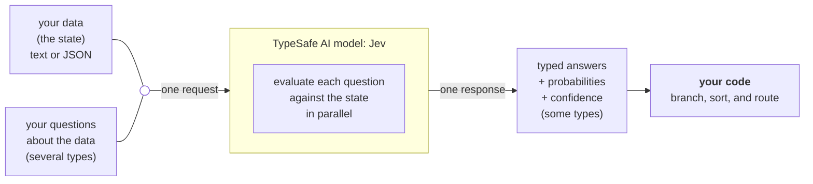
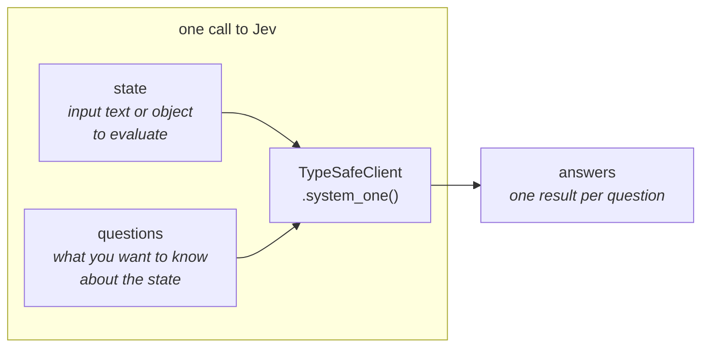

# typesafe.ai

## Fetch log
- Inbox URL: https://typesafe.ai/
- Final URL: https://typesafe.ai/
- Fetched: 2026-10-15
- Pages: 16
- Mode: standard
- Notes: `https://typesafe.ai/llms.txt` returned "Not found" (absent). Docs live on `docs.typesafe.ai` (Mintlify) whose `llms.txt` was curl-fetched and is captured verbatim as the docs index below. Docs pages were fetched as raw Markdown (`<page>.md`) via curl. No GitHub repo on the landing page; docs reference `github.com/typesafe-ai/skills` (agent skill), not used as companion.

## Landing page — https://typesafe.ai/

TypeSafe AI

Enterprise | Thoughts | Company | Docs | API console | Contact us

Version 0.01
©2026. All rights reserved.
Made in SF. With Love.
TS.AI.0S1

### We took the opposite research direction

not chat

Reinforcement Learning from Human Feedback (RLHF) has led to LLMs that are optimized for human preferences. This has led to models that are superhuman at instruction following, and are what we now call "chat." Yet RLHF creates inherent issues such as mode dropping, overconfidence, and lack of reliability. These flaws mean that LLMs require humans-in-the-loop.

a new model

We built a new class of models, System One Models, to be natively used by machines. We're building with a new architecture, a new sampler, and a new training algorithm: Reinforcement Learning for Calibrated Decisions (RLCD).

Decisions, not strings — Typed outputs that software can act on.

calibrated confidence — Every decision includes an estimate of how confident the model is.

more like code — Reliable, fast, and type-safe.

### 193.6x Faster, 444.6x Cheaper.

*based on workflows for System One tasks (proof)

TypeSafe AI, Cost $0.000081, Completed in 0.114s, LLMs, Cost $0.013880, Completed in 8.566s, Watch the real video, Built for automation

Jev returns typed decisions with calibrated probabilities, so your software can account for uncertainty. Set the thresholds for when it acts autonomously and when it asks for review. Combine those decisions in code to build larger workflows, with control over how the intelligence is used.

### Jev's intelligence per dollar is literally off the charts.

Workflow Intelligence vs. Cost

Machine-Native Intelligence — LLMs produce words for people. Jev produces typed decisions and is more like code: reliable, fast, self-consistent, and type-safe.

Hallucinations — Zero Hallucinations — Every Jev decision comes with a confidence estimate, so your software can act when confidence is high and escalate when it is not.

Jev.Cost

### $42
Per Billion input tokens.

### 238x
Lower input price than Claude Fable 5.1

### Come Build With Us
Open roles

TypeSafeAI Blog
- Company News — Jev: For the builders AND dreamers
- Case Study — How Jack & Jill Cut Candidate Screening Costs By 88% With Jev. Reducing cost by 88%, increasing speed 2x, and maintaining quality - all within 10 days from test to prod.
- Company News — Introducing System One Models & Jev. After two years in stealth, we're excited to finally introduce a new intelligence primitive for software.

### We give a FAQ

What are System One Models? What is Jev?
System One Models are a new class of AI model built for decisions inside software. Jev is TypeSafe's first public System One Model, optimized for automation. Send Jev structured questions and get typed decisions with probabilities and confidence that your software can act on.

Is Jev just a smaller LLM? / How is this different from JSON mode or structured outputs? / How can Jev be so fast and inexpensive? / Can you make Jev even faster? / Are these prices temporary or subsidized? / What is Jev good at? Where does it struggle? / Can Jev still get things wrong? / Is Jev deterministic? / How do I get started or ask a question?

Footer: TypeSafe AI © 2026 | Contact | Terms of Use | Privacy Policy | Acceptable Use Policy | Accessibility | LinkedIn | X

Sitemap (`https://typesafe.ai/sitemap.xml`, curl): /, /team, /manifesto, /blog, /enterprise, /contact, /legal/accessibility, /legal/data-processing, /legal/mca, /legal/privacy-policy, /legal/terms, /legal/acceptable-use-policy, /blog/jev-1-14, /blog/series-ai, /blog/jack-jill-jev-case-study, /blog/introducing-system-one-models-and-jev, /blog/antibenchmaxxing, /blog/bitterest-lesson, /blog/ai-too-good-to-be-true-too-bad-to-be-useful-typesafe-ai, /blog/diogo-almeida---founders-you-should-know

## Enterprise — https://typesafe.ai/enterprise

### Put Jev to work

jev for enterprise — Jev makes typed decisions for your software. Classify, score, and route quickly, at low cost. Talk to us about higher limits, data requirements, or getting started.

### Replace your expensive LLMs
- Candidate screening at 88% lower cost — Read the Case Study
- Classification at 98.7% lower cost — Read the Case Study

### Your Data
- SOC2 Type II — Visit our Trust Center to request access to the SOC 2 Type II report.
- ZDR — Zero data retention is available for enterprise customers. Ask about the setup for your account.
- No training on your inputs — We don't use your prompts or other inputs to train or fine-tune models.

### For teams and high volume
Higher Rate Limits — Need more throughput? Tell us how much you plan to run. Talk to Sales

### We give a FAQ
Do you train on our inputs or outputs? No. We don't use your inputs or outputs to train our models.
Do you offer zero data retention? / Where is our data processed? / Can we run Jev in our own VPC or on-premises? / Do you have a SOC 2 report? / Will you sign a BAA? / How much does Jev cost?

### let's talk business — [Enterprise] [Partnerships] [Individual Builders] — Support center

## Manifesto — https://typesafe.ai/manifesto

### Composable AI: Build Prod, Not God

#### Our mission is to pave the shortest path to an AI-based economic revolution² by making intelligence composable to catalyze a Cambrian explosion³ of intelligent software.

We already have general intelligence — We're not racing towards the ever-moving goalposts of "AGI," because today's models have long since crossed the threshold of intelligence needed for creating massive economic value. They know an enormous amount, reason across domains, and do things that looked impossible a few years ago.

Yet after years and trillions of dollars invested in the industry, most software still isn't meaningfully intelligent, and life is mostly the same for the average person. That should tell us something: the bottleneck isn't raw intelligence. It's that today's intelligence is hard to build on.

beyond horseless carriages — Early cars were designed as horseless carriages: rather than reimagining transportation from scratch, inventors took the familiar carriage and replaced the horse with a motor, while keeping the high seats, the buggy springs, and even the whip socket in some models. It's a clear example of how new technologies are often forced into the shape and assumptions of the thing they replace before finding their own native form.

Current AI is trained to be a helpful, articulate, pleasant assistant.⁴ Reasonable goals if you assume a human is on the other side of the model. Yet the foreseeable consequence is AI that requires humans in the loop instead of running in the background.

Software has never worked that way. Even the most complex software is built out of simple logic and layered abstractions, with every branch auditable. We want AI to work alongside existing software as a primitive that any programmer can invoke for semantic judgement and decisions, while still using code for what it's best at: exact computation.

Computers can do so much by just branching on bits, imagine if they could also branch on common sense, understanding, and intent.⁵

This is the opportunity for true, machine-native composable AI.

safe emergence — The people who built databases didn't imagine Google. The people who built internet protocols didn't envision Stripe. They made lower-level capabilities so dependable that they could not only run in the background, but also be layered on top of. A Cambrian explosion of software emerged that nobody could have designed top-down.

Intelligence today is like databases before SQL: powerful, but every use is bespoke. Once a smart decision becomes as dependable and invokable as a database query, builders will stack them the same way. The intelligence revolution will be like the early internet: unplanned, distributed grassroots efforts built by builders for builders and owned by all.⁶

Safety is a precondition for layering. You let a component run unattended if it's reliable; you only build on top of it if it's trustworthy. It takes trust to bury a dependency five layers deep in a system. People will only do so if they can inspect it, test it, and constrain it piece by piece, the way we've always engineered dependable software. That's how the composable path enables an ecosystem of small, legible primitives to safely evolve into trustworthy, complex systems.

a new shape of intelligence — We're building the paradigm shift beyond AGI:
- step one: Ship the shape of machine-native composable AI⁷ with the highest possible intelligence-per-dollar.
- step two: Make our AI reliable enough to transform the economy via real automation.
- step three: Empower the world with higher-level intelligence abstractions that are stable enough to compose and layer upon, for a collaborative, emergent future.

### We're building prod, not God.

appendix:
1. Specifically, the lack of automation.
2. There are many definitions of this, but our favorite is global TFP growth reaching 3% within five years and holding at that level for ten (unprecedented in economic history, but achievable if AI's gains diffuse across the real economy).
3. Through creating the preconditions and allowing the world to take it from there.
4. RLHF, the algorithm almost all of current AI is trained with, directly optimizes for human preference. Modern "reasoning" models are trained with RLVR as well, which optimizes for programmatically evaluatable tasks (i.e., benchmarks).
5. This is the dream of neuro-symbolic AI: neural networks for perception paired with symbolic logic for reasoning. Sometimes cheekily summarized as "smart if-statements."
6. On top of rock solid infrastructure built by people who care A LOT.
7. With a new type of frontier model meant for integrating AI within systems.

## Introducing System One Models & Jev — https://typesafe.ai/blog/introducing-system-one-models-and-jev

Company News — Sep 15, 2026 — Diogo Almeida, founder, TypeSafe

Models have been superhuman at chat for years, so where is all the automation?

This has been my driving question for the last four years. At OpenAI, I helped build the methods that made language models useful at following instructions and talking with people. That work ended up as the research behind ChatGPT. At the time, I thought maybe chat models would lead to AGI, but despite the hype it became obvious to me that there was something really big missing.

After two years in stealth, countless technical challenges, and research breakthroughs… I am beyond excited to announce that today, TypeSafe AI is releasing our first System One Model: a new class of frontier models built to make fast, structured decisions that software can use directly.

We built a new stack entirely focused on automation: with a new model architecture, parallel sampler for maximum efficiency, and training method we call Reinforcement Learning for Calibrated Decisions (RLCD).

Our first public model is Jev, available today in early access. Jev achieves similar levels of intelligence on System One tasks compared to existing LLMs, while being two orders of magnitude faster and more efficient. While Jev gives up string generation, it's optimized for structured outputs and can't hallucinate.

Think of Jev as a frontier-intelligence function call: unstructured state in, typed probabilistic decisions out.

#### Frontiers, Old and New

| | Existing LLMs | System One + Jev |
|---|---|---|
| Optimized with | RLHF / RLVR | Reinforcement Learning for Calibrated Decisions (RLCD) |
| Optimizes for | Human preference: writeups and chat responses that human raters prefer. Verifiable rewards: outputs that can be programmatically verified. | Calibrated decisions: answers with epistemically honest probabilities on System One tasks. |
| Inputs | Unstructured data (e.g. text) with an emphasis on sequential messages. | Unstructured data (e.g. text) with an emphasis on structured program state. |
| Outputs | Strings / generated text. ... To be used by software, responses need to be parsed + validated. There is also always some risk that the AI goes off the rails. | Type-safe structured values. Possible outputs and structure are defined in advance. The model never makes type errors. All answers are accompanied with calibrated probabilities and confidence scores. |
| Sampling | Sequential. Generates one token at a time, each conditioned on the last. | Parallel. Generates all outputs in a single query. Incredibly efficient and hardware-aware. |
| Cost | Input tokens: from $0.20 to $10 / MTok. Output tokens: ~5x more expensive than input tokens. | Input tokens: $0.042 / MTok ($42 per billion tokens). Output tokens: FREE (too cheap to meter). |
| Speed | End-to-end response time is 3 to 329 seconds for frontier models. | End-to-end response time is 70ms-500ms for TypeSafe. This can range from 40x-200x faster for the same levels of frontier intelligence for System One shaped queries. |
| Confidence | Even if prompted for a confidence estimate, models tend to be overconfident and inconsistent. | Always communicates confidence and uncertainty with every output. Calibrated: higher confidence means higher accuracy. More consistent: returns similar answers for similar inputs. |
| Use cases | Human-in-the-loop tasks (chatbots, copilots, coding agents). Verifiable problems (math proofs, kernel optimization). Demos. | AI-Powered Workflows / smart if-statements: classify, route, score, extract, or branch where hand-written logic is too brittle. Map-reducing over big data. Real-time applications (100ms speeds). Verify everything: score, judge, verify, guardrail, and detect jailbreaks of LLM prompts, reasoning traces, and/or outputs. |

#### Evidence / Technical Results

We love skeptics, and are skeptics ourselves. Claims you can easily verify:
- Speed per call: We truly are that fast, though our published evals are generally run from our laptops on the West Coast (this is where our service is currently based).
- Cost per call: We make our pricing transparent. We can't prove it isn't subsidized; we'll need the long-term to prove the sustainability of our pricing (which we expect to go down, not up).
- No type errors: This would be an easy thing to falsify with just a single counter-example, but it is mathematically impossible.

Side-by-side demonstration: Jev outputs all probabilities in parallel instead of autoregressively generating by token. Nuance: the query is highly simplified with a short, dense state, which paints the model in an advantageous light; compared against GPT-5.6 Terra with default reasoning ("the most comparable at intelligence to Jev on average").

Workflow evals: a new type of evaluation to measure how well AI works within code. Every model gets the same workflow (a correct compute graph represented in code); predictions are compared to the average of the smartest models (GPT-6 Astra and Fable 5.1) as reference probabilities. "Jev is off the charts – owning the Pareto frontier for almost 2 orders of magnitude." Nuance: this is where the 193.6x faster / 444.6x cheaper home-page claims come from, "and we expect that these are on the higher end of real world gains"; workflows were made by the model capabilities team so some bias could exist; LLMs use TypeSafe's System One LLM wrapper to emit structured decisions.

Hallucination and Type-safety: "Having a hallucinated tool call is inconvenient in an agent, but is an absolute deal-breaker if it's part of a system with latency guarantees or it's buried several layers deep in a dependency chain." LLM numbers are from OpenRouter; Jev's 0% is not empirical — schema matching is guaranteed.

Fun Demos:
- Doom — real-time intelligence on structured game state (text, not images); 10 queries/second costs ~$7/hour.
- Wikiracing — high-cardinality link choices. Jev supports a cardinality up to 255; for higher cardinality a two-stage system scores independently then makes an explicit choice.

What's next: early access is open; developers are being brought off the waitlist.

FAQ: Names come from Daniel Kahneman's *Thinking, Fast and Slow* (System 1 vs System 2) and William Stanley Jevons (Jevons paradox — every order of magnitude drop in the cost of intelligence unlocks orders of magnitude more use cases). Other FAQ items: Why was a new training algorithm needed? What use cases is Jev good for? Is Jev just a smaller LLM? How does Jev perform against public benchmarks? Where does our training data come from? These results are kinda crazy - how is it possible?

## Jev: For the builders AND dreamers — https://typesafe.ai/blog/jev-1-14

Company News — Oct 14, 2026

TL;DR: We're releasing an improved Jev 1.14.0 along with experimental features for our dreamers: images, a new type, and longer context. Enter the `danger zone` at your own risk.

Our philosophy: balance between reliability (prod builders) and creativity (dreamers). Dreamer-ready features ship under "danger zone" flags in API headers — features that will stay for future models but are still too jagged to vouch for in production.

Composable Images — multimodality enabled for current Jev (`jev-1.13.0` "was multimodal all along"). Image support is composable via a find-and-replace in `assets`; images can go in the `state`, `instructions`, or `criteria`. All models perform worse on multimodality than pure text; decompose questions. Header: `TypeSafe-Danger-Zone-Images: true`. Docs: docs.typesafe.ai/go/images

Types Beyond Decisions — new type `box`: returns a single bounding box, no type errors allowed. First type not purely meant for smart-if statements. Only for `jev-1.14.0`. Docs: docs.typesafe.ai/go/box

Long context — Jev supports a much longer context than enabled in production; header `TypeSafe-Danger-Zone-Long-Context: true`. Docs: docs.typesafe.ai/models#context-length

Opt-in to help us — opt-in to let TypeSafe find model jaggedness from your queries (still no training on queries).

jev-1.14.0 — released under `jev-preview`; small, subtle improvements to everything, largest gain in multi-lingual support. `jev-latest` will move to `jev-1.14.0` in a week; `jev-1.13.0` stays available. 60 days warning before `jev-1.13.0` deprecation, 30 days for `jev-1.14.0`; a deprecation policy will be published.

Measuring Intelligence — TypeSafe dislikes public benchmarks but shares internal measurements, comparing only against open-weight models; "likely biased towards our models."

What's next — "expect most releases to be beautifully boring (like we think AI should be): small improvements across the board, better stability, and features for real deployment."

## Docs — https://docs.typesafe.ai/llms.txt

# TypeSafe

> How to use TypeSafe's System One API

- [Introduction](https://docs.typesafe.ai/introduction.md): Jev is TypeSafe's flagship model and the first System One model. Send state and typed questions; get structured answers your code can use directly.
- [Quick start](https://docs.typesafe.ai/introduction/quickstart.md): Get up and running with Jev in 5 minutes.
- [Jev with coding agents](https://docs.typesafe.ai/introduction/coding-agents.md): What Jev is (and isn't) when you're using a coding agent.
- [Example use cases](https://docs.typesafe.ai/concepts/use-case-map.md): Explore TypeSafe use cases by industry and turn promising ideas into software workflows.
- [System One](https://docs.typesafe.ai/concepts/system-one.md): System One models make fast, structured decisions for software. Jev is TypeSafe's flagship model and the first System One model.
- [State](https://docs.typesafe.ai/concepts/state.md): What state is, how to structure it, and how to give a System One model the context it needs.
- [Primitives (Questions)](https://docs.typesafe.ai/primitives.md): The TypeSafe question types, the typed answers they return, how to choose between them, and how to ask several at once.
- [Choice](https://docs.typesafe.ai/primitives/choice.md): A Choice is a System One question type for selecting one option from a defined set. The answer includes the selected option, a probability for each option, and confidence.
- [Score](https://docs.typesafe.ai/primitives/score.md): A Score is a System One question type for rating content against ordered, descriptive levels. The answer includes a score, a probability for each level, and confidence.
- [Noul](https://docs.typesafe.ai/primitives/noul.md): A Noul question asks the TypeSafe model to evaluate a yes/no question and return the probability that the answer is yes.
- [Box](https://docs.typesafe.ai/primitives/box.md): A Box is a System One question type for finding where something is in an image. The answer is the four edges of a box around it, as fractions of the image's width and height.
- [Advanced: structure](https://docs.typesafe.ai/primitives/advanced.md): Instructions, Choice options, Score levels, and Noul criteria all accept JSON structure.
- [Images](https://docs.typesafe.ai/images.md): Send images in a System One request: in the state, inside a question's instructions, and as the criteria a question is judged against.
- [Confidence](https://docs.typesafe.ai/confidence.md): How TypeSafe reports certainty, how it differs from probability, and how to use it to control system behavior.
- [How to build with TypeSafe](https://docs.typesafe.ai/concepts/how-to-build-with-system-one.md): Design AI-powered software by keeping code in control and giving System One narrow, structured decisions.
- [AI primer](https://docs.typesafe.ai/introduction/machine-learning-primer.md): Why TypeSafe trains decision models with calibrated probabilities instead of optimizing for generated text.
- [Patterns](https://docs.typesafe.ai/patterns.md): Architectural patterns for building systems with TypeSafe.
- [Speculative fan-out](https://docs.typesafe.ai/patterns/fan-out.md): Send many questions in a single call, including speculative ones, and let your code decide what's relevant.
- [Confidence-gated routing](https://docs.typesafe.ai/patterns/confidence-routing.md): Use confidence as a second axis. The answer tells you what; confidence tells you whether to act.
- [Composite scoring](https://docs.typesafe.ai/patterns/composite-scoring.md): Break a complex judgment into atomic scores, combine with weights you control in code.
- [Intent routing](https://docs.typesafe.ai/patterns/intent-routing.md): Classify incoming requests and route each to the optimal handler: deterministic logic, a specialist LLM, or a human.
- [Cookbooks](https://docs.typesafe.ai/cookbooks.md): End-to-end recipes that show TypeSafe in real problems, from a few questions to full pipelines.
- [Function calling](https://docs.typesafe.ai/cookbooks/function_calling.md): Turns natural-language trading requests into calls to ordinary typed functions by mapping function names and closed-set arguments to confidence-aware TypeSafe questions.
- [Skill suggestion](https://docs.typesafe.ai/cookbooks/skill_suggestion.md): Picks at most one skill for an agent turn out of the 182 in Nous Research's Hermes catalog, using two TypeSafe requests to rank and re-check the top candidates.
- [Guardrails for LLMs](https://docs.typesafe.ai/cookbooks/llm_guardrails.md): Screen every message going into and out of an LLM app with one TypeSafe request, thresholding hazard probabilities and severity to pass, review, block, or route.
- [Double-checking citations](https://docs.typesafe.ai/cookbooks/citation_check.md): Catch wrong or hallucinated citations by checking against the source document. One Choice question decides whether the quote's context supports the claim.
- [Classifying RAG passages](https://docs.typesafe.ai/cookbooks/classifying_rag_passages.md): Score each retrieved passage with one TypeSafe request, then decide in code which ones reach the answering model.
- [Simple memory system](https://docs.typesafe.ai/cookbooks/basic_memory.md): Let Jev decide which requests and answers are worth remembering, then wrap the Jev call in a small function that adds memories to later calls.
- [Hierarchical classification](https://docs.typesafe.ai/cookbooks/hierarchical_classification.md): Classifies documents through deep patent, retail product, biomedical, and source-code hierarchies using parallel beam search over TypeSafe Choice probabilities.
- [Classification using confidence](https://docs.typesafe.ai/cookbooks/classification_using_confidence.md): Classify SEC annual reports into 75 industry groups with one Choice each, then read the answer's own confidence to decide whether to report that group or the broader division above it.
- [Twitch chat filter](https://docs.typesafe.ai/cookbooks/twitch_chat_filter.md): Hide insults, spam, and unasked-for gameplay tips in Twitch chat, blur spoilers, and highlight questions. Each message gets one TypeSafe request containing multiple questions. Up to eight messages are processed concurrently, and the rules are defined in code.
- [SDE cascade](https://docs.typesafe.ai/cookbooks/sde_cascade.md): Uses a 2-stage structured-data-extraction cascade (mini → verify → reasoning) to get most of the quality of a big reasoning model at a fraction of the cost.
- [Date extraction](https://docs.typesafe.ai/cookbooks/date_extraction_cookbook.md): Extracts absolute and relative dates by asking TypeSafe for the parts named in a document, then resolving and validating them in code with confidence-based review.
- [Pre-parsed value extraction](https://docs.typesafe.ai/cookbooks/pre_parsed_value_extraction_cookbook.md): Uses regexes to find candidate emails, phone numbers, and amounts, then has TypeSafe select the requested span so code can normalize a verbatim value.
- [Structure recovery](https://docs.typesafe.ai/cookbooks/autoformat.md): Reconstructs Markdown from plain text that lost its formatting in two requests: one stitches hard-wrapped lines back together, one classifies every block (heading, list, code, callout).
- [Re-ranking](https://docs.typesafe.ai/cookbooks/rerank_typesafe.md): Builds 30-passage BM25 shortlists for 40 CLERC legal queries, then uses one TypeSafe question per query-candidate pair to raise top-1 accuracy from 5% to 18% and top-10 accuracy from 38% to 62%.
- [Line-by-line search](https://docs.typesafe.ai/cookbooks/semantic_find.md): Build semantic search for GitHub's Terms of Service. In one request, score 218 line ids against a plain-language query with a Choice question, and use a Noul question to check whether the document contains an answer.
- [Knowledge graph entity alignment](https://docs.typesafe.ai/cookbooks/entity_alignment.md): Decides which of 450 candidate pairs from two beer catalogues describe the same product using one Score question plus three companion Nouls that surface which fields disagree.
- [Self-consistency: choices](https://docs.typesafe.ai/cookbooks/consistency_choice_cookbook.md): Add an uncertain outcome to moderation decisions and compare label agreement with the share of automatic actions.
- [Self-consistency: nouls](https://docs.typesafe.ai/cookbooks/consistency_noul_cookbook.md): Route uncertain probabilities to human review while keeping the underlying noul values visible.
- [Parallel questions](https://docs.typesafe.ai/cookbooks/parallel_questions.md): Runs a 13-question regulatory briefing over the GDPR Wikipedia article, showing that batching every question into one TypeSafe call is 12.2x cheaper and 10.0x faster with no change in answers.
- [Autoresearch feature discovery](https://docs.typesafe.ai/cookbooks/autoresearch_feature_discovery.md): Runs an autoresearch loop that proposes TypeSafe questions, converts free text into numeric features, and uses model errors to improve a supervised CatBoost regressor.
- [Demos](https://docs.typesafe.ai/demos.md): Interactive examples showing what's possible with TypeSafe.
- [Smart home assistant demo](https://docs.typesafe.ai/demos/smart-home.md): Demo code: a smart home assistant that uses TypeSafe to evaluate user requests.
- [Models](https://docs.typesafe.ai/models.md)
- [API reference](https://docs.typesafe.ai/api.md): Full HTTP API reference for the TypeSafe evaluation endpoint.
- [Agent skill](https://docs.typesafe.ai/agent-skill.md): Drop-in skill for Claude Code, Codex, and other agent environments.
- [Legal](https://docs.typesafe.ai/legal.md): Legal documents and policies for TypeSafe.
- [Jev 1.13 jaggedness](https://docs.typesafe.ai/model-jaggedness/jev-1.13.md): Jev isn't perfect. Here are some jagged edges we are aware of with jev-1.13. Many of these will be fixed in later versions.
- [Client SDKs](https://docs.typesafe.ai/sdk.md): Install a TypeSafe client SDK and use typed questions and answers in your application.
- [TypeSafe Python SDK](https://docs.typesafe.ai/sdk/python.md): Install the TypeSafe Python SDK and get started with asynchronous or synchronous API calls.
- [Basic usage](https://docs.typesafe.ai/sdk/python/usage/basic.md): Guides and patterns for working with the TypeSafe Python SDK.
- [Advanced usage](https://docs.typesafe.ai/sdk/python/usage/advanced.md): Performance tuning, logging, and forward compatibility for the TypeSafe Python SDK.
- [Changelog](https://docs.typesafe.ai/sdk/python/changelog.md): Python clients for the TypeSafe AI API
- [API reference](https://docs.typesafe.ai/sdk/python/api.md): Python clients for the TypeSafe AI API
- [Asynchronous client](https://docs.typesafe.ai/sdk/python/api/clients/async.md): Use AsyncTypeSafeClient to ask questions, list models, and configure asynchronous TypeSafe API requests.
- [Synchronous client](https://docs.typesafe.ai/sdk/python/api/clients/sync.md): Use TypeSafeClient to ask questions, list models, and configure synchronous TypeSafe API requests.
- [Questions](https://docs.typesafe.ai/sdk/python/api/types/questions.md): Provide state and ask yes/no, choice, and score questions using objects or dictionaries.
- [Assets](https://docs.typesafe.ai/sdk/python/api/types/assets.md): Attach assets to System One requests and reference them from request content.
- [Answers and responses](https://docs.typesafe.ai/sdk/python/api/types/responses.md): Read answers, confidence scores, token usage, and available models returned by the TypeSafe API.
- [Retries](https://docs.typesafe.ai/sdk/python/api/retries.md): Configure retries with RetryPolicy — attempt count, retryable statuses, backoff, and retry headers handling.
- [Common types](https://docs.typesafe.ai/sdk/python/api/types/common.md): Common types for TypeSafe API SDK.
- [Exceptions](https://docs.typesafe.ai/sdk/python/api/exceptions.md): Handle TypeSafe API errors, rate limits, connection failures, and timeouts.
- [Constants](https://docs.typesafe.ai/sdk/python/api/constants.md): Default settings and environment variable names for the TypeSafe Python SDK.
- [JavaScript SDK](https://docs.typesafe.ai/sdk/javascript.md)
- [Changelog](https://docs.typesafe.ai/sdk/javascript/changelog.md)
- [API reference](https://docs.typesafe.ai/sdk/javascript/api.md)
- [Class: APIConnectionError](https://docs.typesafe.ai/sdk/javascript/api/classes/APIConnectionError.md)
- [Class: APIError](https://docs.typesafe.ai/sdk/javascript/api/classes/APIError.md)
- [Class: APIPromise<T>](https://docs.typesafe.ai/sdk/javascript/api/classes/APIPromise.md)
- [Class: APITimeoutError](https://docs.typesafe.ai/sdk/javascript/api/classes/APITimeoutError.md)
- [Class: APIUserAbortError](https://docs.typesafe.ai/sdk/javascript/api/classes/APIUserAbortError.md)
- [Class: AuthenticationError](https://docs.typesafe.ai/sdk/javascript/api/classes/AuthenticationError.md)
- [Class: BadRequestError](https://docs.typesafe.ai/sdk/javascript/api/classes/BadRequestError.md)
- [Class: Image](https://docs.typesafe.ai/sdk/javascript/api/classes/Image.md)
- [Class: InternalServerError](https://docs.typesafe.ai/sdk/javascript/api/classes/InternalServerError.md)
- [Class: NotFoundError](https://docs.typesafe.ai/sdk/javascript/api/classes/NotFoundError.md)
- [Class: PermissionDeniedError](https://docs.typesafe.ai/sdk/javascript/api/classes/PermissionDeniedError.md)
- [Class: RateLimitError](https://docs.typesafe.ai/sdk/javascript/api/classes/RateLimitError.md)
- [Class: TypeSafeClient](https://docs.typesafe.ai/sdk/javascript/api/classes/TypeSafeClient.md)
- [Class: TypeSafeError](https://docs.typesafe.ai/sdk/javascript/api/classes/TypeSafeError.md)
- [Class: UnprocessableEntityError](https://docs.typesafe.ai/sdk/javascript/api/classes/UnprocessableEntityError.md)
- [Interface: BoxCoordinates](https://docs.typesafe.ai/sdk/javascript/api/interfaces/BoxCoordinates.md)
- [Interface: BoxQuestion](https://docs.typesafe.ai/sdk/javascript/api/interfaces/BoxQuestion.md)
- [Interface: BoxResponse](https://docs.typesafe.ai/sdk/javascript/api/interfaces/BoxResponse.md)
- [Interface: ChoiceQuestion<T>](https://docs.typesafe.ai/sdk/javascript/api/interfaces/ChoiceQuestion.md)
- [Interface: ChoiceResponse<T>](https://docs.typesafe.ai/sdk/javascript/api/interfaces/ChoiceResponse.md)
- [Interface: Logger](https://docs.typesafe.ai/sdk/javascript/api/interfaces/Logger.md)
- [Interface: ModelCard](https://docs.typesafe.ai/sdk/javascript/api/interfaces/ModelCard.md)
- [Interface: Models](https://docs.typesafe.ai/sdk/javascript/api/interfaces/Models.md)
- [Interface: NoulQuestion](https://docs.typesafe.ai/sdk/javascript/api/interfaces/NoulQuestion.md)
- [Interface: NoulResponse](https://docs.typesafe.ai/sdk/javascript/api/interfaces/NoulResponse.md)
- [Interface: Questions](https://docs.typesafe.ai/sdk/javascript/api/interfaces/Questions.md)
- [Interface: RequestOptions](https://docs.typesafe.ai/sdk/javascript/api/interfaces/RequestOptions.md)
- [Interface: RetryPolicy](https://docs.typesafe.ai/sdk/javascript/api/interfaces/RetryPolicy.md)
- [Interface: ScoreQuestion<T>](https://docs.typesafe.ai/sdk/javascript/api/interfaces/ScoreQuestion.md)
- [Interface: ScoreResponse<T>](https://docs.typesafe.ai/sdk/javascript/api/interfaces/ScoreResponse.md)
- [Interface: SystemOneRequest<Q>](https://docs.typesafe.ai/sdk/javascript/api/interfaces/SystemOneRequest.md)
- [Interface: SystemOneResult<Q>](https://docs.typesafe.ai/sdk/javascript/api/interfaces/SystemOneResult.md)
- [Interface: TextWithAssets](https://docs.typesafe.ai/sdk/javascript/api/interfaces/TextWithAssets.md)
- [Interface: TypeSafeClientConfig](https://docs.typesafe.ai/sdk/javascript/api/interfaces/TypeSafeClientConfig.md)
- [Interface: Usage](https://docs.typesafe.ai/sdk/javascript/api/interfaces/Usage.md)
- [Interface: WithResponse<T>](https://docs.typesafe.ai/sdk/javascript/api/interfaces/WithResponse.md)
- [Type Alias: Asset](https://docs.typesafe.ai/sdk/javascript/api/type-aliases/Asset.md)
- [Type Alias: ChoiceCriteria](https://docs.typesafe.ai/sdk/javascript/api/type-aliases/ChoiceCriteria.md)
- [Type Alias: Compression](https://docs.typesafe.ai/sdk/javascript/api/type-aliases/Compression.md)
- [Type Alias: ContentValue](https://docs.typesafe.ai/sdk/javascript/api/type-aliases/ContentValue.md)
- [Type Alias: Description](https://docs.typesafe.ai/sdk/javascript/api/type-aliases/Description.md)
- [Type Alias: EntryType](https://docs.typesafe.ai/sdk/javascript/api/type-aliases/EntryType.md)
- [Type Alias: EnvVar](https://docs.typesafe.ai/sdk/javascript/api/type-aliases/EnvVar.md)
- [Type Alias: Fetch](https://docs.typesafe.ai/sdk/javascript/api/type-aliases/Fetch.md)
- [Type Alias: JsonValue](https://docs.typesafe.ai/sdk/javascript/api/type-aliases/JsonValue.md)
- [Type Alias: LogLevel](https://docs.typesafe.ai/sdk/javascript/api/type-aliases/LogLevel.md)
- [Type Alias: Question](https://docs.typesafe.ai/sdk/javascript/api/type-aliases/Question.md)
- [Type Alias: ResultFor<T>](https://docs.typesafe.ai/sdk/javascript/api/type-aliases/ResultFor.md)
- [Type Alias: ScoreCriteria](https://docs.typesafe.ai/sdk/javascript/api/type-aliases/ScoreCriteria.md)
- [Type Alias: ScoreLegend<T>](https://docs.typesafe.ai/sdk/javascript/api/type-aliases/ScoreLegend.md)
- [Type Alias: ScoreOf<T>](https://docs.typesafe.ai/sdk/javascript/api/type-aliases/ScoreOf.md)
- [Type Alias: SentContent<T>](https://docs.typesafe.ai/sdk/javascript/api/type-aliases/SentContent.md)
- [Variable: ENV](https://docs.typesafe.ai/sdk/javascript/api/variables/ENV.md)
- [Variable: LOG_LEVELS](https://docs.typesafe.ai/sdk/javascript/api/variables/LOG_LEVELS.md)
- [Variable: noul](https://docs.typesafe.ai/sdk/javascript/api/variables/noul.md)
- [Variable: score](https://docs.typesafe.ai/sdk/javascript/api/variables/score.md)
- [Variable: VERSION](https://docs.typesafe.ai/sdk/javascript/api/variables/VERSION.md)
- [Variable: withAssets](https://docs.typesafe.ai/sdk/javascript/api/variables/withAssets.md)
- [Function: box()](https://docs.typesafe.ai/sdk/javascript/api/functions/box.md)
- [Function: choice()](https://docs.typesafe.ai/sdk/javascript/api/functions/choice.md)
- [Function: image()](https://docs.typesafe.ai/sdk/javascript/api/functions/image.md)


This documentation is built and hosted on [Mintlify](https://mintlify.com), a developer documentation platform.

## Introduction — https://docs.typesafe.ai/introduction


> Jev is TypeSafe's flagship model and the first System One model. Send state and typed questions; get structured answers your code can use directly.

Large language models (LLMs) are designed to produce text for humans to read. When you need a model to make a judgment that your code will consume, that creates a mismatch: you are coercing a text-generation system into outputting structured decisions, then parsing the results back into something your code can depend on.

Jev is TypeSafe's flagship model and the first [System One model](/concepts/system-one). System One models are built to make fast, structured decisions that software can use directly. Jev evaluates typed *questions* against a *state* and returns structured results directly. No text generation, no parsing. You get typed values and probability distributions that your code can branch on, sort by, and route with. Some question types also return [confidence](/confidence), which your code can use to decide whether and how to act on an answer. Each question type's page lists what its answers include.



### TypeSafe primitives

TypeSafe exposes *AI primitives*. Similar to software primitives, our AI primitives are modular, composable, structured, reliable, and fast. Each asks a different type of *question* and returns a different type of answer.

| Question type | Goal | Returns |
| - | - | - |
| [Choice](/primitives/choice) | Choose an option from a list | `choice`, `probabilities`, `confidence` |
| [Score](/primitives/score) | Score the state on a rubric | `score`, `probabilities`, `confidence` |
| [Noul](/primitives/noul) | Is this statement true? | `noul` (0–1) |

Any mix of *question* types can go in a single API call. Every *question* is evaluated in parallel and in isolation against the same *state* in one go. Adding questions barely changes the response time. Each question is evaluated independently, so adding more questions does not create context-rot.

### Atomic questions, composed in code

System One models work best when each question asks one specific, well-scoped thing. Think of each question as a gut-check determination: the kind of judgment a highly knowledgeable person could make in a few seconds given the right context.

If the question you want to ask would require extended reasoning or weighs multiple independent factors, decompose it. Ask each factor as a separate question, then combine the results with logic in your code. This keeps each individual evaluation reliable and gives you full control over how dimensions are weighted.

For example, instead of "rate this startup pitch," ask separately about market size, technical feasibility, and differentiation. Combine the scores with your own formula. When priorities shift, change a coefficient in your code rather than rewriting a prompt.

### Next steps

* [Quick Start](/introduction/quickstart) — Everything you need to get started immediately.
* [AI Primer](/introduction/machine-learning-primer) — Why TypeSafe trains models for calibrated decisions instead of generated text.
* [Primitives (Questions)](/primitives) — How to define questions, choose a question type, and ask several at once.
* [Confidence](/confidence) — How TypeSafe reports certainty, and how to use it architecturally.
* [Patterns](/patterns) — Common patterns for building systems with TypeSafe.


This documentation is built and hosted on [Mintlify](https://mintlify.com), a developer documentation platform.


## Quick start — https://docs.typesafe.ai/introduction/quickstart


> Get up and running with Jev in 5 minutes.

This guide covers four ways of using Jev, TypeSafe's [System One model](/concepts/system-one), namely: [use our SDK](#code-it-your-first-request), [call our API](#call-it-the-api), [use our agent skill](#vibe-it-the-agent-skill), or [try our browser-based Playground](#try-it-the-playground).

Get an API key from the [TypeSafe console](https://console.typesafe.ai/keys).

### The minimum you should know to use Jev effectively

Each call to Jev takes a [state](/concepts/state) (as a simple string or structured object) and a set of [questions](/primitives), and returns one answer per question:



Jev answers three types of question, called primitives:

| Question type | Goal | Returns |
| - | - | - |
| [Choice](/primitives/choice) | Choose an option from a list | `choice`, `probabilities`, `confidence` |
| [Score](/primitives/score) | Score the state on a rubric | `score`, `probabilities`, `confidence` |
| [Noul](/primitives/noul) | Is this statement true? | `noul` (0–1) |

### Vibe it: the Agent Skill

The fastest way to add Jev to your project is to have your coding agent write the integration with the TypeSafe skill installed.

1. **[Install the TypeSafe skill](/agent-skill#installation)** using the Claude Code plugin or `npx skills add typesafe-ai/skills --skill typesafe-ai`. You can also [read SKILL.md on GitHub](https://github.com/typesafe-ai/skills/blob/main/skills/typesafe-ai/SKILL.md).

<Tabs>
  <Tab title="Claude Code">
    Run these two commands in your terminal:

    ```bash theme={null}
    claude plugin marketplace add typesafe-ai/skills
    claude plugin install typesafe@typesafe-ai
    ```
  </Tab>

  <Tab title="Other agents">
    ```bash theme={null}
    npx skills add typesafe-ai/skills --skill typesafe-ai
    ```

    Choose your agent when prompted. Installation is project-local by default; add `-g` to install globally.
  </Tab>

  <Tab title="Copy to your agent">
    Paste this prompt into your coding agent:

    ```text wrap theme={null}
    Install the TypeSafe skill. If you're in Claude Code, run `claude plugin marketplace add typesafe-ai/skills`, then `claude plugin install typesafe@typesafe-ai`. If you're in another agent, run `npx skills add typesafe-ai/skills --skill typesafe-ai` and select your agent. Use one installation method. You can read the skill directly at https://github.com/typesafe-ai/skills/blob/main/skills/typesafe-ai/SKILL.md (raw: https://raw.githubusercontent.com/typesafe-ai/skills/main/skills/typesafe-ai/SKILL.md). Then use the TypeSafe skill when working on this project.
    ```
  </Tab>
</Tabs>

2. **Tell your coding agent** to use the TypeSafe skill as you build.

```plaintext title="Coding agent prompt" theme={null}
Let's build a simple CLI that uses Jev to evaluate a set of supplied texts on multiple dimensions. Use the TypeSafe skill to understand how to use the TypeSafe API and how to structure the system. Ask me questions about what kinds of texts I want to evaluate and on what dimensions.
```

<Note>
  We suggest that you generate and store your TypeSafe API key in an environment variable (e.g. `TYPESAFE_API_KEY`).
</Note>

The [Agent Skill](/agent-skill) page has more example prompts and fixes for common issues, such as an agent that isn't using the skill.

### Code it: your first request

See how to call Jev from your favourite programming language. The Python, JavaScript, and TypeScript examples use our SDKs; the Bash example calls the API directly.

Create a working directory and set your API key. These setup commands use Bash on macOS, Linux, or Windows with WSL:

```bash wrap theme={null}
mkdir typesafe-quickstart
cd typesafe-quickstart
export TYPESAFE_API_KEY="your-api-key"
```

The example sends a customer support ticket and asks Jev three questions in one request: which team should handle it, how frustrated the customer sounds, and whether the issue is urgent.

<Tabs>
  <Tab title="Python">
    Requires Python 3.10 or later. Choose a package manager to install the SDK:

    <Tabs sync={false}>
      <Tab title="pip">
        With [pip installed](https://pip.pypa.io/en/stable/installation/), create a virtual environment and add the SDK:

        ```bash wrap theme={null}
        python3 -m venv .venv
        .venv/bin/pip install typesafe-sdk
        ```
      </Tab>

      <Tab title="uv">
        With [uv installed](https://docs.astral.sh/uv/getting-started/installation/), initialize a project and add the SDK:

        ```bash wrap theme={null}
        uv init --bare
        uv add typesafe-sdk
        ```
      </Tab>
    </Tabs>

    Save as `route_ticket.py`:

    ```python wrap theme={null}
    from typesafe_sdk import Choice, Noul, Score, TypeSafeClient

    ticket = "Our API integration started returning 500 errors on every request about 20 minutes ago, and we can't process any customer orders until this is fixed."

    with TypeSafeClient(model="jev-latest") as client:  # Reads TYPESAFE_API_KEY.
        response = client.system_one(
            state=ticket,
            questions={
                "department": Choice(
                    instructions="Which team should handle this",
                    criteria={
                        "billing": "Payment or subscription issues",
                        "technical": "Bugs or integration problems",
                        "sales": "Pricing or account questions",
                    },
                ),
                "frustration": Score(
                    instructions="How frustrated the customer appears",
                    criteria=[
                        "Calm, just stating facts",
                        "Frustrated but civil",
                        "Very angry, strong language",
                    ],
                ),
                "is_urgent": Noul(
                    instructions="The message conveys urgency or time-sensitivity",
                ),
            },
        )

    print(response.choices["department"].choice)
    print(response.scores["frustration"].score)
    print(response.nouls["is_urgent"].noul)
    ```

    Run it with either installation method:

    ```bash wrap theme={null}
    .venv/bin/python route_ticket.py
    ```
  </Tab>

  <Tab title="JavaScript">
    Requires Node.js 20 or later. Install the SDK and mark the project as an ES module:

    ```bash wrap theme={null}
    npm install @typesafe-ai/sdk
    npm pkg set type=module
    ```

    Save as `route_ticket.js`:

    ```javascript wrap theme={null}
    import { choice, noul, score, TypeSafeClient } from "@typesafe-ai/sdk";

    const ticket = "Our API integration started returning 500 errors on every request about 20 minutes ago, and we can't process any customer orders until this is fixed.";

    const client = new TypeSafeClient({ defaultModel: "jev-latest" }); // Reads TYPESAFE_API_KEY.
    const response = await client.systemOne({
      state: ticket,
      questions: {
        department: choice("Which team should handle this", {
          billing: "Payment or subscription issues",
          technical: "Bugs or integration problems",
          sales: "Pricing or account questions",
        }),
        frustration: score("How frustrated the customer appears", [
          "Calm, just stating facts",
          "Frustrated but civil",
          "Very angry, strong language",
        ]),
        is_urgent: noul("The message conveys urgency or time-sensitivity"),
      },
    });

    console.log(response.answers.department.choice);
    console.log(response.answers.frustration.score);
    console.log(response.answers.is_urgent.noul);
    ```

    Run it:

    ```bash wrap theme={null}
    node route_ticket.js
    ```
  </Tab>

  <Tab title="TypeScript">
    Requires Node.js 22.18 or later to run TypeScript directly. Install the SDK and mark the project as an ES module:

    ```bash wrap theme={null}
    npm install @typesafe-ai/sdk
    npm pkg set type=module
    ```

    Save as `route_ticket.ts`:

    ```typescript wrap theme={null}
    import { choice, noul, score, TypeSafeClient } from "@typesafe-ai/sdk";

    const ticket = "Our API integration started returning 500 errors on every request about 20 minutes ago, and we can't process any customer orders until this is fixed.";

    const client = new TypeSafeClient({ defaultModel: "jev-latest" }); // Reads TYPESAFE_API_KEY.
    const response = await client.systemOne({
      state: ticket,
      questions: {
        department: choice("Which team should handle this", {
          billing: "Payment or subscription issues",
          technical: "Bugs or integration problems",
          sales: "Pricing or account questions",
        }),
        frustration: score("How frustrated the customer appears", [
          "Calm, just stating facts",
          "Frustrated but civil",
          "Very angry, strong language",
        ]),
        is_urgent: noul("The message conveys urgency or time-sensitivity"),
      },
    });

    console.log(response.answers.department.choice);
    console.log(response.answers.frustration.score);
    console.log(response.answers.is_urgent.noul);
    ```

    Run it:

    ```bash wrap theme={null}
    node route_ticket.ts
    ```

    The SDK infers answer types from your questions, so `response.answers.department.choice` has the type `"billing" | "technical" | "sales"`.
  </Tab>

  <Tab title="Bash">
    Requires curl 7.76 or later. Save as `route_ticket.sh`:

    ```bash wrap theme={null}
    #!/usr/bin/env bash
    set -euo pipefail
    : "${TYPESAFE_API_KEY:?Set TYPESAFE_API_KEY first.}"

    curl --fail-with-body --silent --show-error \
      https://api.typesafe.ai/v1/systemone \
      -H "Authorization: Bearer $TYPESAFE_API_KEY" \
      -H "Content-Type: application/json" \
      --data-binary @- <<'JSON'
    {
      "state": "Our API integration started returning 500 errors on every request about 20 minutes ago, and we can't process any customer orders until this is fixed.",
      "model": "jev-latest",
      "questions": {
        "department": {
          "type": "choice",
          "instructions": "Which team should handle this",
          "criteria": {
            "billing": "Payment or subscription issues",
            "technical": "Bugs or integration problems",
            "sales": "Pricing or account questions"
          }
        },
        "frustration": {
          "type": "score",
          "instructions": "How frustrated the customer appears",
          "criteria": [
            "Calm, just stating facts",
            "Frustrated but civil",
            "Very angry, strong language"
          ]
        },
        "is_urgent": {
          "type": "noul",
          "instructions": "The message conveys urgency or time-sensitivity"
        }
      }
    }
    JSON
    ```

    Run it:

    ```bash wrap theme={null}
    bash route_ticket.sh
    ```
  </Tab>
</Tabs>

Jev evaluates each question against the same state and returns answers under the IDs you supplied. `choice` is the team label, `score` is the position on the three-level frustration rubric (0–2), and `noul` is the probability of urgency (0–1).

The Python, JavaScript, and TypeScript examples print those three values:

```text Example output theme={null}
technical
0.67
0.99
```

The Bash example prints the raw JSON response on one line. The Raw Response in the next section shows it formatted, with each answer's confidence and probabilities. These are example results; values can change between Jev releases.

The [client SDKs](/sdk) pages cover installing the Python and JavaScript SDKs, typed answers, and their retry policy.

### Call it: the API

All four code examples in the previous section use this endpoint. The Bash tab above shows the complete HTTP request without an SDK.

```http theme={null}
POST https://api.typesafe.ai/v1/systemone
Authorization: Bearer <API_KEY>
Content-Type: application/json
```

<Accordion title="Raw Response">
  ```json theme={null}
  {
    "model": "jev-1.13.0",
    "answers": {
      "department": {
        "type": "choice",
        "choice": "technical",
        "confidence": 1.0,
        "probabilities": {
          "technical": 1.0,
          "billing": 0.0,
          "sales": 0.0
        }
      },
      "frustration": {
        "type": "score",
        "score": 0.67,
        "confidence": 0.5,
        "legend": {
          "0": "Calm, just stating facts",
          "1": "Frustrated but civil",
          "2": "Very angry, strong language"
        },
        "probabilities": {
          "0": 0.33,
          "1": 0.67,
          "2": 0.0
        }
      },
      "is_urgent": {
        "type": "noul",
        "noul": 0.99
      }
    },
    "usage": {
      "input_tokens": 428,
      "output_tokens": 73
    }
  }
  ```
</Accordion>

The [API Reference](/api) lists every request field, question type, and answer type.

### Try it: the Playground

The Playground runs Jev in the browser: paste a state, add questions, and read the answers without writing code.

1. **Open the [Playground](https://console.typesafe.ai/playground)** and log in.
2. **Paste any text** as the state.

```plaintext title="Sample state" theme={null}
Our API integration started returning 500 errors on every request about 20 minutes ago, and we can't process any customer orders until this is fixed.
```

3. **Add a question.** Try a Noul question: `"Does this message express urgency?"`

```json theme={null}
{
  "urgency": {
    "type": "noul",
    "instructions": "Does this message express urgency?"
  }
}
```

4. **Add more questions.** Mix Noul, Choice, and Score questions in one call and see all results at once.

***

### Next Steps

Composing primitives into larger systems takes some practice, even if you're used to LLMs. The [Machine Learning Primer](/introduction/machine-learning-primer) explains why Jev returns calibrated probabilities instead of generated text, and how that changes the way you build with it.

We’d also suggest taking a look at [Primitives](/primitives) and the [Use Case Map](/concepts/use-case-map).

1. [Errors and retries](/sdk/python/usage/basic#error-handling)
2. [Parallel Questions](/cookbooks/parallel_questions)


This documentation is built and hosted on [Mintlify](https://mintlify.com), a developer documentation platform.


## Jev with coding agents — https://docs.typesafe.ai/introduction/coding-agents


> What Jev is (and isn't) when you're using a coding agent.

If you found TypeSafe while looking for a model to plug into your coding agent, start here. Jev is **not** a drop-in replacement for the LLM behind Claude Code, Cursor, opencode, Copilot, Muse Spark, Grok Bot, or similar tools. Instead, you can use your coding agent as usual to write code that uses Jev to make decisions.

### Jev is not a chat or code-completion LLM

Jev is a [System One model](/concepts/system-one). It does not generate text, write code, or hold a conversation. It takes a [state](/concepts/state) and a set of typed [questions](/primitives) and returns structured answers your code can use directly:

* A `choice` from a list of options, with per-option probabilities.
* A `score` on a rubric you define.
* A `noul` (0–1) for a true/false statement.

Coding agents rely on an LLM that streams text, calls tools, and edits files based on natural-language instructions. Jev does none of that. There is no `model: "jev-latest"` setting that turns your coding agent into a Jev-powered agent, because the two systems solve different problems.

### What you probably want instead

Pick the row that matches what you were trying to do:

| You wanted to... | Do this |
| - | - |
| Make your coding agent better at *writing code that uses TypeSafe* | Install the [TypeSafe agent skill](/agent-skill). It gives Claude Code, Codex, and other agents full context on the Jev API, the [primitives](/primitives), and the [patterns](/patterns) so they can generate correct TypeSafe integrations for you. |
| Use Jev inside an app or agent you're building — for routing, classification, scoring, guardrails, or any structured decision | Start with the [Quick start](/introduction/quickstart), then read [How to build with TypeSafe](/concepts/how-to-build-with-system-one) and the [Patterns](/patterns) for common architectures like [confidence routing](/patterns/confidence-routing) and [intent routing](/patterns/intent-routing). |
| Replace or swap the model that powers a coding agent | Jev isn't the tool for this. Keep using an LLM-based coding agent, and use Jev separately wherever your product needs a fast, calibrated, structured decision. |
| Try Jev before writing any code | Open the [Playground](https://console.typesafe.ai/playground), paste some text as the state, and add a few questions. See the [Quick start](/introduction/quickstart) for a walkthrough. |

### When Jev is worth reaching for

Even though Jev isn't a coding-agent LLM, it's often exactly the right tool *inside* an agent or app you're building with a coding agent. Reach for Jev when your code needs to:

* Route a request to one of a fixed set of destinations, and know how confident that routing is.
* Score something on a rubric (urgency, quality, risk) and branch on the number.
* Check whether a statement is true of a document, message, or record before taking an action.
* Replace a fragile prompt that asks an LLM to "return JSON" with a call that returns typed values by construction.

If any of that matches what you're building, the fastest path in is the [Quick start](/introduction/quickstart), then the [primitives](/primitives) reference for the question types.

### Next steps

* [System One](/concepts/system-one) — What a System One model is and how it differs from an LLM.
* [Quick start](/introduction/quickstart) — Try Jev in the Playground, over HTTP, or with the Python SDK.
* [Agent skill](/agent-skill) — Give your coding agent context on the TypeSafe API.
* [Patterns](/patterns) — Common architectures for building with TypeSafe.


This documentation is built and hosted on [Mintlify](https://mintlify.com), a developer documentation platform.


## System One — https://docs.typesafe.ai/concepts/system-one


> System One models make fast, structured decisions for software. Jev is TypeSafe's flagship model and the first System One model.

System One models are a class of AI models built to make fast, structured decisions that software can use directly. A System One model evaluates a [state](/concepts/state) and returns typed answers and probabilities.

Jev is TypeSafe's flagship model and the first System One model.

Like an LLM, a System One model understands natural-language input. It returns typed decisions and probabilities rather than generated text.

<Note>
  Jev currently accepts text input only. It evaluates strings, JSON objects, and arrays of text. Images, audio, and video are not supported (yet).
</Note>

### How it differs from an LLM

System One models are trained for calibrated decisions: their probabilities are optimized against outcomes to reflect uncertainty. Calibration is measured across groups of predictions; it does not guarantee that an individual answer is correct.

System One models do not write replies, produce code, or generate explanations of their reasoning. You define the possible answers through [primitives](/primitives):

| Primitive | Question | Example answer space | Example output |
| - | - | - | - |
| [Choice](/primitives/choice) | Which team should handle this ticket? | `billing`, `technical`, or `account` | `choice: "billing"` |
| [Score](/primitives/score) | How frustrated is this customer? | 0 = calm, 1 = frustrated, 2 = very frustrated | `score: 1.4` |
| [Noul](/primitives/noul) | Does this message request a refund? | True or false | `noul: 0.95` |

These are illustrative configurations and values. The primitive pages describe the available configuration options and full response fields.

Read the [AI primer](/introduction/machine-learning-primer) to learn how System One models work and how they are trained.

<Note>
  The System One name comes from the concept Daniel Kahneman popularized in his book *Thinking, Fast and Slow*. System 1 thinking is fast and intuitive. System 2 is slower and more deliberate. Here, the emphasis is on fast, focused judgments.
</Note>

### Fast judgments inside a larger workflow

For a refund request, your application can:

1. Build a state containing the customer's message, the relevant transactions, and the refund policy.
2. Ask independent questions together: whether a refund was requested, whether the evidence indicates a duplicate charge, and whether the policy supports a refund.
3. Combine the answers with deterministic checks in code, then route the case for action or review.

Once you have seen the primitives in action, you can combine them into a larger system. Because System One models return typed, constrained outputs rather than free-form text, your code can inspect and combine its answers into predictable workflows. See [How to build with TypeSafe](/concepts/how-to-build-with-system-one) for the full workflow.

Answers to some question types also include [confidence](/confidence) (each type's page says which), so you can decide when to act and when to escalate to a person or a reasoning model.

### Call a System One model

Call a System One model through one of our [client SDKs](/sdk) or `POST /v1/systemone` in the [HTTP API](/api). The `model` field selects which model handles the request. The examples in these docs use `jev-latest`, which is also the SDK default. See [Models](/models) for the available models, their prices, and their aliases.

Start with [State](/concepts/state) to prepare the input and [Primitives (Questions)](/primitives) to explore the types of questions you can ask.


This documentation is built and hosted on [Mintlify](https://mintlify.com), a developer documentation platform.


## Primitives (Questions) — https://docs.typesafe.ai/primitives


> The TypeSafe question types, the typed answers they return, how to choose between them, and how to ask several at once.

export function TypesafeExample({example, display, title}) {
  const keyStrUriSafe = "ABCDEFGHIJKLMNOPQRSTUVWXYZabcdefghijklmnopqrstuvwxyz0123456789+-$";
  function compressToEncodedURIComponent(input) {
    if (input == null) return "";
    return _compress(input, 6, function (a) {
      return keyStrUriSafe.charAt(a);
    });
  }
  function _compress(uncompressed, bitsPerChar, getCharFromInt) {
    if (uncompressed == null) return "";
    var i, value, context_dictionary = {}, context_dictionaryToCreate = {}, context_c = "", context_wc = "", context_w = "", context_enlargeIn = 2, context_dictSize = 3, context_numBits = 2, context_data = [], context_data_val = 0, context_data_position = 0, ii;
    for (ii = 0; ii < uncompressed.length; ii += 1) {
      context_c = uncompressed.charAt(ii);
      if (!Object.prototype.hasOwnProperty.call(context_dictionary, context_c)) {
        context_dictionary[context_c] = context_dictSize++;
        context_dictionaryToCreate[context_c] = true;
      }
      context_wc = context_w + context_c;
      if (Object.prototype.hasOwnProperty.call(context_dictionary, context_wc)) {
        context_w = context_wc;
      } else {
        if (Object.prototype.hasOwnProperty.call(context_dictionaryToCreate, context_w)) {
          if (context_w.charCodeAt(0) < 256) {
            for (i = 0; i < context_numBits; i++) {
              context_data_val = context_data_val << 1;
              if (context_data_position == bitsPerChar - 1) {
                context_data_position = 0;
                context_data.push(getCharFromInt(context_data_val));
                context_data_val = 0;
              } else {
                context_data_position++;
              }
            }
            value = context_w.charCodeAt(0);
            for (i = 0; i < 8; i++) {
              context_data_val = context_data_val << 1 | value & 1;
              if (context_data_position == bitsPerChar - 1) {
                context_data_position = 0;
                context_data.push(getCharFromInt(context_data_val));
                context_data_val = 0;
              } else {
                context_data_position++;
              }
              value = value >> 1;
            }
          } else {
            value = 1;
            for (i = 0; i < context_numBits; i++) {
              context_data_val = context_data_val << 1 | value;
              if (context_data_position == bitsPerChar - 1) {
                context_data_position = 0;
                context_data.push(getCharFromInt(context_data_val));
                context_data_val = 0;
              } else {
                context_data_position++;
              }
              value = 0;
            }
            value = context_w.charCodeAt(0);
            for (i = 0; i < 16; i++) {
              context_data_val = context_data_val << 1 | value & 1;
              if (context_data_position == bitsPerChar - 1) {
                context_data_position = 0;
                context_data.push(getCharFromInt(context_data_val));
                context_data_val = 0;
              } else {
                context_data_position++;
              }
              value = value >> 1;
            }
          }
          context_enlargeIn--;
          if (context_enlargeIn == 0) {
            context_enlargeIn = Math.pow(2, context_numBits);
            context_numBits++;
          }
          delete context_dictionaryToCreate[context_w];
        } else {
          value = context_dictionary[context_w];
          for (i = 0; i < context_numBits; i++) {
            context_data_val = context_data_val << 1 | value & 1;
            if (context_data_position == bitsPerChar - 1) {
              context_data_position = 0;
              context_data.push(getCharFromInt(context_data_val));
              context_data_val = 0;
            } else {
              context_data_position++;
            }
            value = value >> 1;
          }
        }
        context_enlargeIn--;
        if (context_enlargeIn == 0) {
          context_enlargeIn = Math.pow(2, context_numBits);
          context_numBits++;
        }
        context_dictionary[context_wc] = context_dictSize++;
        context_w = String(context_c);
      }
    }
    if (context_w !== "") {
      if (Object.prototype.hasOwnProperty.call(context_dictionaryToCreate, context_w)) {
        if (context_w.charCodeAt(0) < 256) {
          for (i = 0; i < context_numBits; i++) {
            context_data_val = context_data_val << 1;
            if (context_data_position == bitsPerChar - 1) {
              context_data_position = 0;
              context_data.push(getCharFromInt(context_data_val));
              context_data_val = 0;
            } else {
              context_data_position++;
            }
          }
          value = context_w.charCodeAt(0);
          for (i = 0; i < 8; i++) {
            context_data_val = context_data_val << 1 | value & 1;
            if (context_data_position == bitsPerChar - 1) {
              context_data_position = 0;
              context_data.push(getCharFromInt(context_data_val));
              context_data_val = 0;
            } else {
              context_data_position++;
            }
            value = value >> 1;
          }
        } else {
          value = 1;
          for (i = 0; i < context_numBits; i++) {
            context_data_val = context_data_val << 1 | value;
            if (context_data_position == bitsPerChar - 1) {
              context_data_position = 0;
              context_data.push(getCharFromInt(context_data_val));
              context_data_val = 0;
            } else {
              context_data_position++;
            }
            value = 0;
          }
          value = context_w.charCodeAt(0);
          for (i = 0; i < 16; i++) {
            context_data_val = context_data_val << 1 | value & 1;
            if (context_data_position == bitsPerChar - 1) {
              context_data_position = 0;
              context_data.push(getCharFromInt(context_data_val));
              context_data_val = 0;
            } else {
              context_data_position++;
            }
            value = value >> 1;
          }
        }
        context_enlargeIn--;
        if (context_enlargeIn == 0) {
          context_enlargeIn = Math.pow(2, context_numBits);
          context_numBits++;
        }
        delete context_dictionaryToCreate[context_w];
      } else {
        value = context_dictionary[context_w];
        for (i = 0; i < context_numBits; i++) {
          context_data_val = context_data_val << 1 | value & 1;
          if (context_data_position == bitsPerChar - 1) {
            context_data_position = 0;
            context_data.push(getCharFromInt(context_data_val));
            context_data_val = 0;
          } else {
            context_data_position++;
          }
          value = value >> 1;
        }
      }
      context_enlargeIn--;
      if (context_enlargeIn == 0) {
        context_enlargeIn = Math.pow(2, context_numBits);
        context_numBits++;
      }
    }
    value = 2;
    for (i = 0; i < context_numBits; i++) {
      context_data_val = context_data_val << 1 | value & 1;
      if (context_data_position == bitsPerChar - 1) {
        context_data_position = 0;
        context_data.push(getCharFromInt(context_data_val));
        context_data_val = 0;
      } else {
        context_data_position++;
      }
      value = value >> 1;
    }
    while (true) {
      context_data_val = context_data_val << 1;
      if (context_data_position == bitsPerChar - 1) {
        context_data.push(getCharFromInt(context_data_val));
        break;
      } else context_data_position++;
    }
    return context_data.join("");
  }
  function buildHref(ex) {
    const documentText = ex.state === undefined ? "" : typeof ex.state === "string" ? ex.state : JSON.stringify(ex.state, null, 2);
    return "https://console.typesafe.ai/decode#share/" + compressToEncodedURIComponent(JSON.stringify({
      apiVersion: "v1",
      documentText,
      promptsText: JSON.stringify(ex.questions, null, 2),
      selectedModels: ex.selectedModels
    }));
  }
  const displayedExample = display === "questions" ? example.questions : example.state === undefined ? {
    questions: example.questions
  } : {
    state: example.state,
    questions: example.questions
  };
  const code = JSON.stringify(displayedExample, null, 2);
  const href = buildHref(example);
  return <div style={{
    margin: "1.25rem 0"
  }}>
      <CodeBlock language="json" filename={title ?? "request"}>
        {code}
      </CodeBlock>
      <div className="pb-8">
        <a href={href} target="_blank" rel="noreferrer" className="text-primary">
          Try it in the Playground →
        </a>
      </div>
    </div>;
}

TypeSafe's primitives are the small, typed building blocks you compose in code. They come in pairs: a question defines one judgment for a [System One model](/concepts/system-one) to make about a [state](/concepts/state), and its answer is the typed value that comes back. You compose the answers in your code to make decisions. Each question type returns a different shape of answer.

| Type | What it answers | Returns |
| - | - | - |
| [Choice](/primitives/choice) | Which of these options? | `choice`, `probabilities`, `confidence` |
| [Score](/primitives/score) | Which level? | `score`, `legend`, `probabilities`, `confidence` |
| [Noul](/primitives/noul) | Is this true? | `noul` (0 to 1) |

You can ask one question or send several together. Every question in a request sees the same state, is evaluated independently, and returns a typed answer under the ID you chose.

### Ask for one snap judgment per question

System One models are built for fast, focused judgments. Ask for a judgment a knowledgeable person makes in a second given the right context. "Does this message convey urgency?" is a good question. "Analyze this message and determine the best course of action" is not. That needs slow reasoning, and it is a signal to break the task into small questions and compose the answers in code.

If the judgment you want depends on several independent factors, ask about each factor separately and combine the answers with your own logic. Instead of "rate this startup pitch", ask about market size, technical feasibility, and differentiation, then weight them in code based on their relative importance. When priorities shift, change the value of weights rather than rewriting a prompt. [Ask multiple questions together](#ask-multiple-questions-together) shows how to do this.

### Define a question

Every question has an ID, a `type`, and `instructions`. Choice and Score questions also take `criteria`, which define the options for a Choice question or the levels for a Score. Noul questions accept `criteria` as an optional clarification of what yes and no mean.

* ID. The key you pick, such as `refund_requested`. It identifies the answer in the response.
* `type`. One of `choice`, `score`, or `noul`.
* `instructions`. The question you are asking about the state. This is where your evaluation logic goes. Write it as a clear, specific question, or as a statement for the model to judge. A string is enough for most questions. It can also be an object or an array, which puts the question in one field and the data it refers to in others; see [Use structure in the questions](/concepts/how-to-build-with-system-one#use-structure-in-the-questions).
* `criteria`. The possible answers: a map of options for a Choice question, an ordered list of levels for a Score, and an optional description of yes and no for a Noul. Each question type's page covers its shape.

This question asks whether a customer requested a refund:

```python theme={null}
from typesafe_sdk import Noul

questions = {
    "refund_requested": Noul(
        instructions="Does the customer request a refund?",
    ),
}
```

<Tip>
  Question IDs are for your code. They are not sent to the model. Write the complete question in `instructions`, even when the ID seems self-explanatory.
</Tip>

### Choose a question type

Pick the type that matches the shape of the answer you need.

* **Choice** fits when the answer is one of a known set of options with no order between them: routing a ticket to a department, classifying a document type, detecting a programming language. Give the full list of options, and add an `other` or `none of the above` option when the list might not cover every input.

* **Score** fits when the answer falls on a spectrum and you can describe what each point on that spectrum means: bug severity, customer frustration, skill level. The levels are yours to define, and the model returns a position along them.

* **Noul** fits a clean yes/no question where the probability itself is the useful signal: does this message contain personally identifiable information, is the customer requesting a refund, does the resume mention distributed systems.

<Note>
  Use Noul for a yes/no judgment and Score to measure a position on a spectrum. "Is this candidate strong in Python?" needs a clear definition of "strong". A Noul value of 0.5 means the model gives yes and no equal probability. It does not mean the candidate has a medium skill level. An unclear definition makes that probability hard to interpret.

  If you want to measure skill level, use a Score with defined levels, such as no experience, some familiarity, daily use, and deep expertise. If you need a yes/no decision, define the condition clearly, such as "Does the resume state that the candidate has used Python at work?"
</Note>

If two types both seem to fit, prefer the one whose answer your code can act on directly. A Choice between `refund`, `rebook`, and `information` maps straight onto three code paths. A Score of customer frustration maps onto a threshold. A Noul maps onto an `if`.

### What comes back

Answers are primitives too. Each question type returns a typed value that your code can compare, threshold, sort, pass into further logic, or put into the state of a follow-up request (see [When one question depends on another](#when-one-question-depends-on-another)).

| Type | Answer fields | How to read it |
| - | - | - |
| Choice | `choice`, `probabilities`, `confidence` | `choice` is the selected option. `probabilities` is the distribution across every option. `confidence` summarizes how peaked that distribution is. |
| Score | `score`, `legend`, `probabilities`, `confidence` | `score` is a position along your levels, and can fall between two of them. `legend` repeats the levels by number. `probabilities` is the distribution across levels. |
| Noul | `noul` | The probability that the answer is yes. Near 1 is a strong yes, near 0 a strong no, near 0.5 uncertain. Noul has no separate `confidence`. |

Two properties of these answers make them composable:

* **Every answer is constrained to the options you supplied.** The model returns a probability distribution over your options or levels, never a value outside them. Your code never has to recover a value from generated prose.
* **Every answer is independent.** One question's answer is not hidden context for another. You can add or remove questions without changing the others' results.

Some question types also return `confidence`; each type's page says whether its answers include it. [Confidence](/confidence) explains how to use it to decide when to act automatically and when to escalate to a person.

### Reference specific fields

The content being evaluated, the [state](/concepts/state), is often a JSON object with several parts: a conversation, a record, a policy. When a question is about one of those parts, name it in the `instructions` with a dot-and-index path to its key, including the backticks. The model then knows which part of the state to judge.

Take the support conversation from the State page:

```json theme={null}
{
  "ticket": {
    "subject": "Duplicate charge",
    "messages": [
      {"from": "customer", "text": "I was charged twice for order A-104. Please refund the duplicate."},
      {"from": "support", "text": "We are checking the charges."}
    ]
  },
  "order": {
    "id": "A-104",
    "charges": [
      {"amount_usd": 49, "status": "captured"},
      {"amount_usd": 49, "status": "captured"}
    ]
  },
  "refund_policy": "Duplicate charges are eligible for a refund."
}
```

These two questions point at the customer's message, the policy, and the charges by path:

```python theme={null}
questions = {
    "refund_requested": {
        "type": "noul",
        "instructions": "Does `ticket.messages[0].text` request a refund?",
    },
    "policy_supports_refund": {
        "type": "noul",
        "instructions": (
            "Does `refund_policy` support the refund requested "
            "in `ticket.messages[0].text`, given `order.charges`?"
        ),
    },
}
```

Explicit paths make it clear which parts of a structured state should inform each judgment. See [State](/concepts/state) for how to structure the input.

### Ask multiple questions together

Send every question that uses the same state in one request. You can mix question types freely. System One models evaluate every question in a request in parallel. Adding questions barely changes the response time and costs only the tokens for the extra questions, which are cheap. Asking a question you might not need is close to free.

This request classifies a customer message, checks for urgency, and scores frustration all at once:

<TypesafeExample
  example={{
state:
  "Our API integration started returning 500 errors on every request about 20 minutes ago, and we can't process any customer orders until this is fixed.",
questions: {
  department: {
    type: 'choice',
    instructions: 'Which team should handle this',
    criteria: {
      billing: 'Payment or subscription issues',
      technical: 'Bugs or integration problems',
      sales: 'Pricing or account questions',
    },
  },
  is_urgent: {
    type: 'noul',
    instructions: 'The message conveys urgency or time-sensitivity',
  },
  frustration: {
    type: 'score',
    instructions: 'How frustrated the customer appears',
    criteria: [
      'Calm, just stating facts',
      'Frustrated but civil',
      'Very angry, strong language',
    ],
  },
},
}}
/>

Our [client SDKs](/sdk) provide typed questions and answers. In Python, pass a `questions` dictionary of `Choice`, `Noul`, and `Score` objects to `client.system_one(...)`. This request sends a ticket and a refund policy once and gets a typed answer for each question:

```python theme={null}
from typesafe_sdk import Choice, Noul, Score, TypeSafeClient

state = {
    "ticket_message": "My flight was cancelled. Can I get a refund?",
    "refund_policy": "Cancelled flights are eligible for a full refund.",
}

with TypeSafeClient() as client:
    response = client.system_one(
        state=state,
        questions={
            "refund_requested": Noul(
                instructions="Does `ticket_message` request a refund?",
            ),
            "request_type": Choice(
                instructions="What is the main request in `ticket_message`?",
                criteria={
                    "refund": "The customer wants money returned.",
                    "rebooking": "The customer wants a replacement flight.",
                    "information": "The customer is asking for information only.",
                },
            ),
            "frustration": Score(
                instructions="How frustrated does the customer appear in `ticket_message`?",
                criteria=[
                    "Calm and neutral.",
                    "Concerned but civil.",
                    "Very angry or using strong language.",
                ],
            ),
        },
    )

print(response.answers["refund_requested"].noul)
print(response.answers["request_type"].choice)
print(response.answers["frustration"].score)
```

See [client SDKs](/sdk) for installation and usage in your language.

#### Ask speculative questions

Ask every question your code might need, including ones whose answer only matters for some inputs, and let the code decide which answers to use. If a ticket turns out not to be a bug report, ignore the severity answer. We call this the [Speculative fan-out](/patterns/fan-out) pattern. The [Parallel questions cookbook](/cookbooks/parallel_questions) shows how batching 13 questions into one call is 11.5x cheaper and 9.6x faster than 13 separate calls, with no change in the answers.

<Tip>
  Coding agents fall into the one question per call habit more than people do. The [TypeSafe agent skill](/agent-skill#installation) tells your agent to put many questions in each call, including ones that only matter for some inputs.
</Tip>

#### How many questions you can ask

There is no limit on the number of questions in a request. What limits a request is its size: it has to fit the model's [per-request context and per-question context](/models#context-length).

Questions are often short compared with the `state`, in which case the `state` takes up most of both. If your questions don't all fit in one request, one option is to spread them across several requests with the same `state`.

#### Split a complex judgment into several questions

A judgment that depends on several things is best split into one question per thing. Combine the answers in your code, giving each a weight for its relative importance. The weights are yours. When the combined result doesn't match what your team would decide, change them in code and run again. Adding questions barely changes the response time because they run in parallel within one request. The split costs a few extra question tokens.

For example, ticket priority might be built from three Score questions: how severe the bug is, how frustrated the customer is, and how much the report gives an engineer to work with. The Score page walks through this request and the code that normalizes and weights the answers in [Splitting a complex judgment into several Scores](/primitives/score#splitting-a-complex-judgment-into-several-score-questions). This technique is called the [Composite scoring](/patterns/composite-scoring) pattern.

#### When one question depends on another

Questions in the same request are independent: one answer does not become context for another question. If a later judgment depends on an earlier answer, make a second request in code. The dependency is real only when your code cannot build the second request until it has the first answer: it needs the answer to fetch more data for the state, to decide what the state is made of, or to pick the next question's options. Otherwise, ask the questions together and combine their answers in code.

Two requests are the exception, not the rule. If the second request's questions could have been asked against the original state, ask them in the first request and let the code ignore the ones it doesn't need. Three cookbooks make a second request for a real reason. [Skill suggestion](/cookbooks/skill_suggestion) ranks 182 skills in one request, then fetches the full text of the top three and judges them again against that better evidence. [Structure recovery](/cookbooks/autoformat) asks whether each line break split a sentence, merges lines into blocks from those answers, then classifies the blocks, which did not exist until the first request had answered. [Hierarchical classification](/cookbooks/hierarchical_classification) uses each Choice answer to decide which options the next request offers.

See [How to build with TypeSafe](/concepts/how-to-build-with-system-one) for guidance on breaking a workflow into focused judgments.

### Next steps

<Columns cols={3}>
  <Card title="Choice" href="/primitives/choice" icon="list">
    Pick one option from a fixed list.
  </Card>

  <Card title="Score" href="/primitives/score" icon="gauge">
    Rate the state along ordered levels.
  </Card>

  <Card title="Noul" href="/primitives/noul" icon="circle-check">
    Get the probability that a statement is true.
  </Card>
</Columns>

To see how these compose into system architectures, head to [Patterns](/patterns).


This documentation is built and hosted on [Mintlify](https://mintlify.com), a developer documentation platform.


## Confidence — https://docs.typesafe.ai/confidence


> How TypeSafe reports certainty, how it differs from probability, and how to use it to control system behavior.

export function ScoreConfidenceExplorer() {
  const [probabilities, setProbabilities] = useState([0, 5, 90, 5, 0]);
  const levels = [0, 1, 2, 3, 4];
  function changeProbability(index, value) {
    setProbabilities(current => {
      const others = levels.filter(i => i !== index);
      const remaining = 100 - value;
      const previousRemaining = others.reduce((sum, i) => sum + current[i], 0);
      const next = [...current];
      next[index] = value;
      for (const i of others) {
        next[i] = previousRemaining > 0 ? remaining * current[i] / previousRemaining : remaining / others.length;
      }
      return next;
    });
  }
  function formatProbability(value) {
    return `${Number(value.toFixed(1))}%`;
  }
  function scoreConfidence(values) {
    const count = values.length;
    const total = values.reduce((sum, value) => sum + value, 0);
    const p = values.map(value => value / total);
    const peak = p.indexOf(Math.max(...p));
    const spread = p.reduce((sum, value, i) => sum + value * Math.abs(i - peak), 0);
    const evenSpread = p.reduce((sum, _, i) => sum + Math.abs(i - (count - 1) / 2), 0) / count;
    return Math.max(0, Math.min(1, 1 - spread / evenSpread));
  }
  function choiceConfidence(values) {
    const count = values.length;
    const peak = Math.max(...values) / 100;
    return Math.max(0, Math.min(1, (count * peak - 1) / (count - 1)));
  }
  const confidence = scoreConfidence(probabilities);
  const choiceComparison = choiceConfidence(probabilities);
  const score = probabilities.reduce((sum, value, i) => sum + i * value / 100, 0);
  const peak = probabilities.indexOf(Math.max(...probabilities));
  const buttonClass = "border px-3 py-2 text-sm hover:bg-zinc-100 dark:hover:bg-zinc-800 focus-visible:outline focus-visible:outline-2 focus-visible:outline-offset-2 focus-visible:outline-pink-500";
  const buttonStyle = {
    borderColor: "#71717a"
  };
  const eyebrow = {
    fontSize: "0.6875rem",
    fontWeight: 700,
    letterSpacing: "0.08em",
    textTransform: "uppercase"
  };
  return <section aria-label="Explore Score probabilities and confidence" className="not-prose my-6 border border-zinc-300 dark:border-zinc-700 p-5 sm:p-6 text-zinc-800 dark:text-zinc-200">
      <div className="flex flex-wrap items-start justify-between gap-4">
        <div>
          <div className="text-zinc-600 dark:text-zinc-400" style={eyebrow}>Score question with five levels</div>
          <div className="mt-2 text-base font-semibold">See how distance between levels changes confidence</div>
        </div>
        <div className="text-right" role="status" aria-live="polite" aria-atomic="true">
          <div className="text-sm text-zinc-600 dark:text-zinc-400">Confidence</div>
          <output className="block text-3xl font-semibold tabular-nums" style={{
    color: "#E551BA"
  }}>
            {confidence.toFixed(2)}
          </output>
        </div>
      </div>

      <div role="img" aria-label={`Probability distribution: ${levels.map(level => `level ${level} ${formatProbability(probabilities[level])}`).join(", ")}. Most likely level ${peak}.`} className="my-6">
        <div className="text-xs text-zinc-600 dark:text-zinc-400">Probability</div>
        <div aria-hidden="true" style={{
    position: "relative",
    height: "180px",
    margin: "34px 0 52px 44px"
  }}>
          {[0, 50, 100].map(tick => <div key={tick} style={{
    position: "absolute",
    bottom: `${tick}%`,
    width: "100%",
    borderBottom: "1px solid",
    borderColor: "color-mix(in srgb, currentColor 18%, transparent)"
  }}>
              <span className="text-xs" style={{
    position: "absolute",
    right: "calc(100% + 8px)",
    transform: "translateY(-50%)"
  }}>{tick}%</span>
            </div>)}
          <div style={{
    position: "absolute",
    inset: 0,
    display: "flex",
    justifyContent: "space-around",
    alignItems: "flex-end"
  }}>
            {levels.map(level => <div key={level} style={{
    position: "relative",
    width: "14%",
    height: `${probabilities[level]}%`
  }}>
                <span className="text-sm font-semibold tabular-nums" style={{
    position: "absolute",
    bottom: "calc(100% + 6px)",
    left: "50%",
    transform: "translateX(-50%)",
    whiteSpace: "nowrap"
  }}>{formatProbability(probabilities[level])}</span>
                <div style={{
    height: "100%",
    background: level === peak ? "#E551BA" : "currentColor",
    opacity: level === peak ? 1 : 0.45
  }} />
                <span className="text-sm" style={{
    position: "absolute",
    top: "calc(100% + 8px)",
    left: "50%",
    transform: "translateX(-50%)"
  }}>{level}</span>
                <span className="text-xs text-zinc-600 dark:text-zinc-400" style={{
    position: "absolute",
    top: "calc(100% + 28px)",
    left: "50%",
    transform: "translateX(-50%)",
    whiteSpace: "nowrap"
  }}>
                  {level === peak ? "peak" : `${Math.abs(level - peak)} away`}
                </span>
              </div>)}
          </div>
        </div>
      </div>

      <div className="space-y-3">
        {levels.map(level => <label key={level} className="flex items-center gap-3 text-sm">
            <span className="w-5 font-semibold">{level}</span>
            <input type="range" min="0" max="100" step="1" value={probabilities[level]} onChange={event => changeProbability(level, Number(event.target.value))} aria-label={`Probability of level ${level}`} aria-valuetext={formatProbability(probabilities[level])} className="min-w-0 flex-1 cursor-pointer" style={{
    accentColor: "#E551BA",
    minHeight: "44px"
  }} />
            <output className="w-16 text-right tabular-nums">{formatProbability(probabilities[level])}</output>
          </label>)}
      </div>
      <p className="mt-3 text-sm text-zinc-600 dark:text-zinc-400">Move a slider to change a level's probability. The other probabilities adjust to keep the total at 100%.</p>

      <div className="mt-4 flex flex-wrap gap-2" aria-label="Example distributions">
        <button type="button" className={buttonClass} style={buttonStyle} onClick={() => setProbabilities([0, 5, 90, 5, 0])}>Clear peak</button>
        <button type="button" className={buttonClass} style={buttonStyle} onClick={() => setProbabilities([0, 55, 45, 0, 0])}>Split between neighbors</button>
        <button type="button" className={buttonClass} style={buttonStyle} onClick={() => setProbabilities([55, 0, 0, 0, 45])}>Split between ends</button>
        <button type="button" className={buttonClass} style={buttonStyle} onClick={() => setProbabilities([20, 20, 20, 20, 20])}>Even spread</button>
      </div>
      <dl className="mt-4 flex flex-wrap gap-x-6 gap-y-1 text-sm" aria-live="polite">
        <div className="flex gap-2"><dt className="text-zinc-600 dark:text-zinc-400">Score</dt><dd className="tabular-nums">{score.toFixed(2)}</dd></div>
        <div className="flex gap-2"><dt className="text-zinc-600 dark:text-zinc-400">Choice formula on the same probabilities</dt><dd className="tabular-nums">{choiceComparison.toFixed(2)}</dd></div>
      </dl>
      <details className="mt-4 text-sm text-zinc-600 dark:text-zinc-400">
        <summary className="cursor-pointer">How this demo calculates Confidence</summary>
        <p className="mt-3">This demo uses the <a href="#score">Score formula</a>. It takes the average distance, in levels, between the answer and the peak, weighted by probability. It divides that by 1.2, the same average for an even spread over five levels measured from the middle level, and subtracts the result from 1, stopping at 0. Probability on a level next to the peak lowers confidence less than probability far from it, which the Choice formula does not take into account.</p>
      </details>
    </section>;
}

export function ConfidenceExplorer() {
  const [probabilities, setProbabilities] = useState([90, 6, 4]);
  const options = ["A", "B", "C"];
  function changeProbability(index, value) {
    setProbabilities(current => {
      const others = [0, 1, 2].filter(i => i !== index);
      const remaining = 100 - value;
      const previousRemaining = current[others[0]] + current[others[1]];
      const next = [...current];
      next[index] = value;
      next[others[0]] = previousRemaining > 0 ? remaining * current[others[0]] / previousRemaining : remaining / 2;
      next[others[1]] = remaining - next[others[0]];
      return next;
    });
  }
  function formatProbability(value) {
    if (Math.abs(value - 100 / 3) < 0.000001) return "33⅓%";
    return `${Number(value.toFixed(1))}%`;
  }
  function choiceConfidence(values) {
    const count = values.length;
    const peak = Math.max(...values) / 100;
    return Math.max(0, Math.min(1, (count * peak - 1) / (count - 1)));
  }
  const confidence = choiceConfidence(probabilities);
  const maximum = Math.max(...probabilities);
  const winners = options.filter((option, i) => Math.abs(probabilities[i] - maximum) < 0.000001);
  const selected = winners.length === 1 ? `Option ${winners[0]}` : `Tie: ${winners.join(", ")}`;
  const buttonClass = "border px-3 py-2 text-sm hover:bg-zinc-100 dark:hover:bg-zinc-800 focus-visible:outline focus-visible:outline-2 focus-visible:outline-offset-2 focus-visible:outline-pink-500";
  const buttonStyle = {
    borderColor: "#71717a"
  };
  const eyebrow = {
    fontSize: "0.6875rem",
    fontWeight: 700,
    letterSpacing: "0.08em",
    textTransform: "uppercase"
  };
  return <section aria-label="Explore probabilities and confidence" className="not-prose my-6 border border-zinc-300 dark:border-zinc-700 p-5 sm:p-6 text-zinc-800 dark:text-zinc-200">
      <div className="flex flex-wrap items-start justify-between gap-4">
        <div>
          <div className="text-zinc-600 dark:text-zinc-400" style={eyebrow}>Choice question with three options</div>
          <div className="mt-2 text-base font-semibold">See how probability distribution changes confidence</div>
        </div>
        <div className="text-right" role="status" aria-live="polite" aria-atomic="true">
          <div className="text-sm text-zinc-600 dark:text-zinc-400">Confidence</div>
          <output className="block text-3xl font-semibold tabular-nums" style={{
    color: "#E551BA"
  }}>
            {confidence.toFixed(2)}
          </output>
        </div>
      </div>

      <div role="img" aria-label={`Probability distribution: ${options.map((option, i) => `${option} ${formatProbability(probabilities[i])}`).join(", ")}. ${selected}.`} className="my-6">
        <div className="text-xs text-zinc-600 dark:text-zinc-400">Probability</div>
        <div aria-hidden="true" style={{
    position: "relative",
    height: "180px",
    margin: "34px 0 36px 44px"
  }}>
          {[0, 50, 100].map(tick => <div key={tick} style={{
    position: "absolute",
    bottom: `${tick}%`,
    width: "100%",
    borderBottom: "1px solid",
    borderColor: "color-mix(in srgb, currentColor 18%, transparent)"
  }}>
              <span className="text-xs" style={{
    position: "absolute",
    right: "calc(100% + 8px)",
    transform: "translateY(-50%)"
  }}>{tick}%</span>
            </div>)}
          <div style={{
    position: "absolute",
    inset: 0,
    display: "flex",
    justifyContent: "space-around",
    alignItems: "flex-end"
  }}>
            {options.map((option, index) => <div key={option} style={{
    position: "relative",
    width: "21%",
    height: `${probabilities[index]}%`
  }}>
                <span className="text-sm font-semibold tabular-nums" style={{
    position: "absolute",
    bottom: "calc(100% + 6px)",
    left: "50%",
    transform: "translateX(-50%)",
    whiteSpace: "nowrap"
  }}>{formatProbability(probabilities[index])}</span>
                <div style={{
    height: "100%",
    background: winners.length === 1 && winners[0] === option ? "#E551BA" : "currentColor",
    opacity: winners.length === 1 && winners[0] === option ? 1 : 0.45
  }} />
                <span className="text-sm" style={{
    position: "absolute",
    top: "calc(100% + 8px)",
    left: "50%",
    transform: "translateX(-50%)"
  }}>{option}</span>
              </div>)}
          </div>
        </div>
      </div>

      <div className="space-y-3">
        {options.map((option, index) => <label key={option} className="flex items-center gap-3 text-sm">
            <span className="w-5 font-semibold">{option}</span>
            <input type="range" min="0" max="100" step="1" value={probabilities[index]} onChange={event => changeProbability(index, Number(event.target.value))} aria-label={`Probability of ${option}`} aria-valuetext={formatProbability(probabilities[index])} className="min-w-0 flex-1 cursor-pointer" style={{
    accentColor: "#E551BA",
    minHeight: "44px"
  }} />
            <output className="w-16 text-right tabular-nums">{formatProbability(probabilities[index])}</output>
          </label>)}
      </div>
      <p className="mt-3 text-sm text-zinc-600 dark:text-zinc-400">Move a slider to change an option's probability. The other probabilities adjust to keep the total at 100%.</p>

      <div className="mt-4 flex flex-wrap gap-2" aria-label="Example distributions">
        <button type="button" className={buttonClass} style={buttonStyle} onClick={() => setProbabilities([90, 6, 4])}>Clear winner</button>
        <button type="button" className={buttonClass} style={buttonStyle} onClick={() => setProbabilities([40, 33, 27])}>Spread out</button>
        <button type="button" className={buttonClass} style={buttonStyle} onClick={() => setProbabilities([100 / 3, 100 / 3, 100 / 3])}>Even split</button>
      </div>
      <div className="mt-4 text-sm" aria-live="polite">{winners.length === 1 ? `Selected: ${selected}` : selected}</div>
      <details className="mt-4 text-sm text-zinc-600 dark:text-zinc-400">
        <summary className="cursor-pointer">How this demo calculates Confidence</summary>
        <p className="mt-3">TypeSafe computes confidence from how the probability is spread across the options. All of it on one option gives 1.0; the more evenly it spreads, the lower the confidence. With three options, the <a href="#choice">Choice formula</a> is <code>(3 × largest probability − 1) / 2</code>, which is what this demo shows.</p>
      </details>
    </section>;
}

All Score and Choice answers from TypeSafe include a `probabilities` property representing the probability distribution across the options (for Choice) or levels (for Score). The *shape* of that distribution is what tells you how certain the model is: concentrated on one outcome means a confident answer, spread out means an uncertain one.

The answer's `confidence` property collapses that shape into a single number from 0 to 1, so you can threshold on it without doing the math yourself. It is 1 when all the probability is on one outcome and 0 when the probability is spread evenly. (Noul answers don't carry one; see [Noul](#noul) below.)

### Confidence is derived from the probabilities

`confidence` is a statistic computed from the probability distribution the answer already gives you. TypeSafe computes it for you and returns it on every Choice and Score answer, so the common case needs no extra work on your side.

<ConfidenceExplorer />

For a [Choice](/primitives/choice), the distribution is `probabilities` across your options. For a [Score](/primitives/score), it is the distribution across your levels. In both cases a flatter distribution means lower confidence: low confidence on a Choice often means none of the options are a clear winner over the others, and low confidence on a Score often means the levels are ambiguous, multi-dimensional, or the state doesn't contain enough to go on.

The exact formula for each question type is in [How confidence is calculated](#how-confidence-is-calculated), so you can see how any `confidence` value follows from the answer's own `probabilities`.

### "I don't know" is a useful signal

If an intelligent system, whether human or machine, cannot express honest uncertainty, the system cannot be trusted.

Confidence gives you a built-in mechanism for the model to say "I'm not sure about this one." This lets your code implement different behavior for different levels of certainty, which is the foundation for building systems you can actually rely on.

### Three paths for using confidence in your code

A useful starting pattern is to divide confidence into three ranges, each producing a different system behavior:

**High confidence:** Act automatically. The model has a clear read and you can proceed without human involvement.

**Medium confidence:** Proceed with caution. The model has a reasonable answer but is not certain. Depending on context, you might ask the user to confirm, flag for review, or gather more information before acting.

**Low confidence:** Do not act. Route to a human, request clarification, or fall back to a different system. The model is telling you it does not have enough information or the question is not a good fit.

Where you draw those boundaries depends on the stakes.

### Thresholds scale with risk

A confidence threshold is not one number. Different actions within the same system should be gated at different levels depending on the consequences of getting it wrong.

```python theme={null}
response = client.system_one(
    state=user_message,
    questions={
        "action": Choice(
            instructions="What is the user trying to do?",
            criteria={
                "check_balance": "View account balance",
                "approve_transfer": "Approve the pending withdrawal request",
                "support": "Get help with an issue",
            },
        ),
    },
)

action = response.answers["action"]
confidence = action.confidence

if confidence < 0.5:
    # Model is genuinely unsure. Don't guess.
    route_to_human(user_message)

elif action.choice == "check_balance":
    # Low stakes. Showing the wrong screen is recoverable.
    show_balance(account_id)

elif action.choice == "approve_transfer":
    if confidence > 0.9:
        # High stakes, high confidence. Proceed with confirmation.
        confirm_then_execute(account_id)
    else:
        # High stakes, moderate confidence. Verify first.
        ask_user_to_confirm(account_id)
```

The 0.5 confidence floor catches anything the model reports as genuinely uncertain. Above that, the threshold for acting without confirmation is higher for a destructive operation than for a read-only one. Your code encodes the risk tolerance.

<Note>
  The correct threshold values depend on your domain and the performance of the model for your use case. Start with conservative thresholds, test with your own data, and adjust as you observe results.
</Note>

### How confidence is calculated

Each question type summarizes its distribution a little differently. A Noul has two outcomes, a Choice has any number of options in no particular order, and a Score's levels are ordered, so each formula below builds on the one before it.

TypeSafe's `confidence` is one reasonable way to summarize a distribution, not the only one. We return a fixed measure so that every answer comes with a sensible default: you can gate on `confidence` from your first call, on the same 0 to 1 scale for every question, without first choosing and validating a statistic of your own. Because the formulas below are exact and every answer includes its full `probabilities`, you can compute whichever measure matters most to your application instead.

#### Noul

A Noul answer is a single probability $p$ that the answer is yes, and TypeSafe returns no separate `confidence` for it. The probability already carries the uncertainty: a value near 0.5 is the model saying it is unsure, and the [Noul](/primitives/noul) page covers how to threshold on it directly.

If you want a confidence-style number anyway, for example to gate Nouls and Choices with the same code, use the distance from 0.5:

$$
\text{confidence} = |2p - 1|
$$

This gives 0 at $p = 0.5$ and 1 at $p = 0$ or $p = 1$. It is also the Choice formula below applied to a yes-or-no Choice, so it sits on the same scale as Choice confidence.

#### Choice

A Choice extends the same idea to any number of options. For a Choice with $n$ options, where $p_{\max}$ is the probability of the selected option:

$$
\text{confidence} = \frac{p_{\max} - \frac{1}{n}}{1 - \frac{1}{n}}
$$

This measures how far the top probability sits above an even split of $\frac{1}{n}$ per option, on a scale where the even split is 0 and certainty is 1. Only the top probability counts, so $(0.6, 0.3, 0.1)$ and $(0.6, 0.2, 0.2)$ both have confidence 0.4.

```python theme={null}
def choice_confidence(probabilities: list[float]) -> float:
    n = len(probabilities)
    return (max(probabilities) - 1 / n) / (1 - 1 / n)


choice_confidence(list(answer.probabilities.values()))
```

The [explorer at the top of this page](#confidence-is-derived-from-the-probabilities) uses this formula with three options.

Two simpler measures, computed from the same `probabilities`, are often very effective in practice and are worth trying alongside `confidence`:

* **Top probability**, $p_{\max}$. It reads directly as "how likely is the selected option", which makes thresholds easy to reason about. Its meaning depends on the number of options, since 0.5 is a weak answer among two options and a strong one among ten, so set its threshold per question.
* **Top-to-second ratio**, $p_{\max} / p_{\text{second}}$. It measures how clearly the selected option beats the runner-up and ignores how the rest is spread. Many real decisions come down to the top two candidates, and this ratio targets exactly that.

#### Score

A Score's levels are ordered, so its formula also counts how far probability sits from the most likely level. For a Score with $n$ levels numbered $0$ to $n - 1$, where $p_i$ is the probability of level $i$ and $m$ is the most likely level:

$$
\text{confidence} = \max\left(0,\ 1 - \frac{\sum_i p_i \, |i - m|}{\text{MAD}_{\text{unif}}}\right)
\qquad
\text{MAD}_{\text{unif}} = \frac{1}{n} \sum_i \left| i - \frac{n - 1}{2} \right|
$$

The sum in the numerator is the probability-weighted average distance, in levels, between the answer and the most likely level. $\text{MAD}_{\text{unif}}$ is the same kind of average distance for an even spread across all levels, measured from the middle level. Confidence compares the two, and is floored at 0 when the answer is at least as spread out as an even spread.

Probability on a neighboring level lowers confidence less than the same probability on a level further away. With three levels, $(0, 0.5, 0.5)$ has confidence 0.25, because the model is torn between two adjacent levels. $(0.5, 0, 0.5)$ has confidence 0, because it is torn between opposite ends. The Choice formula would give both distributions 0.25.

<ScoreConfidenceExplorer />

```python theme={null}
def score_confidence(probabilities: list[float]) -> float:
    n = len(probabilities)
    m = probabilities.index(max(probabilities))
    spread = sum(p * abs(i - m) for i, p in enumerate(probabilities))
    even_spread = sum(abs(i - (n - 1) / 2) for i in range(n)) / n
    return max(0.0, 1 - spread / even_spread)


levels = sorted(answer.probabilities)
score_confidence([answer.probabilities[level] for level in levels])
```

The `bug_severity` answer in the [Score response example](/primitives/score#response-structure) has probabilities $(0, 0.57, 0.43)$. The most likely level is 1, the spread is $0.43$, and $\text{MAD}_{\text{unif}}$ for three levels is $\frac{2}{3}$, so confidence is $1 - 0.43 / \frac{2}{3} \approx 0.35$.


This documentation is built and hosted on [Mintlify](https://mintlify.com), a developer documentation platform.


## Models — https://docs.typesafe.ai/models


Jev is TypeSafe's flagship model and the first [System One model](/concepts/system-one). Every model on this page is served by the same endpoint, `POST /v1/systemone`. The request's `model` field selects which one handles the call; see the [API reference](/api) for the full request shape.

### Current models

| | Jev 1.14 | Jev 1.13 |
| :- | :- | :- |
| Model ID | `jev-1.14.0` | `jev-1.13.0` |
| Price (per Btok / per Mtok) | \$42 / \$0.042 | \$42 / \$0.042 |
| Context length | 64k per-request / 32k per-question | 64k per-request / 32k per-question |
| Input | Text | Text |

Jev 1.14 is the newest Jev release, available from October 14, 2026.

* **Price:** You pay per input token. Output tokens are free. A Btok is a billion tokens and an Mtok is a million tokens.
* **Context length:** Two limits, the per-request context and the per-question context. See [Context length](#context-length). To raise both, see [Long context](#long-context).
* **Input:** Jev reads natural-language text, sent as a string, a JSON object, or an array of text values. It does not accept audio or video. Convert those into text or structured fields before you send them as `state`. See [State](/concepts/state) for the shapes `state` accepts.

### Context length

Jev ingests the `state` once and evaluates every question against it in parallel. A request has to fit two context limits:

* **Per-request context** (`per_request_context`): the `state` plus all questions combined.
* **Per-question context** (`per_question_context`): the `state` plus any one question.

There is no separate limit on the number of questions in a request. Any number of questions is allowed as long as the request fits both limits. See [Speculative fan-out](/patterns/fan-out) for packing many questions into one request, and [Jev 1.13 jaggedness](/model-jaggedness/jev-1.13) for how accuracy shifts as the state grows.

To raise both limits, see [Long context](#long-context).

#### Long context

Long context is off by default and works on both Jev 1.14 and Jev 1.13. To turn it on, send the `TypeSafe-Danger-Zone-Long-Context: true` header with each request that needs it. With the header, the per-request context and the per-question context are both 262k tokens. Requests without the header keep the default limits in the table above.

```bash theme={null}
curl https://api.typesafe.ai/v1/systemone \
  -H "Authorization: Bearer $TYPESAFE_API_KEY" \
  -H "Content-Type: application/json" \
  -H "TypeSafe-Danger-Zone-Long-Context: true" \
  -d '{
    "model": "jev-latest",
    "state": "<a long contract, transcript, or record>",
    "questions": {
      "has_termination_clause": {
        "type": "noul",
        "instructions": "Does the `state` include a clause that lets either party end the agreement early?"
      }
    }
  }'
```

Long context costs the same per token as any other request. It is slower and less accurate than staying within the default limits, so turn it on only for requests that need it.

### Rate limits

Rate limits are set per organization. Your organization's current limits are in the [developer console](https://console.typesafe.ai/rate-limits).

Limits are measured in tokens per second and requests per second. A request over either limit returns `429 Too Many Requests`. Our [client SDKs](/sdk) retry these requests by default, waiting longer between each attempt, and follow the `retry-after` header when the response includes one. If you call the HTTP API directly, see [Handling rate limits](/api#handling-rate-limits).

Higher limits are available on custom and enterprise plans. Contact [sales@typesafe.ai](mailto:sales@typesafe.ai).

### Aliases

An alias is a model name that points to a versioned model ID. Send it in the `model` field the same way you send a model ID.

| Alias | Points to | Meaning |
| :- | :- | :- |
| `jev-latest` | `jev-1.13.0` | The most recent stable, official release. The default in our client SDKs, and the name the examples in these docs use. |
| `jev-preview` | `jev-1.14.0` | The most recent release, official or not. Moves ahead of `jev-latest` when a preview build is available. |

An alias moves when a new release ships, so its answers can change without any change to your code. Each response's `model` field gives the versioned ID that answered, so you can log which model produced each result. If you have tuned confidence thresholds against one version, send that version's ID instead of the alias, and switch to the new version when you are ready.

### Customizing Jev

Jev is not fine-tuned or LoRA-adapted with customer data. It is trained with [RLCD](/introduction/machine-learning-primer) to return calibrated decisions, and the same weights serve every account. You shape its answers to your domain through the request rather than through per-account weights:

* Put your proprietary content, records, and reference material in the `state` field. See [State](/concepts/state).
* Encode your domain rules and boundary cases in the `instructions` and `criteria` of each question. See [How to build with TypeSafe](/concepts/how-to-build-with-system-one) and [Advanced: structure](/primitives/advanced).
* Decompose broad judgments into atomic questions and combine the outputs in code. See [Composite scoring](/patterns/composite-scoring) and the [AutoResearch cookbook](/cookbooks/autoresearch_feature_discovery) for training a downstream classical model on Jev's probabilities.

### Language support

Jev accepts natural-language text. English is the primary training language and where accuracy is currently best. Other languages, including CJK scripts, are handled but not equally well; test on your own content before relying on Jev for a non-English workload, and pay close attention to [Confidence](/confidence) when routing.

### Data handling

Jev is not trained on customer requests or responses. See [Legal](/legal) for the Data Processing Agreement, the Privacy Policy, and details on zero data retention (ZDR) for enterprise customers.

### Listing models

`GET /v1/models` returns the names your account can send in the `model` field, each with a description and a release date. It currently lists the aliases. Versioned IDs such as `jev-1.14.0` are accepted by the `model` field whether or not they appear in the list.

<CodeGroup>
  ```bash cURL theme={null}
  curl https://api.typesafe.ai/v1/models \
    -H "Authorization: Bearer $TYPESAFE_API_KEY"
  ```

  ```python Python theme={null}
  from typesafe_sdk import TypeSafeClient

  with TypeSafeClient() as client:
      for model in client.models.list().models:
          print(model.name, model.release_date, model.description)
  ```

  ```typescript JavaScript theme={null}
  import { TypeSafeClient } from "@typesafe-ai/sdk";

  const client = new TypeSafeClient();
  const models = await client.models.list();
  for (const model of models) {
    console.log(model.name, model.release_date, model.description);
  }
  ```
</CodeGroup>

<ResponseField name="models" type="array" required>
  One entry per model or alias.

  <Expandable title="properties">
    <ResponseField name="name" type="string" required>
      The model ID or alias, as accepted by the `model` field.
    </ResponseField>

    <ResponseField name="description" type="string" required>
      What the model is for.
    </ResponseField>

    <ResponseField name="release_date" type="string" required>
      When the model or alias was released.
    </ResponseField>
  </Expandable>
</ResponseField>

See the [Python](/sdk/python/api/clients/sync#typesafe_sdk.Models.list) and [JavaScript](/sdk/javascript/api/interfaces/Models) SDK references for the full method signatures.


This documentation is built and hosted on [Mintlify](https://mintlify.com), a developer documentation platform.


## API reference — https://docs.typesafe.ai/api


> Full HTTP API reference for the TypeSafe evaluation endpoint.

Evaluate a `state` against a map of typed `questions` and get back structured `answers`, one per question. For a guided introduction, start with the [primitives](/primitives).

### Evaluation endpoint

```http theme={null}
POST https://api.typesafe.ai/v1/systemone
Authorization: Bearer <API_KEY>
Content-Type: application/json
```

### Request body

The top-level shape of every request. Each entry in the `questions` map is a typed question you name.

<ParamField body="state" type="string | object | array" required>
  The content to evaluate. A plain string for text, or structured data (object/array) for things like chat logs, records, or the current state of your application. See [State](/concepts/state) for formats and best practices.
</ParamField>

<ParamField body="model" type="string" required>
  The model that handles the request. Use `"jev-latest"`, TypeSafe's flagship model. See [Models](/models) for the available models and aliases.
</ParamField>

<ParamField body="questions" type="map<string, Question>" required>
  A map of typed [Question](#question-types) objects. You choose each key; answers come back under the same keys.

  <Expandable title="map entries">
    <ParamField body="‹question id›" type="Question">
      A key you choose. The matching [Answer](#answer-types) is returned under this same id. The key is not sent to the underlying model and is not used in inference.
    </ParamField>
  </Expandable>
</ParamField>

```json Example request theme={null}
{
  "state": "Help! My payouts have been failing for 3 days.",
  "model": "jev-latest",
  "questions": {
    "is_urgent": {
      "type": "noul",
      "instructions": "Does this convey urgency?"
    }
  }
}
```

### Request rules

These rules apply to every request:

| Rule | Limit |
| - | - |
| Body size | At most 32 MiB. Headers don't count. |
| Encoding | UTF-8 JSON without a byte order mark (BOM). |
| Nesting | At most 64 nested levels of objects and arrays in each of `state`, `instructions`, and `criteria`. Flatten deeper content. |
| Numbers | Finite numbers only. `NaN`, `Infinity`, and numbers too large to represent, such as `1e400`, are rejected. Send identifiers and exact large quantities as strings. |

A body over 32 MiB returns `413`; the other rules return `400`.

#### Compression

You can compress the body with `Content-Encoding: gzip` (or `x-gzip`) or `zstd`. The SDKs compress request bodies of 1 KiB or more with zstd when the runtime supports it. Use one compression layer, and keep zstd's window at most 8 MiB. The 32 MiB limit applies to both the compressed and the decompressed body. An unsupported `Content-Encoding` or more than one layer returns `415`; a malformed compressed body returns `400`.

### Question types

A `Question`'s type is set by its `type` field. Every question has `type` and `instructions`, and most types also take `criteria`; each type's page says what it accepts.

The `instructions` property can be a string, an object, or an array. You can break up a long question that has extra context, or data it needs to reference, into a structured object. Put the question in one field and the data in the others, and refer to the data fields by name in backticks, the same way you point a question at a nested `state` value:

```json theme={null}
"instructions": {
  "potential_duplicate": {
    "name": "John Smith",
    "location": "Oakland, California",
    "last_employer": "Google"
  },
  "question": "Is the resume for the same person as `potential_duplicate`?"
}
```

See [Use structure in the questions](/concepts/how-to-build-with-system-one#use-structure-in-the-questions) to learn more.

#### Noul

A yes/no question. Returns the probability the answer is yes.

<ParamField body="type" type="&#x22;noul&#x22;" required />

<ParamField body="instructions" type="string | object | array" required>
  The yes/no question to evaluate. An object can hold the question in one field and data it refers to in others; see [Use structure in the questions](/concepts/how-to-build-with-system-one#use-structure-in-the-questions).
</ParamField>

<ParamField body="criteria" type="object">
  Optional descriptions of what a yes and a no mean.

  <Expandable title="properties">
    <ParamField body="true" type="string | object | array">
      What a yes (value near 1) means.
    </ParamField>

    <ParamField body="false" type="string | object | array">
      What a no (value near 0) means.
    </ParamField>
  </Expandable>
</ParamField>

```json Example request focus={5-12} theme={null}
{
  "state": "Help! My payouts have been failing for 3 days.",
  "model": "jev-latest",
  "questions": {
    "is_urgent": {
      "type": "noul",
      "instructions": "Does this convey urgency?",
      "criteria": {
        "true": "Explicitly time-sensitive",
        "false": "No urgency expressed"
      }
    }
  }
}
```

#### Choice

Picks one option from a set you define. Returns the chosen option and the full probability distribution.

<ParamField body="type" type="&#x22;choice&#x22;" required />

<ParamField body="instructions" type="string | object | array" required>
  What the model should decide. An object can hold the question in one field and data it refers to in others; see [Structured instructions and criteria](/primitives/choice#structured-instructions-and-criteria).
</ParamField>

<ParamField body="criteria" type="map<string, string | object | array | null>" required>
  A map of option to rubric description; use null when an option needs no extra detail. You can have a maximum of 255 options per Choice.

  <Expandable title="map entries">
    <ParamField body="‹option›" type="string | object | array | null">
      A key you choose. A description of this option.
    </ParamField>
  </Expandable>
</ParamField>

```json Example request focus={5-13} theme={null}
{
  "state": "Help! My payouts have been failing for 3 days.",
  "model": "jev-latest",
  "questions": {
    "department": {
      "type": "choice",
      "instructions": "Which team should handle this?",
      "criteria": {
        "billing": "Payments, invoicing, refunds",
        "technical": "Bugs, outages, integrations",
        "sales": "Pricing, upgrades, new accounts"
      }
    }
  }
}
```

#### Score

Rates the state along a rubric you define. Returns a probability-weighted value across your levels.

<ParamField body="type" type="&#x22;score&#x22;" required />

<ParamField body="instructions" type="string | object | array" required>
  What the model should rate. An object can hold the question in one field and data it refers to in others; see [Use structure in the questions](/concepts/how-to-build-with-system-one#use-structure-in-the-questions).
</ParamField>

<ParamField body="criteria" type="array<string | object | array>" required>
  An ordered array of level descriptions. A Score should have at least two levels; the API accepts up to 10.
</ParamField>

```json Example request focus={5-9} theme={null}
{
  "state": "Help! My payouts have been failing for 3 days.",
  "model": "jev-latest",
  "questions": {
    "frustration": {
      "type": "score",
      "instructions": "How frustrated is the customer?",
      "criteria": ["Calm", "Frustrated", "Very angry"]
    }
  }
}
```

### Response body

One answer per question, returned under the same ids you provided.

<ResponseField name="model" type="string" required>
  The model that performed the evaluation.
</ResponseField>

<ResponseField name="answers" type="map<string, Answer>" required>
  One [Answer](#answer-types) per question, keyed by the same ids you used in questions.

  <Expandable title="map entries">
    <ResponseField name="‹question id›" type="Answer">
      The same id you chose in questions.
    </ResponseField>
  </Expandable>
</ResponseField>

<ResponseField name="usage" type="object" required>
  Token usage for the request.

  <Expandable title="properties">
    <ResponseField name="input_tokens" type="integer" />

    <ResponseField name="output_tokens" type="integer" />
  </Expandable>
</ResponseField>

```json Example response theme={null}
{
  "model": "jev-1.13.0",
  "answers": {
    "is_urgent": {
      "type": "noul",
      "noul": 0.95
    }
  },
  "usage": { "input_tokens": 296, "output_tokens": 20 }
}
```

### Answer types

Every answer carries a `type` matching its question. Some answer types also carry a `confidence` between 0 and 1; each type's page lists the fields its answers include. See [Confidence](/confidence).

#### Noul answer

<ResponseField name="type" type="&#x22;noul&#x22;" required />

<ResponseField name="noul" type="number" required>
  The yes/no answer on a scale from 0 (no) to 1 (yes).
</ResponseField>

```json Example response focus={4-7} theme={null}
{
  "model": "jev-1.13.0",
  "answers": {
    "is_urgent": {
      "type": "noul",
      "noul": 0.95
    }
  },
  "usage": { "input_tokens": 307, "output_tokens": 20 }
}
```

#### Choice answer

<ResponseField name="type" type="&#x22;choice&#x22;" required />

<ResponseField name="choice" type="string" required>
  The highest-probability option.
</ResponseField>

<ResponseField name="probabilities" type="map<string, number>" required>
  Every option mapped to its probability (floats that sum to 1).

  <Expandable title="map entries">
    <ResponseField name="‹option›" type="number">
      An option you defined in criteria.
    </ResponseField>
  </Expandable>
</ResponseField>

<ResponseField name="confidence" type="number" required>
  How certain the model is, derived from probabilities.
</ResponseField>

```json Example response focus={4-9} theme={null}
{
  "model": "jev-1.13.0",
  "answers": {
    "department": {
      "type": "choice",
      "choice": "billing",
      "probabilities": { "billing": 0.88, "technical": 0.12, "sales": 0.0 },
      "confidence": 0.81
    }
  },
  "usage": { "input_tokens": 318, "output_tokens": 34 }
}
```

#### Score answer

<ResponseField name="type" type="&#x22;score&#x22;" required />

<ResponseField name="score" type="number" required>
  The probability-weighted answer across the levels; can land between levels.
</ResponseField>

<ResponseField name="legend" type="map<string, string>" required>
  Each level number mapped back to its description.
</ResponseField>

<ResponseField name="probabilities" type="map<string, number>" required>
  Each level (string key) mapped to its probability (floats that sum to 1).

  <Expandable title="map entries">
    <ResponseField name="‹level›" type="number">
      A level index, as a string key matching legend.
    </ResponseField>
  </Expandable>
</ResponseField>

<ResponseField name="confidence" type="number" required>
  How certain the model is, derived from probabilities.
</ResponseField>

```json Example response focus={4-10} theme={null}
{
  "model": "jev-1.13.0",
  "answers": {
    "frustration": {
      "type": "score",
      "score": 1.05,
      "legend": { "0": "Calm", "1": "Frustrated", "2": "Very angry" },
      "probabilities": { "0": 0.0, "1": 0.95, "2": 0.05 },
      "confidence": 0.92
    }
  },
  "usage": { "input_tokens": 304, "output_tokens": 18 }
}
```

### Errors

Errors use standard HTTP status codes with a JSON body describing what went wrong.

| Status | Meaning |
| - | - |
| `400 Bad Request` | The body breaks a [request rule](#request-rules), such as invalid UTF-8, too much nesting, a number that isn't finite, or a malformed compressed body. With `max_tokens_exceeded`, the request is longer than the model's [context length](/models). |
| `401 Unauthorized` | Missing or invalid API key. Check the `Authorization` header. |
| `413 Payload Too Large` | The body is over 32 MiB. See [Request rules](#request-rules). |
| `415 Unsupported Media Type` | The body uses an unsupported `Content-Encoding` or more than one compression layer. See [Compression](#compression). |
| `422 Unprocessable Entity` | The request body failed validation, for example a missing required field or a malformed question. The body details the offending field. |
| `429 Too Many Requests` | You have exceeded your rate limit. Back off and retry after a short delay. |
| `529 Overloaded` | TypeSafe is temporarily overloaded. Retry after a short delay. |

#### Handling rate limits

When you receive a `429 Too Many Requests` or `529 Overloaded` response, retry the request with exponential backoff instead of retrying immediately. Our client SDKs handle this automatically, so no extra handling is needed if you use one of our SDKs with its default retry policy.


This documentation is built and hosted on [Mintlify](https://mintlify.com), a developer documentation platform.


## Agent skill — https://docs.typesafe.ai/agent-skill


> Drop-in skill for Claude Code, Codex, and other agent environments.

The TypeSafe agent skill gives your AI coding agent full context on the TypeSafe API: the question [types](/primitives), the architectural [patterns](/patterns), and best practices for structuring evaluations.

### Installation

<Tabs>
  <Tab title="Claude Code">
    Run these two commands in your terminal:

    ```bash theme={null}
    claude plugin marketplace add typesafe-ai/skills
    claude plugin install typesafe@typesafe-ai
    ```
  </Tab>

  <Tab title="Other agents">
    ```bash theme={null}
    npx skills add typesafe-ai/skills --skill typesafe-ai
    ```

    Choose your agent when prompted. Installation is project-local by default; add `-g` to install globally.
  </Tab>

  <Tab title="Copy to your agent">
    Paste this prompt into your coding agent:

    ```text wrap theme={null}
    Install the TypeSafe skill. If you're in Claude Code, run `claude plugin marketplace add typesafe-ai/skills`, then `claude plugin install typesafe@typesafe-ai`. If you're in another agent, run `npx skills add typesafe-ai/skills --skill typesafe-ai` and select your agent. Use one installation method. You can read the skill directly at https://github.com/typesafe-ai/skills/blob/main/skills/typesafe-ai/SKILL.md (raw: https://raw.githubusercontent.com/typesafe-ai/skills/main/skills/typesafe-ai/SKILL.md). Then use the TypeSafe skill when working on this project.
    ```
  </Tab>
</Tabs>

Read [SKILL.md on GitHub](https://github.com/typesafe-ai/skills/blob/main/skills/typesafe-ai/SKILL.md) or fetch the [raw Markdown](https://raw.githubusercontent.com/typesafe-ai/skills/main/skills/typesafe-ai/SKILL.md) directly. For manual installation, copy the entire [skills/typesafe-ai directory](https://github.com/typesafe-ai/skills/tree/main/skills/typesafe-ai), including its reference files, into your agent's skills directory.

Choose one installation method to avoid duplicate copies.

#### Updates

For the Claude Code plugin, run:

```bash theme={null}
claude plugin marketplace update typesafe-ai
claude plugin update typesafe@typesafe-ai
```

Restart Claude Code or run `/reload-plugins` to load the update. To enable automatic updates, open `/plugin`, select **Marketplaces → typesafe-ai → Enable auto-update**.

For skills.sh installations, run `npx skills update`. For manual copies, replace the entire skill directory with the latest GitHub version.

### Example prompts

Naming the skill in your prompt — "use the TypeSafe skill" — works in any agent, so each of the prompts below does that. With the Claude Code plugin, you can also invoke `/typesafe:typesafe-ai` directly.

* A good prompt to start with is a brainstorming prompt to help you figure out where TypeSafe can best be used in a project.

  ```text theme={null}
  Using the TypeSafe skill, explore the project and find opportunities for using
  intelligent judgement to stand in for complex parsing or other fragile code.
  ```

* You can also create an [API key](https://console.typesafe.ai/keys) and give your agent permission to figure out the best way to use TypeSafe by running cheap test queries.

  ```text theme={null}
  Using the TypeSafe skill, run some experiments using the TypeSafe API key that I've
  exported to `TYPESAFE_API_KEY`. Propose changes based on the most promising results.
  ```

* Point your agent at a [specific cookbook](/cookbooks/consistency_noul_cookbook) that solves a problem you have in your codebase, or point it at the [cookbooks index](/cookbooks) and ask if there are any patterns that are similar to the ones in your project.

  ```text theme={null}
  Using the TypeSafe skill, analyze my code and see if there are any applicable
  cookbooks (https://console.typesafe.ai/docs/cookbooks) that show how I could
  refactor my code to be less fragile or complex.
  ```

### Good vibe coding principles

1. Talk it out with your agent, using the example prompts above as a starting point.
2. Review the plan and ensure it makes sense before implementing it.
3. Put the constants (questions and thresholds) in a single place so they're easy to review. Agents aren't great at writing questions, so expect to edit collaboratively with them.
4. Don't take assertions at face value; encourage the agent to validate its assumptions.

### Common issues

#### The agent isn't using the skill

With the Claude Code plugin, invoke `/typesafe:typesafe-ai`. In other agents, ask to "use the TypeSafe skill". If it still does not load, confirm the installer targeted the agent you are using, then restart the agent.

#### Routing isn't working like you expect

Check the questions and thresholds. It's possible that your thresholds are either set too high (causing false negatives) or too low (causing false positives). You may also need to tweak your questions to be more specific.

#### You're using confidence thresholds everywhere

If all you care about is choosing the best option, you just need to choose the option with the highest confidence (rather than setting a confidence threshold). If you have a specific statistical algorithm in mind, you should probably be using probabilities instead of confidence.

#### It's difficult to review TypeSafe code

The most important thing for humans to review is the questions and any threshold constants used in your TypeSafe code. These should be defined in a single code file so that they're easy to find without too much spelunking.

#### The agent invents request or response fields

A stale skill can cause this. Update it using your installation method above and retry.


This documentation is built and hosted on [Mintlify](https://mintlify.com), a developer documentation platform.


## Client SDKs — https://docs.typesafe.ai/sdk


> Install a TypeSafe client SDK and use typed questions and answers in your application.

Our client SDKs provide typed questions and answers for the TypeSafe API and handle retries automatically with their default retry policy.

Choose a client SDK for installation instructions, examples, and API details.

<Card title="Python" href="/sdk/python">
  Install the Python client SDK and make your first request.
</Card>

<Card title="JavaScript / TypeScript" href="/sdk/javascript">
  Install the JavaScript client SDK and make your first typed request.
</Card>

You can also call the [HTTP API](/api) directly from any language.


This documentation is built and hosted on [Mintlify](https://mintlify.com), a developer documentation platform.

